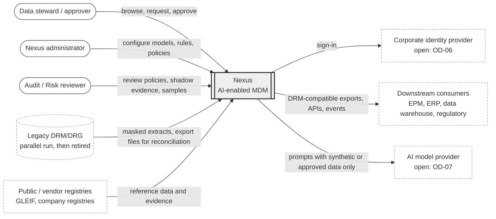
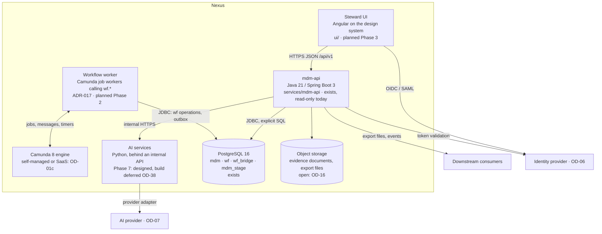
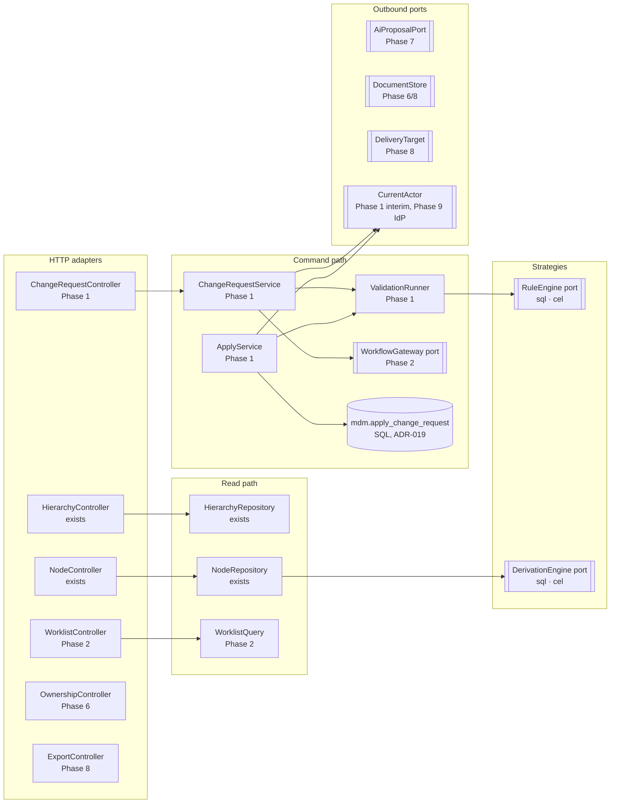
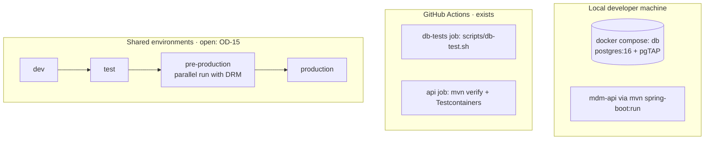

# Nexus architecture overview

- **Status:** First version, awaiting review (2026-11-11) · **Confidence:** Medium
- **Scope:** the whole system across Phases 0–9. Phase LLDs in `docs/design/phase-N-*/LLD.md` refine each part.
- **Conventions:** "exists" means verified in the repository on 2026-11-11; "planned" means designed, not built;
  "open" means a human decision listed in `docs/design/OPEN_DECISIONS.md` (OD-nn). Names in `UPPER_SNAKE` are
  named assumptions, listed there with their proposed defaults.

Confidence is Medium because the core data model and the guards exist and run, but the workflow engine, identity
provider, hosting platform and AI provider are open, and 77 of 91 capabilities have no decision yet.

## 1. Glossary

One term per concept; the UI uses the same words (`docs/design/UI_STANDARD.md` §7).

| Term | Meaning | Where it lives |
|---|---|---|
| Node | A thing with a stable identity (legal entity, person, grouping node). Its name and flags are bitemporal facts. | `mdm.node`, `mdm.node_attr` |
| Hierarchy | A named reporting tree with one top node; may allow shared nodes. | `mdm.hierarchy`, `mdm.hierarchy_relationship` |
| Shared node | A second (non-primary) placement of the same node in one hierarchy. | `hierarchy_relationship.is_primary = false` |
| Property | A typed attribute, global or local to a hierarchy; stored, inherited, derived or defaulted. | `mdm.property_definition`, `mdm.property_value` |
| Version | A named slice: business date plus recorded time (frozen when finalized). Not a copy of the data. | `mdm.version` |
| Business date (valid time) | When a fact is true in the business world. | `valid_period daterange` |
| Recorded time (system time) | When Nexus held that belief. | `recorded_period tstzrange` |
| Change request | The only way to change data: a titled set of change items with a requester, risk tier and decision. | `mdm.change_request` |
| Change item | One action inside a change request (add node, move, set property…). | `mdm.change_item` |
| Apply | Turning the items of a decided request into bitemporal rows, atomically. | planned `ApplyService` |
| Workflow model / stage / task | DRG-equivalent routing: Submit → Enrich/Approve → Commit, with groups and editable properties. | `wf.*` |
| Instance | One run of a workflow model for a change request (several after a split). | `wf.workflow_instance` |
| Commit policy | A human-approved rule set allowing some low-risk requests to commit without a reviewer. | `wf.commit_policy` |
| Shadow mode | A policy is evaluated and recorded, but humans still decide. | `wf.policy_evaluation` |
| Steward | A human user who browses data and raises or decides change requests. | `mdm.app_user (kind='human')` |
| System actor | The non-human actor that records policy commits and system feeds. | `mdm.app_user (kind='system_feed')` |
| AI agent | A non-human actor that may propose but never decide. | `mdm.app_user (kind='ai_agent')` |
| Evidence | A source document a fact cites. | `mdm.evidence_document` |

## 2. System context (C4 level 1)



## 3. Containers (C4 level 2)



Rules that hold for every container:
- Only `mdm-api` and the workflow worker hold database credentials. The UI and AI services never connect to the database.
- AI services return proposals to `mdm-api`, which records them as change requests or suggestions by an `ai_agent` user (ADR-008).
- Ownership percentages, inheritance, derived values and exports are computed in SQL or Java, never by a model (CLAUDE.md rule 4).
- Deployment unit: `mdm-api` is a modular monolith (ADR-013, Proposed). The workflow worker runs as a separate
  process (it may be the same artefact started with a different profile) so that engine outages do not stop reads.

## 4. Components of mdm-api (C4 level 3)

Existing packages are `com.mdm.api.hierarchy`, `com.mdm.api.node`, `com.mdm.api.common`. Planned packages follow
the same feature-first layout. Each module owns its SQL; modules call each other only through the interfaces shown.



Ports and their adapters (ADR-013):

| Port | Adapters | Phase |
|---|---|---|
| *(replaced by ADR-019)* | Apply is the `SECURITY DEFINER` function `mdm.apply_change_request`; it uses all items of a core-approved request, or only items the bridge recorded in `mdm.change_item_clearance` for a workflow-governed one. `ApplyService` in Java only orchestrates | 1–2 |
| `WorkflowGateway` | `SqlWorkflowGateway` (calls `wf.start_instance` etc.); engine adapter per OD-01 | 2 |
| `RuleEngine` / `DerivationEngine` | `SqlRuleEngine` (exists in SQL as the `sql` engine); `CelRuleEngine` (open: OD-19) | 1, 5 |
| `CurrentActor` | `LocalDevActor` (profile `local` only, synthetic user); `OidcActor` (OD-06) | 1, 9 |
| `AiProposalPort` | `StubAiProposals` (deterministic, tests); `HttpAiServiceClient` | 7 |
| `DocumentStore` | `FileSystemStore` (local only); object-storage adapter (OD-16) | 6, 8 |
| `DeliveryTarget` | file share, database table, API push (EXP-06) | 8 |

## 5. Deployment view and environments

Hosting is open (OD-15). The design assumes a container platform with a managed PostgreSQL 16 that supports
point-in-time recovery (needed for VER-06), a secrets store, and an internal package registry.



| Environment | Data | Purpose | Assumption |
|---|---|---|---|
| local | Synthetic only | Development, pgTAP, Testcontainers | Exists |
| CI | Synthetic only | Every push and PR | Exists (`.github/workflows/ci.yml`) |
| dev / test | Synthetic at `PERF_SCALE_FACTOR` × production volumes | Integration, performance baseline (Phase 4) | OD-15 |
| pre-production | Masked legacy extracts | Golden tests and the DRM parallel run (ADR-009, NEW-09) | OD-15; masking approach open (SLICE-01) |
| production | Real data | Live | OD-15 |

Once any shared environment exists, applied migrations are never edited (CLAUDE.md rule 6); this is the trigger to
fix the control gaps in OD-18 in V1–V6 *before* the first shared deployment, or else in a new migration.

## 6. End-to-end flow of a change

The same flow serves stewards, imports and AI agents; only the requester differs.

```mermaid
sequenceDiagram
  autonumber
  actor S as Steward (or AI agent)
  participant API as mdm-api
  participant DB as PostgreSQL (mdm, wf, wf_bridge)
  participant W as Workflow worker (Camunda 8 job workers, ADR-024)
  actor A as Approver (human)
  S->>API: POST /change-requests (title, version, risk tier)
  API->>DB: INSERT mdm.change_request (status draft)
  S->>API: POST /change-requests/{id}/items (actions)
  API->>DB: INSERT mdm.change_item; real-time validation (VAL-01)
  S->>API: POST /change-requests/{id}/submit
  API->>DB: full validation run (validated_at = T)
  API->>DB: wf.start_instance(cr, model, submitter)
  DB-->>DB: wf_bridge.sync_change_request → status in_review
  DB-->>W: wf.event_outbox: instance_started
  W->>DB: activate next included stage (conditions, split)
  alt model covered by a commit policy
    W->>DB: wf.apply_commit_policy(instance, T, system actor)
    Note over DB: shadow → recorded only · active and eligible → committed
  end
  A->>API: claim / approve / commit (worklist)
  API->>DB: INSERT wf.stage_group_decision (guard: wf.can_act)
  W->>DB: wf.close_instance(committed)
  DB-->>DB: sync_change_request → approved, decided_by, decision_basis
  API->>DB: ApplyService: one transaction per request
  Note over API,DB: SET LOCAL mdm.actor_id, mdm.change_request_id<br/>close old recorded_period, insert new rows<br/>exclusion constraints + guards check every row
  API->>DB: change_request.status = applied
  DB-->>DB: trg_audit_row → mdm.audit_log for every row
  API-->>S: request applied; change events published (NEW-07)
```

Step responsibilities and failure handling:

| Step | Owner | On failure |
|---|---|---|
| Draft and items | `ChangeRequestService` | Validation errors returned as Problem Details; nothing applied |
| Submit + full validation | `ValidationRunner` | Blocking errors stop the submit; warnings are recorded and shown |
| Start workflow | `WorkflowGateway` → `wf.start_instance` | One transaction; on failure the request stays `draft` |
| Stage advancement | Workflow worker (process manager) | At-least-once from the outbox; every operation idempotent |
| Commit policy | `wf.apply_commit_policy` | Ineligible → stays with the human Commit stage; evaluation always recorded |
| Decisions | DB guards (`wf.trg_decision_guard`, `wf.trg_action_guard`) | Guard violation → 403/409 Problem Details; history unchanged |
| Apply | `ApplyService` | All items or none; stale-base conflict → request goes back to the steward (§8.2) |
| Audit | Triggers | Inseparable from the write (same transaction) |
| Events | Outbox relay | Retried until delivered; consumers deduplicate on event id |

Without workflow (core only, ADR-003): the request is decided directly in `mdm` through `mdm.decide_change_request`
under `trg_cr_maker_checker`, and the same `mdm.apply_change_request` applies it (ADR-019). Which requests may skip workflow is a configuration decision
per hierarchy (planned, Phase 1 LLD); by default every request goes through workflow once Phase 2 exists.

## 7. Transactions and consistency

- **One database, strong consistency.** All Nexus state is in one PostgreSQL database. Every command is one local
  transaction; there are no distributed transactions. The workflow engine (if external, OD-01) holds only timers and
  references (`wf.workflow_instance.engine_ref`); the database is the system of record for workflow state.
- **Apply is a unit of work.** All items of a change request (or of one committed instance after a split) are
  applied in one transaction. Maximum items per request: `MAX_ITEMS_PER_CHANGE_REQUEST` (assumption 5 000); larger
  loads are split by the import pipeline into several requests (Phase 4).
- **Isolation.** `READ COMMITTED` by default. Correctness of facts does not depend on isolation: exclusion constraints
  (`EXCLUDE USING gist … WHERE upper_inf(recorded_period)`) and `trg_hierarchy_integrity` reject overlapping or cyclic
  rows at commit. Operations that read then decide (apply, policy evaluation, daily caps) take explicit row locks
  (`SELECT … FOR UPDATE`) on the request, the instance and, for caps, the policy (fix for D-14, OD-18).
- **Retries.** SQLSTATE `40001`/`40P01` are retried up to `TX_RETRY_MAX` (3) times with jitter; guard violations are never retried.
- **Cross-module consistency.** Events leave the database only through an outbox written in the same transaction (§13, ADR-016).

## 8. Concurrency control

### 8.1 API level: optimistic concurrency
Mutable resources (draft change requests and items) carry a version; responses send `ETag`, writes require
`If-Match`. A mismatch returns `412` (Problem Details `stale-resource`). Schema change proposed for Phase 1:
`mdm.change_request.row_version int` incremented by trigger (ADR-015).

### 8.2 Data level: stale-base detection on apply
A request drafted on Monday and approved on Friday must not silently overwrite a change committed on Wednesday.
Each value-changing item records the value it expects to replace (`payload.expected`, captured when the item is
added). `ApplyService` compares it with the current fact under lock; a mismatch fails the whole apply with
`conflict-stale-base` and returns the request to the steward. Structural items (`move_node`, `insert_node`) record
the expected parent. Design detail in the Phase 1 LLD.

### 8.3 Idempotency
Every `POST` that creates or transitions something accepts an `Idempotency-Key` header, stored with a request hash
for `IDEMPOTENCY_KEY_TTL` (assumption 24 h). Replays return the original response; the same key with a different body
returns `422`. Outbox consumers deduplicate on `event_id`; workflow operations are written so a second call is a
no-op or a clear error (for example `wf.close_instance` raises "Instance is not open").

## 9. Error model

All errors use RFC 9457 Problem Details (`ProblemDetail`, already used by `ApiExceptionHandler`), with a stable
`type` URN `urn:nexus:problem:<code>`, a human `detail`, a `correlationId`, and `errors[]` for field-level messages.

| Source | HTTP | `type` code |
|---|---|---|
| Unknown resource | 404 | `not-found` |
| Bad parameter (paging, dates) | 400 | `invalid-request` |
| Validation rule (blocking) | 422 | `validation-failed` (with rule codes) |
| DB guard (`RAISE EXCEPTION`, SQLSTATE `P0001`) | 422, or 403 for authorisation guards | `rule-violation` |
| Exclusion / unique constraint (`23P01`, `23505`) | 409 | `conflict` |
| Check constraint (`23514`) | 422 | `constraint-violation` |
| Stale ETag / stale base | 412 / 409 | `stale-resource` / `conflict-stale-base` |
| Not entitled | 403 | `forbidden` (with the reason, e.g. separation of duties, per UI_STANDARD §6) |
| Serialization failure after retries | 503 | `retry-later` |

Today only 404 and 400 are mapped (D-21). Guards raise `P0001` with free-text messages; mapping by message text is
brittle, so the Phase 1 LLD proposes that guards set an explicit `ERRCODE` and a machine-readable `HINT`
(a migration change to messages only; the rule itself is unchanged; OD-18).

## 10. Security and authorisation

Three layers; a request must pass all three.

1. **Authentication** (OD-06): corporate SSO, recommended OIDC with the organisation's Angular library. Until
   Phase 9, `LocalDevActor` supplies a fixed synthetic user and is active only in the `local` profile; a startup check
   fails if it is enabled in any other profile.
2. **Application entitlements** (SEC-01 to SEC-04, pending decision): role × scope (hierarchy, sub-tree, property
   category) checked in the service layer before any write and as filters on reads. Mapping from IdP subject to
   `mdm.app_user` is open (OD-26).
3. **Database guards and privileges**: the guards in V1–V6 stay authoritative for maker-checker, separation of duties,
   human-only decisions and policy limits. ADR-014 (Proposed) adds least-privilege roles so only the bridge can set
   decision fields on `mdm.change_request` and only the apply path can write facts, closing D-04.

Other rules: all SQL parameterised (`JdbcClient` named parameters, as today); input validated at the API boundary
(`spring-boot-starter-validation` exists); no secrets in code (datasource settings come from `MDM_DB_*` environment
variables); actuator endpoints other than `health` require authentication (fixes D-20); admin-authored SQL
(`sql` rule and derivation engines) runs under a read-only role (D-39).

## 11. Audit and provenance

| Question | Answered by | Exists? |
|---|---|---|
| Who changed which row, when, under which request? | `mdm.audit_log` via `trg_audit_row` | Yes; actor/request only if the app sets them (D-29) |
| What did we believe at time T about date D? | Bitemporal facts | Yes, for fact tables (D-08 for definitions) |
| How was a request decided, by whom, on what basis? | `wf.instance_action`, `wf.stage_group_decision`, `change_request.decision_basis` / `decision_policy_ref` | Yes (D-06 attribution after splits) |
| Why did a policy commit or route it? | `wf.policy_evaluation.failed_checks` | Yes |
| Where does a value come from? | Read API provenance: stored / inherited (from which ancestor) / derived / default | Planned (D-18) |
| What is the source of this fact? | `evidence_document`, `ownership_edge.evidence_locator`, `change_item.evidence_document_id` | Yes |

`ApplyService` always sets `mdm.actor_id` and `mdm.change_request_id` with `set_config(..., true)` inside the
transaction, and the Phase 1 LLD proposes a guard that rejects fact inserts without them (OD-18).

## 12. Configuration

- **Runtime settings:** Spring `application.yml` with environment overrides (`MDM_DB_URL`, `MDM_DB_USER`,
  `MDM_DB_PASSWORD`, `MDM_DB_POOL_SIZE` exist). Nexus settings live under `mdm.*` (`mdm.api.max-page-size` exists).
  Every named assumption that is a runtime value becomes an `mdm.*` property with the default from `OPEN_DECISIONS.md`.
- **Business configuration is data, governed like data:** workflow models, tasks, groups, commit policies, validation
  rules, export profiles and UBO thresholds are rows, versioned or frozen by their guards. Promotion between
  environments (ADM-01) is scripted, never hand-edited.
- **Profiles:** `local`, `test`, and one per shared environment; only `local` may use synthetic identity.

## 13. Events

- **Workflow events** exist: `wf.event_outbox` (`instance_started`, `stage_status_changed`, `instance_split`,
  `instance_closed`, `policy_evaluated`, `kill_switch_engaged`).
- **Core change events** (NEW-07) are planned in a separate `mdm.change_event` outbox written by `ApplyService` in the
  apply transaction, so `mdm` still never references `wf`.
- **Consumers** keep their own offsets (ADR-016) instead of the single `processed_at` flag (D-32). Transport beyond
  the database (a broker) is open (OD-20); polling the outbox is the default and enough for notifications.

## 14. Observability

- **Logs:** structured JSON with `correlationId` (from `X-Correlation-Id` or generated), `actorId`, `changeRequestId`; no property values or names of natural persons at INFO level.
- **Metrics** (Micrometer via the existing actuator): request latency per endpoint, page sizes, apply duration and
  items per request, validation duration per rule, outbox lag (`now() - min(created_at)` of unprocessed events),
  policy outcomes per day (from `wf.v_commit_policy_daily`), worklist latency.
- **Traces:** OpenTelemetry (dependency to approve) across UI → API → DB and API → AI services.
- **Alerts:** outbox lag > `OUTBOX_LAG_ALERT` (5 min); any `review_issues` > 0 in `wf.v_commit_policy_daily`;
  kill switch engaged; apply failure rate > 1 %; p95 latency over targets (OD-10).

## 15. Time handling

- **Two clocks, never mixed.** Business dates are `date`/`daterange` (no time zone). Recorded time is `timestamptz`, stored and transmitted in UTC.
- **API parameters:** `asOf=YYYY-MM-DD` (business date) and `recordedAsOf=` ISO-8601 instant (optional; default now).
  Today only `asOf` exists (D-18).
- **"Today"** means today in `BUSINESS_TIME_ZONE` (open: OD-22), computed once by the API and passed to SQL
  explicitly. The API never relies on `current_date` defaults or the JVM zone (D-16). Database sessions run with `TimeZone=UTC`.
- **Finalized versions** pin `recorded_as_of`, so their reads are repeatable for ever (VER-02).
- **Display:** `dd MMM yyyy`, 24-hour times with zone (UI_STANDARD §7); ISO 8601 in APIs and exports.

## 16. Pagination

- Every list endpoint is paged (CLAUDE.md). Default page `DEFAULT_PAGE_SIZE` = 200 (today's default), maximum
  `mdm.api.max-page-size` = 1000 (exists).
- **Keyset, not offset** (ADR-015): responses are `{ "items": [...], "nextCursor": "<opaque>" }`; the cursor encodes the
  last sort key. Children sort by `(sort_order, node_name, child_node_id)`, matching `export_drm`'s ordering and
  adding the id as a tie-breaker. Offset paging (exists) degrades on large sibling sets and skips or repeats rows under concurrent change.
- Tree loading is lazy: the UI asks for one parent's children one page at a time ("Show next 200", UI_STANDARD §5).

## 17. API versioning

- Major version in the path: `/api/v1` (exists). Additive changes (new fields, endpoints, optional parameters) stay in v1.
- Breaking changes go to `/api/v2`, with v1 kept for `API_DEPRECATION_MONTHS` (assumption 6) once external consumers exist (ADM-02).
- The current read endpoints have no external consumers, so moving children and hierarchy lists to the keyset
  envelope in Phase 1 is done within v1 (recorded in ADR-015).
- An OpenAPI document is generated from the code and published with each build; the Angular client is generated from
  it (UI_STANDARD §2). Generator library to approve (springdoc-openapi proposed).

## 18. Technology

| Area | Choice | Status | Reference |
|---|---|---|---|
| Core service language and framework | Java 21, Spring Boot 3 (3.4.5 today), virtual threads | Decided | ADR-011 |
| Database | PostgreSQL 16, schemas `mdm`, `wf`, `wf_bridge`, `mdm_stage` | Decided | ADR-011, ADR-003 |
| Migrations | Flyway | Decided | ADR-011 |
| Data access | `JdbcClient` with explicit SQL | Decided | CLAUDE.md conventions |
| Database tests | pgTAP | Decided | ADR-011 |
| Service tests | JUnit 5 + Testcontainers (1.21.4 pin removed from the working tree: OD-23) | Decided | ADR-011 |
| CI | GitHub Actions | Decided | ADR-011 |
| UI | Angular on the organisation's design system, folder `ui/` | Decided | ADR-012 |
| AI services language | Python behind internal APIs | Decided | ADR-011 |
| Service structure | Modular monolith with ports and adapters | Proposed | ADR-013 |
| Database privileges | Least-privilege roles per layer | Proposed | ADR-014 |
| API conventions | Keyset paging, Problem Details, ETags, idempotency keys, path versioning | Proposed | ADR-015 |
| Events | Transactional outboxes with per-consumer offsets | Proposed | ADR-016 |
| Time | Business dates in a configured business time zone; UTC recorded time | Proposed | ADR-018 |
| Workflow orchestration | Camunda 8 (one generic BPMN process over `wf` models; guarded `wf` functions); self-managed or SaaS per OD-01c | Decided | ADR-017, ADR-024 |
| Business time zone | `America/New_York` | Decided | ADR-018 |
| Identity provider | Corporate SSO; API as OIDC resource server (ADR-033) | Open (provider) | OD-06, ADR-033 |
| AI model and provider | — | Open | OD-07 |
| Hosting platform and environments | — | Open | OD-15 |
| Object storage (evidence, export files) | — | Open | OD-16 |
| Rules beyond SQL (CEL, Python) | — | Open | OD-19 |
| Event transport beyond the database | — | Open | OD-20 |
| Search (QRY-03) | PostgreSQL full-text / trigram vs a search engine | Open | OD-21 |
| Graph visualisation (ownership view) | — | Open | OD-05 |
| OpenAPI generation | springdoc-openapi (needs dependency approval) | Proposed | §17 |
| Observability | Structured logs, Micrometer + Prometheus, OpenTelemetry traces | Decided | ADR-034 |

## 19. Known risks at architecture level

1. **Scope is mostly undecided** (77 of 91 capabilities). Phase LLDs for those areas will be outlines (OD-13).
2. **Control gaps in the existing schema** (D-04 to D-07, D-12 to D-15, D-29, D-33). Any fix touches guards and
   needs an ADR and an Audit/Risk decision before the first shared environment (OD-18).
3. **Tree performance at production scale is unmeasured.** Recursive CTEs walk the whole tree for exports, scope
   checks and inheritance; Phase 4 must benchmark at `MAX_NODES_PER_HIERARCHY` before Phase 5 commits to the approach (patterns.md P-12).
4. **The workflow engine is open (OD-01).** The worker sits behind `WorkflowGateway` so that either engine fits; the
   database keeps all guards whichever is chosen.
