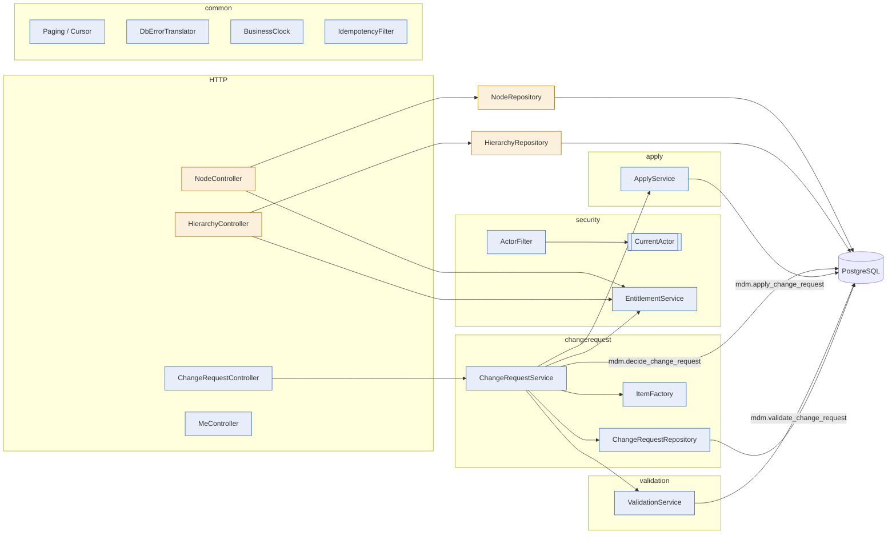
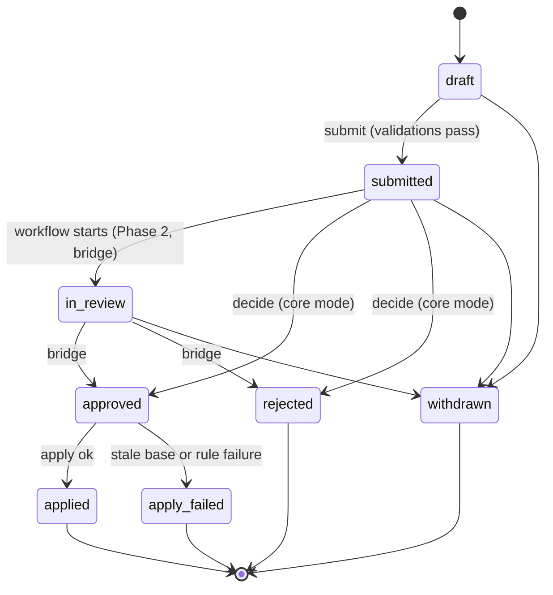
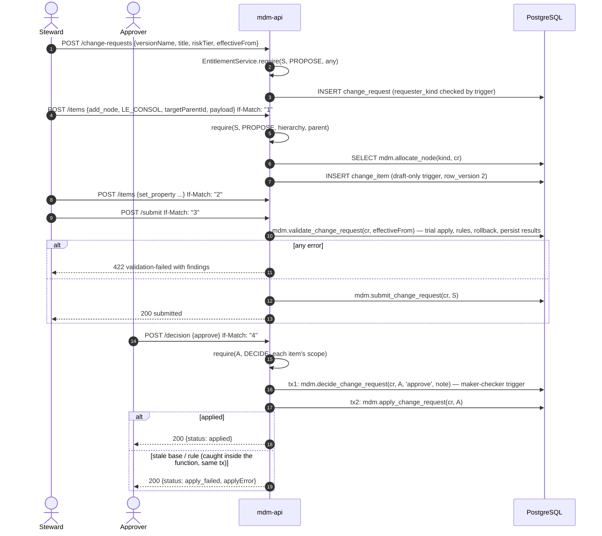

# Phase 1 — Core write path: low-level design

- **Status:** Approved 2026-11-11. **Amendment (Phase 4 LLD §4.1, ADR-026, proposed):** add the `add_hierarchy` action
  (hierarchy + top node) and an `update_node` handler (name, description), both on the commit-policy hard-limit list.
  Build them in Phase 1 if the amendment is approved before Phase 1 is built.
- **Migration rule (CR-07):** where this design says "edit Vn", that is allowed only while no shared environment exists (CLAUDE.md rule 6, OD-18). If one exists when this phase is built, the same change goes into a new V-numbered migration (`ALTER` / `CREATE OR REPLACE`). What counts as shared: OD-44.
- **Phase goal (BUILD_PROTOCOL §2):** changes flow through change requests into the bitemporal model.
- **Reads with:** `docs/architecture/overview.md`, `docs/architecture/patterns.md`, ADR-013 to ADR-022,
  `docs/design/DESIGN_STATE.md` (D-nn), `docs/specs/SLICE-01-add-leaf.md`.
- Every DDL block below is a **proposal for the build**, not a migration.

---

## 1. Purpose and scope

**Goal.** A steward creates a change request with items (add a leaf, move, insert, remove, delete a node; set or
clear a property), validations run on submit, a different human approves it, and Nexus applies it atomically as
bitemporal rows with a complete audit trail. Reads work at any business date and recorded time, and say where each
property value comes from. Every endpoint checks a role and scope. The control gaps on the `mdm` side are closed first.

**Capabilities in scope (designed in full)**

| ID | Decision | What Phase 1 delivers |
|---|---|---|
| HIE-01 | Parity (OD-13) | Paged hierarchy list and detail as of any slice; top node and group |
| HIE-02 | Parity (OD-13) | Item actions `add_node`, `insert_node`, `move_node`, `remove_node`, `delete_node` (new value) and their apply logic |
| PRP-01 | Parity (OD-13) | `set_property` / `clear_property` for global and local properties; resolved reads with provenance |
| SEC-01 | Improve (OD-13) | Roles `VIEWER`, `STEWARD`, `APPROVER`, `WORKFLOW_ADMIN`, `POLICY_ADMIN`, `SYSTEM_ADMIN`; interim actor resolution |
| SEC-02 | Improve (OD-13) | Role grants scoped to a hierarchy and optionally a sub-tree; checked on every write and decision |
| NEW-01 | New | `asOf` + `recordedAsOf` on every read |
| PROG | — | OD-18 group 1 control fixes (D-04, D-05, D-07, D-29, D-36), ADR-014 roles, ADR-015 API conventions, ADR-018 time, D-17 to D-21 |

**In this phase but pending decision (outline only, §15):** HIE-06 (inactivate), PRP-02 (types: enforced by the
existing trigger, nothing new), PRP-03 (list values: same), VAL-01, VAL-02, VAL-03 (only the validation
*infrastructure* SLICE-01 needs is built: §3.5), AUD-01 (the audit trail is guaranteed by §4; a history query API waits for the decision).

**Out:** workflow (Phase 2: the `wf`-side fixes D-06 and D-12 to D-15, D-33; GOV-02 and GOV-13 are designed in the Phase 2 LLD);
UI (Phase 3); HIE-12 performance at scale (Phase 3 build, Phase 4 benchmark); ownership actions (Phase 6).

**Dependencies.** Phase 0 (green baseline). No earlier LLD.

## 2. Confidence and assumptions

**Confidence: Medium.** High for the data and apply design (it builds on V1–V3, which run and are tested). Medium for
the HIE-02 semantics, which must still match DRM's behaviour in golden tests (A-3, A-4). Low for the validation
semantics, which are pending decision (VAL-01–03).

| # | Assumption | Effect if wrong |
|---|---|---|
| A-1 | A change takes effect from one business date for the whole request (`effective_from`), with optional per-item `validTo` | Per-item dates become a payload field; apply already supports them |
| A-2 | Setting a value from date D replaces only the row that covers D; later future-dated rows are kept | If DRM-style "replace everything after D" is wanted, §7.1 step 3 changes |
| A-3 | `remove_node` of a node with children in that hierarchy is rejected ("move or remove the children first") unless `payload.cascade = true`, which removes the sub-tree from that hierarchy | Golden test for DRM's remove behaviour decides; `cascade` default may flip |
| A-4 | `delete_node` ends the node in the version: all relationships end, `node_attr` ends at D; rejected if any `node_ref` / `multi_node_ref` value points at it (merge is HIE-07, pending) | Same golden test |
| A-5 | New nodes get their identity (`mdm.node` row) when the `add_node` item is drafted, so later items and the Phase 2 workflow functions can refer to `node_id`. A withdrawn request leaves an identity with no attributes, which belongs to no slice | Accepted cost; HIE-04 orphan logic must count only nodes with `node_attr` rows |
| A-6 | Validation rules authored in `mdm.validation_rule` are changed only by migration in Phase 1 (no rule-editing API) | Needed because rule SQL runs with the apply role's privileges (D-39); revisit in Phase 5 (VAL-04) |
| A-7 | Role grants are changed only by migration or SQL by a `SYSTEM_ADMIN` in Phase 1; no grant-editing API | A governed grant API is Phase 5 (SEC-01 full) |
| A-8 | `BUSINESS_TIME_ZONE` = `America/New_York` (OD-22a). Single source of truth: the database row `mdm.system_setting('business_time_zone')` (defined in Phase 2 §4.1, created in Phase 1 if Phase 1 is built first); `BusinessClock` reads it at startup and fails if a configured `mdm.business-time-zone` disagrees (CONSISTENCY_REVIEW CR-01) | — |
| A-9 | `MAX_ITEMS_PER_CHANGE_REQUEST` = 5 000; `P95_SUBMIT_MS` / `P95_APPLY_MS` = 2 000 for ≤ 50 items | Benchmarks in §10 |

**Human decisions this phase waits on:** OD-22a (zone value) before the build's time tests can be final; OD-18a (Audit-Risk
review of ADR-021) before the fix migrations are merged; OD-17a (Security/Audit-Risk confirmation of ADR-014/019) before
the first shared environment; OD-09 for the outline-only capabilities.

## 3. Component design

Packages under `services/mdm-api/src/main/java/com/mdm/api/` (ADR-013). Existing: `hierarchy`, `node`, `common`.


Blue = new, amber = changed.

### 3.1 `security`
| Type | Responsibility | Key signatures | Must not |
|---|---|---|---|
| `Actor` (record) | The authenticated user for one request | `Actor(UUID userId, String login, ActorKind kind)` | Carry roles (looked up per check) |
| `CurrentActor` (interface) | Port: resolve the actor for this request | `Optional<Actor> resolve(HttpServletRequest req)` | — |
| `LocalDevActor` | Adapter, profiles `local` and `test` only: reads header `X-Nexus-User` (a login), looks up `mdm.app_user`; `local` falls back to `mdm.api.local-user` | — | Exist in any other profile (`@Profile({"local","test"})`) |
| `ActorFilter` | `OncePerRequestFilter`: resolves the actor, 401 Problem Details if none, puts `Actor` in a request attribute and MDC | `doFilterInternal(...)` | Authorise anything |
| `StartupGuard` | Fails startup if no non-dev `CurrentActor` bean exists and the active profile is not `local`/`test` | `@EventListener(ApplicationReadyEvent)` | — |
| `Permission` (enum) | `READ`, `PROPOSE`, `DECIDE`, `ADMIN_WORKFLOW`, `ADMIN_POLICY`, `ADMIN_SYSTEM`; later phases add `READ_OWNERSHIP`, `PROPOSE_OWNERSHIP`, `DECIDE_OWNERSHIP` (6), `ADMIN_EXPORT`, `RUN_EXPORT`, `REVIEW_RECON`, `READ_EVENTS` (8). Role → permission mapping lives in one class and the full catalogue is in `CONSISTENCY_REVIEW.md` CR-11 | — | — |
| `EntitlementService` | Answers permission questions from `mdm.user_role` (§4.4) | `void require(Actor a, Permission p, UUID hierarchyId, UUID nodeIdOrNull)` throws `ForbiddenException`; `Set<UUID> readableHierarchies(Actor a)` | Decide maker-checker or SoD (database guards do) |

The role-to-permission matrix (ADR-022):

| Role | READ | PROPOSE | DECIDE | Admin |
|---|---|---|---|---|
| `VIEWER` | ✓ | | | |
| `STEWARD` | ✓ | ✓ | | |
| `APPROVER` | ✓ | | ✓ | |
| `WORKFLOW_ADMIN` | ✓ | | | workflow config (Phase 2) |
| `POLICY_ADMIN` | ✓ | | | propose policies (Phase 2; approval still needs `POLICY_APPROVERS`) |
| `SYSTEM_ADMIN` | ✓ | | | role grants, users (Phase 1: read endpoints only, A-7) |

### 3.2 `changerequest`
| Type | Responsibility | Key signatures | Must not |
|---|---|---|---|
| `ChangeRequestController` | Endpoints in §5.2 | — | Contain rules |
| `ChangeRequestService` | Orchestrates create, edit, items, validate, submit, decide, apply, withdraw; checks entitlements; translates DB errors | `ChangeRequestView create(Actor, CreateRequest)`; `ItemView addItem(Actor, UUID crId, int ifMatch, ItemCommand)`; `ValidationReport validate(Actor, UUID crId)`; `ChangeRequestView submit(Actor, UUID crId, int ifMatch)`; `ChangeRequestView decide(Actor, UUID crId, int ifMatch, Decision)`; `ChangeRequestView withdraw(Actor, UUID crId, int ifMatch)` | Write facts; set decision columns directly |
| `ItemFactory` | Turns an `ItemCommand` into a `change_item` row: resolves codes to ids, captures `payload.expected` (§7.3), allocates node identity for `add_node` (`mdm.allocate_node`) | `NewItem build(Actor, ChangeRequestRow, ItemCommand)` | Apply anything |
| `ChangeRequestRepository` | SQL for `change_request`, `change_item`; keyset lists | `Optional<ChangeRequestRow> find(UUID)`; `ChangeRequestRow insert(...)`; `Page<ItemRow> items(UUID, Cursor, int)` | — |
| DTO records | `CreateRequest(String versionName, String title, String rationale, RiskTier riskTier, LocalDate effectiveFrom)`; `ItemCommand(ChangeAction action, String hierarchyCode, UUID nodeId, UUID targetParentId, String propertyCode, JsonNode payload)`; `Decision(DecisionType type, String note)` | — | — |

### 3.3 `apply`
| Type | Responsibility | Key signatures | Must not |
|---|---|---|---|
| `ApplyService` | Calls `mdm.apply_change_request` in its own transaction right after an approval, maps failures, retries serialization failures (`TX_RETRY_MAX`) | `ApplyResult apply(Actor decider, UUID crId)` | Implement item logic (that is SQL, ADR-019) |

### 3.4 Reads (changed)
- `HierarchyController` / `HierarchyRepository`: keyset paging (§5.1), `recordedAsOf`, `findByCode` by SQL (not in memory, D-17), entitlement filter (`readableHierarchies`).
- `NodeController` / `NodeRepository`: `recordedAsOf`; 404 for an unknown hierarchy code (D-19); properties from `mdm.node_properties_resolved` (one call, D-40), with provenance (D-18).

### 3.5 `validation` (infrastructure for SLICE-01; VAL capabilities outline only)
| Type | Responsibility | Key signatures | Must not |
|---|---|---|---|
| `ValidationService` | Calls `mdm.validate_change_request(cr, as_of)`; returns errors and warnings; `submit` refuses on any error | `ValidationReport run(UUID crId)` | Evaluate rules itself |
| `ValidationReport` (record) | `Instant validatedAt, List<Finding> errors, List<Finding> warnings`; `Finding(String ruleCode, UUID nodeId, UUID hierarchyId, String message)` | — | — |

### 3.6 `common`
| Type | Responsibility |
|---|---|
| `BusinessClock` | Wraps `java.time.Clock` and the zone from `mdm.system_setting('business_time_zone')` (CR-01); `LocalDate today()`; `Instant now()` |
| `Cursor` / `Page<T>` | Opaque keyset cursor: base64url of a JSON array of the last sort key; `Page(List<T> items, String nextCursor)` |
| `DbErrorTranslator` | Maps SQLSTATE to Problem Details (§5.3, ADR-020) |
| `IdempotencyFilter` | Stores and replays responses for `POST` with `Idempotency-Key` (§4.6) |
| `ApiExceptionHandler` (changed) | Adds `type`, `correlationId`, `errors[]`; handles `ForbiddenException`, `PreconditionFailedException`, translated DB errors |

## 4. Data design

All proposals; file targets follow OD-18 (edit the defining file in V1–V6; new objects in new files).

### 4.1 Database roles (ADR-014, amended by ADR-019) — new file `V7__roles_and_privileges.sql`
```sql
-- Group roles only; logins are created per environment by the platform and granted these roles.
DO $$ BEGIN
  PERFORM 1 FROM pg_roles WHERE rolname = 'nexus_api';      IF NOT FOUND THEN CREATE ROLE nexus_api NOLOGIN; END IF;
  -- same pattern: nexus_wf, nexus_bridge, nexus_apply, nexus_decider, nexus_readonly
END $$;
REVOKE ALL ON SCHEMA mdm, wf, wf_bridge, mdm_stage FROM PUBLIC;
GRANT USAGE ON SCHEMA mdm, wf, wf_bridge TO nexus_api, nexus_wf, nexus_readonly;
GRANT SELECT ON ALL TABLES IN SCHEMA mdm, wf, wf_bridge TO nexus_api, nexus_readonly;
-- drafts only: no decision columns, no facts
GRANT INSERT ON mdm.change_request TO nexus_api;
GRANT UPDATE (title, rationale, risk_tier, effective_from) ON mdm.change_request TO nexus_api;
GRANT INSERT, DELETE ON mdm.change_item TO nexus_api;            -- guarded to drafts by trg_change_item_draft_only
GRANT INSERT, DELETE ON mdm.idempotency_key TO nexus_api;
GRANT EXECUTE ON FUNCTION mdm.allocate_node, mdm.submit_change_request, mdm.withdraw_change_request,
                          mdm.validate_change_request, mdm.decide_change_request,
                          mdm.apply_change_request TO nexus_api;
-- owners of the SECURITY DEFINER functions
ALTER FUNCTION mdm.apply_change_request(uuid, uuid)    OWNER TO nexus_apply;   -- DML on fact tables
ALTER FUNCTION mdm.validate_change_request(uuid, date)  OWNER TO nexus_apply;
ALTER FUNCTION mdm.decide_change_request(uuid, uuid, text, text) OWNER TO nexus_decider;  -- UPDATE of decision columns
ALTER FUNCTION wf_bridge.sync_change_request(uuid)      OWNER TO nexus_bridge;           -- Phase 2 fixes D-06 there
```
`nexus_apply` gets `SELECT, INSERT, UPDATE (recorded_period)` on the fact tables, `INSERT` on `mdm.node`,
`mdm.change_event`, `mdm.validation_result`, and `UPDATE (status, applied_at, apply_error)` on `mdm.change_request`;
`nexus_decider` gets `UPDATE (status, submitted_at, decided_by, decided_at, decision_note, decision_basis)`;
`nexus_bridge` gets `UPDATE (status, submitted_at, decided_by, decided_at, decision_basis, decision_policy_ref,
governed_by_workflow)` on `mdm.change_request` and `INSERT` on `mdm.change_item_clearance`.

Flyway runs as the owner (`spring.flyway.user` / `MDM_DB_MIGRATION_USER`); the application datasource uses a login in
`nexus_api`. Testcontainers: an extra migration location `db/testroles` (test classpath only) creates login
`nexus_api_test` in role `nexus_api`; the test datasource uses it, so every API test runs with production privileges. pgTAP tests use `SET LOCAL ROLE nexus_api` for denial tests.

### 4.2 Change-request changes — edit `V1__core_schema.sql`
```sql
ALTER TYPE: add 'apply_failed' to mdm.cr_status;  add 'delete_node' to mdm.change_action;   -- in V1's CREATE TYPE lists
-- mdm.change_request: new columns
  effective_from      date NOT NULL,                 -- business date the request takes effect (A-1); set by the API
  row_version         int  NOT NULL DEFAULT 1,       -- ETag (ADR-015)
  governed_by_workflow boolean NOT NULL DEFAULT false, -- set only by wf_bridge at instance start (Phase 2)
  apply_error         text,                          -- reason when status = 'apply_failed'
  origin              text NOT NULL DEFAULT 'user' CHECK (origin IN ('user','sandbox','load','ai')),  -- set at creation, never changed (CR-04)
-- mdm.change_item: new column
  created_at timestamptz NOT NULL DEFAULT now()
```
New guards (ADR-021):

| Guard | Rule | Fixes |
|---|---|---|
| `trg_cr_requester_kind` (BEFORE INSERT OR UPDATE OF requester_id, requester_kind) | `requester_kind` must equal `app_user.kind` of `requester_id` | D-05 |
| `cr_status_transition` → `trg_cr_status_transition` (BEFORE UPDATE OF status) | Allowed: draft→submitted; draft\|submitted→in_review (the bridge, when a workflow instance starts; workflow submission is itself the submit); submitted\|in_review→approved\|rejected; approved→applied\|apply_failed; draft\|submitted\|in_review→withdrawn. Everything else raises `N2101`. The trigger name sorts after `cr_maker_checker`, so a maker-checker violation is still reported first | D-07 |
| `trg_cr_row_version` (BEFORE UPDATE) | `NEW.row_version := OLD.row_version + 1` | ETag |
| `trg_cr_frozen_content` (BEFORE UPDATE) | Once status ≠ draft, `title, rationale, risk_tier, effective_from, version_id, requester_*, ai_*` cannot change | D-07 |
| `trg_change_item_draft_only` (BEFORE INSERT OR UPDATE OR DELETE on `change_item`) | Parent request must be `draft`; also bumps the parent's `row_version` | D-07 |
| `change_item` audit trigger | Add `change_item` to the `trg_audit_row` list | D-07, AUD-01 |

`wf.commit_policy` hard-limit CHECK (V6) gains `'delete_node'` in its forbidden list (a strengthening: deletes always need a human).

Guard trigger functions that **write** (the `row_version` bump from `trg_change_item_draft_only`) are `SECURITY DEFINER`
owned by the migration owner with a fixed `search_path`, so callers need no `UPDATE (row_version)` privilege; guards
that only check and raise stay `SECURITY INVOKER`.

### 4.3 Clearance — new table in `mdm` (V1), written only by the bridge
```sql
CREATE TABLE mdm.change_item_clearance (            -- which items a governing workflow committed (ADR-019)
  change_item_id uuid PRIMARY KEY REFERENCES mdm.change_item,
  cleared_at     timestamptz NOT NULL DEFAULT now()
);  -- append-only (trg_append_only); mdm defines it, wf_bridge writes it, mdm never references wf
```
Phase 1 has no workflow, so `governed_by_workflow = false` and apply uses all items. Phase 2 adds the bridge writes.

### 4.4 Entitlements (ADR-022) — new file `V8__entitlements.sql`
```sql
CREATE TABLE mdm.role (role_code text PRIMARY KEY, description text NOT NULL);
INSERT INTO mdm.role VALUES ('VIEWER','Read'),('STEWARD','Read and propose changes'),('APPROVER','Read and decide'),
  ('WORKFLOW_ADMIN','Configure workflow models'),('POLICY_ADMIN','Propose commit policies'),('SYSTEM_ADMIN','Manage users and grants');

CREATE TABLE mdm.user_role (                          -- bitemporal: grant history is reconstructable
  user_id         uuid NOT NULL REFERENCES mdm.app_user,
  role_code       text NOT NULL REFERENCES mdm.role,
  hierarchy_id    uuid REFERENCES mdm.hierarchy,      -- NULL = every hierarchy
  top_node_id     uuid REFERENCES mdm.node,           -- NULL = whole hierarchy; requires hierarchy_id
  granted_by      uuid NOT NULL REFERENCES mdm.app_user,
  valid_period    daterange NOT NULL,
  recorded_period tstzrange NOT NULL DEFAULT tstzrange(now(), NULL),
  CHECK (top_node_id IS NULL OR hierarchy_id IS NOT NULL),
  CHECK (granted_by <> user_id),                      -- nobody grants themselves a role
  EXCLUDE USING gist (user_id WITH =, role_code WITH =,
                      (coalesce(hierarchy_id,'00000000-0000-0000-0000-000000000000'::uuid)) WITH =,
                      (coalesce(top_node_id, '00000000-0000-0000-0000-000000000000'::uuid)) WITH =,
                      valid_period WITH &&) WHERE (upper_inf(recorded_period))
);
-- + trg_bitemporal_guard and trg_audit_row on mdm.user_role; + trigger: only human users hold roles
CREATE INDEX ON mdm.user_role (user_id) WHERE upper_inf(recorded_period);
```
Scope check (`EntitlementService`): a grant covers node N in hierarchy H at business date D if `hierarchy_id` is NULL,
or equals H and (`top_node_id` is NULL or N is `top_node_id` or a descendant of it at D). Descendant test: the
ancestor walk in §7.5, one query per check, cached per request.

### 4.5 Change events — new table in V1 (outbox, ADR-016)
```sql
CREATE TABLE mdm.change_event (
  event_id          bigint GENERATED ALWAYS AS IDENTITY PRIMARY KEY,
  change_request_id uuid NOT NULL REFERENCES mdm.change_request,
  event_type        text NOT NULL CHECK (event_type IN ('change_request_applied')),
  payload           jsonb NOT NULL,                  -- {items:[{seq, action, node_id, hierarchy_id, property_id}], effective_from}
  created_at        timestamptz NOT NULL DEFAULT clock_timestamp()
);  -- append-only; consumers arrive in Phase 2/8 with mdm.change_event_consumer
```

### 4.6 Idempotency — new table in V8
```sql
CREATE TABLE mdm.idempotency_key (
  actor_id uuid NOT NULL, idem_key text NOT NULL CHECK (length(idem_key) BETWEEN 8 AND 128),
  request_hash char(64) NOT NULL, response_status int NOT NULL, response_body jsonb NOT NULL,
  created_at timestamptz NOT NULL DEFAULT now(),
  PRIMARY KEY (actor_id, idem_key)
);  -- pruned after IDEMPOTENCY_KEY_TTL by a scheduled delete (not a governed table)
```

### 4.7 Functions (all `SET search_path = mdm, public`, schema-qualified bodies)
| Function | Security | Purpose |
|---|---|---|
| `mdm.allocate_node(p_kind node_kind, p_cr uuid) RETURNS uuid` | definer (`nexus_apply`) | Insert identity for an `add_node` draft item; request must be `draft` |
| `mdm.submit_change_request(p_cr uuid, p_actor uuid) RETURNS void` | definer (`nexus_decider`) | draft→submitted, `submitted_at = now()`; actor must be the requester |
| `mdm.withdraw_change_request(p_cr uuid, p_actor uuid)` | definer (`nexus_decider`) | →withdrawn; actor must be the requester |
| `mdm.decide_change_request(p_cr uuid, p_decider uuid, p_decision text, p_note text)` | definer (`nexus_decider`) | Core-mode decision. Rejects if `governed_by_workflow`; sets `decision_basis = 'human_review'` only (policy decisions exist only through the bridge, closing D-04); `trg_cr_maker_checker` still runs |
| `mdm.validate_change_request(p_cr uuid, p_as_of date) RETURNS TABLE (...)` | definer (`nexus_apply`) | Trial apply + rules, rolled back; persists `validation_result` rows (§7.4) |
| `mdm.apply_change_request(p_cr uuid, p_actor uuid) RETURNS int` | definer (`nexus_apply`) | §7.1; returns rows written |
| `mdm.node_properties_resolved(p_node uuid, p_hierarchy uuid, p_as_of date, p_recorded timestamptz) RETURNS TABLE (property_id uuid, value jsonb, provenance text, source_node_id uuid, source_property_value_id uuid)` | invoker | §7.6; `provenance ∈ {stored, inherited, derived, default, none}` |

`mdm.property_value_asof` stays as it is (exports depend on it); a pgTAP test asserts both functions agree on values.

### 4.8 Bitemporal behaviour of each change
| Object | Bitemporal? | Phase 1 behaviour |
|---|---|---|
| `node_attr`, `hierarchy_relationship`, `property_value` | Yes | Written only by `apply_change_request` (close + insert, §7.1) |
| `user_role` | Yes (new) | Grants end by closing/ending rows, never deleted |
| `node` | No (identity) | Inserted at draft (A-5), never updated |
| `change_request`, `change_item` | No (workflow records) | Guarded transitions; content frozen after draft; audited |
| `change_item_clearance`, `change_event`, `audit_log` | Append-only | — |

### 4.9 Volumes and indexes
| Table | Assumed volume | Index (new) | Heaviest query |
|---|---|---|---|
| `hierarchy_relationship` | `MAX_NODES_PER_HIERARCHY` × hierarchies × history depth | `(hierarchy_id, parent_node_id, sort_order, child_node_id) WHERE upper_inf(recorded_period)` (replaces the existing `(hierarchy_id, parent_node_id)` partial index) | Children page (§7.7) |
| `change_item` | ≤ 5 000 per request; ~10⁷ total after years | existing `UNIQUE (change_request_id, seq)` | Apply: items of one request in `seq` order |
| `change_request` | `CHANGE_REQUESTS_PER_DAY` × 365 | `(requester_id, created_at DESC)`, `(status, created_at)` | "My requests" list |
| `user_role` | users × roles × scopes (thousands) | `(user_id) WHERE upper_inf(recorded_period)` | Entitlement check |
| `validation_result` | rules × violations × requests | `(change_request_id, evaluated_at)` | Submit check, commit policy |

## 5. Interface design

All under `/api/v1`, JSON, Problem Details for errors, keyset paging (ADR-015). Every endpoint requires an actor (401 otherwise).

### 5.1 Reads
| Endpoint | Purpose | Auth | Notes |
|---|---|---|---|
| `GET /hierarchies?limit&cursor&asOf&recordedAsOf` | HIE-01 list | READ on the hierarchy (filtered) | Sort `(sort_seq NULLS LAST, hierarchy_code)` |
| `GET /hierarchies/{code}?asOf&recordedAsOf` | HIE-01 detail | READ | 404 if unknown or not readable (no existence leak) |
| `GET /hierarchies/{code}/children?parentId&limit&cursor&asOf&recordedAsOf` | Lazy tree | READ | Sort `(sort_order, node_name, child_node_id)` |
| `GET /nodes/{id}?hierarchy&asOf&recordedAsOf` | Node detail + resolved properties with provenance | READ on `hierarchy` (or any hierarchy containing the node when absent) | 404 for unknown hierarchy (D-19) |
| `GET /me` | Actor and grants | any | — |

### 5.2 Commands
| Endpoint | Purpose | Auth | Idempotency / concurrency | Success |
|---|---|---|---|---|
| `POST /change-requests` | Create draft | PROPOSE (any hierarchy) | `Idempotency-Key` | 201, `ETag: "1"`, `Location` |
| `GET /change-requests?mine=true&status&limit&cursor` | List | READ; others' requests only for APPROVER in scope | — | 200 page |
| `GET /change-requests/{id}` | Detail | requester, or READ in scope of its items | — | 200, `ETag` |
| `PATCH /change-requests/{id}` | Edit draft header | requester | `If-Match` required | 200 |
| `POST /change-requests/{id}/items` | Add item | requester + PROPOSE on the item's hierarchy/node | `If-Match`, `Idempotency-Key` | 201 (returns `nodeId` for `add_node`) |
| `GET /change-requests/{id}/items?limit&cursor` | List items | as detail | — | 200 page |
| `DELETE /change-requests/{id}/items/{itemId}` | Remove draft item | requester | `If-Match` | 204 |
| `POST /change-requests/{id}/validate` | Trial validation | requester or APPROVER in scope | — | 200 report |
| `POST /change-requests/{id}/submit` | Validate and submit | requester | `If-Match`, `Idempotency-Key` | 200; 422 with findings on errors |
| `POST /change-requests/{id}/decision` | Approve or reject (core mode) | DECIDE on every item's scope; not the requester (DB) | `If-Match`, `Idempotency-Key` | 200 with status `applied` or `apply_failed` |
| `POST /change-requests/{id}/withdraw` | Withdraw | requester | `If-Match` | 200 |

OpenAPI fragment (the build generates the full document; generator dependency to approve):
```yaml
paths:
  /api/v1/change-requests/{id}/items:
    post:
      operationId: addChangeItem
      parameters:
        - {name: id, in: path, required: true, schema: {type: string, format: uuid}}
        - {name: If-Match, in: header, required: true, schema: {type: string}}
        - {name: Idempotency-Key, in: header, required: false, schema: {type: string, minLength: 8, maxLength: 128}}
      requestBody:
        required: true
        content:
          application/json:
            schema: {$ref: '#/components/schemas/ItemCommand'}
      responses:
        '201': {description: Item added, headers: {ETag: {schema: {type: string}}},
                content: {application/json: {schema: {$ref: '#/components/schemas/Item'}}}}
        '403': {$ref: '#/components/responses/Problem'}
        '404': {$ref: '#/components/responses/Problem'}
        '409': {$ref: '#/components/responses/Problem'}
        '412': {$ref: '#/components/responses/Problem'}
        '422': {$ref: '#/components/responses/Problem'}
components:
  schemas:
    ItemCommand:
      type: object
      required: [action, hierarchyCode]
      properties:
        action: {type: string, enum: [add_node, insert_node, move_node, remove_node, delete_node, set_property, clear_property]}
        hierarchyCode: {type: string}
        nodeId: {type: string, format: uuid}
        targetParentId: {type: string, format: uuid}
        propertyCode: {type: string}
        payload: {type: object, additionalProperties: true}
    Page:
      type: object
      required: [items]
      properties:
        items: {type: array, items: {}}
        nextCursor: {type: string, nullable: true}
```
Item payloads (validated at the API boundary; unknown fields rejected):

| Action | Required fields | Optional | Captured `expected` |
|---|---|---|---|
| `add_node` | `nodeKind`, `name`, `targetParentId` | `description`, `isLeaf` (default true → `allows_children=false`), `sortOrder` | parent exists and allows children |
| `insert_node` | `nodeId`, `targetParentId` | `sortOrder` | node not already under that parent |
| `move_node` | `nodeId`, `targetParentId` | `sortOrder` | current primary parent |
| `remove_node` | `nodeId` | `cascade` (A-3) | current parent(s) in that hierarchy |
| `delete_node` | `nodeId` | — | current `node_attr` row |
| `set_property` | `nodeId`, `propertyCode`, `value` (JSON; `null` = explicit blank override) | `validTo` | current stored value or absence |
| `clear_property` | `nodeId`, `propertyCode` | — | current stored value |

### 5.3 Error cases (ADR-020)
| SQLSTATE / cause | HTTP | `type` code | Example |
|---|---|---|---|
| `N1xxx` (control, e.g. `N1001` self-approval, `N1002` non-human decider, `N1003` AI request needs human, `N1004` policy basis outside bridge, `N1005` requester kind mismatch) | 403 | `forbidden` with `reason` | Requester approves own request |
| `N2xxx` (integrity rule: `N2001` cycle, `N2002` top node, `N2003` shared not allowed, `N2004` parent is a leaf, `N2005` remove with children, `N2006` delete of a referenced node, `N2010` bitemporal edit, `N2020` property type/scope, `N2101` invalid status transition, `N2102` request not draft, `N2103` too many items) | 422 | `rule-violation` | Add child under a leaf |
| `N3001` stale base | 409 | `conflict-stale-base` | Value changed since drafting |
| `23P01`, `23505` | 409 | `conflict` | Duplicate name at the same dates |
| `23514`, `22P02`, `23503` | 422 | `constraint-violation` | Bad enum or missing reference |
| `40001`, `40P01` after retries | 503 | `retry-later` | — |
| ETag mismatch | 412 | `stale-resource` | — |
| Missing actor / no grant | 401 / 403 | `unauthenticated` / `forbidden` | — |

Guards keep their current message text, so existing pgTAP `throws_like` tests are unchanged; only `ERRCODE` and `HINT` are added.

## 6. Behaviour

### 6.1 Change-request state machine

`apply_failed` is terminal: the steward copies the request ("Create from failed", Phase 3 UI) instead of editing an
approved one, so an approval always refers to exactly what was approved.

### 6.2 Add a leaf and get it approved (SLICE-01, core mode)

Two transactions on purpose: the decision is recorded even if apply fails. Inside `apply_change_request` the item
work runs in a subtransaction; a rule failure (`N2xxx`, `N3001`, `23P01`, `23505`) rolls back only the item work and
the function records `apply_failed` with the reason in the same transaction. Serialization failures and deadlocks are
not caught, so `ApplyService` can retry them.

### 6.3 Transaction boundaries and locking
| Operation | Transaction | Locks |
|---|---|---|
| Create, edit, add/remove item | One per call | `SELECT … FOR UPDATE` on the request row (serialises concurrent item edits; ETag checked under the lock) |
| Validate | One; trial writes inside a subtransaction that is always rolled back | Request row `FOR SHARE` |
| Submit | Validate + submit in one transaction | Request `FOR UPDATE` |
| Decide | One | Request `FOR UPDATE` (inside the function) |
| Apply | One | Request `FOR UPDATE`; each touched fact row is closed by `UPDATE` (row lock); exclusion constraints check overlaps at insert |

Two requests touching the same node: the second apply blocks on the row lock until the first commits, then its stale-base
check (`expected`) fails cleanly with `N3001` instead of overwriting.

### 6.4 Failure modes and recovery
| Step | Failure | Recovery |
|---|---|---|
| Item add | Parent is a leaf, node already under parent, unknown property | 422 before anything is stored |
| Submit | Validation errors | 422; request stays draft |
| Decide | Self-approval, AI decider, out of scope | 403; nothing changes |
| Apply | Stale base, cycle created by another request in the meantime, duplicate name | Caught inside the function: request → `apply_failed` with reason; facts unchanged; no event |
| Apply | Serialization failure / deadlock | Retried up to `TX_RETRY_MAX`; then `apply_failed` with `retry-later` reason and an alert |
| API crash between decide and apply | Request stays `approved` | `ApplyService` sweeps `approved` requests older than 1 minute on startup and every minute (idempotent: apply checks status first) |

## 7. Algorithms

### 7.1 `mdm.apply_change_request(p_cr, p_actor)`
```text
lock cr FOR UPDATE; if cr.status = 'applied' return 0 (idempotent); require cr.status = 'approved' else raise N2101
perform set_config('mdm.actor_id', p_actor, true); set_config('mdm.change_request_id', p_cr, true)
BEGIN  -- subtransaction for the item work; rule failures are caught below

items := governed_by_workflow ? items joined to change_item_clearance : all items   (ORDER BY seq)
if count(items) > limit for cr.origin (MAX_ITEMS_PER_CHANGE_REQUEST; SANDBOX_MAX_ITEMS for origin 'sandbox'): raise N2103   -- CR-04
D := cr.effective_from ; T := now()                     -- one recorded instant for the whole request
for each item: dispatch on action (7.2); each handler first checks payload.expected (7.3)
insert mdm.change_event(cr, 'change_request_applied', summary)
update change_request set status = 'applied', applied_at = T
return rows_written
EXCEPTION WHEN SQLSTATE class 'N2', 'N3001', '23P01', '23505' THEN
   update change_request set status = 'apply_failed', apply_error = code + message   -- facts untouched
   return -1
END
```
**Generic "set fact from D" on a keyed fact table** (used by node_attr, relationships, property values):
```text
r := current row (upper_inf(recorded_period)) whose valid_period @> D        -- at most one by the exclusion constraint
if r exists:
   close r: recorded_period := [lower, T)
   if lower(r.valid) < D: insert copy of r with valid [lower(r.valid), D)       -- history before D unchanged
   new_upper := coalesce(item.validTo, upper(r.valid))                           -- A-2: keep later scheduled rows
   if r.valid upper > new_upper: insert copy of r with valid [new_upper, upper(r.valid))
else:
   new_upper := coalesce(item.validTo, lower(next current row after D), ∞)
insert new row with valid [D, new_upper), recorded [T, ∞), change_request_id = p_cr
```
"End fact at D" (remove, delete, clear) is the same without the final insert. Complexity per item: O(1) index lookups plus
the guard's ancestor walk for relationship inserts (O(depth)). Whole request: O(items × depth).

### 7.2 Handlers
| Action | Steps |
|---|---|
| `add_node` | require identity exists and has no `node_attr`; insert `node_attr` [D,∞) (name, description, `is_active` true, `allows_children` = NOT `isLeaf`); require parent `allows_children` at D (else `N2004`); insert primary relationship (sort = payload or max sibling + 1000) |
| `insert_node` | if the node has no primary placement in H at D → primary, else shared (`trg_hierarchy_integrity` rejects if H disallows shared) |
| `move_node` | end the current primary relationship at D; insert new primary under target; guard checks cycles; descendants follow automatically (adjacency list, P-12) |
| `remove_node` | if children exist in H at D and not `cascade` → `N2005`; with `cascade`, end every relationship of the sub-tree in H (walk top-down) |
| `delete_node` | if any current `property_value` of type `node_ref`/`multi_node_ref` references the node at or after D → `N2006`; end every relationship of the node in every hierarchy; end `node_attr` at D |
| `set_property` | resolve scope: global → `hierarchy_id` NULL, local → item hierarchy (`trg_property_value_check` enforces); set-from-D with `value` |
| `clear_property` | end the stored row at D (value reverts to inherited or default) |

### 7.3 Stale-base check
At draft time `ItemFactory` stores in `payload.expected` what the item assumes (table above). At apply, each handler
reads the same fact under lock and compares; any difference raises `N3001` with `HINT` = JSON of expected vs actual.
Edge case: two items in the same request touching the same fact — the second item's expected value is checked against
the state after the first item (handlers run in `seq` order), and `ItemFactory` captures expected values accordingly
(it consults earlier draft items of the same request first).

### 7.4 `mdm.validate_change_request(p_cr, p_as_of)`
```text
validated_at := clock_timestamp(); findings := '{}'
BEGIN                                   -- subtransaction
   run the apply logic of 7.1 in trial mode (status check: draft, submitted or in_review — the Phase 2 worker
   validates at the Commit stage; no event; no status change)
   affected := nodes touched by items ∪ their parents ∪ (for moves) descendants' ids within MAX_HIERARCHY_DEPTH
   for each active rule r with level in ('node','hierarchy') and (r.hierarchy_id IS NULL or in touched hierarchies),
       engine = 'sql':
         rows := EXECUTE r.expression USING p_as_of, now()
         keep rows whose node_id ∈ affected, or node_id IS NULL and hierarchy_id ∈ touched
         append (r.rule_code, r.severity, row) to findings      -- PL/pgSQL variables survive the rollback
   RAISE EXCEPTION USING ERRCODE = 'N9999'                       -- always roll back the trial
EXCEPTION WHEN SQLSTATE 'N9999' THEN NULL
END
insert findings into mdm.validation_result (change_request_id = p_cr, evaluated_at = validated_at)
return findings, validated_at
```
A guard violation during the trial (e.g. a cycle) is caught too and returned as an error finding with its SQLSTATE.
Complexity: dominated by rule SQL, which today scans whole tables per rule (benchmark in Phase 4; VAL-01 decision may change
the contract to node-scoped rules). Rules with engine ≠ `sql` are skipped with a warning finding (OD-19, Phase 5).

### 7.5 Ancestor test for scopes
```sql
WITH RECURSIVE up(node_id, depth) AS (
  SELECT :node, 0
  UNION ALL
  SELECT r.parent_node_id, up.depth + 1 FROM up
  JOIN mdm.hierarchy_relationship r ON r.child_node_id = up.node_id AND r.hierarchy_id = :h AND r.is_primary
   AND r.valid_period @> :d AND upper_inf(r.recorded_period)
  WHERE up.depth < :max_depth)
SELECT EXISTS (SELECT 1 FROM up WHERE node_id = :top);
```
O(depth). Shared placements: a node is in scope if *any* placement (primary or shared) is under the scope's top node;
the query runs once over primary edges and once over all edges only if the first answer is false.

### 7.6 `mdm.node_properties_resolved`
One ancestor walk (primary edges, ≤ `MAX_HIERARCHY_DEPTH`) joined once to `property_value` for all properties, then per
property: stored on the node → `stored`; else derived (`sql` engine only, as `property_value_asof`) → `derived`; else
nearest ancestor value when `inheritance = 'inherit_from_ancestor'` → `inherited` with `source_node_id`; else
`default_value` → `default`; else `none`. JSON `null` stored → `stored` (explicit blank override). O(depth + properties).

### 7.7 Children page (keyset)
```sql
SELECT r.child_node_id, a.node_name, ... , r.sort_order
FROM mdm.hierarchy_relationship r
JOIN mdm.hierarchy h ON h.hierarchy_id = r.hierarchy_id AND h.hierarchy_code = :code
LEFT JOIN mdm.node_attr a ON a.node_id = r.child_node_id AND a.valid_period @> :asOf AND a.recorded_period @> :rec
WHERE r.parent_node_id = :parent AND r.valid_period @> :asOf AND r.recorded_period @> :rec
  AND (:cursor IS NULL OR (r.sort_order, a.node_name, r.child_node_id) > (:s, :n, :id))
ORDER BY r.sort_order, a.node_name, r.child_node_id
LIMIT :limit + 1;
```
When `recordedAsOf` is absent the query uses `upper_inf(recorded_period)` so the partial index applies.

## 8. Patterns applied
| Pattern | Why here |
|---|---|
| P-01 Bitemporal facts | Every apply writes close + insert (§7.1) |
| P-03 Maker-checker, hardened | D-05, D-07, decision only through `decide_change_request` / the bridge |
| P-05 Single bridge | Clearance table written by the bridge only; `mdm` stays independent of `wf` |
| P-06 Outbox | `mdm.change_event` in the apply transaction |
| P-07 Ports and adapters | `CurrentActor` |
| P-08 Command/read separation | `ChangeRequestService` vs repositories |
| P-09 Atomic apply (now in SQL, ADR-019) | One function, one transaction |
| P-10 ETag, idempotency, stale base | §6.3, §7.3, §4.6 |
| P-11 Keyset paging | §7.7 |
| P-13 Rules | `validate_change_request` trial apply |
| P-17 Entitlements | §4.4 |
| P-18 Provenance | §7.6 |
| P-24 DB guards | §4.2 |

## 9. Security and controls

**Authorisation.** Actor required on every endpoint; `EntitlementService.require` before every write and decision; read
lists filtered. Interim identity only in `local`/`test` (startup guard); shared environments need OD-06.

**How each CLAUDE.md control is enforced and tested in this phase**

| Control | Enforcement | Test |
|---|---|---|
| Bitemporal history | `trg_bitemporal_guard` (exists); only `nexus_apply` may update `recorded_period` | pgTAP: `nexus_api` cannot `UPDATE`/`INSERT` facts; apply produces closed + new rows; history query at T-1 returns old value |
| Maker-checker | `trg_cr_maker_checker` (exists) + `decide_change_request` | pgTAP + JUnit: requester cannot decide (403); second human can |
| Separation of duties | Workflow (Phase 2); core mode = maker-checker | — |
| Human-only decisions | Trigger (exists); `decide_change_request` accepts only `human_review`; requester kind verified (D-05) | pgTAP: AI user cannot decide; AI request labelled `human` is rejected at insert |
| Append-only logs | `audit_log`, `change_event`, `change_item_clearance` append-only | pgTAP: update/delete raise |
| Commit-policy limits | Unchanged (V6) + `delete_node` added to hard limits | pgTAP: policy with `delete_node` is rejected |
| Layer separation | No `wf` reference in `mdm`; clearance written by bridge; privileges | pgTAP: `nexus_api` cannot write `change_item_clearance` or decision columns; build check greps V1–V3, V7, V8 and `com.mdm.api` (excluding `workflow`) for `wf.` |
| Deterministic calculations | Inheritance and derivation in SQL only | pgTAP: `node_properties_resolved` = `property_value_asof` on fixtures |
| No real data | Synthetic fixtures only | Review |

**Audit.** Every fact row carries `change_request_id`; `apply_change_request` always sets `mdm.actor_id` and
`mdm.change_request_id` (D-29 closed for the application path; rows written by the owner role outside the app remain possible and are visible in `audit_log` with NULL actor).

**Data classification.** Node names and properties may include personal data for `natural_person` nodes and `is_pii`
properties: not logged at INFO, not in error messages (guards echo codes, not values, for `is_pii` properties).

**Abuse cases.** (1) Steward approves own request through a second account → out of scope for software; mitigated by
IdP provisioning (OD-26). (2) API code bug sets decision columns → impossible: no privilege (§4.1). (3) Forged policy
approval → `decide_change_request` refuses `approved_policy`; only the bridge holds that privilege. (4) Edit after approval →
draft-only trigger. (5) Replay of a decision call → `If-Match` + idempotency key. (6) Scope escape by moving a node out of
a steward's sub-tree → `require` checks both the node's current position and the target parent.

## 10. Performance and scale
| Target | Value | Design choice | Benchmark |
|---|---|---|---|
| Children page | `P95_CHILDREN_PAGE_MS` 300 at `MAX_SIBLINGS` | keyset + new index | JUnit perf test (tagged `perf`, excluded from default build) on a synthetic 50 000-sibling parent |
| Node detail | `P95_NODE_DETAIL_MS` 500 | one `node_properties_resolved` call | 200 properties, depth 20 |
| Submit / apply | 2 000 ms for ≤ 50 items | set-from-D is O(1) per fact; rules are the cost | 50-item request on a 100 000-node synthetic hierarchy |
| Max request | `MAX_ITEMS_PER_CHANGE_REQUEST` 5 000 | single transaction | apply time recorded, no target yet (Phase 4) |

## 11. Observability
- Logs: `change_request.created|submitted|decided|applied|apply_failed` with `changeRequestId`, `actorId`, `itemCount`, duration; no property values.
- Metrics: `nexus.cr.apply.duration`, `nexus.cr.apply.items`, `nexus.cr.apply.failed{reason}`, `nexus.cr.validate.duration`, `nexus.api.page.size{endpoint}`, `nexus.entitlement.denied{permission}`.
- Alerts: `apply_failed` with reason `retry-later`; any `approved` request older than 5 minutes (sweeper not running).

## 12. UI design
Not applicable: Phase 1 has no user interface (Phase 3).

## 13. Test design

Synthetic data: users `t_steward`, `t_steward2`, `t_approver`, `t_ai`, `t_system`; hierarchy `T_H1` (allows shared) and
`T_H2` (no shared), 6–10 nodes; properties `T.Ccy` (global string, inherited), `T.Local` (local), `T.Ref` (node_ref).
Performance data generated (Phase 1 generator is a test utility; the full generator is Phase 4).

| Capability | Criterion | Cases (P positive · N negative · C control · B boundary) | Type |
|---|---|---|---|
| HIE-01 | Hierarchies list with top node, group and count | P: list paged, 2 pages; P: as-of before a rename shows the old top-node name; N: unreadable hierarchy absent; B: limit 1 and `max-page-size` | JUnit |
| HIE-02 | Each action produces the expected tree | P per action (add, insert shared, move with descendants, remove leaf, remove with cascade, delete); N: add under leaf (`N2004`), move creating a cycle (`N2001`), insert shared into `T_H2` (`N2003`), remove with children without cascade (`N2005`), delete referenced node (`N2006`); B: move to the same parent; C: tree as of D-1 unchanged | pgTAP (apply function) + JUnit (API) |
| HIE-02 | Same result as DRM | Golden before/after exports for scripted action sets on the masked hierarchy | Golden (Phase 4 framework; cases written now as pending) |
| PRP-01 | Global vs local scope; values match | P: set global, read in two hierarchies; P: set local, other hierarchy unaffected; P: clear → value inherited, provenance `inherited` with source node; N: local without hierarchy (`N2020`); B: explicit JSON null blocks inheritance | pgTAP + JUnit |
| NEW-01 | Any date/time queryable | P: read at `recordedAsOf` before apply shows old value; P: future-dated change invisible today, visible at D; B: `recordedAsOf` = apply instant | JUnit |
| SEC-01 | Each role can do exactly what it should | P/N matrix: every endpoint × every role (generated parameterised test); C: no actor → 401 | JUnit |
| SEC-02 | Access by hierarchy and sub-tree | P: steward scoped to sub-tree can add under it; N: cannot add outside; N: cannot move a node from inside to outside; B: node exactly at the scope's top | JUnit |
| PROG D-04 | No forged policy approval | C: `nexus_api` cannot `UPDATE decision_basis`; C: `decide_change_request` refuses policy basis | pgTAP |
| PROG D-05 | Requester kind is truthful | N: AI user with `requester_kind = 'human'` rejected; P: matching kind accepted | pgTAP |
| PROG D-07 | Frozen after draft | N: insert/delete item on submitted request; N: change title after submit; N: applied → draft; P: allowed transitions | pgTAP |
| PROG D-29 | Every applied row traceable | P: every row written by apply has `change_request_id`, audit rows carry actor and request | pgTAP |
| PROG D-36 | Delete exists and needs a human | C: commit policy with `delete_node` rejected by CHECK | pgTAP |
| PROG ADR-015 | Paging, ETag, idempotency | P: replay with same key → same response; N: same key, different body → 422; N: stale `If-Match` → 412 | JUnit |
| PROG ADR-018 | Business today in `America/New_York` | P: fixed `Clock` at 12 Jan 2027 03:30 UTC → default `asOf` 11 Jan 2027 (EST, UTC−5); P: 12 Jul 2027 03:30 UTC → 11 Jul 2027 (EDT, UTC−4); B: 12 Jul 2027 04:00 UTC → 12 Jul 2027; B: the March and November DST change days | JUnit |
| PROG stale base | No silent overwrite | N: two requests set the same property; second apply → `apply_failed`, data = first | pgTAP + JUnit |
| Performance | §10 | Tagged perf tests, results in the Phase 1 test report | JUnit (perf) |

**Changes to existing tests** (setup and shape only; every assertion and its expected outcome is kept, none weakened):
1. `db/tests/01_core_invariants.sql`: the five maker-checker tests update requests from `draft` straight to `approved`.
   The new transition guard forbids that, so the fixture first sets those requests to `submitted`. The three `throws_like`
   tests would still pass without this (maker-checker fires first); the two `lives_ok` tests need it. The test plan count stays 18.
2. `db/tests/02_workflow_invariants.sql`: unchanged (draft→in_review through the bridge stays allowed).
3. `HierarchyApiTest`: seeding moves to an owner-role `JdbcClient` (test-only bean on the Flyway owner credentials),
   because the application login no longer has write access to facts; response assertions change shape only
   (`$[0]` → `$.items[0]`, ADR-015).

## 14. Rollout and compatibility
- **Migration order:** edits to V1 (types, columns, guards, `change_item_clearance`, `change_event`), V5 (function owner only),
  V6 (hard limit); new V7 (roles), V8 (entitlements, idempotency). Allowed by CLAUDE.md rule 6 while no shared environment exists (OD-18); after that, any further change is V9+.
- **API compatibility:** list responses move to the `{items, nextCursor}` envelope and children paging to cursors (ADR-015); no external consumers exist.
- **Feature flags:** none. Core-mode decisions are the only path in Phase 1; Phase 2 sets `governed_by_workflow` for covered hierarchies.
- **Rollback:** local only (rebuild the database from migrations). Before the first shared environment, a rollback plan per migration is part of the Phase 9 runbooks.

## 15. Risks, open questions and alternatives
| # | Item | Handling |
|---|---|---|
| R-1 | HIE-02 semantics may differ from DRM (A-3, A-4) | Golden tests; the `cascade` default is a one-line change |
| R-2 | Rule SQL runs with the apply role's privileges (D-39) | A-6 (migration-only rules); Phase 5 revisits |
| R-3 | Whole-table rule scans on submit at scale | Phase 4 benchmark; VAL-01 decision may scope rules to nodes |
| R-4 | Identity allocation leaves attribute-less nodes on withdrawal (A-5) | Accepted; HIE-04 must ignore them |
| R-5 | No real identity provider until Phase 9 | API cannot be deployed to a shared environment before OD-06 is implemented (by design); bringing OIDC forward is an option (dependency approval) |
| Alt-1 | Apply in Java with an `ApprovedItemsSource` port (the overview's first version) | Rejected in ADR-019: the application role would need write access to facts |
| Alt-2 | Allocate node ids only at apply, with temporary keys in drafts | Rejected: Phase 2 workflow functions (`items_in_scope`, `missing_required_properties`) need real `node_id`s |

**Outline only, pending decision (OD-09):**
- **HIE-06** inactivate/reactivate: a `node_attr` set-from-D on `is_active`; handler and tests are ready to add once decided.
- **PRP-02 / PRP-03**: enforced today by `trg_property_value_check`; Phase 1 maps its errors to `N2020`. Nothing else is built.
- **VAL-01 / VAL-02 / VAL-03**: only `validate_change_request` (§7.4) is built, because SLICE-01 S1-R4 needs it. Real-time per-edit validation, batch runs and level/assignment parity wait for decisions.
- **AUD-01**: the trail is complete for applied changes (§9). A history query API waits for the decision.

## 16. Work breakdown

| # | Increment | Size | Capabilities | Tests (§13) |
|---|---|---|---|---|
| 1-1 | Error codes on existing guards (messages unchanged) + `DbErrorTranslator` + Problem Details shape | S | PROG (D-21) | existing pgTAP unchanged; JUnit mapping |
| 1-2 | Control fixes in V1: requester kind, status transitions, frozen content, draft-only items, item audit, new statuses/actions, `delete_node` hard limit in V6 | M | PROG (D-05, D-07, D-36) | pgTAP D-05, D-07, D-36 |
| 1-3 | Roles and privileges (V7) + test login; datasource split (Flyway owner vs app login) | M | PROG (D-04) | pgTAP privilege denials; full JUnit suite under `nexus_api` |
| 1-4 | Entitlements (V8), `CurrentActor`, `ActorFilter`, `StartupGuard`, `EntitlementService`, `GET /me` | M | SEC-01, SEC-02 | JUnit matrix, scope tests |
| 1-5 | Paging envelope, cursors, `recordedAsOf`, `BusinessClock`, UTC sessions; read endpoints updated; D-17, D-19 | M | HIE-01, NEW-01 | JUnit HIE-01, NEW-01, ADR-018 |
| 1-6 | `node_properties_resolved` + node detail with provenance (D-18, D-40) | S | PRP-01 | pgTAP equality; JUnit provenance |
| 1-7 | Change-request create/edit/items/withdraw, `allocate_node`, ETag, idempotency | M | HIE-02, PRP-01 | JUnit ADR-015, items |
| 1-8 | `apply_change_request` with all seven handlers and stale-base checks; `change_event` | L | HIE-02, PRP-01 | pgTAP HIE-02, PRP-01, stale base, D-29 |
| 1-9 | `validate_change_request` + submit | M | (VAL infrastructure) | pgTAP + JUnit submit |
| 1-10 | `decide_change_request`, decision endpoint, `ApplyService` with sweeper | M | HIE-02, PRP-01 | JUnit end-to-end slice; maker-checker |
| 1-11 | Performance tests (tagged) + Phase 1 synthetic generator | S | HIE-01, PRP-01 | §10 |
| 1-12 | Records: data model, OpenAPI (if the generator is approved), changelog, test report, summary | S | PROG | review |

Build order 1-1 → 1-12; 1-8 is large and splits into 1-8a (add/insert/move), 1-8b (remove/delete), 1-8c (set/clear),
each with its own tests. New dependencies proposed for Phase 1: **none required**; optional `springdoc-openapi` for 1-12.
