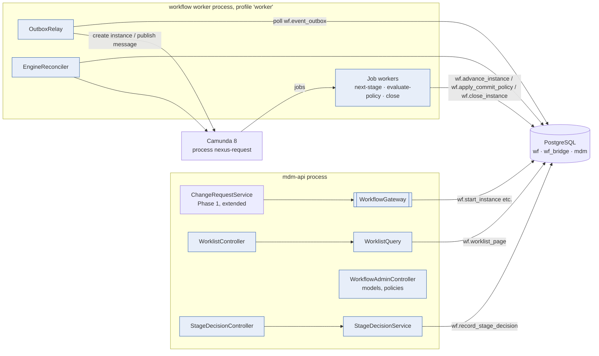
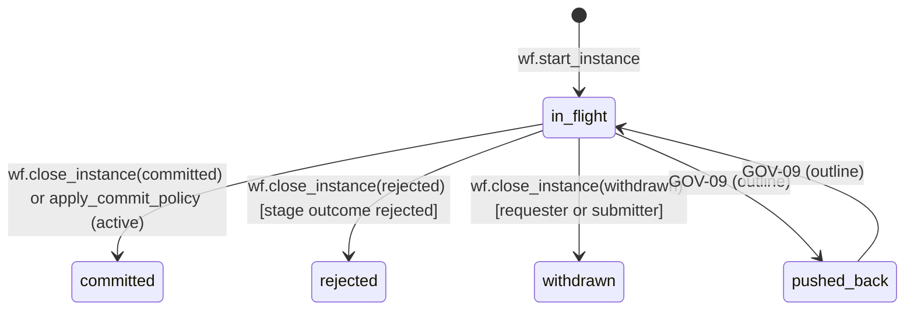
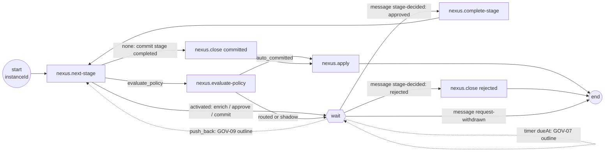

# Phase 2 — Governance: low-level design

- **Status:** Approved 2026-11-11 (consistency fixes CR-nn applied the same day, see `../CONSISTENCY_REVIEW.md`)
- **Migration rule (CR-07):** where this design says "edit Vn", that is allowed only while no shared environment exists (CLAUDE.md rule 6, OD-18). If one exists when this phase is built, the same change goes into a new V-numbered migration (`ALTER` / `CREATE OR REPLACE`). What counts as shared: OD-44.
- **Phase goal (BUILD_PROTOCOL §2):** DRG-equivalent workflow end to end.
- **Exit criteria:** a request moves Submit → (Enrich/Approve) → Commit through the `wf` layer; worklist API; separation
  of duties and human-only decisions proven; commit policy runs in shadow mode.
- **Reads with:** overview, patterns (P-04, P-05, P-06, P-15, P-24), ADR-003, ADR-005, ADR-014, ADR-016, ADR-017,
  ADR-018, ADR-019, ADR-021, the Phase 1 LLD. Every DDL block is a **proposal**, not a migration.

---

## 1. Purpose and scope

**Goal.** A steward submits a change request under a workflow model. Camunda 8 drives it through the model's stages
by calling guarded `wf` functions; approvers act from a paged worklist; the commit policy is evaluated in shadow mode on
every request; a human commits; the bridge records the decision and which items were committed; Phase 1's apply function writes the data.

**Capabilities in scope (designed in full)**

| ID | Decision | What Phase 2 delivers |
|---|---|---|
| GOV-01 | Parity | Versioned models loaded from definition files, validated, activated by a second administrator; in-flight requests keep their model version |
| GOV-02 | Parity | Submit, Enrich, Approve, Commit stages run by the generic Camunda process |
| GOV-12 | Improve | Policy evaluated on every covered request at the Commit stage; shadow mode by default; `active` refused until Audit-Risk signs off (OD-08); daily cap safe under concurrency |
| GOV-13 | Parity | `GET /worklist` with the nine DRG views, search, model filter, keyset paging; urgent flag |
| PROG | — | OD-18 group 2 control fixes (D-06, D-10, D-11, D-12, D-13, D-14, D-15, D-32, D-33), ADR-018 day boundaries in `wf`, Camunda integration (ADR-024) |

**Built as infrastructure because the in-scope stages need it; parity pending decision:** GOV-03 (editable and required
properties: the Enrich stage cannot work without `wf.item_allowed_in_stage` and `wf.missing_required_properties`, which
exist), GOV-06 (`any_group` and `all_groups` outcomes exist in `wf.stage_outcome` and are used as they are), GOV-05
(separation of duties exists as `wf.sod_violation`; Phase 2 proves it as a CLAUDE.md control, not as DRG parity).

**Outline only, pending decision (§15):** GOV-04 (conditional stages, splitting), GOV-07 (claim expiry, SLA timers,
escalation), GOV-09 (push-back and re-approval), GOV-08 and GOV-16 (notifications, alerts), GOV-11 (comments and
attachments), AUD-02 (request history API). The process has a place for each (§6.2), so adding one does not change the design.

**Out:** UI (Phase 3), bulk requests (GOV-10, Phase 4), tags and analytics (GOV-14, GOV-15, Phase 5).

**Dependencies.** Phase 1: change requests, `validate_change_request`, `apply_change_request`, `governed_by_workflow`,
`mdm.change_item_clearance`, roles and entitlements, error codes, `BusinessClock`.

## 2. Confidence and assumptions

**Confidence: Medium.** High for the control fixes and the database side (they extend tested V4–V6 code). Medium for
the Camunda integration (hosting is open, OD-01c; the Camunda client library is a new dependency). Low where GOV parity
semantics are pending.

| # | Assumption | Effect if wrong |
|---|---|---|
| B-1 | Stages run one at a time in `seq` order; DRG has no parallel stages in the in-use models | The generic process would need a parallel multi-instance branch |
| B-2 | The requester picks the workflow model when creating the request (`workflowModelCode`), as in DRG | If the model must be derived from the items, a resolver replaces the field |
| B-3 | A hierarchy flagged `requires_workflow` cannot be changed by a core-mode decision | Flag defaults to false, so Phase 1 behaviour is unchanged until an administrator sets it |
| B-4 | The commit-stage decision of a human (approve on the Commit stage) is the "commit" | Matches `wf.close_instance`, which requires an approved Commit stage |
| B-5 | Enrichers add or change items while the request is `in_review`; such items are written only through the bridge | If DRG enrich only fills properties of existing items, the same function still applies |
| B-6 | Camunda process variables carry identifiers only (`instanceId`, `changeRequestId`, `instanceStageId`, `stageType`, `dueAt`) | Required if SaaS is used (OD-01c); harmless if self-managed |
| B-7 | Volumes: `CHANGE_REQUESTS_PER_DAY` 2 000; ≤ 6 stages per model; ≤ 50 groups; worklist ≤ 5 000 actionable stages per user | Worklist benchmark (§10) |

**Human decisions this phase waits on:** OD-01c (self-managed vs SaaS) for deployment only; OD-08 before any policy may be
`active`; OD-18a (Audit-Risk review of ADR-023); OD-09 for the outline-only capabilities; dependency approval for the
Camunda client in the Phase 2 plan.

## 3. Component design



The API never talks to Camunda directly: it writes state and events in the database; the worker relays events to Camunda
(ADR-024). So an engine outage never blocks a decision, and every message to Camunda comes from a committed transaction.

### 3.1 Packages
| Package | Types | Responsibility | Must not |
|---|---|---|---|
| `com.mdm.api.workflow` | `WorkflowGateway` (interface), `SqlWorkflowGateway` | Start an instance, record decisions, read state: all through `wf` functions | Call Camunda |
| `com.mdm.api.workflow.worklist` | `WorklistController`, `WorklistQuery`, `WorklistView` (enum: ASSIGNED, URGENT, OVERDUE, CLAIMED, SUBMITTED, DRAFTED, PARTICIPATED, NOTIFIED, ALL), `WorklistRow` (record) | GOV-13 | Re-check permissions in Java (the SQL uses `wf.can_act`) |
| `com.mdm.api.workflow.decision` | `StageDecisionController`, `StageDecisionService`, `EnrichmentService` | Approve/reject/commit decisions; enrichment items | Write `wf` tables directly (functions only) |
| `com.mdm.api.workflow.admin` | `WorkflowAdminController`, `ModelDefinitionLoader`, `PolicyAdminService` | GOV-01 models from files; policy proposal, approval, kill switch (existing V6 functions) | Activate a model it created; approve `active` policies without the sign-off flag |
| `com.mdm.api.workflow.engine` (profile `worker`) | `OutboxRelay`, `NextStageWorker`, `EvaluatePolicyWorker`, `CloseInstanceWorker`, `EngineReconciler`, `CamundaClientConfig` | Camunda 8 integration (ADR-024) | Decide anything a guard decides; put names or values in variables |

Key signatures:
```java
public interface WorkflowGateway {
  UUID startInstance(UUID changeRequestId, String modelCode, Actor submitter);          // wf.start_instance
  DecisionResult recordDecision(UUID instanceStageId, Actor actor, StageDecision d);     // wf.record_stage_decision
  ItemView addEnrichmentItem(UUID instanceStageId, Actor actor, ItemCommand cmd);        // wf_bridge.add_enrichment_item
  void withdraw(UUID instanceId, Actor actor);                                           // wf.close_instance(withdrawn)
}
public record StageDecision(Kind kind /* APPROVE, REJECT */, String comment) {}
public record DecisionResult(String stageOutcome /* pending|approved|rejected */, int rowVersion) {}
```

### 3.2 Submit with workflow (change to Phase 1 `ChangeRequestService.submit`)
If the request has a `workflowModelCode`: validate (Phase 1), `mdm.submit_change_request`, then
`WorkflowGateway.startInstance` in the **same transaction**. `wf.start_instance` writes the instance, items, stages,
the `submit` action and the `instance_started` outbox event; the bridge trigger sets `governed_by_workflow = true` and
status `in_review`. If a hierarchy of any item has `requires_workflow` and no model is given → 422 `workflow-required`.

### 3.3 Engine replaceability (ADR-035, accepted with the Phase 2 plan, 2026-11-11)
The repository owner asked that Camunda stay replaceable. The worker is therefore split into engine-neutral ports and
adapters:

| Type | Package | Responsibility |
|---|---|---|
| `WorkflowEngine` (port, Nexus → engine) | `com.mdm.api.workflow.engine` | `startProcess`, `publish(EngineMessage)`, `isRunning`, `deploy` |
| `WorkflowSteps` (port, engine → Nexus) | `com.mdm.api.workflow.engine` | `nextStage`, `completeStage`, `evaluatePolicy`, `close`, `apply`: each one guarded, idempotent database call (the §5.2 job list) |
| `OutboxRelay`, `EngineReconciler` | `com.mdm.api.workflow.engine` | Use `WorkflowEngine` only |
| `CamundaWorkflowEngine`, Camunda job adapters, `nexus-request.bpmn` | `com.mdm.api.workflow.engine.camunda` | The only code that imports Camunda (enforced by a test) |
| `InProcessWorkflowEngine` | `com.mdm.api.workflow.engine.inprocess` | Reference driver: runs the §6.2 loop in Java from the outbox; default build and CI |

The adapter is chosen with `mdm.workflow.engine` (`camunda` | `inprocess`). A single contract suite (§13 GOV-02 and
the resilience cases) runs against both; the Camunda run is tagged `camunda` (`-Dcamunda`). Replacing the engine means
writing one adapter and passing that suite.

## 4. Data design

File targets follow OD-18: edit the defining file (V4, V5, V6, or V1 for `mdm` columns); new objects in a new file
`V9__workflow_phase2.sql`.

### 4.1 `mdm` additions (edit V1)
```sql
ALTER mdm.change_request ADD workflow_model_code text,          -- opaque to mdm (like decision_policy_ref); validated by wf.start_instance
                         ADD is_urgent boolean NOT NULL DEFAULT false;   -- GOV-13 "Urgent" ("urgent flag to add"); editable while draft
ALTER mdm.hierarchy      ADD requires_workflow boolean NOT NULL DEFAULT false;   -- B-3; checked by mdm.decide_change_request
CREATE TABLE mdm.system_setting (setting_key text PRIMARY KEY, setting_value text NOT NULL, description text NOT NULL);
INSERT INTO mdm.system_setting VALUES ('business_time_zone', 'America/New_York', 'ADR-018; day boundaries for caps, SLAs, sampling');
-- owner-only writes; nexus_api / nexus_wf: SELECT. A session cannot shift the business day (unlike a GUC).
CREATE FUNCTION mdm.business_today() RETURNS date STABLE ...       -- (now() AT TIME ZONE setting)::date
CREATE FUNCTION mdm.business_day_start(d date) RETURNS timestamptz STABLE ...  -- d::timestamp AT TIME ZONE setting
```
Privileges: `nexus_api` gets `INSERT` and `UPDATE (is_urgent, workflow_model_code)` on `mdm.change_request` (draft-only
by `trg_cr_frozen_content`); `nexus_wf` gets `EXECUTE` on `mdm.validate_change_request` and `mdm.apply_change_request`
(the worker validates at the Commit stage and applies after close) and `SELECT` on `mdm.system_setting`.

`trg_change_item_draft_only` (Phase 1) gains one exception (ADR-023): inserts are also allowed while the request is
`in_review` **when `current_user = 'nexus_bridge'`**, i.e. only from `wf_bridge.add_enrichment_item`. `mdm` still names no `wf` object.

### 4.2 Group membership history (D-33) — edit V4
```sql
CREATE TABLE wf.user_group_member (
  group_id        uuid NOT NULL REFERENCES wf.user_group,
  user_id         uuid NOT NULL REFERENCES mdm.app_user,
  valid_period    daterange NOT NULL DEFAULT daterange(mdm.business_today(), NULL),
  recorded_period tstzrange NOT NULL DEFAULT tstzrange(now(), NULL),
  granted_by      uuid REFERENCES mdm.app_user,
  EXCLUDE USING gist (group_id WITH =, user_id WITH =, valid_period WITH &&) WHERE (upper_inf(recorded_period))
);  -- + mdm.trg_bitemporal_guard (raises only, writes nothing); audit through wf.config_audit (see note)
CREATE FUNCTION wf.is_member(p_group uuid, p_user uuid, p_on date) RETURNS boolean STABLE ...
  -- one definition used by can_act, trg_decision_guard, trg_policy_guard, engage_kill_switch (fixes D-15: valid_from was missing there)
```
Note on the layer rule: `wf` writing `mdm.audit_log` through `mdm.trg_audit_row` would be a `wf → mdm` write. Instead
`wf` gets its own append-only `wf.config_audit(table_name, action, old_row, new_row, actor_id, occurred_at)` with the same
trigger shape, used for `user_group_member`, `workflow_model`, `commit_policy`, `stp_protected_property`, `freeze_window`.
The existing `wf.instance_action` / `wf.policy_event` stay as they are.

**Governed membership (CR-10).** Group membership decides who may approve requests and, through `POLICY_APPROVERS`, commit
policies, so it gets the same four-eyes rule as role grants (ADR-029): `wf.membership_change(change_id, group_id, user_id,
op add|end, valid_from, proposed_by, approved_by, status)`; a `WORKFLOW_ADMIN` proposes, a different one approves
(`POLICY_APPROVERS` changes need an approver who is in `POLICY_APPROVERS`), and only `wf.apply_membership_change` (definer, `nexus_wf`) writes `wf.user_group_member`. The pgTAP fixture in `02_workflow_invariants.sql`
inserts `(group_id, user_id)` only, which still works with the defaults.
*Built in 2-2:* governed changes are `wf.propose_membership_change` and `wf.decide_membership_change` (approve applies the change; there is no separate `apply_membership_change`), in the new `V9__workflow_phase2.sql` with `wf.membership_change` and `wf.config_audit`. Both functions and the audit trigger are `SECURITY DEFINER` owned by the migration owner, and `nexus_wf` loses `INSERT, UPDATE, DELETE` on `user_group_member`, `membership_change` and `config_audit`, so only the functions write membership. Workflow administrator = `WORKFLOW_ADMIN` for all hierarchies on the business day (`wf.is_workflow_admin`). Added rules: a change cannot take effect before today (`N2233`); proposer and decider must be workflow administrators (`N1026`). New codes `N1026`, `N2230`–`N2233`. Bootstrap members are inserted by the owner.

### 4.3 Claims (D-12) — edit V4
```sql
CREATE FUNCTION wf.trg_claim_guard() ...   -- BEFORE UPDATE OF claimed_by ON wf.instance_stage
  -- NEW.claimed_by IS NULL, or (kind = 'human' AND wf.can_act(NEW.instance_stage_id, NEW.claimed_by)
  --   evaluated as if unclaimed); raises N1010 otherwise
CREATE FUNCTION wf.claim_stage(p_stage uuid, p_user uuid) / wf.unclaim_stage(p_stage uuid, p_user uuid)
  -- write claimed_by/claimed_at/claim_expires_at and the 'claim'/'unclaim' instance_action in one statement set
```
Claim expiry and SLA behaviour are GOV-07 (outline); the guard is a control and is in scope.

### 4.4 Close and decisions (D-13) — edit V4
```sql
CREATE FUNCTION wf.record_stage_decision(p_stage uuid, p_user uuid, p_decision text, p_comment text)
RETURNS text  -- returns wf.stage_outcome after the insert
  -- picks the group: the lowest-seq stage group of which p_user is a member and which has not decided (sequential order
  -- respected by can_act); INSERT wf.stage_group_decision (trg_decision_guard runs); INSERT wf.instance_action with the
  -- matching action (approve | reject). On a Commit stage an approval writes no action here: wf.close_instance writes the
  -- single 'commit' action with the deciding user as actor, so a commit is recorded once; INSERT wf.event_outbox 'stage_decision_recorded'
  -- {instance_stage_id, outcome}; idempotent per (stage, group): a second identical call returns the outcome, a
  -- different decision raises N2201
wf.close_instance changes:
  'rejected'  allowed only if wf.stage_outcome(current stage) = 'rejected'; actor must be the rejecting decider (N1011)
  'withdrawn' allowed only for the requester or submitter, human or system_feed (N1012)
  'committed' unchanged (Commit stage approved; all included stages complete); actor = the committing decider
```
*Built in 2-3:* `record_stage_decision`, `claim_stage`, `unclaim_stage` and `close_instance` are `SECURITY DEFINER` owned by `nexus_wf` (ownership set in V9) and callable by `nexus_api`, because the API role has no write access to `wf`. Stage decisions are human only (`N1002`); `push_back` is refused as an invalid decision until GOV-09 (`22023`). An enrich-stage approval is recorded as the `enrich` action. Claiming sets the stage to `claimed` with `claim_expires_at` from the stage's `claim_duration`; the claimant or a workflow administrator unclaims (`N1010` otherwise). The rejecting decider is the one who recorded a `reject` on the current stage.

### 4.5 Stage progression (new, V9) — the operations the engine calls
```sql
CREATE FUNCTION wf.advance_instance(p_instance uuid)
RETURNS TABLE (action text, instance_stage_id uuid, stage_type wf.stage_type, due_at timestamptz)
  -- action ∈ {'wait' (a stage is active), 'activated', 'evaluate_policy' (Commit reached), 'none'}; see §7.1
CREATE FUNCTION wf.complete_stage(p_stage uuid) RETURNS text   -- after outcome 'approved': status completed, completed_at
```
Both lock the instance row (`FOR UPDATE`) and are idempotent.

### 4.6 Commit policy fixes (D-14, ADR-018 days) — edit V6
- `wf.apply_commit_policy` takes `SELECT … FROM wf.commit_policy WHERE policy_id = e.policy_id FOR UPDATE` before
  counting the day's auto-commits (serialises evaluations per policy; fine at `CHANGE_REQUESTS_PER_DAY`).
- Day boundaries in `evaluate_commit_policy`, `sample_auto_commits`, `v_commit_policy_daily` and `review_due` use
  `mdm.business_today()` / `mdm.business_day_start()` instead of `current_date` / `date_trunc('day', now())`.
- `wf.approve_commit_policy` refuses `mode = 'active'` unless `mdm.system_setting('policy_activation_allowed') = 'true'`,
  a row that only the owner role can change, set after Audit-Risk sign-off (OD-08). A guard, not a configuration flag in the application.
*Built in 2-1:* `mdm.system_setting` (Phase 1, in V8) moved into V1 so the V6 day boundaries can use it, with `mdm.business_time_zone()`, `business_today()`, `business_day_start(d)`, `business_date_of(ts)` and `setting_enabled(key)`. The activation guard sits in `wf.trg_policy_guard` (every path to `approved`), not only in `approve_commit_policy`, with the new code `N2225` (`policy.activation_not_allowed`). Membership date checks still on `current_date` move to `wf.is_member` in 2-2.

### 4.7 Bridge fixes (D-06) and clearance — edit V5
```sql
wf_bridge.sync_change_request(p_cr):
  on first instance insert: UPDATE mdm.change_request SET governed_by_workflow = true
  status as today (in_review / approved / rejected / withdrawn), using the Phase 1 transition matrix
  decider when approved:   the latest HUMAN 'commit' action in a COMMITTED instance → human_review;
                           else the system 'commit' action in a committed instance → approved_policy + policy_id
  decider when rejected:   the latest human 'reject' action (all instances rejected or withdrawn)
  -- never takes the rejecter of one branch as the decider of an approved request (D-06)
  when approved: INSERT INTO mdm.change_item_clearance SELECT items of committed instances ON CONFLICT DO NOTHING
wf_bridge.add_enrichment_item(p_stage uuid, p_user uuid, ...) SECURITY DEFINER (nexus_bridge):
  require wf.can_act(p_stage, p_user) and stage_type = 'enrich'; INSERT mdm.change_item (seq = max+1);
  INSERT wf.instance_item; require wf.item_allowed_in_stage(new item, p_stage) else N1013
```

### 4.8 Node-access scope and dates (D-10, D-11) — edit V4
`wf.items_in_scope` today walks the whole tree (`mdm.hierarchy_tree`) per scope per call. Rewrite with the same rule
(every item's node or target parent lies under a scope's top node) using an **ancestor walk per item** (Phase 1 §7.5),
evaluated at the request's `effective_from` instead of `current_date`. Same for `wf.missing_required_properties` and
`wf.item_condition_matches` (`current_date` → `effective_from`). A pgTAP test runs old and new `items_in_scope` on the
same fixtures and asserts equal results before the old one is replaced.
*Built in 2-4:* `wf.node_under(hierarchy, node, top, day)` walks up through primary and shared placements (bounded by `max_hierarchy_depth`); `items_in_scope` uses it at the request's `effective_from`. The old whole-tree rule is kept only inside `db/tests/17_scope.sql`, which compares both on 28 stage/request cases (shared placements, new nodes through their parent, scopes in a second hierarchy, mixed items) and finds no difference; a node moved into a scope after the effective date shows the new date rule. `missing_required_properties` and `item_condition_matches` read stored values at `effective_from` too.

### 4.9 Worklist (D-10, GOV-13) — new, V9
```sql
CREATE FUNCTION wf.worklist_page(p_user uuid, p_view text, p_search text, p_model text,
                                 p_after_due timestamptz, p_after_id uuid, p_limit int)
RETURNS TABLE (instance_stage_id uuid, instance_id uuid, change_request_id uuid, title text, model_code text,
               stage_label text, stage_type wf.stage_type, stage_status wf.stage_status, due_at timestamptz,
               claimed_by uuid, is_urgent boolean, is_overdue boolean, requester_id uuid, sort_due timestamptz)
```
| View | Rows |
|---|---|
| ASSIGNED | active or claimed stages where `wf.can_act(stage, user)` |
| URGENT | ASSIGNED and `change_request.is_urgent` |
| OVERDUE | ASSIGNED or CLAIMED with `due_at < now()` |
| CLAIMED | stages with `claimed_by = user` |
| SUBMITTED | open instances with `submitted_by = user` (current stage shown) |
| DRAFTED | the user's `draft` change requests (no instance; stage columns NULL) |
| PARTICIPATED | instances with any `instance_action` by the user |
| NOTIFIED | empty until GOV-08 is decided (documented, returns 0 rows) |
| ALL | union of the above, deduplicated |

Ordering `(coalesce(due_at, 'infinity'), instance_stage_id)` with keyset; `p_search` matches title or request id
(`ILIKE`, trigram index when OD-21 search lands). Performance: ASSIGNED first narrows by group membership
(`stage_group` ⨝ `is_member`) before calling `can_act`, so `can_act` runs only on candidate rows.

### 4.10 Outbox consumers (D-32, ADR-016) — new, V9
```sql
CREATE TABLE wf.outbox_consumer (consumer_code text PRIMARY KEY, last_event_id bigint NOT NULL DEFAULT 0, updated_at timestamptz NOT NULL DEFAULT now());
INSERT INTO wf.outbox_consumer (consumer_code) VALUES ('camunda_relay');
-- wf.event_outbox.processed_at kept but unused; dropped after Phase 2 (no reader).
```

### 4.11 Model activation by a second administrator (GOV-01) — edit V4
`wf.workflow_model` gains `activated_by uuid REFERENCES mdm.app_user`, `activated_at`. `wf.trg_model_status` additionally
requires, on draft → active, `activated_by IS NOT NULL AND activated_by <> created_by` (N1014). Strengthening; a model is
governance configuration and gets the same four-eyes rule as policies.

### 4.12 Volumes and indexes
| Object | Volume | New index |
|---|---|---|
| `wf.instance_stage` | ~6 per request × 730 000 / year | `(status, stage_id) WHERE status IN ('active','claimed')`; `(claimed_by) WHERE claimed_by IS NOT NULL` |
| `wf.workflow_instance` | 1–2 per request | `(submitted_by) WHERE status IN ('in_flight','pushed_back')`; `(engine_ref)` |
| `wf.instance_action` | ~10 per request | existing `(instance_id, occurred_at)`; add `(actor_id, instance_id)` for PARTICIPATED |
| `wf.user_group_member` | users × groups | `(user_id) WHERE upper_inf(recorded_period)` |
| `wf.event_outbox` | ~15 per request | existing; consumer reads by `event_id` (PK) |

## 5. Interface design

### 5.1 HTTP (all under `/api/v1`, Phase 1 conventions)
| Endpoint | Purpose | Auth | Concurrency | Errors |
|---|---|---|---|---|
| `POST /change-requests` (changed) | adds `workflowModelCode`, `isUrgent` | PROPOSE | as Phase 1 | 422 unknown or inactive model |
| `POST /change-requests/{id}/submit` (changed) | starts the instance when a model is given | requester | `If-Match` | 422 `workflow-required` |
| `GET /worklist?view&search&model&limit&cursor` | GOV-13 | any actor (rows filtered in SQL) | — | 400 unknown view |
| `GET /workflow/instances/{id}` | instance, stages (label, type, status, due, claimed by), group decisions, policy evaluations | READ on the request's scope | — | 404 |
| `POST /workflow/stages/{stageId}/decision` `{decision: approve\|reject, comment}` | record a decision | DB `can_act` (+ PROPOSE/DECIDE role in scope as a pre-check) | `Idempotency-Key` | 403 `N1xxx` with reason (e.g. separation of duties); 409 `N2201` |
| `POST /workflow/stages/{stageId}/claim` / `DELETE …/claim` | claim / unclaim | DB guard | `Idempotency-Key` | 403 `N1010` |
| `POST /workflow/stages/{stageId}/items` | enrichment item (Enrich stage) | DB `can_act` | `Idempotency-Key` | 403 `N1013` not editable in this stage |
| `POST /change-requests/{id}/withdraw` (changed) | withdraws the instance too | requester | `If-Match` | 403 `N1012` |
| `GET /admin/workflow-models` / `POST /admin/workflow-models` (load file) / `POST /admin/workflow-models/{id}/activate` | GOV-01 | WORKFLOW_ADMIN | — | 422 `wf.validate_model` issues; 403 `N1014` self-activation |
| `POST /admin/commit-policies`, `…/{id}/submit`, `…/{id}/approve`, `…/kill-switch` | GOV-12 lifecycle over the V6 functions | POLICY_ADMIN (propose, submit); member of `POLICY_APPROVERS` (approve); owner group or approvers (kill switch) | `Idempotency-Key` | 403 maker-checker; 422 activation not allowed (OD-08) |

The decision response explains refusals in words (UI_STANDARD §6): `{"type":"urn:nexus:problem:forbidden","code":"sod.violation","detail":"You approved an earlier stage of this request, so you cannot approve this one."}`.

OpenAPI fragment:
```yaml
  /api/v1/worklist:
    get:
      operationId: getWorklist
      parameters:
        - {name: view, in: query, schema: {type: string, enum: [assigned, urgent, overdue, claimed, submitted, drafted, participated, notified, all], default: assigned}}
        - {name: search, in: query, schema: {type: string, maxLength: 100}}
        - {name: model, in: query, schema: {type: string}}
        - {name: limit, in: query, schema: {type: integer, minimum: 1, maximum: 1000, default: 50}}
        - {name: cursor, in: query, schema: {type: string}}
      responses:
        '200':
          content:
            application/json:
              schema:
                type: object
                required: [items, counts]
                properties:
                  items: {type: array, items: {$ref: '#/components/schemas/WorklistRow'}}
                  nextCursor: {type: string, nullable: true}
                  counts: {type: object, additionalProperties: {type: integer}, description: rows per view, for the filter chips}
```

### 5.2 Camunda (ADR-024)
| Element | Name | Variables (ids only) | Handler |
|---|---|---|---|
| Process | `nexus-request` (one definition, versioned with the code) | `instanceId`, `changeRequestId` | — |
| Job | `nexus.next-stage` | in: `instanceId`; out: `action`, `instanceStageId`, `stageType`, `dueAt` | `NextStageWorker` → `wf.advance_instance` |
| Job | `nexus.complete-stage` | in: `instanceStageId` | → `wf.complete_stage` |
| Job | `nexus.evaluate-policy` | in: `instanceId`; out: `policyOutcome` | `EvaluatePolicyWorker` → `mdm.validate_change_request` then `wf.apply_commit_policy(instance, validated_at, system actor)` |
| Job | `nexus.close` | in: `instanceId`, `outcome`, `actorId` | `CloseInstanceWorker` → `wf.close_instance` |
| Job | `nexus.apply` | in: `changeRequestId`, `actorId` (committer, or the system actor after an auto-commit) | `ApplyWorker` → Phase 1 `ApplyService` (`mdm.apply_change_request`; returns 0 if already applied) |
| Message | `stage-decided` | correlation key `instanceStageId`; payload `outcome` | published by `OutboxRelay` from `stage_decision_recorded` events whose outcome ≠ `pending` |
| Message | `request-withdrawn` | correlation key `instanceId` | from `instance_closed` with outcome `withdrawn` |
| Timer | stage due (`dueAt`) | — | GOV-07 outline: records `sla_breached` |

## 6. Behaviour

### 6.1 Instance and stage state (existing enums; transitions now all go through functions)

Stage: `pending → active` (`advance_instance`) `→ claimed` (`claim_stage`) `→ completed` (`complete_stage`) or
`rejected`; `pending → skipped` (condition false, GOV-04 outline).

### 6.2 The generic process `nexus-request`

`advance_instance` returns `evaluate_policy` when the next stage is Commit and no evaluation exists yet for this
iteration; after the evaluation, the Commit stage is activated for a human unless the policy auto-committed.

### 6.3 Approve and commit (shadow mode)
```mermaid
sequenceDiagram
  autonumber
  actor S as Steward
  actor A as Approver
  actor M as Committer
  participant API as mdm-api
  participant DB as PostgreSQL
  participant R as OutboxRelay
  participant C as Camunda 8
  participant J as Job workers
  S->>API: POST /submit (workflowModelCode)
  API->>DB: validate; submit; wf.start_instance (one tx) → outbox instance_started
  R->>DB: poll events > offset
  R->>C: create process instance (businessKey = instanceId), store engine_ref
  C->>J: nexus.next-stage
  J->>DB: wf.advance_instance → Approve stage active
  A->>API: GET /worklist?view=assigned
  A->>API: POST /workflow/stages/{id}/decision approve
  API->>DB: wf.record_stage_decision (guards) → outcome approved, outbox stage_decision_recorded
  R->>C: publish stage-decided(instanceStageId, approved)
  C->>J: nexus.complete-stage, then nexus.next-stage
  J->>DB: advance → evaluate_policy
  C->>J: nexus.evaluate-policy
  J->>DB: mdm.validate_change_request; wf.apply_commit_policy → shadow_would_commit (recorded)
  J->>DB: advance → Commit stage active
  M->>API: POST /decision approve (Commit stage)
  API->>DB: record decision → outcome approved
  R->>C: stage-decided
  C->>J: complete-stage, next-stage → none → nexus.close committed
  J->>DB: wf.close_instance(committed, M) → bridge: approved, clearance rows, decided_by M, human_review
  C->>J: nexus.apply
  J->>DB: mdm.apply_change_request(cr, M) (ApplyService, Phase 1)
```

### 6.4 Transactions, locking, idempotency
| Operation | Transaction | Lock | Idempotent by |
|---|---|---|---|
| Submit + start | API, one tx | request `FOR UPDATE` | `Idempotency-Key`; `workflow_instance_one_root` unique index |
| Decision | API, one tx | stage `FOR UPDATE` | PK `(instance_stage_id, group_id)`; same decision → same outcome |
| Relay batch | worker, one tx per batch | `wf.outbox_consumer` row `FOR UPDATE` | create: Camunda business key + `engine_ref` check; messages: Camunda message id = `event_id` (duplicates ignored within the TTL) |
| Job | worker, one tx per job | instance `FOR UPDATE` | each `wf` function checks current state first |
| Policy evaluation | worker | policy `FOR UPDATE` (D-14) | one evaluation per instance per commit iteration |
| Close + apply | worker: close tx, then apply tx | request `FOR UPDATE` | `apply_change_request` returns 0 when already applied |

### 6.5 Failure modes and recovery
| Failure | Effect | Recovery |
|---|---|---|
| Camunda unavailable | Relay retries; decisions still recorded; stages do not advance | Alert on outbox lag; resumes on recovery |
| Worker crash mid-job | Job times out in Camunda and is retried | Functions are idempotent |
| Process instance lost / engine reset | DB state intact | `EngineReconciler` (hourly and on demand): for every `in_flight` instance without a live process, create one; the generic process resumes from DB state (next-stage reports `wait` for an active stage) |
| Guard rejects a job's call (e.g. model changed) | Job fails with an incident | Incident visible in Camunda Operate; alert; no data change |
| Apply fails after commit | Request `apply_failed` (Phase 1) | Steward recreates; workflow history kept |

## 7. Algorithms

### 7.1 `wf.advance_instance(p_instance)`
```text
lock instance FOR UPDATE; if status not in ('in_flight') return 'none'
cur := latest-iteration stage at current_seq
if cur.status in ('active','claimed') return ('wait', cur)
if cur.status = 'completed' and cur is Commit return ('none')            -- close follows
next := lowest seq > current_seq whose latest iteration is 'pending'
loop:
   if next.condition is not null:                                       -- GOV-04 outline: today, evaluate and skip
       included := every item matches? (wf.item_condition_matches, at effective_from)
       if split_on_condition: outline (GOV-04) — Phase 2 raises N2202 'conditional split not enabled'
       if not included: status skipped; continue loop
   if next is Commit and no policy_evaluation for this instance and iteration: return ('evaluate_policy')
   activate: status active, started_at now(), due_at now() + stage_duration; current_seq := next.seq
   return ('activated', next)
if no next: return ('none')
```
O(stages) per call.

### 7.2 Worklist ASSIGNED
```text
candidates := active/claimed stages s
              JOIN stage_group sg ON sg.stage_id = s.stage_id
              JOIN user_group_member m (is_member(sg.group_id, user, business_today))
              -- narrows to stages of the user's groups: O(groups × open stages per group)
rows := candidates WHERE wf.can_act(s, user)      -- full guard (SoD, scope, claim, order)
order by (coalesce(due_at,'infinity'), instance_stage_id) > cursor, limit+1
```
`can_act` cost is dominated by `items_in_scope`, now O(items × depth) (§4.8) instead of O(tree).

### 7.3 Bridge decider (D-06)
```text
committed := instances of cr with status 'committed'
if committed non-empty:
   h := latest action 'commit' by a human in committed           → decided_by h, human_review
   else p := action 'commit' by system_feed in committed          → decided_by system actor, approved_policy, policy_id
   clearance := items of committed instances
elif every instance rejected or withdrawn and any rejected:
   decided_by := latest human 'reject' action                     → rejected
```

## 8. Patterns applied
| Pattern | Why |
|---|---|
| P-15 State machine + process manager | DB holds state and guards; Camunda drives time and order |
| P-06 Outbox with consumer offsets | Every Camunda call originates from a committed event (ADR-016) |
| P-05 Single bridge | Clearance, enrichment items and decision attribution only through `wf_bridge` |
| P-04 Policy as data, shadow mode | Evaluation on every covered request; activation behind an owner-only setting |
| P-03 Maker-checker | Model activation and policy approval need a second person |
| P-07 Ports and adapters | `WorkflowGateway`; Camunda only in the worker |
| P-10 Idempotency | Decisions, relay, jobs |
| P-11 Keyset paging | Worklist |
| P-24 DB guards | Claims, close, decisions, membership |

## 9. Security and controls

| Control (CLAUDE.md) | Enforcement in Phase 2 | Test |
|---|---|---|
| Maker-checker | Requester/submitter cannot approve or commit (`can_act`); model activation and policy approval by a second person | pgTAP + JUnit |
| Separation of duties | `wf.sod_violation` inside `can_act` and `trg_decision_guard` (exists; now tested) | pgTAP: approver of stage 1 cannot approve stage 2 when SoD is on; can when off; split lineage covered when GOV-04 lands |
| Human-only decisions | `trg_action_guard` (exists), claim guard (D-12), close rules (D-13) | pgTAP: AI user cannot claim, approve, reject, commit, withdraw others' requests |
| Append-only logs | `instance_action`, `stage_group_decision`, `policy_event`, `policy_evaluation` (exist), `wf.config_audit` (new) | pgTAP |
| Commit-policy limits | Hard limits (exist, + `delete_node`), policy lock (D-14), activation setting (OD-08), business-day caps | pgTAP: two concurrent evaluations at cap − 1 → exactly one auto-commit (run with two connections in a JUnit test); `active` approval refused |
| Layer separation | `mdm` unchanged in its references; enrichment and clearance only through `wf_bridge`; `wf` writes only `wf` (its audit is `wf.config_audit`) | pgTAP: `nexus_wf` cannot write `mdm`; grep check |
| Deterministic calculations | No calculation in Camunda; variables are ids | Review; a JUnit test asserts the variable set |
| No real data | Synthetic models and users | Review |

**Abuse cases.** A worker bug calls `close_instance(committed)` early → refused unless the Commit stage is approved.
A forged `stage-decided` message → Camunda only advances; `complete_stage` re-checks `stage_outcome = 'approved'`.
An approver self-assigns through a group → group membership changes are audited (`wf.config_audit`) and dated (D-33).
A user claims a stage to block others → claim guard requires `can_act`; expiry is GOV-07 (outline), so in Phase 2 an
administrator unclaims (`WORKFLOW_ADMIN`).

## 10. Performance and scale
| Target | Value | Design | Benchmark |
|---|---|---|---|
| Worklist page | `P95_WORKLIST_MS` 500 with 5 000 open stages for the user's groups and 200 000 open stages overall | candidate narrowing, ancestor-walk scope | perf test (tagged) |
| Decision | 300 ms | one function call | perf test |
| Stage advance latency (decision → next stage active) | ≤ `OUTBOX_SAFETY_LAG` + relay poll (1 s) + job latency: target 5 s p95 | relay poll interval `OUTBOX_POLL_INTERVAL` = 1 s | integration test with Camunda's test engine |
| Policy evaluation | 200 ms excluding validation | policy row lock held for the evaluation only | perf test |

## 11. Observability
- Metrics: `nexus.wf.relay.lag_seconds`, `nexus.wf.relay.events{type}`, `nexus.wf.job.duration{type}`,
  `nexus.wf.job.failures{type}`, `nexus.wf.decision{outcome}`, `nexus.wf.policy.outcome{policy,outcome}`, `nexus.wf.worklist.duration{view}`, `nexus.wf.reconciler.recreated`.
- Logs: one line per transition with `instanceId`, `changeRequestId`, `stageId`, `actorId` (never titles or values).
- Alerts: relay lag > `OUTBOX_LAG_ALERT`; any Camunda incident; reconciler recreated > 0; `review_issues` > 0; kill switch engaged; any `too_loose` in `v_shadow_comparison` for an active policy.

## 12. UI design
Not applicable: the worklist and decision screens are Phase 3 (they consume §5.1).

## 13. Test design
Synthetic fixtures: models `T_ADD_LEAF` (Submit → Approve → Commit) and `T_ENRICH` (Submit → Enrich → Approve(SoD on) →
Commit); groups `T_APPROVERS`, `T_COMMITTERS`, `T_ENRICHERS`, `POLICY_APPROVERS`; users steward, approver1, approver2,
committer, enricher, ai, system, admin1, admin2; policy `T_ROUTINE_ADDS` in shadow mode covering `T_ADD_LEAF`.

| Capability | Criterion | Cases (P · N · C · B) | Type |
|---|---|---|---|
| GOV-01 | Models configured and routing; versions pinned | P: load file → draft → activate by admin2; N: activation by creator (N1014); N: invalid model (no commit stage); P: in-flight request keeps v1 after v2 activates; C: edit of an active model's stage refused (exists) | pgTAP + JUnit |
| GOV-02 | Stages behave as in DRG | P: `T_ADD_LEAF` end to end through Camunda's test engine; P: `T_ENRICH` with an enrichment item; N: enrichment item not allowed by the task (N1013); N: decision on a pending stage; B: model with only Submit and Commit | JUnit + process test |
| GOV-02 | Same as DRG (golden) | Request histories replayed on the masked models: stage sequence equal | Golden (Phase 4 framework) |
| GOV-12 | Eligible commit after validations; ineligible routes; every auto-commit logged | P: shadow evaluation recorded for every covered request with `failed_checks`; P: shadow summary counts; N: `active` approval refused without the sign-off setting; C: two concurrent evaluations at cap − 1 → one auto-commit (with the setting enabled in a test database); C: AI-originated request never eligible; B: evaluation exactly at the business-day boundary in `America/New_York` | pgTAP + JUnit |
| GOV-13 | Each view returns the right requests | P per view for a sample user; N: a stage the user cannot act on (SoD) is absent from ASSIGNED but present in PARTICIPATED; B: paging across equal `due_at`; P: counts per view | JUnit |
| GOV-13 | Same as DRG (golden) | Worklist samples per view | Golden (Phase 4) |
| PROG D-06 | Correct decider after a split | Pending GOV-04 (splits disabled); test written with a two-instance fixture inserted directly | pgTAP |
| PROG D-12 | Claims human and eligible | N: AI claimant; N: non-member; P: member | pgTAP |
| PROG D-13 | Reject and withdraw authorised | N: reject without a rejecting decision; N: AI withdraws a human's request; P: requester withdraws | pgTAP |
| PROG D-14 | Cap holds under concurrency | see GOV-12 C | JUnit (two connections) |
| PROG D-15 | Kill switch uses membership dates | N: future-dated member cannot engage | pgTAP |
| PROG D-33 | Membership history | P: membership at a past date reconstructable; C: no update or delete | pgTAP |
| PROG D-10/D-11 | Scope at effective date; same results | C: old vs new `items_in_scope` equal on fixtures; P: node moved into scope after `effective_from` | pgTAP |
| PROG controls | SoD, human-only | Matrix in §9 | pgTAP |
| Resilience | Reconciler | P: delete the process instance in the test engine → reconciler recreates → request completes | process test |

Existing tests: `02_workflow_invariants.sql` keeps all 17 assertions; its `user_group_member` insert works with the new
defaults; `engage_kill_switch` test still passes (membership valid from today).

## 14. Rollout and compatibility
- Migration edits: V1 (`mdm` columns, settings, business-day functions, draft-only exception), V4 (membership, claims,
  close, decisions, scope rewrite, model activation), V5 (bridge), V6 (policy lock, days, activation setting); new V9.
  Allowed while no shared environment exists (OD-18).
- Camunda: process `nexus-request.bpmn` in `services/mdm-api/src/main/resources/bpmn/`, deployed by the worker at start
  (versioned with the build). Local: Camunda 8 container in `docker-compose.yml` under a `workflow` profile (an image to
  pull through the internal registry, see DEVELOPER_SETUP §2). CI: Camunda's process-testing library (Testcontainers-based; dependency to approve).
- Hierarchies keep `requires_workflow = false` until an administrator sets it, so Phase 1 core-mode decisions keep working.
- Feature setting `policy_activation_allowed` absent (= false) everywhere until OD-08.
- Rollback: local only, as Phase 1.

## 15. Risks, open questions and alternatives
| # | Item | Handling |
|---|---|---|
| R-1 | Camunda hosting undecided (OD-01c) | Design identical for SaaS and self-managed (ids-only variables); only connection config differs |
| R-2 | New dependencies: Camunda Java client / Spring SDK and the process-testing library | Proposed in the Phase 2 plan for approval |
| R-3 | A generic process is less visual per model than one BPMN per DRG model | Operate shows the generic process; stage names come from the DB timeline (`GET /workflow/instances/{id}`) |
| R-4 | Relay latency adds seconds between a decision and the next stage | Acceptable for human workflows; target in §10 |
| Alt-1 | API calls Camunda directly on decisions | Rejected: dual write; a decision could be recorded without the engine knowing, or the reverse |
| Alt-2 | Camunda user tasks and Tasklist for approvals | Rejected: a second permission model beside `wf.can_act` |
| Alt-3 | Keep `items_in_scope` as a full tree walk | Rejected: worklist cost grows with tree size (D-10) |

**Outline only, pending decision (OD-09):**
- **GOV-04** conditions and splits: `advance_instance` already evaluates conditions and skips; splitting calls the existing `wf.split_instance` and starts a child process instance from the `instance_split` event.
- **GOV-07** claims expiry, SLAs: the timer on the wait state records `sla_breached` and escalates by notifying (`GOV-08`).
- **GOV-09** push-back: a `push_back` decision creates the next iteration of the target stage per `reapproval` and loops the process back to `next-stage`.
- **GOV-08 / GOV-16** notifications and alerts: a second outbox consumer (`notifier`), recipients from `workflow_stage.notify`.
- **GOV-11** comments and attachments: `comment` actions (enum exists) and evidence documents.
- **AUD-02** request history: `GET /workflow/instances/{id}/history` over `wf.instance_action` and `wf.policy_evaluation`.

## 16. Work breakdown
| # | Increment | Size | Capabilities | Tests (§13) |
|---|---|---|---|---|
| 2-1 | Settings and business-day functions; `wf` day boundaries; activation setting | S | PROG, GOV-12 | pgTAP day boundary |
| 2-2 | Membership history (D-33, D-15), `wf.is_member`, `wf.config_audit` | M | PROG | pgTAP D-33, D-15 |
| 2-3 | Claim guard and functions (D-12); close rules (D-13); `record_stage_decision` | M | PROG, GOV-02 | pgTAP D-12, D-13, SoD, human-only |
| 2-4 | Scope rewrite and effective dates (D-10, D-11) with equivalence test | M | PROG | pgTAP equivalence |
| 2-5 | Policy lock (D-14) and activation guard | S | GOV-12 | JUnit concurrency; pgTAP |
| 2-6 | Bridge: attribution (D-06), clearance, `governed_by_workflow`, enrichment items, draft-only exception | M | PROG, GOV-02 | pgTAP D-06; Phase 1 apply with clearance |
| 2-7 | `advance_instance`, `complete_stage`; model activation by a second admin; model loader | M | GOV-01, GOV-02 | pgTAP + JUnit GOV-01 |
| 2-8 | API: submit with model, decisions, claims, enrichment, instance view, admin endpoints | M | GOV-01, GOV-02, GOV-12 | JUnit |
| 2-9 | Worklist function and endpoint, urgent flag | M | GOV-13 | JUnit GOV-13, perf |
| 2-10 | Outbox consumer offsets; relay; Camunda client config; BPMN; job workers (needs dependency approval) | L | GOV-02 | process tests |
| 2-11 | Reconciler; resilience tests | S | PROG | process test |
| 2-12 | Records: data model, changelog, test report, summary | S | PROG | review |

Increment 2-10 splits into 2-10a (relay + offsets, testable without Camunda using a fake `EngineClient`), 2-10b (BPMN and
workers on the test engine). Dependencies to approve in the Phase 2 plan: the Camunda 8 Java client or Spring SDK, and Camunda's process-testing library.

*Changed with ADR-035 (accepted with the Phase 2 plan):* 2-10a becomes the ports (`WorkflowEngine`, `WorkflowSteps`),
offsets, relay and the in-process reference driver, with the contract suite running on it; 2-10b is the Camunda adapter
(BPMN, job adapters) passing the same suite on Camunda's test engine (tag `camunda`); 2-11 runs the reconciler and
resilience cases on both adapters. *Already built in Phase 1:* `mdm.system_setting` with `business_time_zone` (CR-01,
moved forward), so 2-1 adds only `mdm.business_today()` / `business_day_start()`, the `wf` day boundaries and the activation setting.
