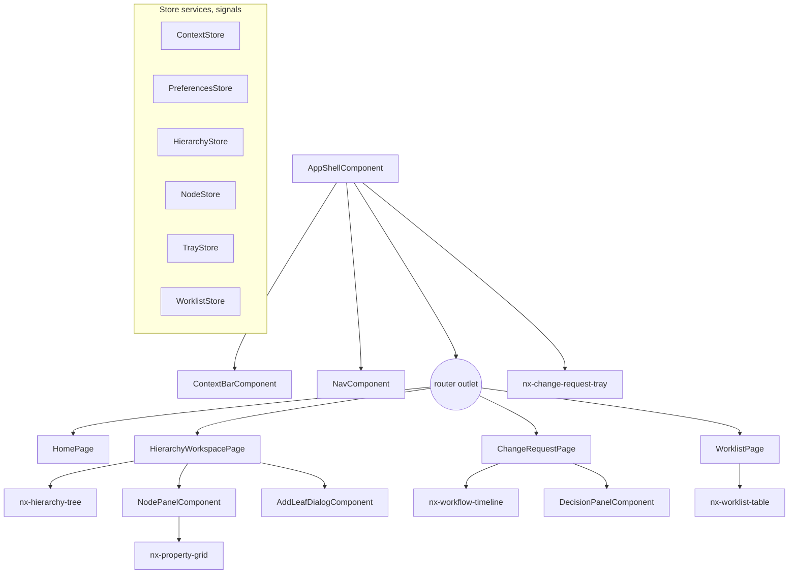

# Phase 3 — Steward UI: low-level design

- **Status:** Approved 2026-11-11 (consistency fixes CR-nn applied the same day, see `../CONSISTENCY_REVIEW.md`)
- **Migration rule (CR-07):** where this design says "edit Vn", that is allowed only while no shared environment exists (CLAUDE.md rule 6, OD-18). If one exists when this phase is built, the same change goes into a new V-numbered migration (`ALTER` / `CREATE OR REPLACE`). What counts as shared: OD-44.
- **Phase goal (BUILD_PROTOCOL §2):** the first slice is usable by a person.
- **Exit criteria:** tree browsing with paging, node panel, worklist, add-leaf form; UI tests pass; SLICE-01 acceptance
  criteria met on synthetic data.
- **Binding standard:** `docs/design/UI_STANDARD.md` (§14 below shows compliance screen by screen). Landing page:
  OD-27, prototype `prototypes/landing.html`. Reads with the Phase 1 and 2 LLDs (APIs), ADR-012, ADR-015, ADR-018, ADR-022.

---

## 1. Purpose and scope

**Goal.** A steward signs in, lands on Home, browses a large hierarchy, inspects a node's properties and where each value
comes from, drafts an add-leaf request with the required properties, submits it; an approver and a committer act from
their worklists; everyone can view any past date read-only.

| ID | Decision | Phase 3 delivers |
|---|---|---|
| HIE-12 | Parity | Virtualised lazy tree, paged siblings, in-tree search, property grid |
| GOV-13 | Parity (API in Phase 2) | Worklist screen with the nine views, counts, search, model filter |
| SLICE-01 | Spec (draft) | The journeys S1-R2 to S1-R7 on synthetic data (S1-R1 load and the golden criterion need Phase 4) |
| NEW-10 | New | Shell, Home (OD-27), change-request tray, request detail with workflow timeline, start-page preference |
| GOV-12 | Improve (Phase 2) | "Committed by policy" label with the policy and evaluation; shadow summary panel for policy roles |

**Pending decision, not built (§15):** the History tab (QRY-04), Ownership tab (Phase 6), move/insert/remove screens
and impact preview (HIE-02 UI beyond add-leaf; Phase 5), AI suggestion cards (Phase 7), notifications (GOV-08).

**Dependencies.** Phase 1 API (reads with provenance, change requests, entitlements), Phase 2 API (submit with model,
worklist, decisions, instance view). Design system details OD-02 to OD-04 are open: this design targets the Nexus token
layer and the Angular CDK, with one adapter per design-system component so the swap is local (§3.4).

## 2. Confidence and assumptions

**Confidence: Medium for structure and behaviour; Low for visual detail** until the design-system packages, tokens and
component catalogue arrive (OD-02 to OD-04).

| # | Assumption | Effect if wrong |
|---|---|---|
| C-1 | The design system supports an Angular major with standalone components and signals (UI_STANDARD §2 allows store services without signals otherwise) | Stores switch from `signal()` to `BehaviorSubject`; component APIs unchanged |
| C-2 | The design system has no tree with lazy loading and virtual scrolling (OD-04) | If it has one, `nx-hierarchy-tree` wraps it instead of `cdk-virtual-scroll-viewport` |
| C-3 | The design system has a table but not virtual scrolling (OD-04) | Worklist table uses CDK virtual scroll inside the design-system table styles |
| C-4 | Users have desktop screens ≥ 1280 px; tablet ≥ 768 px supported (UI_STANDARD §4) | — |
| C-5 | Performance budgets: `UI_INITIAL_JS_KB` 350 (compressed), `UI_ROUTE_JS_KB` 150 per lazy feature, `UI_TREE_EXPAND_MS` 100 after the response, `UI_INP_MS` 200 | Budgets enforced in `angular.json`; values to confirm (OD-10) |
| C-6 | Browser support: current Edge and Chrome (organisation standard unknown, UI_STANDARD §12 item 6) | Add Firefox/Safari to the E2E matrix |
| C-7 | Until OD-06, the UI runs only in `local` and `test` with the development identity (Phase 1 `LocalDevActor`): a dev-only user picker sends `X-Nexus-User` | Phase 9 replaces it with the organisation's Angular auth library |
| C-8 | UI strings in English only, externalised (UI_STANDARD §9) | Translations added later without template changes |

**Human decisions this phase waits on:** OD-02/03/04 (packages, tokens, components) before visual sign-off; OD-06 for any
shared environment; approval of the UI dependencies and the CI job in the Phase 3 plan (ADR-025).

## 3. Component design

Angular workspace in `ui/` (CLAUDE.md layout). Feature folders per UI_STANDARD §9.

```text
ui/
  src/app/
    core/        shell, context bar, auth (dev interceptor), error handling, i18n, preferences store
    shared/      design-system adapters (ds-*), formatting pipes, nx-* presentational components
    home/        Home (default start page)
    hierarchy/   workspace: tree, node panel, property grid, add-leaf form
    change-request/  tray, review and submit, request detail, workflow timeline
    worklist/    worklist screen
    api/         generated OpenAPI client (not hand-edited) + thin facades
  src/styles/tokens.css   Nexus tokens mapped to design-system tokens (one file, UI_STANDARD §3)
  .storybook/  stories for every custom component and state
  e2e/         Playwright journeys (ADR-025)
```



### 3.1 Core
| Class | Responsibility | Key API | Must not |
|---|---|---|---|
| `ContextStore` | Global context: version, as-of date, hierarchy (UI_STANDARD §4) | `version()`, `asOf()`, `isHistorical()` (computed: `asOf ≠ businessToday`), `setAsOf(d)` | Compute "today" from the browser zone: it uses `GET /me` → `businessToday` from the server (ADR-018) |
| `PreferencesStore` | Start page, last hierarchy, density | `startPage()`, `setStartPage(p)`, `rememberHierarchy(code)` (debounced PUT) | Store in browser storage (server-side, OD-27) |
| `startPageGuard` | On `/` redirect to the user's start page | `CanActivateFn` | Authorise (server does) |
| `apiErrorInterceptor` | Maps Problem Details to `UiError {title, detail, reason, fieldErrors}`; 401 → sign-in; 412 → "This was changed by someone else. Reload to see the latest version." | `HttpInterceptorFn` | Swallow errors |
| `correlationIdInterceptor` | Adds `X-Correlation-Id` per request; shows it in error states | — | — |
| `devIdentityInterceptor` | `local`/`test` builds only: adds `X-Nexus-User` from the dev user picker | — | Ship in production builds (file replacement in `angular.json`) |
| `LiveAnnouncer` use | Announces load completion, validation results, request status changes (UI_STANDARD §8) | — | — |

### 3.2 Features
| Feature | Container (fetches) | Presentational (inputs/outputs) | Store |
|---|---|---|---|
| Home | `HomePage` | `nx-search-box`, `nx-worklist-mini`, `nx-my-requests`, `nx-hierarchy-list`, `nx-policy-summary` | `HomeStore` (one `GET /home`) |
| Hierarchy workspace | `HierarchyWorkspacePage` | `nx-hierarchy-tree`, `NodePanelComponent`, `nx-property-grid`, `AddLeafDialogComponent` | `HierarchyStore` (tree nodes, pages, expanded set, selection), `NodeStore` (detail by node + asOf) |
| Change request | `ChangeRequestPage`, `ReviewSubmitPage` | `nx-change-request-tray`, `nx-item-list`, `nx-workflow-timeline`, `DecisionPanelComponent` | `TrayStore` (current draft request id, items, ETag), `RequestStore` |
| Worklist | `WorklistPage` | `nx-worklist-table`, `nx-view-chips` | `WorklistStore` (view, search, model, pages, counts) |

### 3.3 Custom components (UI_STANDARD §5 inventory only)
| Component | Inputs → outputs | Built on | Key behaviour |
|---|---|---|---|
| `nx-hierarchy-tree` | `rows: FlatTreeRow[]`, `selectedId`, `readOnly` → `expand(id)`, `select(id)`, `loadMore(parentId)`, `typeahead(text)` | `cdk-virtual-scroll-viewport` (fixed row height `--nx-density-row-height`), WAI-ARIA tree | Flattened visible rows; "Show next 200" row per partially loaded parent; shared-node indicator (icon + text "Shared"); type-ahead on visible rows; in-tree search reveals a match by loading its ancestor path |
| `nx-property-grid` | `properties: ResolvedProperty[]`, `editable` → `edit(code)` | design-system table + WAI-ARIA grid | Grouped by category; provenance marker per value (icon + text + `--nx-color-provenance-*`); "Inherited from <node>" link; required / read-only states |
| `nx-worklist-table` | `rows`, `loading`, `hasMore` → `open(id)`, `loadMore()` | design-system table + CDK virtual scroll (C-3) | Columns configurable; status = icon + text; overdue labelled; selection persists across pages |
| `nx-change-request-tray` | `count`, `items` → `review()` | design-system panel/drawer | Always visible in the shell when a draft exists; text "Nothing changes until governance approves." |
| `nx-workflow-timeline` | `stages`, `decisions`, `evaluations` | design-system list | Read-only; stage status icon + text; "Committed by policy <name>" with link to the evaluation; states announced |

Not built in Phase 3: diff/compare view (request detail shows a simple before → after list per item), ownership graph, evidence viewer.

### 3.4 Design-system adapters
`shared/ds/` holds thin wrappers (`ds-button`, `ds-input`, `ds-select`, `ds-dialog`, `ds-table`, `ds-tabs`, `ds-badge`,
`ds-date-input`, `ds-toast`, `ds-header`). Until OD-02 they render plain accessible HTML styled only with Nexus tokens and
neutral placeholder values (UI_STANDARD §1, ADR-012). When the packages arrive, each wrapper's template switches to the
design-system component; feature code does not change.

## 4. Data design

UI state is in memory (stores). Two backend additions:

```sql
-- new file V10__ui_support.sql
CREATE TABLE mdm.user_preference (
  user_id           uuid PRIMARY KEY REFERENCES mdm.app_user,
  start_page        text NOT NULL DEFAULT 'home' CHECK (start_page IN ('home','hierarchies','worklist')),
  last_hierarchy_id uuid REFERENCES mdm.hierarchy,
  density           text NOT NULL DEFAULT 'compact' CHECK (density IN ('compact','comfortable')),
  updated_at        timestamptz NOT NULL DEFAULT now()
);  -- not governed data; nexus_api INSERT/UPDATE; the API writes only the caller's own row

CREATE EXTENSION IF NOT EXISTS pg_trgm;   -- PostgreSQL contrib (OD-21: PostgreSQL search first); approve in the Phase 3 plan
CREATE INDEX node_attr_name_trgm ON mdm.node_attr USING gin (node_name gin_trgm_ops) WHERE upper_inf(recorded_period);
```
No bitemporal facts change. Volumes: one preference row per user.

## 5. Interface design

### 5.1 New endpoints (backend, Phase 3)
| Endpoint | Purpose | Auth | Response |
|---|---|---|---|
| `GET /me` (extended) | adds `businessToday`, `businessTimeZone`, `preferences`, `permissions` per readable hierarchy | actor | `{actor, businessToday, businessTimeZone, preferences, grants}` |
| `PUT /me/preferences` | start page, last hierarchy, density | actor (own row) | 200 |
| `GET /home` | bounded summary: worklist top 5 + counts per view; own requests (counts by status, latest 5); readable hierarchies (≤ 10: last used first, then by `sort_seq`) with open-request counts; shadow summary rows (only for `POLICY_ADMIN` or `POLICY_APPROVERS` members) | actor | one object; each list capped (no paging needed) |
| `GET /hierarchies/{code}/search?q&limit&asOf&recordedAsOf` | HIE-12 in-tree search by name or description (trigram) | READ | `{items: [{nodeId, name, path: [{nodeId, name}]}], nextCursor}`; `q` ≥ 2 characters; `limit` ≤ 50 |
| `GET /hierarchies/{code}/nodes/{id}/path?asOf&recordedAsOf` | Ancestor path to reveal a node in the tree | READ | `{path: [{nodeId, name}]}` (primary placement) |
| `GET /workflow/models/{code}/submit-form?hierarchy` | Properties the submit task lets the steward set, with required flags (GOV-03 infrastructure) | PROPOSE | `{properties: [{code, label, dataType, required, listValues?}]}` |
| `GET /change-requests/{id}` (extended) | adds `workflowInstanceId` (root instance) and `items[].before` (from `payload.expected`) for the request page | as Phase 1 | — |
| `POST /client-errors` | Client error reports (§11): `{status, type, correlationId, route}` only | actor; 20 per minute per user | 202 |

All other calls use the Phase 1 and 2 endpoints (no change). The client is generated from the OpenAPI document (ADR-025).

### 5.2 API calls per interaction
| Interaction | Calls | Notes |
|---|---|---|
| Sign in / open app | `GET /me` | Sets context `businessToday`, start page |
| Land on Home | `GET /home` | One call |
| Open hierarchy | `GET /hierarchies/{code}`; `GET …/children?parentId=top&limit=200`; `PUT /me/preferences` (debounced 2 s) | |
| Expand node | `GET …/children?parentId&limit=200` | Cached per (hierarchy, parent, asOf, recordedAsOf) for the session |
| Show next 200 | `GET …/children?…&cursor=` | |
| Select node | `GET /nodes/{id}?hierarchy&asOf` | |
| Search in tree | `GET …/search?q` (debounced 300 ms) → on choose: `GET …/path`, then children of each ancestor not yet loaded | |
| Change as-of date | Invalidates tree and node caches; reloads visible pages | |
| Add leaf | `GET /workflow/models/{code}/submit-form`; if no draft: `POST /change-requests`; `POST …/items` (add_node), `POST …/items` × n (set_property) | `If-Match` from `TrayStore`; `Idempotency-Key` per click |
| Review and submit | `POST …/validate`; `POST …/submit` | Findings shown per field and in a summary |
| Worklist | `GET /worklist?view&search&model&limit=50&cursor` | Counts from the same response |
| Open request | `GET /change-requests/{id}`, `…/items`, `GET /workflow/instances/{instanceId}` | |
| Decide | `POST /workflow/stages/{id}/decision` | Refusal reason shown inline |

## 6. Behaviour

### 6.1 Add a leaf (SLICE-01 S1-R4)
```mermaid
sequenceDiagram
  autonumber
  actor S as Steward
  participant UI as Angular UI
  participant API as mdm-api
  S->>UI: select limb node → "Add child"
  UI->>API: GET /workflow/models/ADD_LEAF/submit-form?hierarchy=…
  UI-->>S: form: name, description, kind, leaf (default yes), required properties
  S->>UI: fill, "Add to request"
  alt no draft request
    UI->>API: POST /change-requests {version, title (pre-filled "Add <name> under <parent>"), riskTier, effectiveFrom = businessToday, workflowModelCode}
  end
  UI->>API: POST /items add_node (If-Match)
  UI->>API: POST /items set_property × n (If-Match, chained ETags)
  UI-->>S: tray shows 1 + n items; toast "Added to your draft request"
  S->>UI: tray → "Review and submit"
  UI->>API: POST /validate
  UI-->>S: errors block submit (field + summary); warnings shown
  S->>UI: "Submit request"
  UI->>API: POST /submit (If-Match)
  UI-->>S: request page: status In review, timeline at Approve
```
Partial failure (an item call fails after the request exists): the tray shows what was added and the error for the rest;
the user retries the failed items (each call is idempotent by key).

### 6.2 UI states for every view (UI_STANDARD §6)
| View | Loading | Empty | Error | Read-only (historical) |
|---|---|---|---|---|
| Home | skeleton cards | "No requests need you" + quick actions | per card, with retry | banner; quick actions hidden |
| Tree | skeleton rows; per-parent spinner row | "This node has no children" | inline row "Couldn't load children. Retry" | edit actions hidden; banner |
| Node panel | skeleton grid | "No properties apply here" | panel message with correlation id | "Edit" hidden; values still show provenance |
| Add-leaf form | — | — | field errors + summary; server errors mapped to fields by `errors[].field` | not reachable |
| Worklist | skeleton rows | per view, e.g. "Nothing is overdue" | inline with retry | unaffected (worklist is current state) |
| Request page | skeleton | — | 404 "This request doesn't exist or you can't see it" | — |

### 6.3 Historical view
Setting "Viewing as of" to any date ≠ `businessToday` sets `isHistorical`; the shell shows the persistent banner; every
write control is removed from the DOM (not just disabled) and the tray is hidden. The URL carries `?asOf=` so a link opens the same view.

## 7. Algorithms

### 7.1 Flattened lazy tree
```text
state: nodes: Map<id, {id, name, parentId, depth, hasChildren, shared, active}>
       children: Map<parentId, {ids: id[], nextCursor: string|null, loading: boolean}>
       expanded: Set<id>
visibleRows() (computed signal):
   rows = []
   walk(id): rows.push(nodeRow(id)); if expanded.has(id):
               for c in children[id].ids: walk(c)
               if children[id].nextCursor: rows.push(loadMoreRow(id))
               if children[id].loading:    rows.push(loadingRow(id))
   walk(topId); return rows
```
Recomputed only when `nodes`, `children` or `expanded` change; O(visible rows). The virtual viewport renders only rows in
view, so 50 000 loaded siblings render ~40 DOM rows. Keyboard (WAI-ARIA tree): ↑/↓ move, → expand or first child, ←
collapse or parent, Home/End, Enter select, `*` expand siblings (loaded only), printable characters type-ahead over visible rows.

### 7.2 Reveal a search result
```text
path := GET …/path(node)
for each ancestor a in path (top → parent):
    expanded.add(a)
    if children[a] not loaded: load first page
    if node's next ancestor not in children[a].ids: load pages until found or nextCursor null
        (bounded by MAX_SIBLINGS / 200 requests; beyond 5 pages, insert the target as a pinned row "found by search" under a)
select(node); scroll into view; announce "Showing <name>"
```

### 7.3 ETag chaining in the tray
`TrayStore` keeps the latest `ETag`; each item call sends `If-Match` and stores the returned `ETag`. On 412 it reloads the
request and items, then asks the user to repeat the last action ("This request changed in another window.").

## 8. Patterns applied
| Pattern | Why |
|---|---|
| P-11 Keyset paging and lazy tree loading | Tree and worklist |
| P-18 Provenance | Property grid markers |
| P-21 Caching immutable slices | Children pages cached per session; for a pinned `recordedAsOf` they never go stale |
| P-26 Feature store with signals (new) | One store per feature; containers read signals; presentational components stay pure |
| P-27 Generated API client (new) | No hand-written DTOs; contract drift fails the build |

## 9. Security and controls
- No business rules in the UI: availability of actions comes from the server (`permissions` in `GET /me`, decision refusals); the UI explains, never decides (UI_STANDARD §6, §9).
- Edits only through the change-request tray; no control writes live data (UI_STANDARD §6).
- No `innerHTML` with dynamic content; Angular sanitisation not bypassed; no tokens in browser storage; preferences server-side.
- Dev identity only in `local`/`test` builds (C-7); production build fails if `devIdentityInterceptor` is present (build check).
- CLAUDE.md controls are server-side; the UI shows them: maker-checker and SoD refusals as text reasons; "Committed by policy" labels; historical views read-only.
- Data classification: property values of `is_pii` properties are not written to the browser console or error reports.

## 10. Performance and scale
| Target | Value | Design | Proof |
|---|---|---|---|
| Initial JS | `UI_INITIAL_JS_KB` 350 compressed | lazy routes per feature; design-system modules imported per component | Angular budgets fail the build |
| Tree expand (after response) | `UI_TREE_EXPAND_MS` 100 at 50 000 loaded siblings | flattened computed rows + virtual scroll | Playwright trace on a synthetic 50 000-child parent |
| Interaction | `UI_INP_MS` 200 | `OnPush` everywhere, `@for` with `track` | Playwright performance test |
| Children page round trip | `P95_CHILDREN_PAGE_MS` 300 (server, Phase 1) | — | Phase 1 perf test |

## 11. Observability
Client errors (status, `type`, correlation id, route; never values) sent to `POST /client-errors` (bounded, rate-limited,
logged server-side); page-load and interaction timings sampled at `UI_TELEMETRY_SAMPLE` (10 %). No third-party analytics.

## 12. UI design

### 12.1 Routes
| Route | Screen | Default for |
|---|---|---|
| `/` | redirect to start page (`startPageGuard`) | — |
| `/home` | Home | start page `home` (default) |
| `/hierarchies/:code?node=&asOf=` | Workspace | start page `hierarchies` (opens `last_hierarchy_id`) |
| `/worklist?view=&search=&model=` | Worklist | start page `worklist` |
| `/requests/:id` | Request detail, timeline, decision panel | — |
| `/requests/:id/review` | Review and submit | — |
| `/settings` | Preferences | — |

### 12.2 Screens (layouts follow the approved prototype, OD-27)
- **Shell:** design-system header (brand slot, app name "Nexus", environment badge, user menu); left nav: Home,
  Hierarchies, Worklist (count badge), Search, Ownership, Audit, Administration (items for later phases are shown only when the user has a permission for them); context bar; tray.
- **Home:** search box (nodes by name in the last hierarchy, request ids); next 5 worklist items with "All n"; your requests
  with status pills and "Committed by policy" labels; your hierarchies; governance panel for policy roles.
- **Workspace:** master-detail; tree (resizable, min 240 px) | node panel with tabs Properties and Relationships (History
  and Ownership tabs hidden until their phases); actions "Add child" (limbs only; leaves show the reason "Leaf nodes can't have children").
- **Add-leaf dialog:** name (required, unique message from server conflict), description, kind, "This is a leaf" (default on),
  required and optional properties from the submit form, effective date (default business today); buttons "Add to request", "Cancel".
- **Review and submit:** items list (before → after), validation findings with links to fields, "Submit request".
- **Worklist:** view chips with counts, search, model filter, table (request, title, stage, status, due, hierarchy, requester).
- **Request detail:** header (id with copy action, status, requester, effective date), items, `nx-workflow-timeline`,
  decision panel: "Approve", "Reject" (comment required) or the reason actions are unavailable (e.g. "You submitted this request").

### 12.3 Accessibility
WCAG 2.1 AA; WAI-ARIA tree and grid patterns; focus moved to the page heading on route change and back to the trigger on
dialog close; live region for loads, validation and status; reduced motion respected; status and provenance never by colour
alone; every flow keyboard-only in E2E tests; manual screen-reader check for each custom component before release.

## 13. Test design

Synthetic data: the Phase 2 fixtures plus a generated hierarchy `T_BIG` (one parent with 50 000 children, depth 12, 100 000 nodes).

| Capability | Criterion | Cases | Type |
|---|---|---|---|
| HIE-12 | Largest hierarchy loads and expands within targets | P: expand `T_BIG` parent, scroll to the end with "Show next" (all pages); B: page boundary row; P: in-tree search reveals a node 8 levels down; P: type-ahead; N: search `q` of 1 character refused with a message | Playwright + perf trace |
| HIE-12 | Property grid | P: provenance markers for stored / inherited (with source link) / derived / default; P: as-of change shows earlier values; A11y: grid keyboard | Component + Storybook + axe |
| GOV-13 | Views and counts | P: each chip shows the API count and rows; P: search and model filter; B: paging with equal due dates | Component + Playwright |
| SLICE-01 S1-R2 | Lazy paging, largest sibling set | as HIE-12 | Playwright |
| SLICE-01 S1-R3 | Node panel as of a chosen date | P: date before the leaf exists shows parent without it | Playwright |
| SLICE-01 S1-R4 | Add leaf with required properties; validations on submit | P: happy path; N: missing required property blocks submit with field message; N: duplicate name → conflict shown at the name field | Playwright |
| SLICE-01 S1-R5 | Right worklists; committed by an authorised human | P: approver sees it in Assigned; P: committer commits; N: steward without commit rights sees "You submitted this request" instead of Commit | Playwright (three users via the dev user picker) |
| SLICE-01 S1-R6 | Shadow evaluation recorded | P: timeline shows the policy evaluation "would commit" / "would route" | Playwright |
| SLICE-01 S1-R7 | Hierarchy, history, audit reflect the change; no self-approval | P: leaf visible today, absent as of the day before (acceptance criterion 3); P: audit rows exist (API check in the E2E test); "history" via as-of views only until QRY-04 | Playwright + API assertion |
| NEW-10 | Shell, Home, start page | P: start page preference respected after reload; P: historical banner + no write controls; A11y on every page | Playwright + axe |
| All custom components | Every state in Storybook (default, hover, focus, selected, disabled, loading, empty, error, read-only) | Story per state; axe on each story | Storybook test runner |
| Standards | Tokens only | Style lint fails on colour literals, px font sizes, font-family outside `tokens.css` | Lint in CI |

SLICE-01 acceptance criterion 1 (golden inherited and derived values) needs the masked extract and the Phase 4 golden
framework: listed as an explicit gap at the Phase 3 gate.

## 14. Compliance with UI_STANDARD
| Standard § | How Phase 3 complies |
|---|---|
| §1 Authority | Visual values only from tokens; design-system adapters (§3.4); no brand assets in the repo; placeholders until OD-02/03 |
| §2 Baseline | Angular at the design system's major (C-1), strict TypeScript, standalone + `OnPush`, signals + store services, typed reactive forms (add-leaf), lazy routes, guards for navigation only, `HttpClient` interceptors, generated client, CDK where needed |
| §3 Tokens | `ui/src/styles/tokens.css` with the `--nx-*` names from the standard; mapping column filled when OD-03 arrives; lint enforcement |
| §4 Layout | Shell, context bar with as-of banner and read-only mode, master-detail workspace, desktop-first with tablet collapse, compact density default + preference |
| §5 Components | Only inventory components built (tree, grid, worklist table, tray, timeline); each with Storybook states |
| §6 Interaction | Edits via tray; validation errors block, warnings don't; reasons for unavailable actions; "Committed by policy" label; global as-of; designed loading/empty/error states; toasts only for confirmations |
| §7 Content | `dd MMM yyyy` pipe; 24-hour times with zone; identifiers in the identifier style with copy action; verbs on buttons ("Add to request", "Submit request") |
| §8 Accessibility | §12.3 |
| §9 Code | Feature folders; container/presentational split; no business rules; `@for` with `track`; virtual scroll > 100 rows; budgets; no `innerHTML`; strings externalised |
| §10 Testing | Component tests for each custom component incl. keyboard; axe in CI; Playwright SLICE-01 journeys; Storybook as visual reference |
| §11 DoD | Checked at the Phase 3 gate, item by item, in the test report |
| §12 Obtain from UX | OD-02 to OD-06 remain open; listed in `OPEN_DECISIONS.md` |

## 15. Risks, open questions and alternatives
| # | Item | Handling |
|---|---|---|
| R-1 | Design-system packages may not be available to the build in time (OD-02) | Adapters render accessible placeholders; swap is per adapter |
| R-2 | The design system's supported Angular version may lack signals (C-1) | Store services keep the same public API |
| R-3 | Revealing a deep search result under a huge sibling set may need many pages | Bounded to 5 pages, then a pinned "found by search" row (§7.2) |
| R-4 | UI cannot be shown in a shared environment before OD-06 | Demonstrations run locally with synthetic data |
| Alt-1 | Load whole sub-trees into the client | Rejected: size at `MAX_NODES_PER_HIERARCHY` |
| Alt-2 | NgRx store | Rejected for now (UI_STANDARD §2: only with an ADR); signal stores suffice for these features |
| Alt-3 | Cypress for E2E | ADR-025 compares; Playwright recommended |

**Not built, pending decision:** History tab (QRY-04 / AUD-01), Ownership tab (NEW-02, Phase 6), move/insert/remove UI with
impact preview (HIE-02 UI; Phase 5 with the impact endpoint), AI suggestion cards (Phase 7), notifications inbox (GOV-08/16).

## 16. Work breakdown
| # | Increment | Size | Capabilities | Tests |
|---|---|---|---|---|
| 3-1 | Backend: `GET /me` extension, preferences, `/home`, search + path (pg_trgm), submit-form, client-errors | M | NEW-10, HIE-12 | JUnit |
| 3-2 | OpenAPI generation in the API build; generated client in `ui/api` (ADR-025) | S | PROG | build check |
| 3-3 | Workspace scaffold, tokens file, style lint, adapters, Storybook, axe, Playwright, CI job (approval needed) | M | PROG | CI |
| 3-4 | Shell, context bar, as-of banner and read-only mode, start-page guard, dev user picker | M | NEW-10 | Playwright, axe |
| 3-5 | `nx-hierarchy-tree` + `HierarchyStore` (lazy, paged, keyboard, search reveal) | L | HIE-12 | component, Storybook, perf |
| 3-6 | Node panel + `nx-property-grid` (provenance, as-of) | M | HIE-12 | component, Playwright S1-R3 |
| 3-7 | Add-leaf dialog, tray, review and submit | M | SLICE-01 | Playwright S1-R4 |
| 3-8 | Worklist screen + `nx-worklist-table` | M | GOV-13 | Playwright |
| 3-9 | Request detail, `nx-workflow-timeline`, decision panel | M | SLICE-01, GOV-12 | Playwright S1-R5, S1-R6 |
| 3-10 | Home (OD-27) | S | NEW-10 | Playwright |
| 3-11 | SLICE-01 end-to-end suite (S1-R2 … S1-R7), accessibility and performance runs | M | SLICE-01 | Playwright, axe, perf |
| 3-12 | Records: UI_STANDARD token mapping status, DEVELOPER_SETUP (Node.js), changelog, test report, summary | S | PROG | review |

Dependencies to approve in the Phase 3 plan (ADR-025): Node.js LTS and npm; Angular CLI and framework at the design
system's major; Angular CDK; Storybook; Playwright; axe-core; Stylelint; an OpenAPI generator for TypeScript and
`springdoc-openapi` for the API; `pg_trgm` extension.
