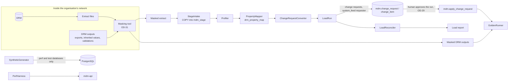

# Phase 4 — Data loading and parity harness: low-level design

- **Status:** Draft, awaiting review (2026-11-11)
- **Phase goal (BUILD_PROTOCOL §2):** realistic volumes and objective parity checks.
- **Exit criteria:** staging loader; synthetic data generator at production-like scale; golden-test framework; performance baseline recorded.
- **Reads with:** ADR-002, ADR-009, ADR-019, ADR-021, ADR-022, P-20, P-22, P-23; `tests/golden/README.md`;
  `tools/drm-analysis/README.md`; V3 staging tables; Phase 1 LLD (apply), Phase 2 LLD (workflow). DDL below is a proposal.

---

## 1. Purpose and scope

**Goal.** Load a (masked) DRM extract into Nexus through the same governed path as every other change; generate synthetic
data at production scale; compare Nexus outputs with captured DRM outputs automatically; measure performance at scale and record a baseline.

| Item | Decision | Phase 4 delivers |
|---|---|---|
| PROG — migration loader | — | Staging intake (COPY), profiling, property mapping, conversion of staged versions into governed change requests, load-run approval and reconciliation report |
| PROG — synthetic generator | — | Deterministic, seeded generator at `PERF_SCALE_FACTOR` × the assumed volumes |
| PROG — golden framework | — | Case format, comparators (byte, row, tree, value), runner, capability tagging, report |
| PROG — performance baseline | — | Load-test harness without new dependencies; baseline report |
| NEW-09 | New (primary Phase 8) | The comparison engine that Phase 8's daily reconciliation reuses |
| PROG — Phase 1 amendment | — | `add_hierarchy` change action (§4.1), found missing while designing the loader |

**Outline only, pending decision (§15):** IMP-01 (flat-file imports for users), IMP-02 (action scripts), GOV-10 (bulk requests
from file), ADM-04 (downstream integrations inventory and cutover). The loader's converter is the shared core they would use.

**Dependencies.** Phase 1 (change requests, apply, roles), Phase 2 (workflow, for loads that must be governed by a model),
Phase 3 (not required). Masked extracts and DRM outputs captured inside the organisation's network (OD-31, OD-32).

## 2. Confidence and assumptions

**Confidence: Medium** for the loader and harness design; **Low** for anything that depends on the actual DRM extract
format, which nobody in this repository has seen (`tools/drm-analysis` produces counts only).

| # | Assumption | Effect if wrong |
|---|---|---|
| E-1 | Extracts can mark each property value as **defined at the node** vs inherited or derived | If only resolved values are available, every value would load as stored and inheritance parity would be lost; the loader would then compare resolved values with Nexus's inherited result and store only the differences (§7.3 option b) |
| E-2 | Each DRM node has a stable internal id in the extract (`raw` JSON), so renames across versions are detected | Without it, renames look like delete + add; history continuity is lost for renamed nodes |
| E-3 | DRM versions are period snapshots; loading them oldest first and diffing gives valid-time history | — |
| E-4 | Number of historical versions to migrate: decided by OD-30 (recommendation: current + the versions needed for the parallel run and golden comparisons) | Load time and storage scale linearly |
| E-5 | Volumes: `MAX_NODES_PER_HIERARCHY` 500 000; ~100 hierarchies; ~300 properties; ~10⁸ property values over history | Benchmarks re-run with confirmed NFRs (OD-10) |
| E-6 | Masking is deterministic and rank-preserving for names and codes (OD-31) | Export row order could differ between masked DRM output and Nexus output |

**Human decisions this phase waits on:** OD-29 (how load runs are approved), OD-30 (versions to migrate), OD-31 (masking
approach), OD-32 (where masked golden datasets are stored), OD-09 for IMP/GOV-10/ADM-04; ADR-009 is still Proposed and needs acceptance.

## 3. Component design

New Maven module code stays inside `services/mdm-api` (ADR-013) under `com.mdm.api.load`, `com.mdm.api.generator`,
`com.mdm.api.golden`, `com.mdm.api.perf`, each runnable as a Spring Boot command with its own profile.



### 3.1 `load`
| Type | Responsibility | Key signatures | Must not |
|---|---|---|---|
| `StageIntake` | Load extract files into `mdm_stage.*` with `CopyManager` (PostgreSQL JDBC, no new dependency) in chunks of `STAGE_CHUNK_SIZE`; one `mdm_stage.intake_batch` row per file with SHA-256 | `IntakeResult load(Path file, StageTable table, String versionName)` | Touch `mdm` |
| `Profiler` | Counts, null rates, duplicate names per version, orphan relationships, unknown properties; writes `mdm_stage.profile_finding` | `Profile profile(String versionName)` | Change staged data |
| `PropertyMapper` | Maintains `mdm.drm_property_map` (exists): proposes rows (rules: same name → same code; DRM type → `property_data_type`), a human confirms (`status = 'confirmed'`); value transforms from a fixed library | `List<MapProposal> propose()`; `void confirm(String drmName, Actor a)` | Use an AI model (Phase 7 may *propose* rows; transforms stay code, CLAUDE.md rule 4) |
| `ValueTransforms` | Deterministic conversions named in `value_transform`: `text`, `Y/N->boolean`, `True/False->boolean`, `date:<pattern>`, `decimal:<locale>`, `list`, `node_ref:by_name` | `JsonNode apply(String transform, String raw)` | Guess formats |
| `DefinitionLoader` | Creates categories, property definitions and list values from confirmed mappings (configuration, not facts) under a load run | `void load(LoadRun run)` | Run without an approved load run |
| `ChangeRequestConverter` | Turns a staged version (or the diff between two staged versions) into change requests of ≤ `MAX_ITEMS_PER_CHANGE_REQUEST` items, ordered so parents precede children | `List<UUID> convert(LoadRun run, String versionName, String previousVersionName)` | Bypass change requests |
| `LoadRun` (entity) + `LoadRunService` | Lifecycle: prepared → reviewed → approved → applying → applied \| failed; manifest of request ids and item hashes; approval by a human ≠ preparer (OD-29) | `LoadRun prepare(...)`; `void approve(UUID runId, Actor a)`; `void applyAll(UUID runId)` | Apply anything before approval |
| `LoadReconciler` | After apply: counts per version and hierarchy (nodes, relationships, stored values) vs staging; tree equality per hierarchy; report | `ReconciliationReport reconcile(UUID runId)` | — |

### 3.2 `generator`
| Type | Responsibility |
|---|---|
| `SyntheticGenerator` | From a `GeneratorSpec` and a seed, writes hierarchies, nodes, relationships, properties, history, change requests and workflow instances. Writes with `COPY` as the owner role for speed (test data only); refuses to run unless `mdm.system_setting('environment_kind')` ∈ {`local`, `test`, `perf`} |
| `GeneratorSpec` (record) | `hierarchies`, `nodesPerHierarchy` (distribution), `maxDepth`, `fanOut` (Zipf exponent), `sharedPct`, `propertiesPerNode`, `localPct`, `inheritedPct`, `historyCorrectionsPerFact`, `openRequests`, `seed` |
| `NameFactory` | Synthetic names from fixed syllable lists and counters (e.g. "Varnel 0412 Holdings"), checked against a deny-list of real company suffix patterns combined with real-looking words; never real names (CLAUDE.md rule 5) |

### 3.3 `golden`
| Type | Responsibility |
|---|---|
| `GoldenCase` | One case: `tests/golden/cases/<id>/case.yaml` (capability IDs, input reference, comparator, expected reference) |
| `Comparator` (interface) | `ComparisonResult compare(Expected e, Actual a)`; implementations `ByteComparator` (exports, with SHA-256 and first differing line), `RowComparator` (keyed rows, per-column differences, tolerance none), `TreeComparator` (parent-child sets, sort order), `ValueComparator` (node × property resolved values) |
| `GoldenRunner` | Runs cases, writes `target/golden/report.json` and a Markdown summary per capability (pass rate rolls up to the tracker) |
| `NexusOutputs` | Produces the actual side: `mdm.export_drm` lines, `node_properties_resolved` for all nodes, validation results |

### 3.4 `perf`
`PerfHarness` drives the API with the JDK `HttpClient` on virtual threads (no new dependency): scenarios (browse, node
detail, worklist, submit, decide+apply) with a target rate, records latency histograms (HdrHistogram-style buckets in
code), writes `docs/phases/phase-4/PERF_BASELINE.md` data. SQL-level timings via `EXPLAIN (ANALYZE, BUFFERS)` for the
heaviest queries.

## 4. Data design

### 4.1 Phase 1 amendment: `add_hierarchy` (edit V1; amends the approved Phase 1 LLD)
Phase 1 has no way to create a hierarchy and its top node through a change request (found here; ADR-026).
- `mdm.change_action` gains `'add_hierarchy'`; payload `{code, name, purpose, group, allowSharedNodes, sortSeq, topNode: {nodeKind, name, description}}`; the top node identity is allocated at draft (A-5 of Phase 1).
- Apply handler: insert `mdm.hierarchy` (the row's creation is audited; `hierarchy` stays non-bitemporal, D-08) and the top node's `node_attr` [D, ∞).
- Entitlement: PROPOSE with a grant on all hierarchies (`hierarchy_id` NULL).
- `wf.commit_policy` hard limits gain `'add_hierarchy'` (structural; always human).

### 4.2 Staging additions — edit V3 (`mdm_stage`)
```sql
CREATE TABLE mdm_stage.intake_batch (
  batch_id uuid PRIMARY KEY DEFAULT gen_random_uuid(), file_name text NOT NULL, file_sha256 char(64) NOT NULL,
  stage_table text NOT NULL, version_name text, row_count bigint NOT NULL, loaded_at timestamptz NOT NULL DEFAULT now(),
  loaded_by uuid NOT NULL REFERENCES mdm.app_user, UNIQUE (file_sha256, stage_table));
ALTER TABLE mdm_stage.drm_node             ADD batch_id uuid, ADD drm_internal_id text;   -- E-2
ALTER TABLE mdm_stage.drm_relationship     ADD batch_id uuid;
ALTER TABLE mdm_stage.drm_property_value   ADD batch_id uuid, ADD is_defined_here boolean;  -- E-1
CREATE TABLE mdm_stage.node_identity_map (                -- stable identity across versions
  drm_key text PRIMARY KEY,                                -- drm_internal_id, else 'name:' || node_name
  node_id uuid NOT NULL UNIQUE REFERENCES mdm.node);
CREATE TABLE mdm_stage.profile_finding (batch_id uuid, version_name text, kind text, detail jsonb, count bigint);
```
Staging is not governed data; it may be truncated after a successful reconciliation (`STAGE_RETENTION_DAYS` 30).
`mdm_stage` is written only by role `nexus_loader` (new, ADR-026); it reads `mdm` for identity lookups.

### 4.3 Load runs — new file `V11__load_runs.sql` (in `mdm`, because it governs `mdm` changes)
```sql
CREATE TABLE mdm.load_run (
  load_run_id   uuid PRIMARY KEY DEFAULT gen_random_uuid(),
  kind          text NOT NULL CHECK (kind IN ('definitions','baseline_version','version_delta')),
  version_name  text, previous_version_name text,
  status        text NOT NULL DEFAULT 'prepared' CHECK (status IN ('prepared','approved','applying','applied','failed','cancelled')),
  prepared_by   uuid NOT NULL REFERENCES mdm.app_user,       -- a human operator; requests use the system actor as requester
  approved_by   uuid REFERENCES mdm.app_user,
  approved_at   timestamptz,
  manifest_sha256 char(64),                                  -- hash over (request id, item count, items hash) in order
  report        jsonb,
  CHECK (approved_by IS NULL OR approved_by <> prepared_by)
);
CREATE TABLE mdm.load_run_request (load_run_id uuid REFERENCES mdm.load_run, change_request_id uuid UNIQUE REFERENCES mdm.change_request, seq int, items_sha256 char(64), PRIMARY KEY (load_run_id, seq));
-- guard: approved_by must be a human; status transitions as listed; manifest frozen after 'approved'; audited
```
Load-run requests have `requester_kind = 'system_feed'`, `risk_tier` from OD-29, `effective_from` = the version's business date.

### 4.4 Bitemporal behaviour
- **Baseline version** (oldest loaded): every fact gets `valid_period [business_as_of, ∞)` and recorded time = load time.
- **Each later version**: the converter diffs staged version N−1 and N by stable identity and emits items effective at N's
  business date: `add_node`, `move_node`, `remove_node`/`delete_node`, `set_property`, `clear_property`, renames as an
  attribute change (a set-from-D on `node_attr`, handled by an `update_node` item: `change_action` value exists in V1; its
  handler is added here, payload `{name?, description?}`).
- Recorded time is always the load time: Nexus records honestly that it learned the past at migration (NEW-01 queries for
  times before the load return nothing). `mdm.version` rows for migrated DRM versions keep their names, business dates and,
  for finalized ones, `recorded_as_of` = the end of their load run.

### 4.5 Volumes and indexes
| Object | Volume | Strategy |
|---|---|---|
| Staged property values | ~10⁷ per version | `COPY`; index `(version_name, node_name)` created after load |
| Change items per baseline | ~500 000 nodes + ~3 × 10⁶ values → ~700 requests of 5 000 items | Converter streams (P-20); apply runs requests sequentially per hierarchy, hierarchies in parallel (`LOAD_PARALLELISM` 4) |
| Guards during load | `trg_hierarchy_integrity` ancestor walk per relationship insert | Parents first (top-down order) keeps each walk short; measured in the baseline |

## 5. Interface design

Operators use commands (Spring Boot runner, profile `load`), and approvers use the API.

| Command / endpoint | Purpose | Auth |
|---|---|---|
| `load intake --table drm_node --file … --version FY26_Oct` | Stage a file | Operator login with `nexus_loader` |
| `load profile --version …` | Profile | Operator |
| `load map propose` / `POST /admin/load/property-map/{drmName}/confirm` | Property mapping | Operator / `SYSTEM_ADMIN` (confirm) |
| `load prepare --kind baseline_version --version …` | Create a load run and its change requests (status draft→submitted) | Operator (prepared_by) |
| `GET /admin/load-runs/{id}` | Manifest, counts, profile findings, dry-run reconciliation | `SYSTEM_ADMIN`, approvers |
| `POST /admin/load-runs/{id}/approve` `{manifestSha256}` | The human approves the run; the API decides every request in the manifest as that human (OD-29 option A) | Human with `APPROVER` on all affected hierarchies, ≠ preparer |
| `load apply --run …` | Apply all decided requests; resumable | Operator |
| `GET /admin/load-runs/{id}/reconciliation` | Post-apply report | as above |
| `golden run [--capability HIE-02]` | Run golden cases | CI / developer |
| `generate --spec perf-large.yaml --seed 42` | Synthetic data | Developer (refuses outside local/test/perf) |
| `perf run --scenario all --rate …` | Baseline | Developer |

Golden case file:
```yaml
id: HIE-01-hierarchy-list-LE
capabilities: [HIE-01]
input: { dataset: masked-2027-01, version: FY26_Oct }
actual: { kind: hierarchy_list }
expected: { file: expected/hierarchy_list.csv }
comparator: { kind: row, key: [hierarchy_code], columns: [top_node_name, hierarchy_group, node_count] }
```

## 6. Behaviour

### 6.1 Load-run lifecycle
```mermaid
stateDiagram-v2
  [*] --> prepared: load prepare (requests created and submitted; dry-run reconciliation)
  prepared --> approved: human ≠ preparer approves manifest hash
  prepared --> cancelled
  approved --> applying: load apply
  applying --> applied: all requests applied + reconciliation clean
  applying --> failed: a request apply_failed or reconciliation mismatch
  failed --> [*]
  applied --> [*]
```

### 6.2 Baseline load
```mermaid
sequenceDiagram
  autonumber
  actor O as Operator
  actor A as Approver
  participant L as load commands
  participant DB as PostgreSQL
  participant API as mdm-api
  O->>L: intake (files) → mdm_stage, batch hashes
  O->>L: profile → findings
  O->>L: map propose; A confirms mappings in the API
  O->>L: prepare definitions run → A approves → DefinitionLoader
  O->>L: prepare baseline_version run
  L->>DB: converter streams staged rows → change requests (system actor requester) → submitted
  L->>DB: dry-run: validate each request (trial apply), aggregate findings
  A->>API: GET run (manifest, counts, findings) → POST approve {manifestSha256}
  API->>DB: decide every request in the manifest as A (human_review), one transaction per request
  O->>L: apply → mdm.apply_change_request per request (ordered, resumable)
  L->>DB: reconcile → report
```

### 6.3 Failure and recovery
| Failure | Recovery |
|---|---|
| Intake: same file twice | Refused by `UNIQUE (file_sha256, stage_table)` |
| Profile finding (duplicate names, orphans) | Run cannot be prepared until findings are fixed at source or explicitly accepted by the approver (recorded in the run) |
| A request fails to apply | Run → `failed`; applied requests stay (each is atomic); operator fixes the cause, prepares a delta run for the remainder |
| Reconciliation mismatch | Run → `failed` with the report; no automatic correction |
| Golden mismatch | Test fails with the first differences; never auto-accepted |

## 7. Algorithms

### 7.1 Converter ordering
```text
for each hierarchy h in the staged version:
   emit add_hierarchy (baseline only)
   BFS from the top node over staged relationships (primary first, then shared)
   emit add_node / insert_node per edge in BFS order, sort_order from staging
   emit set_property per (node, property) where is_defined_here (E-1), value = transform(raw)
   flush a change request every MAX_ITEMS_PER_CHANGE_REQUEST items, never splitting a node's add from its properties
global properties are emitted once per node, in the first hierarchy that contains it
```
O(nodes + edges + values) time; memory O(BFS frontier) with streaming reads.

### 7.2 Version delta
```text
prev := identity-mapped facts of version N−1 ; next := of version N           (both from staging)
nodes:   in next not in prev → add_node (or insert_node if identity exists); in prev not in next → remove_node, or delete_node if gone from every hierarchy
edges:   primary parent changed → move_node; shared added/removed → insert_node / remove_node
attrs:   name/description/flags changed → update_node
values:  defined-here value added/changed → set_property; removed → clear_property
order:   adds (top-down), moves, attribute and value changes, removes (bottom-up), deletes
```
O(n log n) with sorted merges on the identity key.

### 7.3 Inherited values when E-1 fails (option b)
Load the top-down resolved values; for each node and inheritable property, store the value only if it differs from what
`node_properties_resolved` would return from its ancestors at that point in the load. Deterministic, O(nodes × properties).

### 7.4 Comparators
- **Byte:** compare SHA-256; on mismatch, stream both files and report the first 20 differing lines with line numbers.
- **Row:** sort both by key; merge; report missing, extra and per-column differences.
- **Tree:** compare sets of (parent key, child key, primary, sort order) per hierarchy.
- **Value:** for every (node key, property code, hierarchy), compare resolved JSON; numeric values compared as decimals (no tolerance).

## 8. Patterns applied
| Pattern | Why |
|---|---|
| P-09 Atomic apply | Migration uses the same change requests and apply function as users |
| P-20 Chunked streaming with backpressure | Intake, conversion and apply at 10⁷ rows |
| P-22 Golden-master testing | The framework itself |
| P-23 Strangler and parallel run | Staged versions → Nexus master per consumer later (Phase 8) |
| P-01 Bitemporal facts | History reconstructed from DRM snapshots with honest recorded time |
| P-03 Maker-checker | Load runs: preparer ≠ approver; mapping confirmations by a human |

## 9. Security and controls
| Control | Phase 4 enforcement | Test |
|---|---|---|
| Maker-checker | Load run approval by a human ≠ preparer; every request decided as that human (OD-29) | pgTAP: preparer cannot approve; JUnit: approval with a stale manifest hash refused |
| Bitemporal history | All facts through `apply_change_request` | Reconciliation + pgTAP: no fact row without `change_request_id` after a load |
| Human-only decisions | Requests decided by the human approver; system actor is only the requester | pgTAP |
| Commit-policy limits | Load requests never auto-commit (system-feed requests with structural actions are on the hard-limit list) | pgTAP |
| Deterministic calculations | Value transforms and the converter are code; no AI | Unit tests per transform |
| No real data | Repository holds only synthetic data and the masking *specification*; masked datasets stored per OD-32; generator refuses outside local/test/perf | Review; generator guard test |
| Layer separation | `nexus_loader` writes `mdm_stage` and calls `mdm` functions only | pgTAP SET ROLE |

## 10. Performance and scale (the baseline this phase records)
| Measure | Target or assumption | Method |
|---|---|---|
| Intake rate | ≥ 100 000 rows/s | `COPY` timing |
| Baseline load of one 500 000-node hierarchy | record (no target yet) | converter + apply wall time; per-request apply time |
| Children page, node detail, worklist, submit, apply | Phase 1–3 targets | `PerfHarness` at `CONCURRENT_STEWARDS` |
| Export of a 500 000-node hierarchy (`export_drm`) | record; decides whether Phase 8 needs a set-based rewrite | SQL timing |
| `items_in_scope`, `can_act` | record | SQL timing on generated workflow data |
Results in `docs/phases/phase-4/PERF_BASELINE.md` with hardware, data spec and seed.

## 11. Observability
Load runs log per request (id, items, duration, outcome); metrics `nexus.load.rows{stage}`, `nexus.load.apply.duration`,
`nexus.golden.cases{capability,result}`; a load run's report is stored in `mdm.load_run.report`.

## 12. UI design
Not applicable in Phase 4: load runs are approved through the API (`/admin/load-runs`); a UI screen can follow in Phase 5.

## 13. Test design
| Item | Criterion | Cases | Type |
|---|---|---|---|
| Loader | Same file → same structure; counts match | P: synthetic extract (generator output exported in DRM-like format) loads and reconciles exactly; N: duplicate file refused; N: orphan relationship reported; B: node with 50 000 children; P: version delta (rename, move, value change, removal) reproduces the second snapshot | JUnit (Testcontainers) |
| Loader | Inherited values preserved (E-1) | P: only defined-here values stored; resolved values equal the source's | JUnit |
| Load run | Maker-checker | N: preparer approves; N: approval with a changed manifest; P: approver ≠ preparer | pgTAP + JUnit |
| Transforms | Deterministic | P/N per transform, including locale decimals and invalid dates | Unit |
| Generator | Deterministic and safe | P: same seed → same hash of generated data; N: refuses in an environment marked `shared` | JUnit |
| Golden framework | Comparators find every difference | P/N for each comparator with synthetic expected files (self-tests committed in `tests/golden/self-test/`) | Unit |
| SLICE-01 AC 1 | Inherited and derived values match DRM | Golden cases on the masked dataset once available (OD-31, OD-32) | Golden |
| HIE-01, HIE-02, PRP-01, GOV-02, GOV-13 | "Same as DRM" criteria | Golden cases written against the masked dataset | Golden |
| Performance | Baseline recorded | `PerfHarness` runs; report present | Perf |

## 14. Rollout and compatibility
- Migration edits: V1 (`add_hierarchy`, `update_node` handler), V3 (staging), new V11 (load runs), role `nexus_loader` in V7. Allowed while no shared environment exists.
- Golden datasets are never in git unless OD-32 decides otherwise; CI fetches them from the agreed store, or skips those cases with an explicit "dataset unavailable" result (never a silent pass).
- Generator and perf profiles are excluded from the production artefact's default profile.

## 15. Risks, open questions and alternatives
| # | Item | Handling |
|---|---|---|
| R-1 | Extract format unknown (E-1, E-2) | `tools/drm-analysis/strip_structure` (planned) reveals the format without data; the converter's input adapters are the only part that changes |
| R-2 | Approving ~700 requests with one human action may not satisfy Audit (OD-29) | Options in ADR-026 |
| R-3 | Masked data in CI may still be sensitive (OD-32) | Default: not in git |
| R-4 | Per-row guards slow the baseline load | Measured; if needed, a governed bulk path is a separate ADR (guards stay on) |
| Alt-1 | Load facts directly with `COPY` into `mdm` | Rejected: bypasses change requests, audit and guards for the most important data set |
| Alt-2 | Use the DRM transaction log to rebuild history | Possible later for audit history; snapshots give valid-time history more simply |

**Outline only, pending decision:** IMP-01 (user imports reuse `StageIntake` + converter into a draft request), IMP-02
(DRM action-script parser → items), GOV-10 (file → items of a draft request under a model), ADM-04 (inventory of
downstream feeds from `mdm_stage.drm_export_definition.target_system`; cutover in Phase 8).

## 16. Work breakdown
| # | Increment | Size | Items | Tests |
|---|---|---|---|---|
| 4-1 | Phase 1 amendment: `add_hierarchy`, `update_node` handler (ADR-026) | S | PROG, HIE-01 | pgTAP + JUnit |
| 4-2 | Synthetic generator + `NameFactory` + environment guard | M | PROG | JUnit |
| 4-3 | Staging additions, `StageIntake`, `Profiler` | M | PROG | JUnit |
| 4-4 | `PropertyMapper`, `ValueTransforms`, `DefinitionLoader` | M | PROG | unit + JUnit |
| 4-5 | Load runs (V11), approval endpoint, guard | M | PROG | pgTAP + JUnit |
| 4-6 | `ChangeRequestConverter` baseline + apply orchestration + `LoadReconciler` | L | PROG | JUnit |
| 4-7 | Version delta converter | M | PROG | JUnit |
| 4-8 | Golden framework, comparators, self-tests, runner, report | M | PROG, NEW-09 | unit |
| 4-9 | `PerfHarness` + baseline run at `PERF_SCALE_FACTOR` | M | PROG | perf |
| 4-10 | Records: PERF_BASELINE, data model, changelog, test report, summary | S | PROG | review |

New dependencies: **none required** (PostgreSQL JDBC `CopyManager`, JDK `HttpClient`). Case files are YAML only if the plan
approves `jackson-dataformat-yaml` (version-managed by Spring Boot, not yet a project dependency); otherwise they are JSON.
