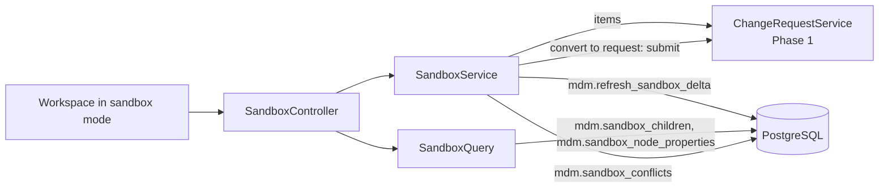
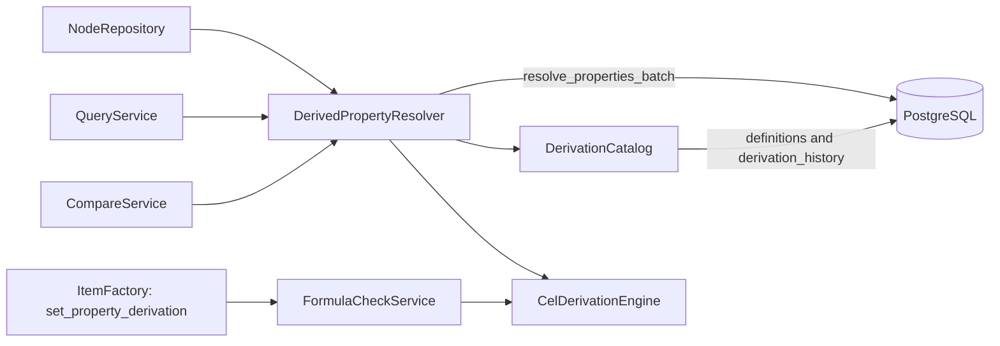

# Phase 5 — Remaining parity: low-level design

- **Status:** Approved 2026-11-11 (consistency fixes CR-nn applied the same day, see `../CONSISTENCY_REVIEW.md`).
  **§17 added and approved 2026-11-14** (repository owner): the detailed design for the capabilities ADR-038 decided. On the same day the
  repository owner moved Phase 5 ahead of Phase 4 (ADR-038 D3, amended); §17.1 records what that defers. Also on
  2026-11-14, the owner approved the Phase 5 plan and accepted ADR-039 (OD-47); §18 will design the rows ADR-039 puts in Phase 5.
- **Migration rule (CR-07):** where this design says "edit Vn", that is allowed only while no shared environment exists (CLAUDE.md rule 6, OD-18). If one exists when this phase is built, the same change goes into a new V-numbered migration (`ALTER` / `CREATE OR REPLACE`). What counts as shared: OD-44.
- **Phase goal (BUILD_PROTOCOL §2):** the rest of the in-scope legacy capabilities.
- **Exit criterion:** each capability with decision Parity or Improve has passing acceptance tests, or is listed as an explicit gap.
- **Reads with:** Phase 1–4 LLDs, patterns, ADR-006, ADR-019, ADR-022, ADR-026; `docs/capabilities.md`.

---

## 1. Purpose and scope

37 capabilities have Phase 5 as their primary phase (`TRACEABILITY.md`). On 2026-11-11 only one of them has a decision:

| Group | Capabilities | Decision | Treatment in this LLD |
|---|---|---|---|
| Designed in full | **NEW-08** sandboxes and scenarios | New | §3–§13 |
| Designed in full | **SEC-01, SEC-02 (full scope)**: governed role grants; DRM access-group mapping; sub-tree read filtering | Improve (primary Phase 1) | §3–§13 |
| Outline only (pending decision) | VER-01…07, HIE-03, 04, 05, 07, 08, 09, 10, 11, PRP-04…10, VAL-04, QRY-01…05, IMP-03, SEC-03, SEC-04, AUD-03, AUD-04, BLD-03, GOV-14, GOV-15 | `—` | §15.1, one block per capability |
| Pending, primary in earlier phases | HIE-06, PRP-02, PRP-03, VAL-01…03, AUD-01 (Phase 1); GOV-03…09, GOV-11, GOV-16, AUD-02 (Phase 2) | `—` | Outlined in those LLDs; built in Phase 5 if decided by then |

The exit criterion can be met today only for NEW-08 and SEC-01/02; every other row will be an **explicit gap** until OD-09
decisions arrive. This is stated plainly so the Phase 5 plan is not mistaken for full parity.

**Update 2026-11-14.** ADR-038 (accepted) decided PRP-06, QRY-01…05, IMP-03 and BLD-03. OD-45 (ADR-037) had already
decided the versions:
- VER-01 and VER-02 were built in Phase 3.
- VER-03 and VER-05 belong to Phase 8.
- VER-06 is retired.
- VER-04 stays in Phase 5.

§17 designs the Phase 5 ones in full. ADR-039 (accepted 2026-11-14, OD-47) decided every capability that still had no
decision, VER-07 included. §18 designs the rows it puts in Phase 5; their §15.1 outlines stand until §18 is approved.

**Dependencies.** Phases 1–3 (apply, roles, workflow, UI shell, versions). Phase 4 supplies the loader for access-group
mapping and the golden framework. Phase 5 is now built first, so the items that need Phase 4 wait for it (§17.1).

## 2. Confidence and assumptions

**Confidence:** Medium for NEW-08 and SEC; **Low** for every outline (scope, DRM behaviour and acceptance details unknown).

| # | Assumption | Effect if wrong |
|---|---|---|
| F-1 | A sandbox belongs to one owner; collaborators can view, not edit | Shared editing needs locking per item and a second owner column |
| F-2 | A sandbox may hold up to `SANDBOX_MAX_ITEMS` (20 000) items and is applied as one request | Larger restructures split into several requests and lose atomicity |
| F-3 | Sandbox overlay reads cover the tree and node detail; exports from a sandbox are out of scope | Phase 8 would need overlay-aware exports |
| F-4 | Role grants are changed only through change requests (maker-checker) from Phase 5; the Phase 1 SQL path for `SYSTEM_ADMIN` is removed | — |
| F-5 | DRM node access groups map to (role, hierarchy, top node) without loss; anything that does not map is reported, not approximated | Gaps listed for SEC-02 parity review |
| F-6 | Users outside a sub-tree scope see the scope's ancestors as a breadcrumb path only (names, no properties) | If DRM hides ancestors entirely, the path is replaced by "…" |

**Human decisions this phase waits on:** OD-09 (all outline rows), OD-12 (BLD-03), OD-30 and OD-31 for golden parity, and
the review of ADR-028 and ADR-029.

## 3. Component design (designed scope)

### 3.1 Sandboxes (NEW-08)

| Type | Responsibility | Key signatures | Must not |
|---|---|---|---|
| `SandboxController` | `/sandboxes` endpoints (§5) | — | — |
| `SandboxService` | Create, add/remove items (reuses Phase 1 item rules), refresh overlay, list conflicts, rebase, submit, discard | `SandboxView create(Actor, CreateSandbox)`; `ItemView addItem(Actor, UUID id, int ifMatch, ItemCommand)`; `List<Conflict> conflicts(UUID id)`; `SandboxView rebase(Actor, UUID id, int ifMatch)`; `ChangeRequestView submit(Actor, UUID id, int ifMatch)` | Write facts |
| `SandboxQuery` | Overlay reads with the Phase 1 paging envelope | `Page<ChildNode> children(UUID sandbox, UUID parent, Cursor, int)`; `NodeDetail node(UUID sandbox, UUID node)` | — |

### 3.2 Governed role grants and access mapping (SEC-01, SEC-02 full)
| Type | Responsibility | Must not |
|---|---|---|
| Change actions `grant_role`, `revoke_role` | Grants become change requests decided by a second `SYSTEM_ADMIN` (maker-checker); apply writes `mdm.user_role` bitemporally | Allow a user to grant themselves (CHECK exists) or decide their own grant (maker-checker exists) |
| `AccessGroupMapper` (load module) | Maps staged DRM access groups to proposed grants; a human confirms; output is a load run of `grant_role` items (ADR-026) | Approximate an unmappable rule |
| `EntitlementService` (extended) | Read filtering for sub-tree scopes: children and search results outside every readable scope are removed; node detail outside scope → 404; ancestors shown as a path only (F-6) | Leak property values outside scope |

## 4. Data design (designed scope)

```sql
-- edit V1
ALTER mdm.change_request ADD kind text NOT NULL DEFAULT 'request' CHECK (kind IN ('request','sandbox')),
                         ADD sandbox_base_recorded_at timestamptz,   -- recorded time the sandbox was based on (rebase moves it)
                         ADD sandbox_name text;
-- a sandbox is a change request of kind 'sandbox' kept in status 'draft'; submit turns kind into 'request' (one-way, guarded);
-- its origin (Phase 1 column) is 'sandbox' from creation, so apply allows up to SANDBOX_MAX_ITEMS after submit (CR-04)
-- mdm.change_action gains 'grant_role', 'revoke_role' (and both join the commit-policy hard-limit list)

-- new file V12__sandboxes.sql: derived overlay, rebuildable, not governed data
CREATE TABLE mdm.sandbox_delta_relationship (
  sandbox_id uuid NOT NULL REFERENCES mdm.change_request ON DELETE CASCADE,
  hierarchy_id uuid NOT NULL, parent_node_id uuid NOT NULL, child_node_id uuid NOT NULL,
  is_primary boolean NOT NULL, sort_order numeric NOT NULL,
  op char(1) NOT NULL CHECK (op IN ('+','-')),
  PRIMARY KEY (sandbox_id, hierarchy_id, parent_node_id, child_node_id, op));
CREATE TABLE mdm.sandbox_delta_node_attr (sandbox_id uuid, node_id uuid, node_name text, description text,
  is_active boolean, allows_children boolean, op char(1), PRIMARY KEY (sandbox_id, node_id, op));
CREATE TABLE mdm.sandbox_delta_value (sandbox_id uuid, node_id uuid, property_id uuid, hierarchy_key uuid,
  value jsonb, op char(1), PRIMARY KEY (sandbox_id, node_id, property_id, hierarchy_key, op));
CREATE INDEX ON mdm.sandbox_delta_relationship (sandbox_id, hierarchy_id, parent_node_id);
```
Bitemporal behaviour: none until submit; the sandbox only describes changes. On apply, the normal Phase 1 apply writes facts.
Volume: ≤ `SANDBOX_MAX_ITEMS` items and a delta of the same order per sandbox; `SANDBOX_MAX_ACTIVE_PER_USER` (5).

**Built in 5-1a** (refinements of the sketch above; no control changed):
- *Valid period in the delta.* Apply never edits a fact in place: it closes the current row and re-states the parts that
  stay true, so one item can close one row and insert two for the same key (a move). Each delta table therefore has
  `valid_period daterange NOT NULL`, and the period is part of its primary key. Reads at an as-of date use it.
- *Indexes.* The relationship primary key starts `(sandbox_id, hierarchy_id, parent_node_id, …)`, so it serves the
  overlay children page and replaces the separate parent index. A `(sandbox_id, hierarchy_id, child_node_id)` index
  serves node detail.
- *No foreign keys to facts* from the delta tables: rows for a hierarchy that only the sandbox's own `add_hierarchy`
  item creates exist only inside the rolled-back trial. All columns are `NOT NULL` except `description`;
  `hierarchy_key` is the zero uuid for a global value, as in `property_value`'s exclusion constraint.
- *Writers.* Only `nexus_apply` (owner of the trial apply) has `INSERT, DELETE` on the delta tables; every role reads them.
- *The kind guard* (`trg_cr_sandbox_kind`, `N2303`): origin `'sandbox'` is reachable only by creating a sandbox
  (insert with origin and kind both `'sandbox'` or neither; hint `sandbox.origin`); kind moves only `sandbox → request`
  (hint `sandbox.kind_one_way`) and only while the request is a draft; a request of kind `'sandbox'` can be only `draft`
  or `withdrawn` (hint `sandbox.not_draft`, which also covers submitting without the flip). `kind` has this guard of its
  own and is not on the frozen-content list; `sandbox_name` and `sandbox_base_recorded_at` are (`N2102` once submitted).
- *Item limit at insert.* `change_item_sandbox_limit` (statement level) raises `N2302` as soon as an origin-`'sandbox'`
  request would hold more than `sandbox_max_items` items, so a sandbox can never grow past what apply allows (CR-04).
- *Grants.* `nexus_api` inserts sandboxes and their items but cannot update `kind` or `sandbox_base_recorded_at`;
  submit (with the `N2301` conflicts check and the flip) and rebase are `SECURITY DEFINER` functions added in 5-1b/5-2.
  The settings `sandbox_max_active_per_user` and `sandbox_incremental_threshold` are added with their first use.

## 5. Interface design (designed scope)
| Endpoint | Purpose | Auth |
|---|---|---|
| `POST /sandboxes` `{name, versionName, hierarchyCode, effectiveFrom}` | Create (a `kind='sandbox'` draft) | PROPOSE |
| `GET /sandboxes?mine` / `GET /sandboxes/{id}` | List / detail with item count, conflict count | owner; viewers with READ (F-1) |
| `POST /sandboxes/{id}/items`, `DELETE …/items/{itemId}` | Same payloads as Phase 1 items | owner, `If-Match` |
| `GET /sandboxes/{id}/hierarchies/{code}/children?parentId&cursor&limit` | Overlay children | owner/viewer |
| `GET /sandboxes/{id}/nodes/{nodeId}` | Overlay node detail with provenance (`sandbox` marker on changed values) | owner/viewer |
| `GET /sandboxes/{id}/diff?cursor` | Items with before/after (from the delta) | owner/viewer |
| `GET /sandboxes/{id}/conflicts` | Items whose expected base no longer matches | owner |
| `POST /sandboxes/{id}/rebase` | Re-capture `expected` for non-conflicting items, move `sandbox_base_recorded_at` to now; conflicting items stay flagged | owner, `If-Match` |
| `POST /sandboxes/{id}/submit` `{workflowModelCode}` | Validate; refuse with conflicts; becomes a normal request | owner, `If-Match` |
| `POST /sandboxes/{id}/discard` | Withdraw | owner |
| `POST /change-requests` with `grant_role` / `revoke_role` items | Governed grants | `SYSTEM_ADMIN` (propose), another `SYSTEM_ADMIN` (decide) |

Errors as Phase 1; new codes `N2301` sandbox has conflicts, `N2302` too many items, `N2303` sandbox is not a draft.
All three are class `N2`, so the existing translator returns 422 with no Java change. Built in 5-1a: `N2302` is raised
when an item is added (not only at apply), and `N2303` carries the hints `sandbox.origin`, `sandbox.kind_one_way` and
`sandbox.not_draft` (§4).

## 6. Behaviour (designed scope)

### 6.1 Sandbox lifecycle

```mermaid
stateDiagram-v2
  [*] --> open: create
  open --> open: add/remove items → refresh delta
  open --> conflicted: another request changes a fact this sandbox touches
  conflicted --> open: rebase / remove conflicting items
  open --> submitted: submit (kind → request; Phase 1/2 flow)
  open --> discarded: discard (withdrawn)
  conflicted --> discarded
```

Conflict state is computed on read (`mdm.sandbox_conflicts`), not stored.

### 6.2 Overlay refresh (transaction per item change)
`SandboxService.addItem` inserts the item (Phase 1 rules) and calls `mdm.refresh_sandbox_delta(sandbox)` in the same
transaction; the function trial-applies all items in a subtransaction, captures the rows it would close (`-`) and insert
(`+`) into PL/pgSQL arrays, rolls back, and writes the delta tables (§7.1). Concurrency: the request row lock (Phase 1) serialises edits of one sandbox.

## 7. Algorithms (designed scope)

### 7.1 `mdm.refresh_sandbox_delta(p_sandbox)` — overlay by trial apply (P-28)
```text
lock sandbox FOR UPDATE; require kind = 'sandbox' and status = 'draft'
plus := {}; minus := {}
BEGIN
   run the Phase 1 apply handlers in trial mode with a capture hook:
      on "close row r"  → minus += r (relationship / node_attr / value)
      on "insert row n" → plus  += n
   RAISE 'N9999'                                  -- always roll back
EXCEPTION WHEN SQLSTATE 'N9999' THEN NULL
END
delete delta rows of p_sandbox; insert plus with '+', minus with '-'
```
One implementation of the change semantics (the apply handlers) serves apply, validation and the overlay. Cost:
O(items × depth) per refresh; for sandboxes over `SANDBOX_INCREMENTAL_THRESHOLD` (1 000 items) the refresh runs only the
new item against the existing delta when items are appended (order-independent items), else a full refresh.

### 7.2 Overlay children
```sql
SELECT … FROM (
  SELECT base children of :parent at (:asOf, sandbox_base_recorded_at)
  EXCEPT SELECT '-' rows of the delta for :parent
  UNION  SELECT '+' rows of the delta for :parent
) c ORDER BY sort_order, node_name, child_node_id   -- keyset as Phase 1 §7.7
```
Reads use `sandbox_base_recorded_at`, so the owner sees the world the sandbox was built on; `conflicts` shows what changed since.

### 7.3 Conflicts
For each item, compare `payload.expected` with the current fact at `now()` (the Phase 1 stale-base check as a query, not
an exception). Return item, expected, actual, and the request that changed it (`change_request_id` of the current row).

### 7.4 Sub-tree read filtering (SEC-02 full)
Children page: filter rows to nodes that are in a readable scope or are ancestors of one (ancestors flagged
`pathOnly = true`, no properties). Precompute per request the user's scope tops per hierarchy; a child is kept if it is a
scope top, under one (ancestor walk, cached), or an ancestor of one (descendant check by walking up from each scope top once).

## 8. Patterns applied
P-01, P-09, P-10 (rebase uses expected-base), P-11, P-17 (full), P-18 (sandbox marker), **P-28 Overlay by trial apply (new)**.

## 9. Security and controls
| Control | Enforcement | Test |
|---|---|---|
| Maker-checker | Sandboxes become normal requests; grants are requests decided by a second admin | pgTAP + JUnit |
| Bitemporal history | Sandbox never writes facts; only apply does | pgTAP: fact tables unchanged by any sandbox operation |
| Human-only decisions / policy limits | `grant_role`, `revoke_role` on the hard-limit list; sandbox submit follows Phase 2 | pgTAP |
| Layer separation | All sandbox objects in `mdm`; no `wf` reference | grep check |
| Read scope | No property values outside scope; ancestors path-only | JUnit negative tests per endpoint |
Abuse: a user hoards conflicting sandboxes to block others → sandboxes do not lock facts; conflicts surface on their side only.

## 10. Performance and scale
| Target | Value | Proof |
|---|---|---|
| Overlay children page | `P95_CHILDREN_PAGE_MS` + 100 ms | perf test with a 5 000-item sandbox |
| Refresh after one item | 500 ms at 1 000 items; full refresh at 20 000 items recorded | perf test |
| Submit of a 20 000-item sandbox | recorded; decides whether `SANDBOX_MAX_ITEMS` stays | perf test |

## 11. Observability
Metrics `nexus.sandbox.active`, `nexus.sandbox.refresh.duration`, `nexus.sandbox.conflicts`; grants logged with actor, grantee, scope.

## 12. UI design (designed scope)
Workspace gains a sandbox switcher in the context bar ("Live data" / "Sandbox: <name>"); in sandbox mode a persistent
banner, changed nodes marked with the change tokens (UI_STANDARD §3 "added, removed, modified, moved") plus icons; the
tray becomes the sandbox item list with a diff view (the Diff/compare custom component, UI_STANDARD §5); conflicts panel
with "Rebase" and "Remove item"; "Submit as request". Grants: Administration → Access → request a grant (form) → decision in the worklist.

## 13. Test design (designed scope)
| Capability | Criterion | Cases | Type |
|---|---|---|---|
| NEW-08 | Sandbox lifecycle works end to end | P: create, add 3 kinds of item, overlay shows them, diff lists them, submit, apply; P: discard; N: submit with conflicts (N2301); N: > max items (N2302); C: no fact row changes before apply; B: rebase with one conflicting and one clean item | pgTAP + JUnit + Playwright |
| NEW-08 | Overlay equals the result of apply | P: for a generated sandbox, overlay tree = tree after applying the same items in a test database | JUnit |
| SEC-01 full | Each role can do exactly what it should; grants governed | P: grant via request decided by second admin; N: self-decision; N: self-grant (CHECK); C: grant history reconstructable | pgTAP + JUnit |
| SEC-02 full | Access by hierarchy and sub-tree, reads included | P/N per read endpoint (children, search, node, sandbox overlay); B: node at scope top; P: mapped DRM access groups reproduce the access matrix sample (golden, OD-31) | JUnit + golden |

## 14. Rollout and compatibility
Edits to V1 (columns, actions); new V12. Removing the Phase 1 SQL grant path (F-4) is a privilege change in V7.

*Clarified in the Phase 5 plan (2026-11-14):* there is no application grant path to remove.
- `nexus_api` has only SELECT on `mdm.user_role` (V7), and no Java code writes that table.
- The only other path is the database owner, which bootstraps the first administrators and runs the seeds and fixtures. Privileges cannot remove that path.

So the V7 change grants `nexus_apply` the writes that the `grant_role` and `revoke_role` handlers need. A pgTAP test proves that `nexus_api` cannot write `user_role`. Behaviour does not change.
Existing requests default to `kind = 'request'`.

## 15. Risks, open questions and alternatives
| # | Item | Handling |
|---|---|---|
| R-1 | Most of Phase 5 is undecided | Explicit gaps at the gate; each outline below is ready to become a design section once decided |
| R-2 | Large sandboxes make one long apply transaction | Measured (§10); split option kept |
| Alt-1 | Sandbox as a physical copy of the hierarchy | Rejected: copy cost and divergence (P-02) |
| Alt-2 | Overlay computed by separate SQL per action | Rejected: a second implementation of the change semantics |

### 15.1 Outlines for capabilities pending decision (OD-09)
Each line: approach · objects (existing or proposed) · main risk · tests from the catalogue criterion.

**2026-11-14:** §17 replaces the rows for PRP-06, QRY-01, QRY-02, QRY-03, QRY-05, IMP-03, VER-04 and BLD-03, and records
QRY-04. ADR-039 gives options and a recommendation for the rows that are still undecided.

| ID | Approach | Objects | Risk | Tests |
|---|---|---|---|---|
| VER-01 Create/copy versions | **Moved to Phase 3** (ADR-037, OD-45): Phase 3 LLD "Third scope extension: versions" | `V11__versions.sql` | Users expect isolation between working versions | Golden: version list + node counts (Phase 4) |
| VER-02 Status lifecycle | **Moved to Phase 3** (ADR-037, OD-45): freeze at submit, four eyes on finalize, one request trigger in place of a check in `apply_change_request` | `V11__versions.sql` | Definitions not bitemporal (D-08) make old pictures read with today's definitions | Golden: exports of past finalized versions (Phase 8) |
| VER-03 As-of versions | Reads at any (asOf, recordedAsOf) (built in Phase 1) + export as of a past recorded time | Phase 1 reads; Phase 8 exports | D-08 | Golden: DRM as-of exports for 3 dates |
| VER-04 Baseline versions | Named slice + compare (QRY-02) | `mdm.version`, compare service | depends on QRY-02 | Golden: compare export |
| VER-05 Version variables | `mdm.version_alias(alias, version_id, valid_period)` bitemporal; exports and jobs resolve aliases | new table | — | Export runs before/after an alias change |
| VER-06 Load/unload/backup | Not a feature: PITR (OD-15); **retired as a feature** (ADR-037 D1) | platform | — | DR test |
| VER-07 Version properties | `mdm.version_property_value` (bitemporal) with `property_definition.scope` = 'version' (new enum value) | new table | — | Values display and export |
| HIE-03 Shared nodes | Exists in schema and Phase 1 apply; parity of display/export/validation via golden | `is_primary` | Export expansion rules | Golden exports with shared nodes |
| HIE-04 Orphans | View of nodes with `node_attr` in a slice and no relationship in any hierarchy (excludes A-5 identities) | new view | — | Golden orphan list |
| HIE-05 Leaf/limb, promotion | `update_node` sets `allows_children`; add-under-leaf refused (Phase 1 N2004) | Phase 1 + ADR-026 | `is_leaf` meaning (D-38) | Validation results |
| HIE-07 Merge on delete | Action `merge_node`: repoint `node_ref` values and relationships to the target, end the source | new action + handler | Reference discovery across all properties | Merge log |
| HIE-08 Sibling sort | `reorder_node` handler (enum exists); fractional `sort_order` | Phase 1 handler set | Export order parity | Golden exports |
| HIE-09 Node types | `mdm.property_applicability(node_kind or type property, property_id)`; validation rule per type | new table | DRM "node type" may be a property, not `node_kind` | Validation by type |
| HIE-10 Domains | Identifier schemes + uniqueness rules per domain (exclusion constraints exist for names and identifiers) | `identifier_scheme` | Cross-version uniqueness semantics | Domain validation results |
| HIE-11 Model after | UI action that pre-fills an `add_node` + `set_property` items from a source node | UI only | — | Clone has source values except name |
| PRP-04 Lookup properties | `sql` derivation over a lookup table `mdm.lookup_value(lookup_code, key, value, valid_period)` | new table | — | Derived value extract |
| PRP-05 Inheritance and overrides | Exists (`property_value_asof`, `node_properties_resolved`); locks at lower nodes need `property_lock` | new table for locks | Lock semantics unknown | Golden inherited values |
| PRP-06 Derived properties | `DerivationEngine` strategies: `sql` (exists), `cel` in Java (OD-19); each in-use formula translated with a golden test | `derivation_expr` | Formula translation effort | Golden derived values (key test) |
| PRP-07 System properties | Computed columns (name, level, child count, leaf) in exports and reads | export functions | Definitions of level/leaf (D-38) | Golden exports |
| PRP-08 Categories | Exists (`property_category`); grid groups by it (Phase 3) | — | — | UI grouping |
| PRP-09 Property edit permissions | Task properties (GOV-03) + entitlements by category (SEC-03) | — | Depends on SEC-03 | Unauthorised edits rejected |
| PRP-10 Hierarchy properties | `mdm.hierarchy_property_value` (bitemporal), scope 'hierarchy' | new table | — | Values display and export |
| VAL-04 Formula validations | `RuleEngine` `cel` (OD-19); each in-use DRM validation converted with tests; `drm_validation_orig` kept | `validation_rule` | Conversion effort; D-39 rule-authoring privilege | Validation outputs |
| QRY-01 Property queries | Saved query = JSON filter (same format as `node_filter`) + `mdm.saved_query` with owner and sharing (SEC-04); paged results | new table | Performance of property filters | Golden query results |
| QRY-02 Compares | Diff service on two slices: structure (edges), property (resolved values), rename (node_attr) — set-based SQL | new functions | Large diffs: stream (P-20) | Golden compare output |
| QRY-03 Search | PostgreSQL full-text + `pg_trgm` (OD-21; trigram index from Phase 3) across hierarchies | indexes | NFR target unknown | Search latency |
| QRY-04 Node history | Bitemporal history of a node (all its facts) + `audit_log` + requests; History tab in the UI | read API | Volume per node | Complete history visible |
| QRY-05 Edit from results | Result grids add items to the tray (same governance) | UI + Phase 1 items | — | Edits go through governance |
| IMP-03 Bulk property updates | Grid multi-select → many `set_property` items in one request (atomic) | UI + Phase 1 | Request size limit | Bulk edits atomic with validation |
| SEC-03 Property access | Entitlements by category: read/edit per role scope; property grid and API filter values | `mdm.user_role` + category scope column | Read filtering cost | Access matches DRM |
| SEC-04 Object access | Owner and sharing on saved queries, export profiles, sandboxes | `owner_id`, `mdm.object_share` | — | Visibility matches DRM |
| AUD-03 Job and export run history | `export_run` (exists, not append-only, D-30) + `mdm.job_run`; make both append-only | guards | — | Every run logged with hash |
| AUD-04 Retention | Parameter `AUDIT_RETENTION_YEARS` (OD-25); archive to object storage (OD-16); no deletion before decision | job | Legal hold | Retention test |
| BLD-03 Scenario versions | Covered by NEW-08 sandboxes if OD-12 says scenarios are used; otherwise retire | — | — | Scenario built, compared, applied or discarded |
| GOV-14 Request tags | `mdm.change_request_tag(change_request_id, tag)`; worklist filter | new table | — | Tags searchable and reportable |
| GOV-15 Governance analytics | Read-only views over `wf` (durations, volumes, SLA) refreshed daily | views | — | Same metrics as today |

## 16. Work breakdown (designed scope only)
| # | Increment | Size | Capabilities | Tests |
|---|---|---|---|---|
| 5-1 | `kind`, sandbox columns, delta tables, `refresh_sandbox_delta` with capture hook in the apply handlers | L | NEW-08 | pgTAP overlay = apply |
| 5-2 | Sandbox API: create, items, overlay reads, diff, conflicts, rebase, submit, discard | M | NEW-08 | JUnit |
| 5-3 | Sandbox UI: switcher, banner, change markers, diff view, conflicts panel | M | NEW-08 | Playwright, Storybook |
| 5-4 | `grant_role` / `revoke_role` actions, admin UI, removal of the SQL grant path | M | SEC-01 | pgTAP + JUnit |
| 5-5 | Sub-tree read filtering across read endpoints | M | SEC-02 | JUnit negative matrix |
| 5-6 | `AccessGroupMapper` + load run of grants | M | SEC-02 | JUnit + golden access matrix |
| 5-7 | Decision-triggered increments: one per capability decided before Phase 5 planning, sized from §15.1 | — | per decision | per catalogue criterion |
| 5-8 | Records and gap list for the gate | S | PROG | review |

§17.14 adds increments 5-9 to 5-16. Increment 5-6 waits for the Phase 4 loader (§17.1). Increment 5-7 is replaced by
5-9 to 5-16, plus the rows ADR-039 puts in Phase 5 (§18).

*Split in the Phase 5 plan (approved 2026-11-14):* 5-1 is built as two increments, with the same content and tests:
- 5-1a: the V1 columns, the `kind` guard, the codes and the V12 tables;
- 5-1b: `refresh_sandbox_delta`, the overlay functions and conflicts.

---

## 17. Detailed design for the capabilities decided by ADR-038 (approved 2026-11-14)

Written on 2026-11-14, after the repository owner accepted ADR-038 and amended D3 so that Phase 5 is built before Phase 4.
It replaces the §15.1 outline rows for PRP-06, QRY-01, QRY-02, QRY-03, QRY-05, IMP-03, VER-04 and BLD-03, and records
QRY-04. ADR-039 decided the other §15.1 rows (accepted 2026-11-14), and §18 designs the ones it puts in Phase 5.

**Confidence**
- **Medium** for compares, queries, search and bulk edits, because they reuse functions that are already built.
- **Medium-Low** for PRP-06. We will not know which DRM formula functions are in use, and so what the CEL environment
  must offer, until Phase 4 profiles the extract.

### 17.1 Effects of building Phase 5 before Phase 4
| Phase 5 needs from Phase 4 | Effect now | When it closes |
|---|---|---|
| Loader module and staged DRM access groups | 5-6 `AccessGroupMapper` waits. The SEC-02 case "mapped access groups reproduce the access matrix" is listed at the gate as "waits for Phase 4" | Built straight after the Phase 4 loader. The Phase 4 plan says whether it is a Phase 4 increment or a Phase 5 follow-up |
| Golden framework and masked datasets (ADR-009, ADR-027) | Every golden case in §13 and §17.13 is written now as a synthetic self-test. Parity is reported as unproven (ADR-038 D5) | The Phase 4 gate runs them on masked data |
| Profile of the DRM extract: which formulas, queries and compares are in use | The CEL environment (§17.3.2) covers what derived formulas commonly need. Translation of the real formulas waits; the list of formulas to translate is a Phase 4 output | Phase 4 profile, then one translation request per formula (§17.3.6) |
| Migration number: the Phase 4 LLD names `V11__load_runs.sql` | V11 is versions (Phase 3), V12 is sandboxes and V13 is this section. Phase 4 takes the next free number when it is planned | Phase 4 plan |
| Exit criterion | Rows that wait for Phase 4 are listed as explicit gaps with that reason, not as failures | Phase 4 gate |

Nothing in this section reads or writes `mdm_stage`.

### 17.2 Scope
| ID | Decision (ADR-038) | Design | Increments |
|---|---|---|---|
| PRP-06 Derived properties | Parity | §17.3 | 5-10, 5-11 |
| QRY-02 Compares | Parity | §17.4 | 5-12 |
| VER-04 Baseline versions | Parity (OD-45) | §17.4.5 | 5-12 |
| QRY-01 Property queries | Parity | §17.5 | 5-13 |
| QRY-03 Search | Parity | §17.6 | 5-14 |
| QRY-05 Edit from results, IMP-03 Bulk property updates | Parity | §17.7 | 5-15 |
| BLD-03 Scenario versions | Improve, met by NEW-08 | §17.8 | 5-16 |
| QRY-04 Node history | Parity, built in Phase 3 | §17.9 (record only) | — |
| Shared foundations | — | §17.10 | 5-9 |

### 17.3 PRP-06 derived properties

#### 17.3.1 Components

| Type | Responsibility | Key signatures | Must not |
|---|---|---|---|
| `DerivationEngine` (port) | Evaluate one compiled definition for one node. `sql`: the value was already computed by `property_value_asof`, so Java passes it through. `cel`: evaluated in Java. `python` stays unused (OD-19) | `Optional<JsonNode> evaluate(CompiledDerivation d, DerivationInput in)` | — |
| `CelDerivationEngine` | Compile and type-check against the environment (§17.3.2); evaluate | `CompiledDerivation compile(String code, String expr, PropertyType type)` | Do I/O, read the clock or call the database |
| `DerivationCatalog` | The compiled CEL definitions valid at a slice, with their dependencies and a topological order | `Catalog at(Slice)`. One small query per batch reads the definitions. Compiled programs are cached by (property code, expression hash), so every API instance picks up a changed formula on its next read | Hold a definition without checking its hash |
| `DerivedPropertyResolver` | Fill CEL-derived values into resolved property sets, for one node or a batch | `Map<UUID, List<PropertyValue>> resolve(List<UUID> nodes, UUID hierarchy, Slice, Set<String> codes)` | Fail a read because one formula failed |
| `FormulaCheckService` | Compile, type and cycle checks, and a dry run on a chosen node. Used by the item factory, at submit and by the formula editor | `FormulaCheck check(String code, String expr, List<PendingFormula> sameRequest)` | Write anything |

#### 17.3.2 The CEL environment
All variables are read-only.
| Name | Type | Content |
|---|---|---|
| `node` | map | `name`, `description`, `kind`, `isActive`, `allowsChildren`, `isLeaf` (no children in this hierarchy at the slice), `level` (1 = top, along the primary path), `hierarchy` (code) |
| `props` | `map(string, dyn)` | This node's resolved values by `property_code`: stored, inherited, default, `sql`-derived, and CEL-derived values that come earlier in the order. A property with no value is absent, so formulas test `'Custom.Currency' in props` |
| `parent` | map | `{node, props}` of the primary parent, including the parent's own CEL-derived values. An empty map at the top node |
| `asOf` | string | The business date of the read, `YYYY-MM-DD`. There is no wall clock: the same slice always gives the same value (CLAUDE.md rule 4) |

**Type mapping**
- `string`, `memo` → string
- `integer` → int
- `decimal` → double (risk R-4)
- `boolean` → bool
- `date` → ISO date string
- `datetime` → timestamp
- `list` → list of string
- `node_ref` → node id string
- `multi_node_ref` → list of node id strings

The result is converted to the property's data type. A result that does not convert is a read-time error (§17.3.3).

**Functions.** The CEL standard library and the strings extension (`substring`, `indexOf`, `lowerAscii`, `upperAscii`,
`replace`, `split`, `join`, `trim`).
- A custom function is added only when a translated formula needs one.
- A custom function must be deterministic Java with unit tests, and is added through this LLD.
- A custom function that would read anything beyond the variables above needs an ADR first.

**Formulas that look further up the tree** than the parent are written recursively, because `parent.props` holds the
parent's derived values. For example, `L2Name = node.level == 2 ? node.name : (node.level > 2 ? parent.props['L2Name'] : null)`.

**Property keys must be literals**, so every dependency is known when the formula is compiled. A computed key is refused
at the check (N2801).

**Limits**
- Expression length ≤ `CEL_MAX_EXPR_CHARS` (4 000).
- Comprehension iterations ≤ `CEL_MAX_ITERATIONS` (1 000). The plan confirms the library option names.
- Recursion through `parent` is bounded by `max_hierarchy_depth` (50).

#### 17.3.3 Evaluation
```text
resolve(nodes, hierarchy, slice, codes):
  defs := catalog.at(slice)                    -- CEL definitions valid at the slice, topologically ordered
  if defs is empty or no requested code depends on one: return SQL values unchanged
  need := nodes
  if any needed def uses parent: need += primary ancestors of nodes      -- one recursive query, bounded by max depth
  base := mdm.resolve_properties_batch(need, hierarchy, slice)           -- §17.10, one call
  for each node in need, parents before children:
     for d in defs (topological order):
        v := engine.evaluate(d, node, props(node), props(parent(node)), asOf)
        on error: value NULL, provenance 'derived_error', reason; metric nexus.derivation.errors{property}
        props(node)[d.code] := v
  return the requested nodes' values
```
**Node detail** is a batch of one.

**Cost**
- One SQL call.
- Then (nodes + their ancestors) × definitions evaluations, at microseconds each.
- Only definitions that use `parent` pull ancestors in.

**Provenance.** CEL values keep the provenance `derived`, so the UI marker is unchanged. A failed formula has the new
provenance `derived_error`: the cell shows "Formula error", with the reason in its tooltip. UI_STANDARD's provenance list
gains this marker.

**Cycles.** A cycle in the catalog is reported as `derived_error` "cycle" on every formula in it, and nothing loops.
Checks stop a cycle being proposed (§17.3.5), so reaching this case needs two requests applied in an unlucky order.

#### 17.3.4 Formula history: a frozen version reads the formula of its time
`property_definition` is not bitemporal (D-08). If a governed change overwrote a formula, a finalized version would read
with today's formula, and its exports would change after finalization. So formula changes are kept:
```sql
CREATE TABLE mdm.derivation_history (
  derivation_history_id bigint GENERATED ALWAYS AS IDENTITY PRIMARY KEY,
  property_id       uuid NOT NULL REFERENCES mdm.property_definition,
  derivation_engine text NOT NULL,
  derivation_expr   text NOT NULL,
  drm_formula_orig  text,
  recorded_at       timestamptz NOT NULL DEFAULT now(),
  change_request_id uuid REFERENCES mdm.change_request,     -- NULL only for the V13 backfill rows
  UNIQUE (property_id, recorded_at));
-- append-only: trg_append_only (N2011). V13 backfills one row per derived definition with recorded_at = '-infinity'.
```
**How the catalog reads it**
- A slice recorded as of R reads, for each property, the latest row with `recorded_at` ≤ R.
- A working slice reads the current definition.
- `property_definition` stays the current state, which SQL and exports read.

**`sql`-engine formulas**
- They change only by migration, and such a migration also inserts a history row (review checklist).
- A pgTAP test checks that, for every derived property, the latest history row equals the definition.
- SQL itself still evaluates `sql` formulas with the current expression at every slice. This is a D-08 limitation that
  remains, and it is recorded as a gap.

#### 17.3.5 Governed formula change: `set_property_derivation`
| Aspect | Design |
|---|---|
| Item | `propertyCode` (ItemCommand), with payload `{engine: "cel", expr, drmFormulaOrig, expected: {origin, engine, expr}}`. No hierarchy or node |
| Who | Proposed by a `SYSTEM_ADMIN` and decided by a different `SYSTEM_ADMIN`, with the same decision guard as `grant_role` (5-4). Never straight-through: the action joins the V6 hard-limit CHECK, with `grant_role` and `revoke_role` |
| Eligible property | Origin `derived` with engine `cel` (the formula is replaced), or origin `stored` with no `property_value` rows (it becomes derived). Anything else is refused with N2804. Engine `sql` is refused too: SQL formulas run with the application's privileges (D-39), so they stay migration-only and are reviewed as code |
| At item add (Java) | Compile and type-check (N2801); property keys are literals only (N2801); the result type must match the data type where it is known statically (N2803); no cycle with the catalog or with earlier items of the same request (N2802). `expected` is captured from the current definition |
| At submit | The same checks run again against the current catalog, because another formula may have been applied since |
| Apply (SQL) | `apply_set_property_derivation`: stale-base check on `expected` (N3001); update `property_definition` (origin, engine, expression, original formula); insert a `derivation_history` row with the request id. The existing trigger writes the audit row. Apply cannot compile CEL, so it relies on the submit check; §17.3.3 handles a cycle that gets through anyway |
| Shape | One property per item. A request may hold several items, so related formulas apply together |
| Validation | `validate_change_request` treats the action like `add_hierarchy`, because it has no node scope |

#### 17.3.6 Translating DRM formulas (after Phase 4)
Each formula in use becomes one `set_property_derivation` item, holding `drmFormulaOrig` and the translated expression.
Each has a golden case: the property's values across the masked hierarchy equal DRM's.

**Until Phase 4**, tests use synthetic formulas written to exercise each part of the environment:
- string building and conditionals;
- recursion through `parent` up to the top;
- level and leaf;
- an inherited input;
- a derived value built on another derived value;
- read-time errors.

**Untranslated formulas.** The Phase 4 LLD decides how a formula loaded before translation is represented. Suggested: engine
`cel`, with the CEL literal `null` as the expression text, and the original formula kept. The text is not SQL NULL, so the
definition CHECK (`(origin = 'derived') = (derivation_expr IS NOT NULL)`) still holds. Reads then show an empty value marked
"not translated", not a wrong value.

#### 17.3.7 Where CEL values would reach SQL
SQL that reads a CEL-derived property through `property_value_asof` gets NULL. Each of these places is guarded or
routed, so that never becomes a silent wrong answer:
| Place | Handling |
|---|---|
| Export filters and columns (`run_export`, `export_drm`) | A profile that filters on or outputs a CEL-derived property is refused with N2805 ("needs the export service"). The Phase 8 Java path will serve it |
| `node_passes_filter` called directly | N2806 when a condition names a CEL-derived property. The query service (§17.5) evaluates such conditions in Java |
| `sql` validation rules and `sql` formulas that read a CEL-derived property | SQL text cannot be checked reliably. The rule-authoring checklist forbids it, and a best-effort pgTAP test searches rule and formula SQL for the codes of CEL-derived properties |

### 17.4 QRY-02 compares, and VER-04

#### 17.4.1 What is compared
A compare has a left side and a right side, each `{hierarchyCode, version | (asOf, recordedAsOf)}`.
- The usual DRM version compare is one hierarchy in two slices. Two different hierarchies also work, because nodes are
  shared across hierarchies.
- Nodes are matched by `node_id`. Names are unique within a slice (exclusion constraint), so matching by id gives the
  same result as DRM's match by name, except for renames, which the rename compare reports.

| Kind | Rows | Columns |
|---|---|---|
| `structure` | added (right only), removed (left only), moved (primary parent differs), reordered (same parent, different position; only with `includeOrder`), shared edge added or removed | node, left and right parent, left and right sort order, `isPrimary` |
| `property` | For nodes on both sides, a resolved value that differs, for the chosen properties (default: every property) | node, property, left and right value, left and right provenance |
| `rename` | Same node, different name or description | node, left and right name, left and right description |

Options: `kinds`, `propertyCodes`, `subtreeRootId` (a sub-tree, taken on both sides), `includeInactive`, `includeOrder`.

#### 17.4.2 Algorithm (set-based)
```sql
-- structure: one INSERT … SELECT into compare_row
WITH l AS (SELECT … FROM mdm.hierarchy_relationship WHERE hierarchy_id = :hl AND valid_period @> :asOfL AND <slice L>),
     r AS (SELECT … FROM mdm.hierarchy_relationship WHERE hierarchy_id = :hr AND valid_period @> :asOfR AND <slice R>)
SELECT … FROM (SELECT * FROM l WHERE is_primary) lp
FULL JOIN (SELECT * FROM r WHERE is_primary) rp ON lp.child_node_id = rp.child_node_id
WHERE lp IS NULL OR rp IS NULL OR lp.parent_node_id <> rp.parent_node_id OR (:includeOrder AND lp.sort_order <> rp.sort_order)
UNION ALL  -- shared (non-primary) edges compared as sets on (parent, child)
…
```
- **Edges:** each side is one indexed range read of `hierarchy_relationship`.
- **Rename:** joins `node_attr` at the two slices, for nodes on either side.
- **Property:**
  - runs `resolve_properties_batch` on both slices, for nodes on both sides, in batches of `BATCH_FETCH_SIZE`;
  - the resolver fills CEL values;
  - a row is written where `value IS DISTINCT FROM`.
- **Sub-tree:** on each side, a recursive walk from the root, bounded by the maximum depth.

#### 17.4.3 Compare runs
A large compare (500 000 nodes) cannot be recomputed for every page, so a compare is a run whose rows are stored and paged.
```sql
CREATE TABLE mdm.compare_run (
  compare_run_id uuid PRIMARY KEY DEFAULT gen_random_uuid(),
  requested_by   uuid NOT NULL REFERENCES mdm.app_user,
  definition     jsonb NOT NULL,      -- both sides resolved to (hierarchy, asOf, recordedAsOf), kinds, options
  slice_key      text NOT NULL,       -- hash of the resolved definition
  is_frozen      boolean NOT NULL,    -- both sides have a recorded time in the past
  status         text NOT NULL CHECK (status IN ('running', 'done', 'failed')),
  counts         jsonb, error text,
  started_at     timestamptz NOT NULL DEFAULT now(), finished_at timestamptz,
  expires_at     timestamptz NOT NULL);
CREATE TABLE mdm.compare_row (
  compare_run_id uuid NOT NULL REFERENCES mdm.compare_run ON DELETE CASCADE,
  seq bigint NOT NULL, kind text NOT NULL, node_id uuid NOT NULL, node_name text NOT NULL, detail jsonb NOT NULL,
  PRIMARY KEY (compare_run_id, seq));
CREATE INDEX compare_row_page ON mdm.compare_row (compare_run_id, kind, node_name, node_id);
CREATE INDEX compare_run_reuse ON mdm.compare_run (slice_key) WHERE status = 'done' AND is_frozen;
```
**Lifecycle**
1. `POST` creates a run with status `running`.
2. A bounded executor (`COMPARE_PARALLELISM`, 2 per instance) fills the rows in one transaction, then sets `done` with counts.
3. A run still `running` after `COMPARE_TIMEOUT_MIN` (15) reads as `failed`, because its instance stopped.

**Reuse.** A `done` run whose two sides are frozen is reused for the same `slice_key`. This is safe across users because
rows are filtered by the reader's scope when they are read (§17.4.4). Runs on working slices are never reused.

**Expiry.** Rows expire after `COMPARE_RESULT_TTL_H` (24), and a cleanup deletes expired runs. A compare run is a derived,
rebuildable result like the sandbox delta, not a record. Who compared what is not audited, because reads are not audited
today (AUD-01).

#### 17.4.4 Read scope
A compare needs READ on both hierarchies. Rows are filtered by the reader's sub-tree scopes when read (5-5), so a reused
run never shows a node outside the reader's scope. Property rows follow SEC-03: under ADR-039 D4 A, the grant's categories also limit reads. §18 designs this.

#### 17.4.5 VER-04 baselines
In DRM, a baseline version is a read-only snapshot kept for comparison. In Nexus a finalized version is already a frozen
slice (ADR-037), so a baseline is a version with `version_type = 'baseline'`, finalized as usual.
- The type is set when the version is created, by a version administrator.
- It cannot change afterwards (`trg_version_guard`, N2701).
- The values are DRM's three type names: `normal`, `baseline` and `as_of`. An `as_of` version names a past slice (VER-03).
- The compare page offers "Compare with baseline", which puts the latest finalized baseline on the left.

### 17.5 QRY-01 property queries

#### 17.5.1 Query definition
```json
{ "hierarchyCode": "SYN-H1", "rootNodeId": null, "include": "all", "includeInactive": false,
  "where": { "all": [ { "property": "Custom.Currency", "op": "=", "value": "XXX" },
                      { "any": [ { "attribute": "name", "op": "starts_with", "value": "SYN-", "ci": true },
                                 { "property": "Custom.Region", "op": "is_null" } ] } ] },
  "columns": ["Custom.Currency", "Custom.Region"] }
```
**`include`**: `all`, `leaves` or `limbs`.

**Operators.** The node filter keeps its six operators and gains:
- `contains`, `starts_with`, `ends_with`, `like` (SQL `LIKE` patterns);
- `gt`, `ge`, `lt`, `le`, `between`.

**Comparison rules**
- Text operators accept `"ci": true` for case-insensitive matching.
- Numbers compare numerically and dates as dates.
- Text compares by code point (`COLLATE "C"`), so results are deterministic.

**Attributes.** A condition can name an attribute instead of a property: `name`, `description`, `kind`, `level`, `isLeaf`
or `isActive`.

**Grouping.** Conditions group with `all` and `any`. A bare JSON array still means "all of", so existing export filters
keep their meaning.

**Limits** (N2807)
- `QUERY_MAX_CONDITIONS` (50).
- Groups nest at most 5 deep.
- `QUERY_MAX_COLUMNS` (50).

#### 17.5.2 Execution
`QueryPlanner` sorts conditions into three classes:
| Class | Which conditions | Evaluated |
|---|---|---|
| indexed | `name` and `description` (trigram indexes), and stored-only properties (no inheritance, not derived) with `=`, `in` or the null operators | As SQL predicates when candidates are selected |
| resolved | Inherited, default and `sql`-derived properties, and every other operator | In SQL, on each chunk of candidates, through `resolve_properties_batch` |
| java | CEL-derived properties | In Java, after the resolver |

An `any` group that contains a condition that is not indexed is treated as not indexed as a whole.

**How a page is built**
1. Candidates are the hierarchy's nodes (or the sub-tree's) at the slice, in (node name, node id) keyset order, after the
   indexed predicates.
2. They are fetched in chunks of `BATCH_FETCH_SIZE`, and each chunk is filtered by the resolved and java conditions.
3. The page ends when it is full or when the scan budget `QUERY_SCAN_MAX` (50 000 candidates per page) runs out.

**When the budget runs out**, the response is a partial page with a `next` cursor and a `scanned` count. The UI shows
"N matches so far — continue". Results are never cut short silently.

**Rows** carry the node id, name and parent name, plus the requested columns with provenance. Candidates are filtered by
the runner's read scope (5-5).

#### 17.5.3 Saved queries
```sql
CREATE TABLE mdm.saved_query (
  saved_query_id uuid PRIMARY KEY DEFAULT gen_random_uuid(),
  owner_id     uuid NOT NULL REFERENCES mdm.app_user,
  name         text NOT NULL,
  description  text,
  hierarchy_id uuid REFERENCES mdm.hierarchy,       -- NULL = chosen when run
  definition   jsonb NOT NULL,
  visibility   text NOT NULL DEFAULT 'private' CHECK (visibility IN ('private', 'shared')),
  created_at   timestamptz NOT NULL DEFAULT now(),
  updated_at   timestamptz NOT NULL DEFAULT now(),
  row_version  int NOT NULL DEFAULT 1,
  UNIQUE (owner_id, name));
-- audited (trg_audit_row); a user's own object, not governed master data, so no change request
```
- **Who sees a shared query:** everyone who can read its hierarchy. A query with no hierarchy is visible to every user.
- **Who changes it:** only the owner edits or deletes it.
- **Whose scope applies:** results always use the runner's own read scope, so sharing a query never shares data.
- **SEC-04 (object access, ADR-039: Parity)** gives `visibility` a `system` value, which an administrator sets. §18 designs it.
- **Limit:** `SAVED_QUERY_MAX_PER_USER` (200).
- **Validation:** a definition is validated when saved, with the same checks as a run (N2604, N2605, N2807).

### 17.6 QRY-03 search across hierarchies
`GET /api/v1/search?q&hierarchy&version|asOf&in=name,description,identifier&cursor&limit`.

**Matching**
- A single word matches name and description by substring, on the V10 trigram indexes.
- Several words use full-text search, with every word required, on a new `simple`-configuration GIN index over name and
  description (OD-21).
- Identifiers match by exact value, ignoring case.
- The minimum query length is the in-tree search's `SEARCH_MIN_CHARS`.

**Rows.** One row per (node, hierarchy) where the node is in a hierarchy the user can read at the slice. Columns: node,
name, description, matched field, hierarchy code, primary parent name, and whether the node is shared.

**Order.** Rank first:
- 0: identifier exact;
- 1: name exact;
- 2: name prefix;
- 3: other.

Then node name, node id and hierarchy code. Keyset paging runs on that tuple, so the order is deterministic and uses no
similarity scores.

**Scope and slice.** Filtered by readable hierarchies and sub-trees (5-5). The default slice is the current state; a
version can be chosen.

**Target.** `P95_SEARCH_MS` (800), measured at `MAX_NODES_PER_HIERARCHY` with 20 hierarchies sharing nodes.

### 17.7 QRY-05 edit from results, IMP-03 bulk property updates
**Endpoints.** `POST /api/v1/change-requests/{id}/items/batch` and `POST /api/v1/sandboxes/{id}/items/batch`, with body
`{items: [ItemCommand…]}` and one `If-Match`.

**Rules**
- Each item goes through `ItemFactory` exactly as a single add does: the same expected-base capture and the same scope
  checks.
- The batch is all or nothing, in one transaction.
- The request's limit is checked before anything is inserted (N2103): 5 000 items, or 20 000 for a sandbox.
- A failure returns 400 with one entry per failing item (`items[i].field`), and nothing is added.

**UI**
- In query results and the children grid, multi-select rows, then "Set property…" (one property, one value or clear).
  That adds one batch to the tray's draft request.
- Editing a cell inline in the results adds one item, the same as editing in node detail.
- The request applies atomically, with validation at submit (Phase 1). That is IMP-03's criterion.

**Target.** A 5 000-item batch within `P95_BATCH_ADD_S` (10), measured.

### 17.8 BLD-03 scenarios
NEW-08 meets BLD-03. In DRM terms:
- a scenario is a sandbox (§3–§13);
- comparing the scenario is the sandbox diff (§5 `/diff`) and the overlay;
- applying it is submit;
- discarding it is discard.

There are no new objects. One acceptance test joins the NEW-08 tests:
1. Build a restructure of a synthetic hierarchy in a sandbox.
2. Read its diff.
3. Submit and apply it in one case; discard it in the other.
4. Check that no fact changes before apply.

### 17.9 QRY-04 node history (record only)
QRY-04 was built in Phase 3: the History tab, increments 3-18 to 3-22 (Phase 3 LLD, "Second scope extension"). It is
recorded here because ADR-038 decided it. Its golden check waits for Phase 4.

### 17.10 Data design
| Change | Where | Why |
|---|---|---|
| `mdm.change_action` gains `set_property_derivation`, next to `grant_role` and `revoke_role` (§4) | edit V1 | A value added in V13 could not be used by the V6 CHECK in the same transaction |
| The hard-limit CHECK gains `set_property_derivation`, `grant_role` and `revoke_role` | edit V6 | These actions are never straight-through |
| `apply_item` dispatches `set_property_derivation` | edit V1 | §17.3.5 |
| `mdm.version.version_type text NOT NULL DEFAULT 'normal' CHECK (… IN ('normal', 'baseline', 'as_of'))`; `create_version` takes the type; the guard refuses a change | edit V1, V11 | VER-04 |
| `node_passes_filter`: groups, the new operators, attributes, N2806 | edit V3 | QRY-01. Existing export filters keep their meaning |
| `run_export` and `export_drm` refuse CEL-derived columns and filters (N2805) | edit V3 | §17.3.7 |
| `mdm.resolve_properties_batch(p_nodes uuid[], p_hierarchy uuid, p_as_of date, p_rec timestamptz, p_properties uuid[] DEFAULT NULL)` | new V13 | Set-based reads for queries, compares and the resolver. Returns the same columns as `node_properties_resolved` (below) |
| `mdm.derivation_history`, its backfill and its append-only trigger | V13 | §17.3.4 |
| `mdm.apply_set_property_derivation` (security definer, `SET search_path`) | V13 | §17.3.5 |
| `mdm.saved_query` | V13 | §17.5.3 |
| `mdm.compare_run`, `mdm.compare_row` | V13 | §17.4.3 |
| Full-text GIN index on `node_attr` name and description | V13 | §17.6 |
| `nexus_api` privileges on the new tables. `derivation_history` is written only through apply | V13 grants | ADR-014 |
| `system_setting` rows for the new limits | V13 | Named parameters (§17.15) |

**How `resolve_properties_batch` works**
- **Stored values:** one join of `property_value` to the nodes at the slice.
- **Inherited values:** one recursive walk up the primary path, bounded by `max_hierarchy_depth`, keeping the nearest
  ancestor's value (`DISTINCT ON (node, property) … ORDER BY distance`).
- **Then:** defaults, and `sql`-derived values per node as today (derived properties are few).
- **CEL-derived rows:** returned with value NULL and provenance `derived`, for Java to fill.
- **Proof:** a pgTAP test checks it equals `node_properties_resolved`, row for row, on a generated hierarchy.

Volumes: `saved_query` is at most 200 rows per user. `compare_row` holds up to one row per node and property per live run,
for 24 hours. `derivation_history` gets one row per formula change.

### 17.11 Interfaces
| Endpoint | Purpose | Auth |
|---|---|---|
| `GET /api/v1/property-definitions?origin=derived&cursor&limit` | Definitions with engine, expression and original DRM formula | READ |
| `POST /api/v1/property-definitions/{code}/derivation-check` `{expr, nodeId, hierarchyCode, version \| asOf}` | Compile, type and cycle checks, and a dry run on one node. Changes nothing | `SYSTEM_ADMIN` |
| `POST /api/v1/change-requests/{id}/items` with `set_property_derivation` | Propose a formula | `SYSTEM_ADMIN` proposes; another `SYSTEM_ADMIN` decides |
| `POST /api/v1/queries/run` `{definition}` `?version\|asOf&cursor&limit` | Run an unsaved query (paged, with continuation) | READ on the hierarchy |
| `GET /api/v1/queries`, `POST /api/v1/queries`, `GET/PUT/DELETE /api/v1/queries/{id}` (`If-Match`), `POST /api/v1/queries/{id}/run` | Saved queries | Owner edits; shared readers run |
| `POST /api/v1/compares` → 202 `{id}`; `GET /api/v1/compares/{id}`; `GET /api/v1/compares/{id}/rows?kind&cursor&limit` | Compares | READ on both sides |
| `GET /api/v1/search` | Cross-hierarchy search | READ (filtered) |
| `POST /api/v1/change-requests/{id}/items/batch`, `POST /api/v1/sandboxes/{id}/items/batch` | Batch items | Owner, `If-Match` |
| `GET /api/v1/versions?type=baseline`; `versionType` on create | Baselines | As ADR-037 |

Every list uses the paging envelope. `docs/api/openapi.json` is regenerated, and the UI's `api:check` must pass.

**Error codes** (HTTP status per the ADR-020 and ADR-015 mapping)
| Code | Meaning |
|---|---|
| `N2801` | The formula does not compile, or it uses a computed property key |
| `N2802` | The formula creates a dependency cycle |
| `N2803` | The formula's result type does not match the property's data type |
| `N2804` | The property cannot take a governed formula: it has stored values, the engine is `sql`, or the property is unknown |
| `N2805` | The export profile reads a CEL-derived property, so it must run through the export service (Phase 8) |
| `N2806` | The filter names a CEL-derived property, so it must run through the query service |
| `N2807` | The query definition is invalid or over its limits |
| `N2808` | The compare run failed or has expired |

### 17.12 UI design
- **Administration → Derived properties**
  - A list: code, engine, formula, original DRM formula, last request.
  - A formula editor: a monospace field and a "Check" button that shows the compile result and a dry-run value on a node
    the user picks.
  - "Propose change" adds a `set_property_derivation` item to the tray.
  - The property grid shows the `derived_error` marker.
- **Queries**
  - A builder: conditions in AND/OR groups, a property picker grouped by category, and operators offered by data type.
  - A results grid: virtual scroll, chosen columns, and a "continue" bar for partial pages.
  - Save and share. Multi-select, then "Set property…".
- **Compare**
  - Two side pickers (hierarchy and version or as-of), plus kinds and options.
  - Run status, then results in tabs by kind, with counts.
  - Uses the Diff/compare component (UI_STANDARD §5) with the change tokens.
  - "Compare with baseline" is offered from the Versions page.
- **Search:** a search box in the header opens a results page grouped by hierarchy. Opening a result opens the workspace
  at that node.
- **Everything** follows UI_STANDARD: tokens, keyboard use, and Storybook stories checked with axe.

### 17.13 Test design
| Capability | Criterion | Cases | Type |
|---|---|---|---|
| PRP-06 | Derived values are correct | P: string building, conditional, recursion through `parent` to the top, level and leaf, inherited input, derived-on-derived in order. N: compile error and computed key (N2801), cycle with an applied formula and within one request (N2802), type mismatch (N2803), `sql` engine or stored values (N2804). B: top node with no parent; depth 50. C: a read error gives NULL with `derived_error` and never fails the page. C: a frozen version reads the formula valid at its recorded time after a later change. C: the same slice read twice gives the same values | JUnit (engine unit tests and Testcontainers) |
| PRP-06 governance | Formulas change only under maker-checker | P: propose, a second `SYSTEM_ADMIN` decides, applied, history row, audit row. N: the proposer decides. N: a `STEWARD` or `APPROVER` decides. N: a commit policy that lists the action is refused by the CHECK. N: stale `expected` (N3001) | pgTAP and JUnit |
| PRP-06 guards | SQL never gives a silent blank | N: export profile with a CEL column (N2805). N: `node_passes_filter` on a CEL property (N2806). P: `resolve_properties_batch` equals `node_properties_resolved` on a generated hierarchy | pgTAP |
| QRY-02 | The compare is correct | P: each kind on a synthetic pair of slices with known edits (add, remove, move, reorder, shared edge, rename, property change including inherited and CEL values). P: two hierarchies. B: identical slices give no rows. B: sub-tree. C: a frozen run is reused. C: rows are filtered by scope. N: unknown version | pgTAP (functions) and JUnit |
| VER-04 | Baseline against current reproduces DRM's compare | P: create a baseline, finalize it, change the working version, compare. N: change the type after create (N2701). The golden case waits for Phase 4 | pgTAP and JUnit; golden later |
| QRY-01 | Query results are correct | P: every operator × data type; nested groups; attributes; a CEL condition. B: the scan budget gives a partial page, and continuation gives the rest; the union equals the full answer. N: N2604, N2605, N2807. C: a shared query run by another user shows only their scope. C: existing export filters (bare arrays) are unchanged | pgTAP and JUnit |
| QRY-03 | Search finds the right nodes | P: name, description, identifier, several words; across hierarchies with shared nodes. C: deterministic order and keyset. C: scope filtered. Performance | JUnit; perf |
| QRY-05, IMP-03 | Edits go through governance; bulk edits are atomic | P: a 500-item batch from results. N: one bad item, nothing added. N: over the limit (N2103). C: applied atomically, validated at submit | JUnit and Playwright |
| BLD-03 | A scenario can be built, compared, applied or discarded | §17.8 | JUnit and Playwright |

**Playwright journeys**
- Query, then bulk edit, then submit.
- Compare with a baseline.
- Propose a formula and decide it (two users).

**Performance tests** (tag `perf`, run at the end of the build like the others)
- Compare at `MAX_NODES_PER_HIERARCHY`.
- A query with an inherited condition at the same size.
- Search.

All data is synthetic (ADR-038 D5).

### 17.14 Increments
| # | Increment | Size | Capabilities | Tests |
|---|---|---|---|---|
| 5-9 | Foundations: enum and hard-limit edits, `version_type`, `resolve_properties_batch`, filter groups, operators and attributes, guards N2805 and N2806, settings | M | PRP-06, QRY-01, VER-04 | pgTAP |
| 5-10 | CEL engine: the `dev.cel` dependency (version approved in the plan), port, catalog, resolver in node detail, `derivation_history`, check endpoint | L | PRP-06 | JUnit |
| 5-11 | `set_property_derivation`: item-factory checks, check again at submit, apply handler, decision guard, admin UI | M | PRP-06 | pgTAP, JUnit, Playwright |
| 5-12 | Compare runs, endpoints and UI; baselines | L | QRY-02, VER-04 | pgTAP, JUnit, Playwright |
| 5-13 | Query planner and runner, saved queries, query builder and results UI | L | QRY-01 | pgTAP, JUnit, Playwright |
| 5-14 | Cross-hierarchy search and the header search box | M | QRY-03 | JUnit, Playwright |
| 5-15 | Batch items, edit from results, bulk "Set property" | M | QRY-05, IMP-03 | JUnit, Playwright |
| 5-16 | Scenario acceptance test | S | BLD-03 | JUnit, Playwright |

**Order**
1. 5-1 to 5-5.
2. 5-9 to 5-16.
3. The increments for the rows ADR-039 puts in Phase 5 (§18, reviewed before they are built).
4. 5-8, the gate.

5-5 (read filtering) comes before 5-12 to 5-14, so the new read endpoints are filtered from their first commit. 5-6 follows
the Phase 4 loader (§17.1).

*Split in the Phase 5 plan (approved 2026-11-14):* three L increments are each built as two, with the same content and tests:
- 5-10: 5-10a, the engine core, and 5-10b, the catalog, resolver, history and check endpoint.
- 5-12: 5-12a, the compare backend and baselines, and 5-12b, the compare UI.
- 5-13: 5-13a, the query backend and saved queries, and 5-13b, the query UI.

The `dev.cel` version is `dev.cel:cel` 0.15.0. `protobuf-java` 4.36.2 and `guava` 33.7.2-jre are pinned with it.

### 17.15 Risks, choices for review, parameters
| # | Item | Handling |
|---|---|---|
| R-3 | Which DRM formula functions are in use is unknown until Phase 4 | The environment covers strings, conditionals, the parent chain, level and leaf. Custom functions are added per translation (§17.3.2) |
| R-4 | `decimal` maps to double, so binary rounding could differ from DRM's decimal output | Golden case per formula. If a formula needs exact arithmetic, add a deterministic decimal extension (BigDecimal) through this LLD |
| R-5 | SQL that reads a CEL-derived property gets NULL | Guards and checklist (§17.3.7) |
| R-6 | A query with no indexed condition scans the whole hierarchy | Scan budget and continuation; performance test; Alt-3 only if that test fails |
| R-7 | `compare_row` volume | Expiry, cascade delete, reuse of frozen runs |
| R-8 | `sql` formulas changed by migration without a history row | Checklist and the pgTAP equality test (§17.3.4) |
| R-9 | `dev.cel` brings transitive dependencies (protobuf, Guava) | Dependency review in the plan. The version must be published at least four days earlier (the owner's curated-registry rule may apply to Maven) |
| Alt-3 | Materialise resolved property values as a read model for queries | Rejected for now: a second copy to keep in step with every apply. Revisit only with performance evidence |
| Alt-4 | Evaluate CEL inside PostgreSQL through an extension | Rejected: no maintained extension, and it would be a second implementation |
| Alt-5 | Compare page by page, without stored runs | Rejected: every page would cost O(N) at 500 000 nodes |

**Choices for the reviewer.** These are design choices, not open decisions:
- **C-1:** keep a formula history, so a frozen version reads the formula of its time (§17.3.4).
- **C-2:** the governed action accepts CEL only; SQL formulas stay migration-only (D-39) (§17.3.5).
- **C-3:** compares are stored runs that expire after 24 hours (§17.4.3).
- **C-4:** the filter extension also applies to export filters; bare arrays keep their meaning (§17.5.1).
- **C-5:** `version_type`, using DRM's three type names (§17.4.5).

**New parameters**
| Parameter | Value |
|---|---|
| `CEL_MAX_EXPR_CHARS` | 4 000 |
| `CEL_MAX_ITERATIONS` | 1 000 |
| `QUERY_SCAN_MAX` | 50 000 |
| `QUERY_MAX_CONDITIONS` / `QUERY_MAX_COLUMNS` | 50 / 50 |
| `SAVED_QUERY_MAX_PER_USER` | 200 |
| `COMPARE_PARALLELISM` | 2 |
| `COMPARE_TIMEOUT_MIN` | 15 |
| `COMPARE_RESULT_TTL_H` | 24 |
| `P95_SEARCH_MS` | 800 |
| `P95_COMPARE_STRUCTURE_S` | 30 |
| `P95_BATCH_ADD_S` | 10 |
