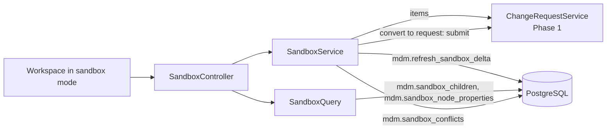

# Phase 5 — Remaining parity: low-level design

- **Status:** Draft, awaiting review (2026-11-11)
- **Phase goal (BUILD_PROTOCOL §2):** the rest of the in-scope legacy capabilities.
- **Exit criterion:** each capability with decision Parity or Improve has passing acceptance tests, or is listed as an explicit gap.
- **Reads with:** Phase 1–4 LLDs, patterns, ADR-006, ADR-019, ADR-022, ADR-026; `docs/capabilities.md`.

---

## 1. Purpose and scope

37 capabilities have Phase 5 as their primary phase (`TRACEABILITY.md`). On 2026-11-11 only one of them has a decision:

| Group | Capabilities | Decision | Treatment in this LLD |
|---|---|---|---|
| Designed in full | **NEW-08** sandboxes and scenarios | New | §3–§13 |
| Designed in full | **SEC-01, SEC-02 (full scope)**: governed role grants; DRM access-group mapping; sub-tree read filtering | Improve (primary Phase 1) | §3–§13 |
| Outline only (pending decision) | VER-01…07, HIE-03, 04, 05, 07, 08, 09, 10, 11, PRP-04…10, VAL-04, QRY-01…05, IMP-03, SEC-03, SEC-04, AUD-03, AUD-04, BLD-03, GOV-14, GOV-15 | `—` | §15.1, one block per capability |
| Pending, primary in earlier phases | HIE-06, PRP-02, PRP-03, VAL-01…03, AUD-01 (Phase 1); GOV-03…09, GOV-11, GOV-16, AUD-02 (Phase 2) | `—` | Outlined in those LLDs; built in Phase 5 if decided by then |

The exit criterion can be met today only for NEW-08 and SEC-01/02; every other row will be an **explicit gap** until OD-09
decisions arrive. This is stated plainly so the Phase 5 plan is not mistaken for full parity.

**Dependencies.** Phases 1–4 (apply, roles, workflow, UI shell, loader for access-group mapping, golden framework).

## 2. Confidence and assumptions

**Confidence:** Medium for NEW-08 and SEC; **Low** for every outline (scope, DRM behaviour and acceptance details unknown).

| # | Assumption | Effect if wrong |
|---|---|---|
| F-1 | A sandbox belongs to one owner; collaborators can view, not edit | Shared editing needs locking per item and a second owner column |
| F-2 | A sandbox may hold up to `SANDBOX_MAX_ITEMS` (20 000) items and is applied as one request | Larger restructures split into several requests and lose atomicity |
| F-3 | Sandbox overlay reads cover the tree and node detail; exports from a sandbox are out of scope | Phase 8 would need overlay-aware exports |
| F-4 | Role grants are changed only through change requests (maker-checker) from Phase 5; the Phase 1 SQL path for `SYSTEM_ADMIN` is removed | — |
| F-5 | DRM node access groups map to (role, hierarchy, top node) without loss; anything that does not map is reported, not approximated | Gaps listed for SEC-02 parity review |
| F-6 | Users outside a sub-tree scope see the scope's ancestors as a breadcrumb path only (names, no properties) | If DRM hides ancestors entirely, the path is replaced by "…" |

**Human decisions this phase waits on:** OD-09 (all outline rows), OD-12 (BLD-03), OD-30 and OD-31 for golden parity, and
the review of ADR-028 and ADR-029.

## 3. Component design (designed scope)

### 3.1 Sandboxes (NEW-08)

| Type | Responsibility | Key signatures | Must not |
|---|---|---|---|
| `SandboxController` | `/sandboxes` endpoints (§5) | — | — |
| `SandboxService` | Create, add/remove items (reuses Phase 1 item rules), refresh overlay, list conflicts, rebase, submit, discard | `SandboxView create(Actor, CreateSandbox)`; `ItemView addItem(Actor, UUID id, int ifMatch, ItemCommand)`; `List<Conflict> conflicts(UUID id)`; `SandboxView rebase(Actor, UUID id, int ifMatch)`; `ChangeRequestView submit(Actor, UUID id, int ifMatch)` | Write facts |
| `SandboxQuery` | Overlay reads with the Phase 1 paging envelope | `Page<ChildNode> children(UUID sandbox, UUID parent, Cursor, int)`; `NodeDetail node(UUID sandbox, UUID node)` | — |

### 3.2 Governed role grants and access mapping (SEC-01, SEC-02 full)
| Type | Responsibility | Must not |
|---|---|---|
| Change actions `grant_role`, `revoke_role` | Grants become change requests decided by a second `SYSTEM_ADMIN` (maker-checker); apply writes `mdm.user_role` bitemporally | Allow a user to grant themselves (CHECK exists) or decide their own grant (maker-checker exists) |
| `AccessGroupMapper` (load module) | Maps staged DRM access groups to proposed grants; a human confirms; output is a load run of `grant_role` items (ADR-026) | Approximate an unmappable rule |
| `EntitlementService` (extended) | Read filtering for sub-tree scopes: children and search results outside every readable scope are removed; node detail outside scope → 404; ancestors shown as a path only (F-6) | Leak property values outside scope |

## 4. Data design (designed scope)

```sql
-- edit V1
ALTER mdm.change_request ADD kind text NOT NULL DEFAULT 'request' CHECK (kind IN ('request','sandbox')),
                         ADD sandbox_base_recorded_at timestamptz,   -- recorded time the sandbox was based on (rebase moves it)
                         ADD sandbox_name text;
-- a sandbox is a change request of kind 'sandbox' kept in status 'draft'; submit turns kind into 'request' (one-way, guarded)
-- mdm.change_action gains 'grant_role', 'revoke_role' (and both join the commit-policy hard-limit list)

-- new file V12__sandboxes.sql: derived overlay, rebuildable, not governed data
CREATE TABLE mdm.sandbox_delta_relationship (
  sandbox_id uuid NOT NULL REFERENCES mdm.change_request ON DELETE CASCADE,
  hierarchy_id uuid NOT NULL, parent_node_id uuid NOT NULL, child_node_id uuid NOT NULL,
  is_primary boolean NOT NULL, sort_order numeric NOT NULL,
  op char(1) NOT NULL CHECK (op IN ('+','-')),
  PRIMARY KEY (sandbox_id, hierarchy_id, parent_node_id, child_node_id, op));
CREATE TABLE mdm.sandbox_delta_node_attr (sandbox_id uuid, node_id uuid, node_name text, description text,
  is_active boolean, allows_children boolean, op char(1), PRIMARY KEY (sandbox_id, node_id, op));
CREATE TABLE mdm.sandbox_delta_value (sandbox_id uuid, node_id uuid, property_id uuid, hierarchy_key uuid,
  value jsonb, op char(1), PRIMARY KEY (sandbox_id, node_id, property_id, hierarchy_key, op));
CREATE INDEX ON mdm.sandbox_delta_relationship (sandbox_id, hierarchy_id, parent_node_id);
```
Bitemporal behaviour: none until submit; the sandbox only describes changes. On apply, the normal Phase 1 apply writes facts.
Volume: ≤ `SANDBOX_MAX_ITEMS` items and a delta of the same order per sandbox; `SANDBOX_MAX_ACTIVE_PER_USER` (5).

## 5. Interface design (designed scope)
| Endpoint | Purpose | Auth |
|---|---|---|
| `POST /sandboxes` `{name, versionName, hierarchyCode, effectiveFrom}` | Create (a `kind='sandbox'` draft) | PROPOSE |
| `GET /sandboxes?mine` / `GET /sandboxes/{id}` | List / detail with item count, conflict count | owner; viewers with READ (F-1) |
| `POST /sandboxes/{id}/items`, `DELETE …/items/{itemId}` | Same payloads as Phase 1 items | owner, `If-Match` |
| `GET /sandboxes/{id}/hierarchies/{code}/children?parentId&cursor&limit` | Overlay children | owner/viewer |
| `GET /sandboxes/{id}/nodes/{nodeId}` | Overlay node detail with provenance (`sandbox` marker on changed values) | owner/viewer |
| `GET /sandboxes/{id}/diff?cursor` | Items with before/after (from the delta) | owner/viewer |
| `GET /sandboxes/{id}/conflicts` | Items whose expected base no longer matches | owner |
| `POST /sandboxes/{id}/rebase` | Re-capture `expected` for non-conflicting items, move `sandbox_base_recorded_at` to now; conflicting items stay flagged | owner, `If-Match` |
| `POST /sandboxes/{id}/submit` `{workflowModelCode}` | Validate; refuse with conflicts; becomes a normal request | owner, `If-Match` |
| `POST /sandboxes/{id}/discard` | Withdraw | owner |
| `POST /change-requests` with `grant_role` / `revoke_role` items | Governed grants | `SYSTEM_ADMIN` (propose), another `SYSTEM_ADMIN` (decide) |

Errors as Phase 1; new codes `N2301` sandbox has conflicts, `N2302` too many items, `N2303` sandbox is not a draft.

## 6. Behaviour (designed scope)

### 6.1 Sandbox lifecycle

```mermaid
stateDiagram-v2
  [*] --> open: create
  open --> open: add/remove items → refresh delta
  open --> conflicted: another request changes a fact this sandbox touches
  conflicted --> open: rebase / remove conflicting items
  open --> submitted: submit (kind → request; Phase 1/2 flow)
  open --> discarded: discard (withdrawn)
  conflicted --> discarded
```

Conflict state is computed on read (`mdm.sandbox_conflicts`), not stored.

### 6.2 Overlay refresh (transaction per item change)
`SandboxService.addItem` inserts the item (Phase 1 rules) and calls `mdm.refresh_sandbox_delta(sandbox)` in the same
transaction; the function trial-applies all items in a subtransaction, captures the rows it would close (`-`) and insert
(`+`) into PL/pgSQL arrays, rolls back, and writes the delta tables (§7.1). Concurrency: the request row lock (Phase 1) serialises edits of one sandbox.

## 7. Algorithms (designed scope)

### 7.1 `mdm.refresh_sandbox_delta(p_sandbox)` — overlay by trial apply (P-28)
```text
lock sandbox FOR UPDATE; require kind = 'sandbox' and status = 'draft'
plus := {}; minus := {}
BEGIN
   run the Phase 1 apply handlers in trial mode with a capture hook:
      on "close row r"  → minus += r (relationship / node_attr / value)
      on "insert row n" → plus  += n
   RAISE 'N9999'                                  -- always roll back
EXCEPTION WHEN SQLSTATE 'N9999' THEN NULL
END
delete delta rows of p_sandbox; insert plus with '+', minus with '-'
```
One implementation of the change semantics (the apply handlers) serves apply, validation and the overlay. Cost:
O(items × depth) per refresh; for sandboxes over `SANDBOX_INCREMENTAL_THRESHOLD` (1 000 items) the refresh runs only the
new item against the existing delta when items are appended (order-independent items), else a full refresh.

### 7.2 Overlay children
```sql
SELECT … FROM (
  SELECT base children of :parent at (:asOf, sandbox_base_recorded_at)
  EXCEPT SELECT '-' rows of the delta for :parent
  UNION  SELECT '+' rows of the delta for :parent
) c ORDER BY sort_order, node_name, child_node_id   -- keyset as Phase 1 §7.7
```
Reads use `sandbox_base_recorded_at`, so the owner sees the world the sandbox was built on; `conflicts` shows what changed since.

### 7.3 Conflicts
For each item, compare `payload.expected` with the current fact at `now()` (the Phase 1 stale-base check as a query, not
an exception). Return item, expected, actual, and the request that changed it (`change_request_id` of the current row).

### 7.4 Sub-tree read filtering (SEC-02 full)
Children page: filter rows to nodes that are in a readable scope or are ancestors of one (ancestors flagged
`pathOnly = true`, no properties). Precompute per request the user's scope tops per hierarchy; a child is kept if it is a
scope top, under one (ancestor walk, cached), or an ancestor of one (descendant check by walking up from each scope top once).

## 8. Patterns applied
P-01, P-09, P-10 (rebase uses expected-base), P-11, P-17 (full), P-18 (sandbox marker), **P-28 Overlay by trial apply (new)**.

## 9. Security and controls
| Control | Enforcement | Test |
|---|---|---|
| Maker-checker | Sandboxes become normal requests; grants are requests decided by a second admin | pgTAP + JUnit |
| Bitemporal history | Sandbox never writes facts; only apply does | pgTAP: fact tables unchanged by any sandbox operation |
| Human-only decisions / policy limits | `grant_role`, `revoke_role` on the hard-limit list; sandbox submit follows Phase 2 | pgTAP |
| Layer separation | All sandbox objects in `mdm`; no `wf` reference | grep check |
| Read scope | No property values outside scope; ancestors path-only | JUnit negative tests per endpoint |
Abuse: a user hoards conflicting sandboxes to block others → sandboxes do not lock facts; conflicts surface on their side only.

## 10. Performance and scale
| Target | Value | Proof |
|---|---|---|
| Overlay children page | `P95_CHILDREN_PAGE_MS` + 100 ms | perf test with a 5 000-item sandbox |
| Refresh after one item | 500 ms at 1 000 items; full refresh at 20 000 items recorded | perf test |
| Submit of a 20 000-item sandbox | recorded; decides whether `SANDBOX_MAX_ITEMS` stays | perf test |

## 11. Observability
Metrics `nexus.sandbox.active`, `nexus.sandbox.refresh.duration`, `nexus.sandbox.conflicts`; grants logged with actor, grantee, scope.

## 12. UI design (designed scope)
Workspace gains a sandbox switcher in the context bar ("Live data" / "Sandbox: <name>"); in sandbox mode a persistent
banner, changed nodes marked with the change tokens (UI_STANDARD §3 "added, removed, modified, moved") plus icons; the
tray becomes the sandbox item list with a diff view (the Diff/compare custom component, UI_STANDARD §5); conflicts panel
with "Rebase" and "Remove item"; "Submit as request". Grants: Administration → Access → request a grant (form) → decision in the worklist.

## 13. Test design (designed scope)
| Capability | Criterion | Cases | Type |
|---|---|---|---|
| NEW-08 | Sandbox lifecycle works end to end | P: create, add 3 kinds of item, overlay shows them, diff lists them, submit, apply; P: discard; N: submit with conflicts (N2301); N: > max items (N2302); C: no fact row changes before apply; B: rebase with one conflicting and one clean item | pgTAP + JUnit + Playwright |
| NEW-08 | Overlay equals the result of apply | P: for a generated sandbox, overlay tree = tree after applying the same items in a test database | JUnit |
| SEC-01 full | Each role can do exactly what it should; grants governed | P: grant via request decided by second admin; N: self-decision; N: self-grant (CHECK); C: grant history reconstructable | pgTAP + JUnit |
| SEC-02 full | Access by hierarchy and sub-tree, reads included | P/N per read endpoint (children, search, node, sandbox overlay); B: node at scope top; P: mapped DRM access groups reproduce the access matrix sample (golden, OD-31) | JUnit + golden |

## 14. Rollout and compatibility
Edits to V1 (columns, actions); new V12. Removing the Phase 1 SQL grant path (F-4) is a privilege change in V7.
Existing requests default to `kind = 'request'`.

## 15. Risks, open questions and alternatives
| # | Item | Handling |
|---|---|---|
| R-1 | Most of Phase 5 is undecided | Explicit gaps at the gate; each outline below is ready to become a design section once decided |
| R-2 | Large sandboxes make one long apply transaction | Measured (§10); split option kept |
| Alt-1 | Sandbox as a physical copy of the hierarchy | Rejected: copy cost and divergence (P-02) |
| Alt-2 | Overlay computed by separate SQL per action | Rejected: a second implementation of the change semantics |

### 15.1 Outlines for capabilities pending decision (OD-09)
Each line: approach · objects (existing or proposed) · main risk · tests from the catalogue criterion.

| ID | Approach | Objects | Risk | Tests |
|---|---|---|---|---|
| VER-01 Create/copy versions | New `version` row = new slice; "copy" sets `base_version_id` and the same business date | `mdm.version` (exists) | Users expect a physical copy | Golden: version list + node counts |
| VER-02 Status lifecycle | Guarded transitions working→submitted→finalized→expired; finalize pins `recorded_as_of`; edits refused for requests targeting submitted/finalized versions | trigger on `mdm.version`; check in `apply_change_request` | Definitions not bitemporal (D-08) make old slices drift | Golden: exports of past finalized versions |
| VER-03 As-of versions | Reads at any (asOf, recordedAsOf) (built in Phase 1) + export as of a past recorded time | Phase 1 reads; Phase 8 exports | D-08 | Golden: DRM as-of exports for 3 dates |
| VER-04 Baseline versions | Named slice + compare (QRY-02) | `mdm.version`, compare service | depends on QRY-02 | Golden: compare export |
| VER-05 Version variables | `mdm.version_alias(alias, version_id, valid_period)` bitemporal; exports and jobs resolve aliases | new table | — | Export runs before/after an alias change |
| VER-06 Load/unload/backup | Not a feature: PITR (OD-15) | platform | — | DR test |
| VER-07 Version properties | `mdm.version_property_value` (bitemporal) with `property_definition.scope` = 'version' (new enum value) | new table | — | Values display and export |
| HIE-03 Shared nodes | Exists in schema and Phase 1 apply; parity of display/export/validation via golden | `is_primary` | Export expansion rules | Golden exports with shared nodes |
| HIE-04 Orphans | View of nodes with `node_attr` in a slice and no relationship in any hierarchy (excludes A-5 identities) | new view | — | Golden orphan list |
| HIE-05 Leaf/limb, promotion | `update_node` sets `allows_children`; add-under-leaf refused (Phase 1 N2004) | Phase 1 + ADR-026 | `is_leaf` meaning (D-38) | Validation results |
| HIE-07 Merge on delete | Action `merge_node`: repoint `node_ref` values and relationships to the target, end the source | new action + handler | Reference discovery across all properties | Merge log |
| HIE-08 Sibling sort | `reorder_node` handler (enum exists); fractional `sort_order` | Phase 1 handler set | Export order parity | Golden exports |
| HIE-09 Node types | `mdm.property_applicability(node_kind or type property, property_id)`; validation rule per type | new table | DRM "node type" may be a property, not `node_kind` | Validation by type |
| HIE-10 Domains | Identifier schemes + uniqueness rules per domain (exclusion constraints exist for names and identifiers) | `identifier_scheme` | Cross-version uniqueness semantics | Domain validation results |
| HIE-11 Model after | UI action that pre-fills an `add_node` + `set_property` items from a source node | UI only | — | Clone has source values except name |
| PRP-04 Lookup properties | `sql` derivation over a lookup table `mdm.lookup_value(lookup_code, key, value, valid_period)` | new table | — | Derived value extract |
| PRP-05 Inheritance and overrides | Exists (`property_value_asof`, `node_properties_resolved`); locks at lower nodes need `property_lock` | new table for locks | Lock semantics unknown | Golden inherited values |
| PRP-06 Derived properties | `DerivationEngine` strategies: `sql` (exists), `cel` in Java (OD-19); each in-use formula translated with a golden test | `derivation_expr` | Formula translation effort | Golden derived values (key test) |
| PRP-07 System properties | Computed columns (name, level, child count, leaf) in exports and reads | export functions | Definitions of level/leaf (D-38) | Golden exports |
| PRP-08 Categories | Exists (`property_category`); grid groups by it (Phase 3) | — | — | UI grouping |
| PRP-09 Property edit permissions | Task properties (GOV-03) + entitlements by category (SEC-03) | — | Depends on SEC-03 | Unauthorised edits rejected |
| PRP-10 Hierarchy properties | `mdm.hierarchy_property_value` (bitemporal), scope 'hierarchy' | new table | — | Values display and export |
| VAL-04 Formula validations | `RuleEngine` `cel` (OD-19); each in-use DRM validation converted with tests; `drm_validation_orig` kept | `validation_rule` | Conversion effort; D-39 rule-authoring privilege | Validation outputs |
| QRY-01 Property queries | Saved query = JSON filter (same format as `node_filter`) + `mdm.saved_query` with owner and sharing (SEC-04); paged results | new table | Performance of property filters | Golden query results |
| QRY-02 Compares | Diff service on two slices: structure (edges), property (resolved values), rename (node_attr) — set-based SQL | new functions | Large diffs: stream (P-20) | Golden compare output |
| QRY-03 Search | PostgreSQL full-text + `pg_trgm` (OD-21; trigram index from Phase 3) across hierarchies | indexes | NFR target unknown | Search latency |
| QRY-04 Node history | Bitemporal history of a node (all its facts) + `audit_log` + requests; History tab in the UI | read API | Volume per node | Complete history visible |
| QRY-05 Edit from results | Result grids add items to the tray (same governance) | UI + Phase 1 items | — | Edits go through governance |
| IMP-03 Bulk property updates | Grid multi-select → many `set_property` items in one request (atomic) | UI + Phase 1 | Request size limit | Bulk edits atomic with validation |
| SEC-03 Property access | Entitlements by category: read/edit per role scope; property grid and API filter values | `mdm.user_role` + category scope column | Read filtering cost | Access matches DRM |
| SEC-04 Object access | Owner and sharing on saved queries, export profiles, sandboxes | `owner_id`, `mdm.object_share` | — | Visibility matches DRM |
| AUD-03 Job and export run history | `export_run` (exists, not append-only, D-30) + `mdm.job_run`; make both append-only | guards | — | Every run logged with hash |
| AUD-04 Retention | Parameter `AUDIT_RETENTION_YEARS` (OD-25); archive to object storage (OD-16); no deletion before decision | job | Legal hold | Retention test |
| BLD-03 Scenario versions | Covered by NEW-08 sandboxes if OD-12 says scenarios are used; otherwise retire | — | — | Scenario built, compared, applied or discarded |
| GOV-14 Request tags | `mdm.change_request_tag(change_request_id, tag)`; worklist filter | new table | — | Tags searchable and reportable |
| GOV-15 Governance analytics | Read-only views over `wf` (durations, volumes, SLA) refreshed daily | views | — | Same metrics as today |

## 16. Work breakdown (designed scope only)
| # | Increment | Size | Capabilities | Tests |
|---|---|---|---|---|
| 5-1 | `kind`, sandbox columns, delta tables, `refresh_sandbox_delta` with capture hook in the apply handlers | L | NEW-08 | pgTAP overlay = apply |
| 5-2 | Sandbox API: create, items, overlay reads, diff, conflicts, rebase, submit, discard | M | NEW-08 | JUnit |
| 5-3 | Sandbox UI: switcher, banner, change markers, diff view, conflicts panel | M | NEW-08 | Playwright, Storybook |
| 5-4 | `grant_role` / `revoke_role` actions, admin UI, removal of the SQL grant path | M | SEC-01 | pgTAP + JUnit |
| 5-5 | Sub-tree read filtering across read endpoints | M | SEC-02 | JUnit negative matrix |
| 5-6 | `AccessGroupMapper` + load run of grants | M | SEC-02 | JUnit + golden access matrix |
| 5-7 | Decision-triggered increments: one per capability decided before Phase 5 planning, sized from §15.1 | — | per decision | per catalogue criterion |
| 5-8 | Records and gap list for the gate | S | PROG | review |
