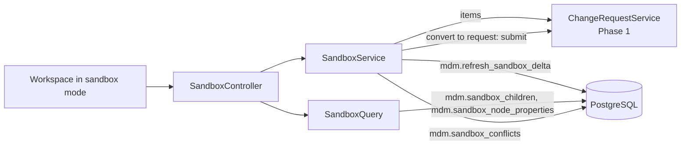
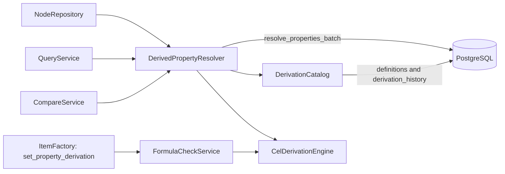
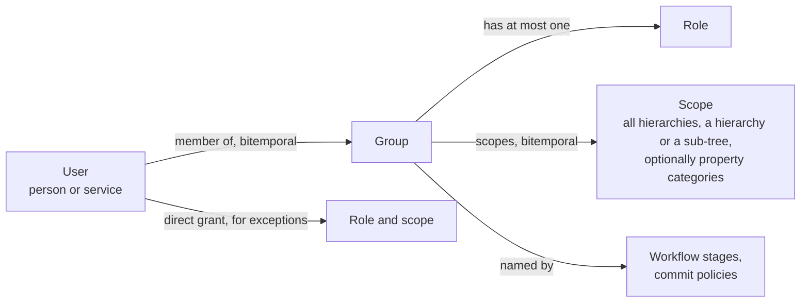

# Phase 5 — Remaining parity: low-level design

- **Status:** Approved 2026-11-11 (consistency fixes CR-nn applied the same day, see `../CONSISTENCY_REVIEW.md`).
  **§17 added and approved 2026-11-14** (repository owner): the detailed design for the capabilities ADR-038 decided. On the same day the
  repository owner moved Phase 5 ahead of Phase 4 (ADR-038 D3, amended); §17.1 records what that defers. Also on
  2026-11-14, the owner approved the Phase 5 plan and accepted ADR-039 (OD-47); §18 will design the rows ADR-039 puts in Phase 5.
- **Migration rule (CR-07):** where this design says "edit Vn", that is allowed only while no shared environment exists (CLAUDE.md rule 6, OD-18). If one exists when this phase is built, the same change goes into a new V-numbered migration (`ALTER` / `CREATE OR REPLACE`). What counts as shared: OD-44.
- **Phase goal (BUILD_PROTOCOL §2):** the rest of the in-scope legacy capabilities.
- **Exit criterion:** each capability with decision Parity or Improve has passing acceptance tests, or is listed as an explicit gap.
- **Reads with:** Phase 1–4 LLDs, patterns, ADR-006, ADR-019, ADR-022, ADR-026; `docs/capabilities.md`.

---

## 1. Purpose and scope

37 capabilities have Phase 5 as their primary phase (`TRACEABILITY.md`). On 2026-11-11 only one of them has a decision:

| Group | Capabilities | Decision | Treatment in this LLD |
|---|---|---|---|
| Designed in full | **NEW-08** sandboxes and scenarios | New | §3–§13 |
| Designed in full | **SEC-01, SEC-02 (full scope)**: governed role grants; DRM access-group mapping; sub-tree read filtering | Improve (primary Phase 1) | §3–§13 |
| Outline only (pending decision) | VER-01…07, HIE-03, 04, 05, 07, 08, 09, 10, 11, PRP-04…10, VAL-04, QRY-01…05, IMP-03, SEC-03, SEC-04, AUD-03, AUD-04, BLD-03, GOV-14, GOV-15 | `—` | §15.1, one block per capability |
| Pending, primary in earlier phases | HIE-06, PRP-02, PRP-03, VAL-01…03, AUD-01 (Phase 1); GOV-03…09, GOV-11, GOV-16, AUD-02 (Phase 2) | `—` | Outlined in those LLDs; built in Phase 5 if decided by then |

The exit criterion can be met today only for NEW-08 and SEC-01/02; every other row will be an **explicit gap** until OD-09
decisions arrive. This is stated plainly so the Phase 5 plan is not mistaken for full parity.

**Update 2026-11-14.** ADR-038 (accepted) decided PRP-06, QRY-01…05, IMP-03 and BLD-03. OD-45 (ADR-037) had already
decided the versions:
- VER-01 and VER-02 were built in Phase 3.
- VER-03 and VER-05 belong to Phase 8.
- VER-06 is retired.
- VER-04 stays in Phase 5.

§17 designs the Phase 5 ones in full. ADR-039 (accepted 2026-11-14, OD-47) decided every capability that still had no
decision, VER-07 included. §18 designs the rows it puts in Phase 5; their §15.1 outlines stand until §18 is approved.

**Dependencies.** Phases 1–3 (apply, roles, workflow, UI shell, versions). Phase 4 supplies the loader for access-group
mapping and the golden framework. Phase 5 is now built first, so the items that need Phase 4 wait for it (§17.1).

## 2. Confidence and assumptions

**Confidence:** Medium for NEW-08 and SEC; **Low** for every outline (scope, DRM behaviour and acceptance details unknown).

| # | Assumption | Effect if wrong |
|---|---|---|
| F-1 | A sandbox belongs to one owner; collaborators can view, not edit | Shared editing needs locking per item and a second owner column |
| F-2 | A sandbox may hold up to `SANDBOX_MAX_ITEMS` (20 000) items and is applied as one request | Larger restructures split into several requests and lose atomicity |
| F-3 | Sandbox overlay reads cover the tree and node detail; exports from a sandbox are out of scope | Phase 8 would need overlay-aware exports |
| F-4 | Role grants are changed only through change requests (maker-checker) from Phase 5; the Phase 1 SQL path for `SYSTEM_ADMIN` is removed | — |
| F-5 | DRM node access groups map to (role, hierarchy, top node) without loss; anything that does not map is reported, not approximated | Gaps listed for SEC-02 parity review |
| F-6 | Users outside a sub-tree scope see the scope's ancestors as a breadcrumb path only (names, no properties) | If DRM hides ancestors entirely, the path is replaced by "…" |

**Human decisions this phase waits on:** OD-09 (all outline rows), OD-12 (BLD-03), OD-30 and OD-31 for golden parity, and
the review of ADR-028 and ADR-029.

## 3. Component design (designed scope)

### 3.1 Sandboxes (NEW-08)

| Type | Responsibility | Key signatures | Must not |
|---|---|---|---|
| `SandboxController` | `/sandboxes` endpoints (§5) | — | — |
| `SandboxService` | Create, add/remove items (reuses Phase 1 item rules), refresh overlay, list conflicts, rebase, submit, discard | `SandboxView create(Actor, CreateSandbox)`; `ItemView addItem(Actor, UUID id, int ifMatch, ItemCommand)`; `List<Conflict> conflicts(UUID id)`; `SandboxView rebase(Actor, UUID id, int ifMatch)`; `ChangeRequestView submit(Actor, UUID id, int ifMatch)` | Write facts |
| `SandboxQuery` | Overlay reads with the Phase 1 paging envelope | `Page<ChildNode> children(UUID sandbox, UUID parent, Cursor, int)`; `NodeDetail node(UUID sandbox, UUID node)` | — |

### 3.2 Governed role grants and access mapping (SEC-01, SEC-02 full)
| Type | Responsibility | Must not |
|---|---|---|
| Change actions `grant_role`, `revoke_role` | Grants become change requests decided by a second `SYSTEM_ADMIN` (maker-checker); apply writes `mdm.user_role` bitemporally | Allow a user to grant themselves (CHECK exists) or decide their own grant (maker-checker exists) |
| `AccessGroupMapper` (load module) | Maps staged DRM access groups to proposed grants; a human confirms; output is a load run of `grant_role` items (ADR-026) | Approximate an unmappable rule |
| `EntitlementService` (extended) | Read filtering for sub-tree scopes: children and search results outside every readable scope are removed; node detail outside scope → 404; ancestors shown as a path only (F-6) | Leak property values outside scope |

## 4. Data design (designed scope)

```sql
-- edit V1
ALTER mdm.change_request ADD kind text NOT NULL DEFAULT 'request' CHECK (kind IN ('request','sandbox')),
                         ADD sandbox_base_recorded_at timestamptz,   -- recorded time the sandbox was based on (rebase moves it)
                         ADD sandbox_name text;
-- a sandbox is a change request of kind 'sandbox' kept in status 'draft'; submit turns kind into 'request' (one-way, guarded);
-- its origin (Phase 1 column) is 'sandbox' from creation, so apply allows up to SANDBOX_MAX_ITEMS after submit (CR-04)
-- mdm.change_action gains 'grant_role', 'revoke_role' (and both join the commit-policy hard-limit list)

-- new file V12__sandboxes.sql: derived overlay, rebuildable, not governed data
CREATE TABLE mdm.sandbox_delta_relationship (
  sandbox_id uuid NOT NULL REFERENCES mdm.change_request ON DELETE CASCADE,
  hierarchy_id uuid NOT NULL, parent_node_id uuid NOT NULL, child_node_id uuid NOT NULL,
  is_primary boolean NOT NULL, sort_order numeric NOT NULL,
  op char(1) NOT NULL CHECK (op IN ('+','-')),
  PRIMARY KEY (sandbox_id, hierarchy_id, parent_node_id, child_node_id, op));
CREATE TABLE mdm.sandbox_delta_node_attr (sandbox_id uuid, node_id uuid, node_name text, description text,
  is_active boolean, allows_children boolean, op char(1), PRIMARY KEY (sandbox_id, node_id, op));
CREATE TABLE mdm.sandbox_delta_value (sandbox_id uuid, node_id uuid, property_id uuid, hierarchy_key uuid,
  value jsonb, op char(1), PRIMARY KEY (sandbox_id, node_id, property_id, hierarchy_key, op));
CREATE INDEX ON mdm.sandbox_delta_relationship (sandbox_id, hierarchy_id, parent_node_id);
```
Bitemporal behaviour: none until submit; the sandbox only describes changes. On apply, the normal Phase 1 apply writes facts.
Volume: ≤ `SANDBOX_MAX_ITEMS` items and a delta of the same order per sandbox; `SANDBOX_MAX_ACTIVE_PER_USER` (5).

**Built in 5-1a** (refinements of the sketch above; no control changed):
- *Valid period in the delta.* Apply never edits a fact in place: it closes the current row and re-states the parts that
  stay true, so one item can close one row and insert two for the same key (a move). Each delta table therefore has
  `valid_period daterange NOT NULL`, and the period is part of its primary key. Reads at an as-of date use it.
- *Indexes.* The relationship primary key starts `(sandbox_id, hierarchy_id, parent_node_id, …)`, so it serves the
  overlay children page and replaces the separate parent index. A `(sandbox_id, hierarchy_id, child_node_id)` index
  serves node detail.
- *No foreign keys to facts* from the delta tables: rows for a hierarchy that only the sandbox's own `add_hierarchy`
  item creates exist only inside the rolled-back trial. All columns are `NOT NULL` except `description`;
  `hierarchy_key` is the zero uuid for a global value, as in `property_value`'s exclusion constraint.
- *Writers.* Only `nexus_apply` (owner of the trial apply) has `INSERT, DELETE` on the delta tables; every role reads them.
- *The kind guard* (`trg_cr_sandbox_kind`, `N2303`): origin `'sandbox'` is reachable only by creating a sandbox
  (insert with origin and kind both `'sandbox'` or neither; hint `sandbox.origin`); kind moves only `sandbox → request`
  (hint `sandbox.kind_one_way`) and only while the request is a draft; a request of kind `'sandbox'` can be only `draft`
  or `withdrawn` (hint `sandbox.not_draft`, which also covers submitting without the flip). `kind` has this guard of its
  own and is not on the frozen-content list; `sandbox_name` and `sandbox_base_recorded_at` are (`N2102` once submitted).
- *Item limit at insert.* `change_item_sandbox_limit` (statement level) raises `N2302` as soon as an origin-`'sandbox'`
  request would hold more than `sandbox_max_items` items, so a sandbox can never grow past what apply allows (CR-04).
- *Grants.* `nexus_api` inserts sandboxes and their items but cannot update `kind` or `sandbox_base_recorded_at`;
  submit (with the `N2301` conflicts check and the flip) and rebase are `SECURITY DEFINER` functions added in 5-1b/5-2.
  The settings `sandbox_max_active_per_user` and `sandbox_incremental_threshold` are added with their first use.

## 5. Interface design (designed scope)
| Endpoint | Purpose | Auth |
|---|---|---|
| `POST /sandboxes` `{name, versionName, hierarchyCode, effectiveFrom}` | Create (a `kind='sandbox'` draft) | PROPOSE |
| `GET /sandboxes?mine` / `GET /sandboxes/{id}` | List / detail with item count, conflict count | owner; viewers with READ (F-1) |
| `POST /sandboxes/{id}/items`, `DELETE …/items/{itemId}` | Same payloads as Phase 1 items | owner, `If-Match` |
| `GET /sandboxes/{id}/hierarchies/{code}/children?parentId&cursor&limit` | Overlay children | owner/viewer |
| `GET /sandboxes/{id}/nodes/{nodeId}` | Overlay node detail with provenance (`sandbox` marker on changed values) | owner/viewer |
| `GET /sandboxes/{id}/diff?cursor` | Items with before/after (from the delta) | owner/viewer |
| `GET /sandboxes/{id}/conflicts` | Items whose expected base no longer matches | owner |
| `POST /sandboxes/{id}/rebase` | Re-capture `expected` for non-conflicting items, move `sandbox_base_recorded_at` to now; conflicting items stay flagged | owner, `If-Match` |
| `POST /sandboxes/{id}/submit` `{workflowModelCode}` | Validate; refuse with conflicts; becomes a normal request | owner, `If-Match` |
| `POST /sandboxes/{id}/discard` | Withdraw | owner |
| `POST /change-requests` with `grant_role` / `revoke_role` items | Governed grants | `SYSTEM_ADMIN` (propose), another `SYSTEM_ADMIN` (decide) |

Errors as Phase 1; new codes `N2301` sandbox has conflicts, `N2302` too many items, `N2303` sandbox is not a draft.
All three are class `N2`, so the existing translator returns 422 with no Java change. Built in 5-1a: `N2302` is raised
when an item is added (not only at apply), and `N2303` carries the hints `sandbox.origin`, `sandbox.kind_one_way` and
`sandbox.not_draft` (§4). Built in 5-1b: `N2303` also carries `sandbox.not_sandbox`, when a sandbox operation names a
request that is not (or no longer) a sandbox; a sandbox that is withdrawn gives `sandbox.not_draft`, and an unknown id
gives `N2102` `change_request.not_found`.

**Built in 5-2** (`SandboxController`, `SandboxService`, `SandboxRepository`; V12 `convert_sandbox`, `discard_sandbox`;
V9 edit; JUnit `SandboxApiTest`, pgTAP `24_sandbox_submit`; no control changed):
- *Create.* The title is the sandbox name. `hierarchyCode` is optional and is checked (the owner must be able to read it)
  but not stored: a sandbox's scope comes from its items, and PROPOSE is checked per item as in Phase 1. The limit
  `sandbox_max_active_per_user` (5) is checked by the API under a per-owner advisory lock, so two creates cannot both
  pass it: 422 `sandbox.too_many_active`. It is a product limit, not a control, so it has no SQLSTATE.
- *Submit, in one transaction.* First the conflicts: if any, 422 `sandbox.has_conflicts` (`sqlState` `N2301`) with the
  list, and nothing changes. Then the optional `workflowModelCode`. Then validation as any request: errors give 422
  `change_request.validation_failed`, and the findings are kept, but it stays a sandbox. Then
  `mdm.convert_sandbox(sandbox, actor)` (definer, `nexus_apply`, which gets `UPDATE (kind)`) re-checks the conflicts
  (`N2301`), turns the kind into `request` and clears the overlay. Finally the Phase 1/2 submit runs
  (`ChangeRequestService.submitValidated`). The request keeps origin `sandbox`, so the sandbox item limit applies.
- *Discard* is `mdm.discard_sandbox` (definer, `nexus_apply`): the Phase 1 withdraw, then the overlay is cleared. It
  needs `If-Match` like every other write.
- *Reads* default `asOf` to the sandbox's effective date, not today, because that is where its items show. `GET
  /sandboxes/{id}` still answers after submit, with `kind = request`. `conflictCount` is computed on read for an open
  sandbox (one rolled-back trial), so detail and list run read-write.
- *Diff* lists the overlay fact by fact, grouped by node: each base row a sandbox replaces (`side = before`) and each
  row it writes (`after`), with its valid dates. It is keyset-paged on a text key. It is not grouped per item, because
  the delta does not record which item wrote a row; the items list already shows each item's before (`expected`) and
  after (`payload`).
- *Item writes return the refresh outcome.* Adding an item gives 201 with the item and the failing items. Deleting
  one gives 200 with `{rowVersion, failures}` instead of 204. Conflicts are paged over the full list by seq.
- *Kept out of the ordinary lists.* Sandboxes are left out of `GET /change-requests?mine`, the Home counts and the
  worklist's `drafted` view (V9 `worklist_rows`). Item, submit and withdraw calls on a sandbox through
  `/change-requests` are refused with 422 `sandbox.use_sandbox_api`; the database refuses a sandbox submit anyway (`N2303`).
- *Metrics* (§11): the timer `nexus.sandbox.refresh.duration` (refresh and rebase), the summary
  `nexus.sandbox.conflicts` (per conflicts listing) and the gauge `nexus.sandbox.active` (a count query at scrape).

## 6. Behaviour (designed scope)

### 6.1 Sandbox lifecycle

```mermaid
stateDiagram-v2
  [*] --> open: create
  open --> open: add/remove items → refresh delta
  open --> conflicted: another request changes a fact this sandbox touches
  conflicted --> open: rebase / remove conflicting items
  open --> submitted: submit (kind → request; Phase 1/2 flow)
  open --> discarded: discard (withdrawn)
  conflicted --> discarded
```

Conflict state is computed on read (`mdm.sandbox_conflicts`), not stored.

### 6.2 Overlay refresh (transaction per item change)
`SandboxService.addItem` inserts the item (Phase 1 rules) and calls `mdm.refresh_sandbox_delta(sandbox)` in the same
transaction; the function trial-applies all items in a subtransaction, captures the rows it would close (`-`) and insert
(`+`) into PL/pgSQL arrays, rolls back, and writes the delta tables (§7.1). Concurrency: the request row lock (Phase 1) serialises edits of one sandbox.

## 7. Algorithms (designed scope)

### 7.1 `mdm.refresh_sandbox_delta(p_sandbox)` — overlay by trial apply (P-28)
```text
lock sandbox FOR UPDATE; require kind = 'sandbox' and status = 'draft'
plus := {}; minus := {}
BEGIN
   run the Phase 1 apply handlers in trial mode with a capture hook:
      on "close row r"  → minus += r (relationship / node_attr / value)
      on "insert row n" → plus  += n
   RAISE 'N9999'                                  -- always roll back
EXCEPTION WHEN SQLSTATE 'N9999' THEN NULL
END
delete delta rows of p_sandbox; insert plus with '+', minus with '-'
```
One implementation of the change semantics (the apply handlers) serves apply, validation and the overlay. Cost:
O(items × depth) per refresh; for sandboxes over `SANDBOX_INCREMENTAL_THRESHOLD` (1 000 items) the refresh runs only the
new item against the existing delta when items are appended (order-independent items), else a full refresh.

### 7.2 Overlay children
```sql
SELECT … FROM (
  SELECT base children of :parent at (:asOf, sandbox_base_recorded_at)
  EXCEPT SELECT '-' rows of the delta for :parent
  UNION  SELECT '+' rows of the delta for :parent
) c ORDER BY sort_order, node_name, child_node_id   -- keyset as Phase 1 §7.7
```
Reads use `sandbox_base_recorded_at`, so the owner sees the world the sandbox was built on; `conflicts` shows what changed since.

### 7.3 Conflicts
For each item, compare `payload.expected` with the current fact at `now()` (the Phase 1 stale-base check as a query, not
an exception). Return item, expected, actual, and the request that changed it (`change_request_id` of the current row).

**Built in 5-1b** (V12, with hooks in V1 and V11; pgTAP `23_sandbox_overlay`; no control changed):
- *Capture hook.* V1 has a no-op `mdm.apply_capture(p_table text, p_op text, p_row jsonb)`: `apply_insert` passes it
  the stored row (`'+'`) and `apply_fact` the row it closes (`'-'`). V12 gives it a body that acts only when
  `mdm.sandbox_capture` names the request being applied. `apply_change_request` (V1) and `validate_change_request`
  (V11) clear that setting, so a committed apply or a validation never writes an overlay. A `'-'` for a row the trial
  itself inserted removes that `'+'` row instead, so the overlay holds only the net effect of the items.
- *Trial.* `mdm.sandbox_trial(sandbox, items, capture)` (invoker; only `nexus_apply` may run it) runs the items through
  `mdm.apply_item`, as the requester and at the effective date, in a block that is always rolled back. The capture is
  written to the delta tables inside that block and read out as jsonb before the rollback. A first pass runs straight
  through; if an item hits a rule failure, a careful pass gives each item its own subtransaction. **Failing items are
  reported (`seq, change_item_id, error_code, message, detail`, with `detail` as JSON when the DETAIL is JSON) and left
  out of the overlay; the items after them still show. Faults are raised.** The trial does not check the item limit
  (5-1a checks it as items are added).
- *Refresh* (`refresh_sandbox_delta(sandbox, new_item)`, definer, `nexus_apply`) locks the request, then either
  replaces the three delta sets from a full trial, or takes the incremental path of §7.1. The incremental path is taken
  only when the new item is the last, the sandbox holds more than `sandbox_incremental_threshold` items, the action is
  `update_node`, `set_property` or `clear_property`, and its node has no attribute or value delta yet. Its result is kept
  only if the item applied and its new name does not overlap an attribute delta row of another node; otherwise the
  refresh is full. The incremental path reports only the new item's outcome.
- *Reads.* `sandbox_children`, `sandbox_node`, `sandbox_placements` and `sandbox_node_properties` are invoker,
  `STABLE` functions over the helpers `sandbox_children_of`, `sandbox_parent_of`, `sandbox_attr_of` and
  `sandbox_value_of`. Each helper returns the base rows recorded at the base, minus every key with a delta row on the
  date, plus the `'+'` rows. A `'+'` primary placement also hides the child's base primary placement. `changed` compares
  with the base on the date, so history rows the trial re-stated unchanged are not marked. Resolved properties use the
  V3 rules over the overlay; **derived values come from the base**.
- *Limits, recorded:* the overlay is exact only while the base equals the current state (otherwise the stale items are
  conflicts). The `hierarchy` row an `add_hierarchy` item creates is not overlaid; its top node's attributes are.
  Reads at a recorded instant cannot use the `upper_inf` partial indexes. A withdrawn sandbox's delta stays until the
  5-2 discard clears it.

**Built in 5-1b, conflicts (§7.3) and rebase (§5):**
- `sandbox_conflicts(sandbox)` (definer, `nexus_apply`) takes `FOR SHARE`, runs the trial without capture and returns
  its `N3001` failures. That is the Phase 1 stale-base check itself rather than a second copy of it as a query, so
  **only the first stale field of each item is reported**. It writes and rolls back, so it needs a read-write
  transaction. The request that changed the fact is the latest current row recorded after the base: `node_attr` for
  `name` and `description`, the (hierarchy, child) placements for `parentId` and `parentIds`, and `property_value`
  for `present` and `value`. It is NULL when there is no such row, for example after a rebase.
- `rebase_sandbox(sandbox, actor)` (definer, `nexus_apply`, which gets `UPDATE (sandbox_base_recorded_at)`): only the
  requester (`N1025`). It moves the base to now and refreshes. The conflicting items stay flagged until the owner
  changes them. It writes no item: §5's "re-capture `expected` for non-conflicting items" would change nothing,
  because an item that does not conflict already expects what is there now.

### 7.4 Sub-tree read filtering (SEC-02 full)
Children page: filter rows to nodes that are in a readable scope or are ancestors of one (ancestors flagged
`pathOnly = true`, no properties). Precompute per request the user's scope tops per hierarchy; a child is kept if it is a
scope top, under one (ancestor walk, cached), or an ancestor of one (descendant check by walking up from each scope top once).

## 8. Patterns applied
P-01, P-09, P-10 (rebase uses expected-base), P-11, P-17 (full), P-18 (sandbox marker), **P-28 Overlay by trial apply (new)**.

## 9. Security and controls
| Control | Enforcement | Test |
|---|---|---|
| Maker-checker | Sandboxes become normal requests; grants are requests decided by a second admin | pgTAP + JUnit |
| Bitemporal history | Sandbox never writes facts; only apply does | pgTAP: fact tables unchanged by any sandbox operation |
| Human-only decisions / policy limits | `grant_role`, `revoke_role` on the hard-limit list; sandbox submit follows Phase 2 | pgTAP |
| Layer separation | All sandbox objects in `mdm`; no `wf` reference | grep check |
| Read scope | No property values outside scope; ancestors path-only | JUnit negative tests per endpoint |
Abuse: a user hoards conflicting sandboxes to block others → sandboxes do not lock facts; conflicts surface on their side only.

## 10. Performance and scale
| Target | Value | Proof |
|---|---|---|
| Overlay children page | `P95_CHILDREN_PAGE_MS` + 100 ms | perf test with a 5 000-item sandbox |
| Refresh after one item | 500 ms at 1 000 items; full refresh at 20 000 items recorded | perf test |
| Submit of a 20 000-item sandbox | recorded; decides whether `SANDBOX_MAX_ITEMS` stays | perf test |

## 11. Observability
Metrics `nexus.sandbox.active`, `nexus.sandbox.refresh.duration`, `nexus.sandbox.conflicts`; grants logged with actor, grantee, scope.

## 12. UI design (designed scope)
Workspace gains a sandbox switcher in the context bar ("Live data" / "Sandbox: <name>"); in sandbox mode a persistent
banner, changed nodes marked with the change tokens (UI_STANDARD §3 "added, removed, modified, moved") plus icons; the
tray becomes the sandbox item list with a diff view (the Diff/compare custom component, UI_STANDARD §5); conflicts panel
with "Rebase" and "Remove item"; "Submit as request". Grants: Administration → Access → request a grant (form) → decision in the worklist.

**Built in 5-3** (`ui/src/app/sandbox/`; changes to the shell, context store, tray, hierarchy store, node store, tree,
node panel and property grid; Vitest +8, stories +6 with axe, Playwright `09-sandboxes` (6)):
- *The URL carries the sandbox* (`?sandbox=<id>`), like `?asOf=`, so a link opens the same view. The context-bar
  switcher ("Work in": Live data / Sandbox: name) and the banner's "Back to live data" only change that parameter.
  The banner names the sandbox, its number of changes and its date, and says nothing in it is live.
- *The tray is the sandbox's change list.* In sandbox mode every existing dialog (add leaf, edit details, properties,
  place, move, remove, delete, drag and drop) adds an item to the sandbox instead of creating a draft. Each change
  reloads the overlay tree and the panel. The tray's action opens the sandbox page.
- *Markers.* The overlay reports only "changed", not the kind of change, so the tree row, the node panel and each
  value use one marker: the "modified" change token, a ✎ icon and the words "Changed in sandbox". The tree marker is
  per placement.
- *The diff view is `nx-item-list`*, the before/after view built in Phase 3 (the plan's "existing `nx-diff-view`").
  The sandbox page shows it with the sandbox's items, and the changes the preview leaves out are listed above it. The
  fact-level `GET /sandboxes/{id}/diff` is not shown yet.
- *Sandbox page* (`/sandboxes/:id`): facts, the conflicts panel (`nx-sandbox-conflicts`, with Rebase and Remove
  change per conflicting item), Submit as request (disabled while there are conflicts; it uses the MAINTAIN model,
  like the tray's drafts, and opens the request), and Discard with an inline confirmation. Viewers see it read-only.
  *Sandboxes page* (`/sandboxes`): the open sandboxes and "New sandbox" (name and date), which opens the workspace in
  the new sandbox.
- *Limits, recorded:* search, the path and the reveal use the live data, so after a move the panel's path shows where
  the node is today, and a node moved in the sandbox is revealed as "found by search" under its old parent. Overlay
  reads have no recorded-time slice.

## 13. Test design (designed scope)
| Capability | Criterion | Cases | Type |
|---|---|---|---|
| NEW-08 | Sandbox lifecycle works end to end | P: create, add 3 kinds of item, overlay shows them, diff lists them, submit, apply; P: discard; N: submit with conflicts (N2301); N: > max items (N2302); C: no fact row changes before apply; B: rebase with one conflicting and one clean item | pgTAP + JUnit + Playwright |
| NEW-08 | Overlay equals the result of apply | P: for a generated sandbox, overlay tree = tree after applying the same items in a test database | JUnit |
| SEC-01 full | Each role can do exactly what it should; grants governed | P: grant via request decided by second admin; N: self-decision; N: self-grant (CHECK); C: grant history reconstructable | pgTAP + JUnit |
| SEC-02 full | Access by hierarchy and sub-tree, reads included | P/N per read endpoint (children, search, node, sandbox overlay); B: node at scope top; P: mapped DRM access groups reproduce the access matrix sample (golden, OD-31) | JUnit + golden |

## 14. Rollout and compatibility
Edits to V1 (columns, actions); new V12. Removing the Phase 1 SQL grant path (F-4) is a privilege change in V7.

*Clarified in the Phase 5 plan (2026-11-14):* there is no application grant path to remove.
- `nexus_api` has only SELECT on `mdm.user_role` (V7), and no Java code writes that table.
- The only other path is the database owner, which bootstraps the first administrators and runs the seeds and fixtures. Privileges cannot remove that path.

So the V7 change grants `nexus_apply` the writes that the `grant_role` and `revoke_role` handlers need. A pgTAP test proves that `nexus_api` cannot write `user_role`. Behaviour does not change.
Existing requests default to `kind = 'request'`.

## 15. Risks, open questions and alternatives
| # | Item | Handling |
|---|---|---|
| R-1 | Most of Phase 5 is undecided | Explicit gaps at the gate; each outline below is ready to become a design section once decided |
| R-2 | Large sandboxes make one long apply transaction | Measured (§10); split option kept |
| Alt-1 | Sandbox as a physical copy of the hierarchy | Rejected: copy cost and divergence (P-02) |
| Alt-2 | Overlay computed by separate SQL per action | Rejected: a second implementation of the change semantics |

### 15.1 Outlines for capabilities pending decision (OD-09)
Each line: approach · objects (existing or proposed) · main risk · tests from the catalogue criterion.

**2026-11-14:** §17 replaces the rows for PRP-06, QRY-01, QRY-02, QRY-03, QRY-05, IMP-03, VER-04 and BLD-03, and records
QRY-04. ADR-039 gives options and a recommendation for the rows that are still undecided.

| ID | Approach | Objects | Risk | Tests |
|---|---|---|---|---|
| VER-01 Create/copy versions | **Moved to Phase 3** (ADR-037, OD-45): Phase 3 LLD "Third scope extension: versions" | `V11__versions.sql` | Users expect isolation between working versions | Golden: version list + node counts (Phase 4) |
| VER-02 Status lifecycle | **Moved to Phase 3** (ADR-037, OD-45): freeze at submit, four eyes on finalize, one request trigger in place of a check in `apply_change_request` | `V11__versions.sql` | Definitions not bitemporal (D-08) make old pictures read with today's definitions | Golden: exports of past finalized versions (Phase 8) |
| VER-03 As-of versions | Reads at any (asOf, recordedAsOf) (built in Phase 1) + export as of a past recorded time | Phase 1 reads; Phase 8 exports | D-08 | Golden: DRM as-of exports for 3 dates |
| VER-04 Baseline versions | Named slice + compare (QRY-02) | `mdm.version`, compare service | depends on QRY-02 | Golden: compare export |
| VER-05 Version variables | `mdm.version_alias(alias, version_id, valid_period)` bitemporal; exports and jobs resolve aliases | new table | — | Export runs before/after an alias change |
| VER-06 Load/unload/backup | Not a feature: PITR (OD-15); **retired as a feature** (ADR-037 D1) | platform | — | DR test |
| VER-07 Version properties | `mdm.version_property_value` (bitemporal) with `property_definition.scope` = 'version' (new enum value) | new table | — | Values display and export |
| HIE-03 Shared nodes | Exists in schema and Phase 1 apply; parity of display/export/validation via golden | `is_primary` | Export expansion rules | Golden exports with shared nodes |
| HIE-04 Orphans | View of nodes with `node_attr` in a slice and no relationship in any hierarchy (excludes A-5 identities) | new view | — | Golden orphan list |
| HIE-05 Leaf/limb, promotion | `update_node` sets `allows_children`; add-under-leaf refused (Phase 1 N2004) | Phase 1 + ADR-026 | `is_leaf` meaning (D-38) | Validation results |
| HIE-07 Merge on delete | Action `merge_node`: repoint `node_ref` values and relationships to the target, end the source | new action + handler | Reference discovery across all properties | Merge log |
| HIE-08 Sibling sort | `reorder_node` handler (enum exists); fractional `sort_order` | Phase 1 handler set | Export order parity | Golden exports |
| HIE-09 Node types | `mdm.property_applicability(node_kind or type property, property_id)`; validation rule per type | new table | DRM "node type" may be a property, not `node_kind` | Validation by type |
| HIE-10 Domains | Identifier schemes + uniqueness rules per domain (exclusion constraints exist for names and identifiers) | `identifier_scheme` | Cross-version uniqueness semantics | Domain validation results |
| HIE-11 Model after | UI action that pre-fills an `add_node` + `set_property` items from a source node | UI only | — | Clone has source values except name |
| PRP-04 Lookup properties | `sql` derivation over a lookup table `mdm.lookup_value(lookup_code, key, value, valid_period)` | new table | — | Derived value extract |
| PRP-05 Inheritance and overrides | Exists (`property_value_asof`, `node_properties_resolved`); locks at lower nodes need `property_lock` | new table for locks | Lock semantics unknown | Golden inherited values |
| PRP-06 Derived properties | `DerivationEngine` strategies: `sql` (exists), `cel` in Java (OD-19); each in-use formula translated with a golden test | `derivation_expr` | Formula translation effort | Golden derived values (key test) |
| PRP-07 System properties | Computed columns (name, level, child count, leaf) in exports and reads | export functions | Definitions of level/leaf (D-38) | Golden exports |
| PRP-08 Categories | Exists (`property_category`); grid groups by it (Phase 3) | — | — | UI grouping |
| PRP-09 Property edit permissions | Task properties (GOV-03) + entitlements by category (SEC-03) | — | Depends on SEC-03 | Unauthorised edits rejected |
| PRP-10 Hierarchy properties | `mdm.hierarchy_property_value` (bitemporal), scope 'hierarchy' | new table | — | Values display and export |
| VAL-04 Formula validations | `RuleEngine` `cel` (OD-19); each in-use DRM validation converted with tests; `drm_validation_orig` kept | `validation_rule` | Conversion effort; D-39 rule-authoring privilege | Validation outputs |
| QRY-01 Property queries | Saved query = JSON filter (same format as `node_filter`) + `mdm.saved_query` with owner and sharing (SEC-04); paged results | new table | Performance of property filters | Golden query results |
| QRY-02 Compares | Diff service on two slices: structure (edges), property (resolved values), rename (node_attr) — set-based SQL | new functions | Large diffs: stream (P-20) | Golden compare output |
| QRY-03 Search | PostgreSQL full-text + `pg_trgm` (OD-21; trigram index from Phase 3) across hierarchies | indexes | NFR target unknown | Search latency |
| QRY-04 Node history | Bitemporal history of a node (all its facts) + `audit_log` + requests; History tab in the UI | read API | Volume per node | Complete history visible |
| QRY-05 Edit from results | Result grids add items to the tray (same governance) | UI + Phase 1 items | — | Edits go through governance |
| IMP-03 Bulk property updates | Grid multi-select → many `set_property` items in one request (atomic) | UI + Phase 1 | Request size limit | Bulk edits atomic with validation |
| SEC-03 Property access | Entitlements by category: read/edit per role scope; property grid and API filter values | `mdm.user_role` + category scope column | Read filtering cost | Access matches DRM |
| SEC-04 Object access | Owner and sharing on saved queries, export profiles, sandboxes | `owner_id`, `mdm.object_share` | — | Visibility matches DRM |
| AUD-03 Job and export run history | `export_run` (exists, not append-only, D-30) + `mdm.job_run`; make both append-only | guards | — | Every run logged with hash |
| AUD-04 Retention | Parameter `AUDIT_RETENTION_YEARS` (OD-25); archive to object storage (OD-16); no deletion before decision | job | Legal hold | Retention test |
| BLD-03 Scenario versions | Covered by NEW-08 sandboxes if OD-12 says scenarios are used; otherwise retire | — | — | Scenario built, compared, applied or discarded |
| GOV-14 Request tags | `mdm.change_request_tag(change_request_id, tag)`; worklist filter | new table | — | Tags searchable and reportable |
| GOV-15 Governance analytics | Read-only views over `wf` (durations, volumes, SLA) refreshed daily | views | — | Same metrics as today |

## 16. Work breakdown (designed scope only)
| # | Increment | Size | Capabilities | Tests |
|---|---|---|---|---|
| 5-1 | `kind`, sandbox columns, delta tables, `refresh_sandbox_delta` with capture hook in the apply handlers | L | NEW-08 | pgTAP overlay = apply |
| 5-2 | Sandbox API: create, items, overlay reads, diff, conflicts, rebase, submit, discard | M | NEW-08 | JUnit |
| 5-3 | Sandbox UI: switcher, banner, change markers, diff view, conflicts panel | M | NEW-08 | Playwright, Storybook |
| 5-4 | `grant_role` / `revoke_role` actions, admin UI, removal of the SQL grant path | M | SEC-01 | pgTAP + JUnit |
| 5-5 | Sub-tree read filtering across read endpoints | M | SEC-02 | JUnit negative matrix |
| 5-6 | `AccessGroupMapper` + load run of grants | M | SEC-02 | JUnit + golden access matrix |
| 5-7 | Decision-triggered increments: one per capability decided before Phase 5 planning, sized from §15.1 | — | per decision | per catalogue criterion |
| 5-8 | Records and gap list for the gate | S | PROG | review |

§17.14 adds increments 5-9 to 5-16. Increment 5-6 waits for the Phase 4 loader (§17.1). Increment 5-7 is replaced by
5-9 to 5-16, plus the rows ADR-039 puts in Phase 5 (§18).

*Split in the Phase 5 plan (approved 2026-11-14):* 5-1 is built as two increments, with the same content and tests:
- 5-1a: the V1 columns, the `kind` guard, the codes and the V12 tables;
- 5-1b: `refresh_sandbox_delta`, the overlay functions and conflicts.

---

## 17. Detailed design for the capabilities decided by ADR-038 (approved 2026-11-14)

Written on 2026-11-14, after the repository owner accepted ADR-038 and amended D3 so that Phase 5 is built before Phase 4.
It replaces the §15.1 outline rows for PRP-06, QRY-01, QRY-02, QRY-03, QRY-05, IMP-03, VER-04 and BLD-03, and records
QRY-04. ADR-039 decided the other §15.1 rows (accepted 2026-11-14), and §18 designs the ones it puts in Phase 5.

**Confidence**
- **Medium** for compares, queries, search and bulk edits, because they reuse functions that are already built.
- **Medium-Low** for PRP-06. We will not know which DRM formula functions are in use, and so what the CEL environment
  must offer, until Phase 4 profiles the extract.

### 17.1 Effects of building Phase 5 before Phase 4
| Phase 5 needs from Phase 4 | Effect now | When it closes |
|---|---|---|
| Loader module and staged DRM access groups | 5-6 `AccessGroupMapper` waits. The SEC-02 case "mapped access groups reproduce the access matrix" is listed at the gate as "waits for Phase 4" | Built straight after the Phase 4 loader. The Phase 4 plan says whether it is a Phase 4 increment or a Phase 5 follow-up |
| Golden framework and masked datasets (ADR-009, ADR-027) | Every golden case in §13 and §17.13 is written now as a synthetic self-test. Parity is reported as unproven (ADR-038 D5) | The Phase 4 gate runs them on masked data |
| Profile of the DRM extract: which formulas, queries and compares are in use | The CEL environment (§17.3.2) covers what derived formulas commonly need. Translation of the real formulas waits; the list of formulas to translate is a Phase 4 output | Phase 4 profile, then one translation request per formula (§17.3.6) |
| Migration number: the Phase 4 LLD names `V11__load_runs.sql` | V11 is versions (Phase 3), V12 is sandboxes and V13 is this section. Phase 4 takes the next free number when it is planned | Phase 4 plan |
| Exit criterion | Rows that wait for Phase 4 are listed as explicit gaps with that reason, not as failures | Phase 4 gate |

Nothing in this section reads or writes `mdm_stage`.

### 17.2 Scope
| ID | Decision (ADR-038) | Design | Increments |
|---|---|---|---|
| PRP-06 Derived properties | Parity | §17.3 | 5-10, 5-11 |
| QRY-02 Compares | Parity | §17.4 | 5-12 |
| VER-04 Baseline versions | Parity (OD-45) | §17.4.5 | 5-12 |
| QRY-01 Property queries | Parity | §17.5 | 5-13 |
| QRY-03 Search | Parity | §17.6 | 5-14 |
| QRY-05 Edit from results, IMP-03 Bulk property updates | Parity | §17.7 | 5-15 |
| BLD-03 Scenario versions | Improve, met by NEW-08 | §17.8 | 5-16 |
| QRY-04 Node history | Parity, built in Phase 3 | §17.9 (record only) | — |
| Shared foundations | — | §17.10 | 5-9 |

### 17.3 PRP-06 derived properties

#### 17.3.1 Components

| Type | Responsibility | Key signatures | Must not |
|---|---|---|---|
| `DerivationEngine` (port) | Evaluate one compiled definition for one node. `sql`: the value was already computed by `property_value_asof`, so Java passes it through. `cel`: evaluated in Java. `python` stays unused (OD-19) | `Optional<JsonNode> evaluate(CompiledDerivation d, DerivationInput in)` | — |
| `CelDerivationEngine` | Compile and type-check against the environment (§17.3.2); evaluate | `CompiledDerivation compile(String code, String expr, PropertyType type)` | Do I/O, read the clock or call the database |
| `DerivationCatalog` | The compiled CEL definitions valid at a slice, with their dependencies and a topological order | `Catalog at(Slice)`. One small query per batch reads the definitions. Compiled programs are cached by (property code, expression hash), so every API instance picks up a changed formula on its next read | Hold a definition without checking its hash |
| `DerivedPropertyResolver` | Fill CEL-derived values into resolved property sets, for one node or a batch | `Map<UUID, List<PropertyValue>> resolve(List<UUID> nodes, UUID hierarchy, Slice, Set<String> codes)` | Fail a read because one formula failed |
| `FormulaCheckService` | Compile, type and cycle checks, and a dry run on a chosen node. Used by the item factory, at submit and by the formula editor | `FormulaCheck check(String code, String expr, List<PendingFormula> sameRequest)` | Write anything |

#### 17.3.2 The CEL environment
All variables are read-only.
| Name | Type | Content |
|---|---|---|
| `node` | map | `name`, `description`, `kind`, `isActive`, `allowsChildren`, `isLeaf` (no children in this hierarchy at the slice), `level` (1 = top, along the primary path), `hierarchy` (code) |
| `props` | `map(string, dyn)` | This node's resolved values by `property_code`: stored, inherited, default, `sql`-derived, and CEL-derived values that come earlier in the order. A property with no value is absent, so formulas test `'Custom.Currency' in props` |
| `parent` | map | `{node, props}` of the primary parent, including the parent's own CEL-derived values. An empty map at the top node |
| `asOf` | string | The business date of the read, `YYYY-MM-DD`. There is no wall clock: the same slice always gives the same value (CLAUDE.md rule 4) |

**Type mapping**
- `string`, `memo` → string
- `integer` → int
- `decimal` → double (risk R-4)
- `boolean` → bool
- `date` → ISO date string
- `datetime` → timestamp
- `list` → list of string
- `node_ref` → node id string
- `multi_node_ref` → list of node id strings

The result is converted to the property's data type. A result that does not convert is a read-time error (§17.3.3).

**Functions.** The CEL standard library and the strings extension (`substring`, `indexOf`, `lowerAscii`, `upperAscii`,
`replace`, `split`, `join`, `trim`).
- A custom function is added only when a translated formula needs one.
- A custom function must be deterministic Java with unit tests, and is added through this LLD.
- A custom function that would read anything beyond the variables above needs an ADR first.

**Formulas that look further up the tree** than the parent are written recursively, because `parent.props` holds the
parent's derived values. For example, `L2Name = node.level == 2 ? node.name : (node.level > 2 ? parent.props['L2Name'] : null)`.

**Property keys must be literals**, so every dependency is known when the formula is compiled. A computed key is refused
at the check (N2801).

**Limits**
- Expression length ≤ `CEL_MAX_EXPR_CHARS` (4 000).
- Comprehension iterations ≤ `CEL_MAX_ITERATIONS` (1 000). The plan confirms the library option names.
- Recursion through `parent` is bounded by `max_hierarchy_depth` (50).

#### 17.3.3 Evaluation
```text
resolve(nodes, hierarchy, slice, codes):
  defs := catalog.at(slice)                    -- CEL definitions valid at the slice, topologically ordered
  if defs is empty or no requested code depends on one: return SQL values unchanged
  need := nodes
  if any needed def uses parent: need += primary ancestors of nodes      -- one recursive query, bounded by max depth
  base := mdm.resolve_properties_batch(need, hierarchy, slice)           -- §17.10, one call
  for each node in need, parents before children:
     for d in defs (topological order):
        v := engine.evaluate(d, node, props(node), props(parent(node)), asOf)
        on error: value NULL, provenance 'derived_error', reason; metric nexus.derivation.errors{property}
        props(node)[d.code] := v
  return the requested nodes' values
```
**Node detail** is a batch of one.

**Cost**
- One SQL call.
- Then (nodes + their ancestors) × definitions evaluations, at microseconds each.
- Only definitions that use `parent` pull ancestors in.

**Provenance.** CEL values keep the provenance `derived`, so the UI marker is unchanged. A failed formula has the new
provenance `derived_error`: the cell shows "Formula error", with the reason in its tooltip. UI_STANDARD's provenance list
gains this marker.

**Cycles.** A cycle in the catalog is reported as `derived_error` "cycle" on every formula in it, and nothing loops.
Checks stop a cycle being proposed (§17.3.5), so reaching this case needs two requests applied in an unlucky order.

#### 17.3.4 Formula history: a frozen version reads the formula of its time
`property_definition` is not bitemporal (D-08). If a governed change overwrote a formula, a finalized version would read
with today's formula, and its exports would change after finalization. So formula changes are kept:
```sql
CREATE TABLE mdm.derivation_history (
  derivation_history_id bigint GENERATED ALWAYS AS IDENTITY PRIMARY KEY,
  property_id       uuid NOT NULL REFERENCES mdm.property_definition,
  derivation_engine text NOT NULL,
  derivation_expr   text NOT NULL,
  drm_formula_orig  text,
  recorded_at       timestamptz NOT NULL DEFAULT now(),
  change_request_id uuid REFERENCES mdm.change_request,     -- NULL only for the V13 backfill rows
  UNIQUE (property_id, recorded_at));
-- append-only: trg_append_only (N2011). V13 backfills one row per derived definition with recorded_at = '-infinity'.
```
**How the catalog reads it**
- A slice recorded as of R reads, for each property, the latest row with `recorded_at` ≤ R.
- A working slice reads the current definition.
- `property_definition` stays the current state, which SQL and exports read.

**`sql`-engine formulas**
- They change only by migration, and such a migration also inserts a history row (review checklist).
- A pgTAP test checks that, for every derived property, the latest history row equals the definition.
- SQL itself still evaluates `sql` formulas with the current expression at every slice. This is a D-08 limitation that
  remains, and it is recorded as a gap.

#### 17.3.5 Governed formula change: `set_property_derivation`
| Aspect | Design |
|---|---|
| Item | `propertyCode` (ItemCommand), with payload `{engine: "cel", expr, drmFormulaOrig, expected: {origin, engine, expr}}`. No hierarchy or node |
| Who | Proposed by a `SYSTEM_ADMIN` and decided by a different `SYSTEM_ADMIN`, with the same decision guard as `grant_role` (5-4). Never straight-through: the action joins the V6 hard-limit CHECK, with `grant_role` and `revoke_role` |
| Eligible property | Origin `derived` with engine `cel` (the formula is replaced), or origin `stored` with no `property_value` rows (it becomes derived). Anything else is refused with N2804. Engine `sql` is refused too: SQL formulas run with the application's privileges (D-39), so they stay migration-only and are reviewed as code |
| At item add (Java) | Compile and type-check (N2801); property keys are literals only (N2801); the result type must match the data type where it is known statically (N2803); no cycle with the catalog or with earlier items of the same request (N2802). `expected` is captured from the current definition |
| At submit | The same checks run again against the current catalog, because another formula may have been applied since |
| Apply (SQL) | `apply_set_property_derivation`: stale-base check on `expected` (N3001); update `property_definition` (origin, engine, expression, original formula); insert a `derivation_history` row with the request id. The existing trigger writes the audit row. Apply cannot compile CEL, so it relies on the submit check; §17.3.3 handles a cycle that gets through anyway |
| Shape | One property per item. A request may hold several items, so related formulas apply together |
| Validation | `validate_change_request` treats the action like `add_hierarchy`, because it has no node scope |

#### 17.3.6 Translating DRM formulas (after Phase 4)
Each formula in use becomes one `set_property_derivation` item, holding `drmFormulaOrig` and the translated expression.
Each has a golden case: the property's values across the masked hierarchy equal DRM's.

**Until Phase 4**, tests use synthetic formulas written to exercise each part of the environment:
- string building and conditionals;
- recursion through `parent` up to the top;
- level and leaf;
- an inherited input;
- a derived value built on another derived value;
- read-time errors.

**Untranslated formulas.** The Phase 4 LLD decides how a formula loaded before translation is represented. Suggested: engine
`cel`, with the CEL literal `null` as the expression text, and the original formula kept. The text is not SQL NULL, so the
definition CHECK (`(origin = 'derived') = (derivation_expr IS NOT NULL)`) still holds. Reads then show an empty value marked
"not translated", not a wrong value.

#### 17.3.7 Where CEL values would reach SQL
SQL that reads a CEL-derived property through `property_value_asof` gets NULL. Each of these places is guarded or
routed, so that never becomes a silent wrong answer:
| Place | Handling |
|---|---|
| Export filters and columns (`run_export`, `export_drm`) | A profile that filters on or outputs a CEL-derived property is refused with N2805 ("needs the export service"). The Phase 8 Java path will serve it |
| `node_passes_filter` called directly | N2806 when a condition names a CEL-derived property. The query service (§17.5) evaluates such conditions in Java |
| `sql` validation rules and `sql` formulas that read a CEL-derived property | SQL text cannot be checked reliably. The rule-authoring checklist forbids it, and a best-effort pgTAP test searches rule and formula SQL for the codes of CEL-derived properties |

### 17.4 QRY-02 compares, and VER-04

#### 17.4.1 What is compared
A compare has a left side and a right side, each `{hierarchyCode, version | (asOf, recordedAsOf)}`.
- The usual DRM version compare is one hierarchy in two slices. Two different hierarchies also work, because nodes are
  shared across hierarchies.
- Nodes are matched by `node_id`. Names are unique within a slice (exclusion constraint), so matching by id gives the
  same result as DRM's match by name, except for renames, which the rename compare reports.

| Kind | Rows | Columns |
|---|---|---|
| `structure` | added (right only), removed (left only), moved (primary parent differs), reordered (same parent, different position; only with `includeOrder`), shared edge added or removed | node, left and right parent, left and right sort order, `isPrimary` |
| `property` | For nodes on both sides, a resolved value that differs, for the chosen properties (default: every property) | node, property, left and right value, left and right provenance |
| `rename` | Same node, different name or description | node, left and right name, left and right description |

Options: `kinds`, `propertyCodes`, `subtreeRootId` (a sub-tree, taken on both sides), `includeInactive`, `includeOrder`.

#### 17.4.2 Algorithm (set-based)
```sql
-- structure: one INSERT … SELECT into compare_row
WITH l AS (SELECT … FROM mdm.hierarchy_relationship WHERE hierarchy_id = :hl AND valid_period @> :asOfL AND <slice L>),
     r AS (SELECT … FROM mdm.hierarchy_relationship WHERE hierarchy_id = :hr AND valid_period @> :asOfR AND <slice R>)
SELECT … FROM (SELECT * FROM l WHERE is_primary) lp
FULL JOIN (SELECT * FROM r WHERE is_primary) rp ON lp.child_node_id = rp.child_node_id
WHERE lp IS NULL OR rp IS NULL OR lp.parent_node_id <> rp.parent_node_id OR (:includeOrder AND lp.sort_order <> rp.sort_order)
UNION ALL  -- shared (non-primary) edges compared as sets on (parent, child)
…
```
- **Edges:** each side is one indexed range read of `hierarchy_relationship`.
- **Rename:** joins `node_attr` at the two slices, for nodes on either side.
- **Property:**
  - runs `resolve_properties_batch` on both slices, for nodes on both sides, in batches of `BATCH_FETCH_SIZE`;
  - the resolver fills CEL values;
  - a row is written where `value IS DISTINCT FROM`.
- **Sub-tree:** on each side, a recursive walk from the root, bounded by the maximum depth.

#### 17.4.3 Compare runs
A large compare (500 000 nodes) cannot be recomputed for every page, so a compare is a run whose rows are stored and paged.
```sql
CREATE TABLE mdm.compare_run (
  compare_run_id uuid PRIMARY KEY DEFAULT gen_random_uuid(),
  requested_by   uuid NOT NULL REFERENCES mdm.app_user,
  definition     jsonb NOT NULL,      -- both sides resolved to (hierarchy, asOf, recordedAsOf), kinds, options
  slice_key      text NOT NULL,       -- hash of the resolved definition
  is_frozen      boolean NOT NULL,    -- both sides have a recorded time in the past
  status         text NOT NULL CHECK (status IN ('running', 'done', 'failed')),
  counts         jsonb, error text,
  started_at     timestamptz NOT NULL DEFAULT now(), finished_at timestamptz,
  expires_at     timestamptz NOT NULL);
CREATE TABLE mdm.compare_row (
  compare_run_id uuid NOT NULL REFERENCES mdm.compare_run ON DELETE CASCADE,
  seq bigint NOT NULL, kind text NOT NULL, node_id uuid NOT NULL, node_name text NOT NULL, detail jsonb NOT NULL,
  PRIMARY KEY (compare_run_id, seq));
CREATE INDEX compare_row_page ON mdm.compare_row (compare_run_id, kind, node_name, node_id);
CREATE INDEX compare_run_reuse ON mdm.compare_run (slice_key) WHERE status = 'done' AND is_frozen;
```
**Lifecycle**
1. `POST` creates a run with status `running`.
2. A bounded executor (`COMPARE_PARALLELISM`, 2 per instance) fills the rows in one transaction, then sets `done` with counts.
3. A run still `running` after `COMPARE_TIMEOUT_MIN` (15) reads as `failed`, because its instance stopped.

**Reuse.** A `done` run whose two sides are frozen is reused for the same `slice_key`. This is safe across users because
rows are filtered by the reader's scope when they are read (§17.4.4). Runs on working slices are never reused.

**Expiry.** Rows expire after `COMPARE_RESULT_TTL_H` (24), and a cleanup deletes expired runs. A compare run is a derived,
rebuildable result like the sandbox delta, not a record. Who compared what is not audited, because reads are not audited
today (AUD-01).

#### 17.4.4 Read scope
A compare needs READ on both hierarchies. Rows are filtered by the reader's sub-tree scopes when read (5-5), so a reused
run never shows a node outside the reader's scope. Property rows follow SEC-03: under ADR-039 D4 A, the grant's categories also limit reads. §18 designs this.

#### 17.4.5 VER-04 baselines
In DRM, a baseline version is a read-only snapshot kept for comparison. In Nexus a finalized version is already a frozen
slice (ADR-037), so a baseline is a version with `version_type = 'baseline'`, finalized as usual.
- The type is set when the version is created, by a version administrator.
- It cannot change afterwards (`trg_version_guard`, N2701).
- The values are DRM's three type names: `normal`, `baseline` and `as_of`. An `as_of` version names a past slice (VER-03).
- The compare page offers "Compare with baseline", which puts the latest finalized baseline on the left.

### 17.5 QRY-01 property queries

#### 17.5.1 Query definition
```json
{ "hierarchyCode": "SYN-H1", "rootNodeId": null, "include": "all", "includeInactive": false,
  "where": { "all": [ { "property": "Custom.Currency", "op": "=", "value": "XXX" },
                      { "any": [ { "attribute": "name", "op": "starts_with", "value": "SYN-", "ci": true },
                                 { "property": "Custom.Region", "op": "is_null" } ] } ] },
  "columns": ["Custom.Currency", "Custom.Region"] }
```
**`include`**: `all`, `leaves` or `limbs`.

**Operators.** The node filter keeps its six operators and gains:
- `contains`, `starts_with`, `ends_with`, `like` (SQL `LIKE` patterns);
- `gt`, `ge`, `lt`, `le`, `between`.

**Comparison rules**
- Text operators accept `"ci": true` for case-insensitive matching.
- Numbers compare numerically and dates as dates.
- Text compares by code point (`COLLATE "C"`), so results are deterministic.

**Attributes.** A condition can name an attribute instead of a property: `name`, `description`, `kind`, `level`, `isLeaf`
or `isActive`.

**Grouping.** Conditions group with `all` and `any`. A bare JSON array still means "all of", so existing export filters
keep their meaning.

**Limits** (N2807)
- `QUERY_MAX_CONDITIONS` (50).
- Groups nest at most 5 deep.
- `QUERY_MAX_COLUMNS` (50).

#### 17.5.2 Execution
`QueryPlanner` sorts conditions into three classes:
| Class | Which conditions | Evaluated |
|---|---|---|
| indexed | `name` and `description` (trigram indexes), and stored-only properties (no inheritance, not derived) with `=`, `in` or the null operators | As SQL predicates when candidates are selected |
| resolved | Inherited, default and `sql`-derived properties, and every other operator | In SQL, on each chunk of candidates, through `resolve_properties_batch` |
| java | CEL-derived properties | In Java, after the resolver |

An `any` group that contains a condition that is not indexed is treated as not indexed as a whole.

**How a page is built**
1. Candidates are the hierarchy's nodes (or the sub-tree's) at the slice, in (node name, node id) keyset order, after the
   indexed predicates.
2. They are fetched in chunks of `BATCH_FETCH_SIZE`, and each chunk is filtered by the resolved and java conditions.
3. The page ends when it is full or when the scan budget `QUERY_SCAN_MAX` (50 000 candidates per page) runs out.

**When the budget runs out**, the response is a partial page with a `next` cursor and a `scanned` count. The UI shows
"N matches so far — continue". Results are never cut short silently.

**Rows** carry the node id, name and parent name, plus the requested columns with provenance. Candidates are filtered by
the runner's read scope (5-5).

#### 17.5.3 Saved queries
```sql
CREATE TABLE mdm.saved_query (
  saved_query_id uuid PRIMARY KEY DEFAULT gen_random_uuid(),
  owner_id     uuid NOT NULL REFERENCES mdm.app_user,
  name         text NOT NULL,
  description  text,
  hierarchy_id uuid REFERENCES mdm.hierarchy,       -- NULL = chosen when run
  definition   jsonb NOT NULL,
  visibility   text NOT NULL DEFAULT 'private' CHECK (visibility IN ('private', 'shared')),
  created_at   timestamptz NOT NULL DEFAULT now(),
  updated_at   timestamptz NOT NULL DEFAULT now(),
  row_version  int NOT NULL DEFAULT 1,
  UNIQUE (owner_id, name));
-- audited (trg_audit_row); a user's own object, not governed master data, so no change request
```
- **Who sees a shared query:** everyone who can read its hierarchy. A query with no hierarchy is visible to every user.
- **Who changes it:** only the owner edits or deletes it.
- **Whose scope applies:** results always use the runner's own read scope, so sharing a query never shares data.
- **SEC-04 (object access, ADR-039: Parity)** gives `visibility` a `system` value, which an administrator sets. §18 designs it.
- **Limit:** `SAVED_QUERY_MAX_PER_USER` (200).
- **Validation:** a definition is validated when saved, with the same checks as a run (N2604, N2605, N2807).

**Built in 5-9, 5-13a and 5-13b** (ADR-041 order; V1, V3, V6 and V11 edits; new V13; pgTAP `25_query_foundations` (25)
and `26_saved_queries` (10); JUnit `QueryApiTest` (9); Vitest +9; stories +6 with axe; Playwright `12-queries` (4)):
- *One filter language for exports and queries.* `node_passes_filter` is rebuilt on three new functions:
  `filter_compile` checks a filter once (N2604, N2605, N2807) and notes the type each condition compares as;
  `filter_holds` evaluates it over a node's facts; `filter_node_attrs` computes the attributes it names. The query
  runner calls `filter_holds` itself over facts from `resolve_properties_batch`, so a filter means the same in an
  export and in a query. Bare arrays keep their meaning, and an export filter keeps its row order.
- *What counts as CEL-derived:* `origin = 'derived'` and `derivation_engine = 'cel'`. `export_drm` refuses such a column
  or filter with N2805, and `node_passes_filter` refuses such a condition with N2806.
- *`resolve_properties_batch`* walks at most 100 levels, the same bound as `node_properties_resolved`, so the two cannot
  differ (the design said `max_hierarchy_depth`). A pgTAP test compares them row for row, now and at a past recorded time.
- *`version_type`:* `create_version` gains an overload with the type. The five-argument function stays and creates a
  normal version, so existing callers and grants are unchanged. Changing a type is refused with N2701,
  `version.type_fixed`. Choosing a type in the API and UI comes with baselines in 5-12.
- *The planner* puts only conditions directly under the top-level `all` into candidate selection. Every candidate is
  then checked against the whole filter, so a predicate can only narrow candidates to a superset of the matches. A
  stored-only property is stored, not inherited and has no default; only `=`, `in` and `not_null` on one are indexed.
- *Paging:* candidates are scanned in (name, id) order, `COLLATE "C"`. The page cursor is the last row returned when the
  page fills, and the last candidate scanned when the budget runs out, so a continued scan neither skips nor repeats a
  match. A test checks that the union of the pages equals the full answer.
- *Until 5-5 and 5-10 (ADR-041):* results are filtered by readable hierarchy. A query that compares a CEL-derived
  property is refused with 422 `query.cel_not_available`. CEL-derived columns show no value, as node detail does today.
- *Other API refusals:* more than `query_max_columns` columns (`query.too_many_columns`); an unknown column
  (`query.unknown_column`); more than `saved_query_max_per_user` saved queries (`query.too_many_saved`). An owner change
  is refused by a trigger (N2807, `query.owner_fixed`); the API also has no UPDATE right on the owner or the ETag.
- *`GET /api/v1/property-definitions`* (§17.11) is built now, for the builder's property picker. It returns every
  definition with its list values, to anyone with READ somewhere. The `origin` filter is there for 5-10.
- *UI:* the results are a table with "Show more" and "Continue searching" (for a partial page), not a virtual-scroll
  grid. The DOM holds only the pages the user asked for. Multi-select and "Set property…" come with 5-15. A date-time
  value is entered in the browser's local form and compared as UTC.

### 17.6 QRY-03 search across hierarchies
`GET /api/v1/search?q&hierarchy&version|asOf&in=name,description,identifier&cursor&limit`.

**Matching**
- A single word matches name and description by substring, on the V10 trigram indexes.
- Several words use full-text search, with every word required, on a new `simple`-configuration GIN index over name and
  description (OD-21).
- Identifiers match by exact value, ignoring case.
- The minimum query length is the in-tree search's `SEARCH_MIN_CHARS`.

**Rows.** One row per (node, hierarchy) where the node is in a hierarchy the user can read at the slice. Columns: node,
name, description, matched field, hierarchy code, primary parent name, and whether the node is shared.

**Order.** Rank first:
- 0: identifier exact;
- 1: name exact;
- 2: name prefix;
- 3: other.

Then node name, node id and hierarchy code. Keyset paging runs on that tuple, so the order is deterministic and uses no
similarity scores.

**Scope and slice.** Filtered by readable hierarchies and sub-trees (5-5). The default slice is the current state; a
version can be chosen.

**Target.** `P95_SEARCH_MS` (800), measured at `MAX_NODES_PER_HIERARCHY` with 20 hierarchies sharing nodes.

### 17.7 QRY-05 edit from results, IMP-03 bulk property updates
**Endpoints.** `POST /api/v1/change-requests/{id}/items/batch` and `POST /api/v1/sandboxes/{id}/items/batch`, with body
`{items: [ItemCommand…]}` and one `If-Match`.

**Rules**
- Each item goes through `ItemFactory` exactly as a single add does: the same expected-base capture and the same scope
  checks.
- The batch is all or nothing, in one transaction.
- The request's limit is checked before anything is inserted (N2103): 5 000 items, or 20 000 for a sandbox.
- A failure returns 400 with one entry per failing item (`items[i].field`), and nothing is added.

**UI**
- In query results and the children grid, multi-select rows, then "Set property…" (one property, one value or clear).
  That adds one batch to the tray's draft request.
- Editing a cell inline in the results adds one item, the same as editing in node detail.
- The request applies atomically, with validation at submit (Phase 1). That is IMP-03's criterion.

**Target.** A 5 000-item batch within `P95_BATCH_ADD_S` (10), measured.

### 17.8 BLD-03 scenarios
NEW-08 meets BLD-03. In DRM terms:
- a scenario is a sandbox (§3–§13);
- comparing the scenario is the sandbox diff (§5 `/diff`) and the overlay;
- applying it is submit;
- discarding it is discard.

There are no new objects. One acceptance test joins the NEW-08 tests:
1. Build a restructure of a synthetic hierarchy in a sandbox.
2. Read its diff.
3. Submit and apply it in one case; discard it in the other.
4. Check that no fact changes before apply.

### 17.9 QRY-04 node history (record only)
QRY-04 was built in Phase 3: the History tab, increments 3-18 to 3-22 (Phase 3 LLD, "Second scope extension"). It is
recorded here because ADR-038 decided it. Its golden check waits for Phase 4.

### 17.10 Data design
| Change | Where | Why |
|---|---|---|
| `mdm.change_action` gains `set_property_derivation`, next to `grant_role` and `revoke_role` (§4) | edit V1 | A value added in V13 could not be used by the V6 CHECK in the same transaction |
| The hard-limit CHECK gains `set_property_derivation`, `grant_role` and `revoke_role` | edit V6 | These actions are never straight-through |
| `apply_item` dispatches `set_property_derivation` | edit V1 | §17.3.5 |
| `mdm.version.version_type text NOT NULL DEFAULT 'normal' CHECK (… IN ('normal', 'baseline', 'as_of'))`; `create_version` takes the type; the guard refuses a change | edit V1, V11 | VER-04 |
| `node_passes_filter`: groups, the new operators, attributes, N2806 | edit V3 | QRY-01. Existing export filters keep their meaning |
| `run_export` and `export_drm` refuse CEL-derived columns and filters (N2805) | edit V3 | §17.3.7 |
| `mdm.resolve_properties_batch(p_nodes uuid[], p_hierarchy uuid, p_as_of date, p_rec timestamptz, p_properties uuid[] DEFAULT NULL)` | new V13 | Set-based reads for queries, compares and the resolver. Returns the same columns as `node_properties_resolved` (below) |
| `mdm.derivation_history`, its backfill and its append-only trigger | V13 | §17.3.4 |
| `mdm.apply_set_property_derivation` (security definer, `SET search_path`) | V13 | §17.3.5 |
| `mdm.saved_query` | V13 | §17.5.3 |
| `mdm.compare_run`, `mdm.compare_row` | V13 | §17.4.3 |
| Full-text GIN index on `node_attr` name and description | V13 | §17.6 |
| `nexus_api` privileges on the new tables. `derivation_history` is written only through apply | V13 grants | ADR-014 |
| `system_setting` rows for the new limits | V13 | Named parameters (§17.15) |

**How `resolve_properties_batch` works**
- **Stored values:** one join of `property_value` to the nodes at the slice.
- **Inherited values:** one recursive walk up the primary path, bounded by `max_hierarchy_depth`, keeping the nearest
  ancestor's value (`DISTINCT ON (node, property) … ORDER BY distance`).
- **Then:** defaults, and `sql`-derived values per node as today (derived properties are few).
- **CEL-derived rows:** returned with value NULL and provenance `derived`, for Java to fill.
- **Proof:** a pgTAP test checks it equals `node_properties_resolved`, row for row, on a generated hierarchy.

Volumes: `saved_query` is at most 200 rows per user. `compare_row` holds up to one row per node and property per live run,
for 24 hours. `derivation_history` gets one row per formula change.

### 17.11 Interfaces
| Endpoint | Purpose | Auth |
|---|---|---|
| `GET /api/v1/property-definitions?origin=derived&cursor&limit` | Definitions with engine, expression and original DRM formula | READ |
| `POST /api/v1/property-definitions/{code}/derivation-check` `{expr, nodeId, hierarchyCode, version \| asOf}` | Compile, type and cycle checks, and a dry run on one node. Changes nothing | `SYSTEM_ADMIN` |
| `POST /api/v1/change-requests/{id}/items` with `set_property_derivation` | Propose a formula | `SYSTEM_ADMIN` proposes; another `SYSTEM_ADMIN` decides |
| `POST /api/v1/queries/run` `{definition}` `?version\|asOf&cursor&limit` | Run an unsaved query (paged, with continuation) | READ on the hierarchy |
| `GET /api/v1/queries`, `POST /api/v1/queries`, `GET/PUT/DELETE /api/v1/queries/{id}` (`If-Match`), `POST /api/v1/queries/{id}/run` | Saved queries | Owner edits; shared readers run |
| `POST /api/v1/compares` → 202 `{id}`; `GET /api/v1/compares/{id}`; `GET /api/v1/compares/{id}/rows?kind&cursor&limit` | Compares | READ on both sides |
| `GET /api/v1/search` | Cross-hierarchy search | READ (filtered) |
| `POST /api/v1/change-requests/{id}/items/batch`, `POST /api/v1/sandboxes/{id}/items/batch` | Batch items | Owner, `If-Match` |
| `GET /api/v1/versions?type=baseline`; `versionType` on create | Baselines | As ADR-037 |

Every list uses the paging envelope. `docs/api/openapi.json` is regenerated, and the UI's `api:check` must pass.

**Error codes** (HTTP status per the ADR-020 and ADR-015 mapping)
| Code | Meaning |
|---|---|
| `N2801` | The formula does not compile, or it uses a computed property key |
| `N2802` | The formula creates a dependency cycle |
| `N2803` | The formula's result type does not match the property's data type |
| `N2804` | The property cannot take a governed formula: it has stored values, the engine is `sql`, or the property is unknown |
| `N2805` | The export profile reads a CEL-derived property, so it must run through the export service (Phase 8) |
| `N2806` | The filter names a CEL-derived property, so it must run through the query service |
| `N2807` | The query definition is invalid or over its limits |
| `N2808` | The compare run failed or has expired |

### 17.12 UI design
- **Administration → Derived properties**
  - A list: code, engine, formula, original DRM formula, last request.
  - A formula editor: a monospace field and a "Check" button that shows the compile result and a dry-run value on a node
    the user picks.
  - "Propose change" adds a `set_property_derivation` item to the tray.
  - The property grid shows the `derived_error` marker.
- **Queries**
  - A builder: conditions in AND/OR groups, a property picker grouped by category, and operators offered by data type.
  - A results grid: virtual scroll, chosen columns, and a "continue" bar for partial pages.
  - Save and share. Multi-select, then "Set property…".
- **Compare**
  - Two side pickers (hierarchy and version or as-of), plus kinds and options.
  - Run status, then results in tabs by kind, with counts.
  - Uses the Diff/compare component (UI_STANDARD §5) with the change tokens.
  - "Compare with baseline" is offered from the Versions page.
- **Search:** a search box in the header opens a results page grouped by hierarchy. Opening a result opens the workspace
  at that node.
- **Everything** follows UI_STANDARD: tokens, keyboard use, and Storybook stories checked with axe.

### 17.13 Test design
| Capability | Criterion | Cases | Type |
|---|---|---|---|
| PRP-06 | Derived values are correct | P: string building, conditional, recursion through `parent` to the top, level and leaf, inherited input, derived-on-derived in order. N: compile error and computed key (N2801), cycle with an applied formula and within one request (N2802), type mismatch (N2803), `sql` engine or stored values (N2804). B: top node with no parent; depth 50. C: a read error gives NULL with `derived_error` and never fails the page. C: a frozen version reads the formula valid at its recorded time after a later change. C: the same slice read twice gives the same values | JUnit (engine unit tests and Testcontainers) |
| PRP-06 governance | Formulas change only under maker-checker | P: propose, a second `SYSTEM_ADMIN` decides, applied, history row, audit row. N: the proposer decides. N: a `STEWARD` or `APPROVER` decides. N: a commit policy that lists the action is refused by the CHECK. N: stale `expected` (N3001) | pgTAP and JUnit |
| PRP-06 guards | SQL never gives a silent blank | N: export profile with a CEL column (N2805). N: `node_passes_filter` on a CEL property (N2806). P: `resolve_properties_batch` equals `node_properties_resolved` on a generated hierarchy | pgTAP |
| QRY-02 | The compare is correct | P: each kind on a synthetic pair of slices with known edits (add, remove, move, reorder, shared edge, rename, property change including inherited and CEL values). P: two hierarchies. B: identical slices give no rows. B: sub-tree. C: a frozen run is reused. C: rows are filtered by scope. N: unknown version | pgTAP (functions) and JUnit |
| VER-04 | Baseline against current reproduces DRM's compare | P: create a baseline, finalize it, change the working version, compare. N: change the type after create (N2701). The golden case waits for Phase 4 | pgTAP and JUnit; golden later |
| QRY-01 | Query results are correct | P: every operator × data type; nested groups; attributes; a CEL condition. B: the scan budget gives a partial page, and continuation gives the rest; the union equals the full answer. N: N2604, N2605, N2807. C: a shared query run by another user shows only their scope. C: existing export filters (bare arrays) are unchanged | pgTAP and JUnit |
| QRY-03 | Search finds the right nodes | P: name, description, identifier, several words; across hierarchies with shared nodes. C: deterministic order and keyset. C: scope filtered. Performance | JUnit; perf |
| QRY-05, IMP-03 | Edits go through governance; bulk edits are atomic | P: a 500-item batch from results. N: one bad item, nothing added. N: over the limit (N2103). C: applied atomically, validated at submit | JUnit and Playwright |
| BLD-03 | A scenario can be built, compared, applied or discarded | §17.8 | JUnit and Playwright |

**Playwright journeys**
- Query, then bulk edit, then submit.
- Compare with a baseline.
- Propose a formula and decide it (two users).

**Performance tests** (tag `perf`, run at the end of the build like the others)
- Compare at `MAX_NODES_PER_HIERARCHY`.
- A query with an inherited condition at the same size.
- Search.

All data is synthetic (ADR-038 D5).

### 17.14 Increments
| # | Increment | Size | Capabilities | Tests |
|---|---|---|---|---|
| 5-9 | Foundations: enum and hard-limit edits, `version_type`, `resolve_properties_batch`, filter groups, operators and attributes, guards N2805 and N2806, settings | M | PRP-06, QRY-01, VER-04 | pgTAP |
| 5-10 | CEL engine: the `dev.cel` dependency (version approved in the plan), port, catalog, resolver in node detail, `derivation_history`, check endpoint | L | PRP-06 | JUnit |
| 5-11 | `set_property_derivation`: item-factory checks, check again at submit, apply handler, decision guard, admin UI | M | PRP-06 | pgTAP, JUnit, Playwright |
| 5-12 | Compare runs, endpoints and UI; baselines | L | QRY-02, VER-04 | pgTAP, JUnit, Playwright |
| 5-13 | Query planner and runner, saved queries, query builder and results UI | L | QRY-01 | pgTAP, JUnit, Playwright |
| 5-14 | Cross-hierarchy search and the header search box | M | QRY-03 | JUnit, Playwright |
| 5-15 | Batch items, edit from results, bulk "Set property" | M | QRY-05, IMP-03 | JUnit, Playwright |
| 5-16 | Scenario acceptance test | S | BLD-03 | JUnit, Playwright |

**Order**
1. 5-1 to 5-5.
2. 5-9 to 5-16.
3. The increments for the rows ADR-039 puts in Phase 5 (§18, reviewed before they are built).
4. 5-8, the gate.

5-5 (read filtering) comes before 5-12 to 5-14, so the new read endpoints are filtered from their first commit. 5-6 follows
the Phase 4 loader (§17.1).

*Amended 2026-11-15 by ADR-041 (repository owner):* 5-9, 5-13a and 5-13b are built first, then 5-4 and 5-5, then the
rest. Until 5-5 the query runner filters by readable hierarchy, as every read does today, and 5-5 adds the query
endpoints to its matrix. The 5-13a test "a CEL condition" moves to 5-11.

*Split in the Phase 5 plan (approved 2026-11-14):* three L increments are each built as two, with the same content and tests:
- 5-10: 5-10a, the engine core, and 5-10b, the catalog, resolver, history and check endpoint.
- 5-12: 5-12a, the compare backend and baselines, and 5-12b, the compare UI.
- 5-13: 5-13a, the query backend and saved queries, and 5-13b, the query UI.

The `dev.cel` version is `dev.cel:cel` 0.15.0. `protobuf-java` 4.36.2 and `guava` 33.7.2-jre are pinned with it.

### 17.15 Risks, choices for review, parameters
| # | Item | Handling |
|---|---|---|
| R-3 | Which DRM formula functions are in use is unknown until Phase 4 | The environment covers strings, conditionals, the parent chain, level and leaf. Custom functions are added per translation (§17.3.2) |
| R-4 | `decimal` maps to double, so binary rounding could differ from DRM's decimal output | Golden case per formula. If a formula needs exact arithmetic, add a deterministic decimal extension (BigDecimal) through this LLD |
| R-5 | SQL that reads a CEL-derived property gets NULL | Guards and checklist (§17.3.7) |
| R-6 | A query with no indexed condition scans the whole hierarchy | Scan budget and continuation; performance test; Alt-3 only if that test fails |
| R-7 | `compare_row` volume | Expiry, cascade delete, reuse of frozen runs |
| R-8 | `sql` formulas changed by migration without a history row | Checklist and the pgTAP equality test (§17.3.4) |
| R-9 | `dev.cel` brings transitive dependencies (protobuf, Guava) | Dependency review in the plan. The version must be published at least four days earlier (the owner's curated-registry rule may apply to Maven) |
| Alt-3 | Materialise resolved property values as a read model for queries | Rejected for now: a second copy to keep in step with every apply. Revisit only with performance evidence |
| Alt-4 | Evaluate CEL inside PostgreSQL through an extension | Rejected: no maintained extension, and it would be a second implementation |
| Alt-5 | Compare page by page, without stored runs | Rejected: every page would cost O(N) at 500 000 nodes |

**Choices for the reviewer.** These are design choices, not open decisions:
- **C-1:** keep a formula history, so a frozen version reads the formula of its time (§17.3.4).
- **C-2:** the governed action accepts CEL only; SQL formulas stay migration-only (D-39) (§17.3.5).
- **C-3:** compares are stored runs that expire after 24 hours (§17.4.3).
- **C-4:** the filter extension also applies to export filters; bare arrays keep their meaning (§17.5.1).
- **C-5:** `version_type`, using DRM's three type names (§17.4.5).

**New parameters**
| Parameter | Value |
|---|---|
| `CEL_MAX_EXPR_CHARS` | 4 000 |
| `CEL_MAX_ITERATIONS` | 1 000 |
| `QUERY_SCAN_MAX` | 50 000 |
| `QUERY_MAX_CONDITIONS` / `QUERY_MAX_COLUMNS` | 50 / 50 |
| `SAVED_QUERY_MAX_PER_USER` | 200 |
| `COMPARE_PARALLELISM` | 2 |
| `COMPARE_TIMEOUT_MIN` | 15 |
| `COMPARE_RESULT_TTL_H` | 24 |
| `P95_SEARCH_MS` | 800 |
| `P95_COMPARE_STRUCTURE_S` | 30 |
| `P95_BATCH_ADD_S` | 10 |

## 18. Rows decided by ADR-039 (§18.1 to §18.9: audit, written first by ADR-043; approved 2026-11-19)
ADR-043 takes AUD-01 and AUD-02 ahead of the other ADR-039 rows. Their sections are §18.1 to §18.9; the other 19 rows
get their sections here later, before their build, as planned.

### 18.1 What DRM does, and what Nexus has
- **DRM:** the transaction history lists who changed what and when, filtered by date, user, hierarchy, node, property and
  transaction type. Each governance request has its own history.
- **Nexus records more than DRM, but nothing reads it yet:**
  - `mdm.audit_log`: one row per insert, update or delete on every governed table, written only by `trg_audit_row`
    (definer, append-only), with the time, the actor (`mdm.actor_id`), the request (`mdm.change_request_id`) and the
    row before and after;
  - the bitemporal facts themselves (the node History tab, QRY-04, reads them for one node);
  - `wf.instance_action` (every workflow action, with actor and comment, override reasons included), `wf.policy_evaluation`
    and `wf.config_audit` (workflow configuration).
- **Who did it.** Data changes are written only by apply, which sets the actor and the request. The request names its
  requester (the maker) and its decider (the checker); in a workflow, the stage decisions name the approvers. API writes
  outside apply (drafts, items) do not set the actor, so their audit rows have none; only the requester can edit a draft
  (`ChangeRequestService` refuses anyone else), so the request history attributes draft edits to the requester.

### 18.2 Data design (edit V1; no new migration)
```sql
-- audit_log gains the subject of each row, filled by trg_audit_row from the row itself (NEW, or OLD for a delete).
-- They make the filters and the before/after pairing (§18.3) use indexes instead of reading JSON.
ALTER TABLE mdm.audit_log
  ADD COLUMN hierarchy_id uuid,   -- row's hierarchy_id; NULL for rows without one (node_attr, a global property value)
  ADD COLUMN node_id      uuid,   -- node_id; child_node_id for hierarchy_relationship; owned_node_id for ownership_edge
  ADD COLUMN property_id  uuid;   -- property_id (property_value, property_definition)
-- (written in V1's CREATE TABLE; no backfill: local databases are recreated, rule 6)
CREATE INDEX ON mdm.audit_log (occurred_at DESC, audit_id DESC);
CREATE INDEX ON mdm.audit_log (change_request_id);
CREATE INDEX ON mdm.audit_log (node_id, occurred_at DESC);
CREATE INDEX ON mdm.audit_log (hierarchy_id, occurred_at DESC);
CREATE INDEX ON mdm.audit_log (actor_id, occurred_at DESC);
```
- The trigger stays the only writer, and the log stays append-only. No column is ever updated.
- No schema change for AUD-02: it reads `audit_log`, `change_request`, `change_item`, `wf.instance_action` and
  `wf.policy_evaluation`. The API reads `wf` as it already does (`InstanceQuery`); `mdm` still never references `wf`.

### 18.3 Transaction history: what one entry is
An entry is one audit row, described in words. Each has a **category**, which decides the default view and who sees it:

| Category | Tables | Shown by default | Who sees it |
|---|---|---|---|
| Data | `node`, `node_attr`, `hierarchy`, `hierarchy_relationship`, `property_value`, `node_identifier`, `legal_entity_profile`, `ownership_edge` | Yes | Readers of its hierarchy (§18.5) |
| Requests | `change_request`, `change_item` | No | Those who can see the request |
| Definitions | `property_definition`, `version` | No | ADMIN |
| Access | `user_role`, `user_group`, `user_group_member`, `user_group_scope` | No | ADMIN |
| Configuration | `wf.config_audit` rows (models, policies, stage groups) | No | ADMIN |

Personal objects (`saved_query`) are not listed: they are their owner's (§17.5.3).

- **Kind:**
  - `stated`: a fact row inserted (a new value or placement for its valid period);
  - `superseded`: a fact row's recorded period closed by apply. It is the "before" of a `stated` row and is hidden by
    default ("Show superseded rows");
  - `created`, `updated`, `deleted`: rows of non-bitemporal tables (requests, items, groups, versions, definitions).
- **Before and after.** A `stated` row is paired with the `superseded` row of the same request, table and subject
  (hierarchy, node, property), so the entry reads "Segment: Retail → Wholesale, from 2026-12-01" or "Placement:
  under North → under South". Without a pair it is new ("Segment: Wholesale"). The pairing is one indexed lookup
  per row on `change_request_id`.
- **Fields:** time; category and kind; a summary built from the subject and the changed columns; node (id and name),
  hierarchy, property (code and label); valid period; before and after values; the request (id and title), its
  requester and decider (or "decided by policy"); the actor recorded by apply.

### 18.4 API
| Endpoint | Purpose | Auth |
|---|---|---|
| `GET /api/v1/audit?from&to&user&version&hierarchy&node&property&request&category&includeSuperseded&cursor&limit` | Transaction history, newest first, keyset paged on `(occurred_at, audit_id)` | READ; ADMIN for the ADMIN categories |
| `GET /api/v1/change-requests/{id}/history?cursor&limit` | Request history, oldest first (§18.6) | Whoever can see the request |

- **Filters:**
  - `from`, `to`: recorded time (when the change was made), dates in the business time zone. Default: the last 30
    days. A range over 366 days needs a narrowing filter (`request`, `node` or `user`); otherwise 400 (a field
    error on `from`), so one search cannot scan years of history.
  - `user`: a login. It matches the requester, the decider or the applying actor of the entry's request.
  - `hierarchy`: a code. It matches the row's hierarchy, or, for a row without one (a node's name), a request that
    touched that hierarchy.
  - `category`: one or more of §18.3; default `data`.
  - `version` (added at the owner's request, 2026-11-19): a version name. It matches rows written by requests raised
    in that version (a version is a slice, so a request belongs to one); rows without a request are left out.
- **Paging:** `limit` 1 to 200, default 50, and an opaque cursor, as every list (§17.15 limits).
- **No totals.** Counting the whole log is avoided; the page says whether there is a next page.

### 18.5 Who sees what
- **ADMIN:** every category, every hierarchy.
- **Others:** the `data` category only, for hierarchies they can read. A row with a hierarchy is shown if they can read
  it; a row without one (a node's name, a global property value) is shown if the request that wrote it touched only
  hierarchies they can read. Rows without a request (bootstrap rows written by the database owner) are ADMIN only.
- **Request history:** the same rule as the request (`ChangeRequestService.canSee`): the requester, or someone who can
  read every hierarchy its items touch; access requests to ADMINs only (ADR-042).
- Until 5-5, scope is per hierarchy, as for every read (ADR-043 D3).

### 18.6 Request history (AUD-02)
One list, oldest first, merged from:

| Source | Events |
|---|---|
| `change_request` audit rows | created; title, version or date edited; submitted; approved or rejected (with the note); applied; apply failed (with the reason); withdrawn |
| `change_item` audit rows | item added, changed or removed while a draft, with its action and target (the item text the tray uses) |
| `wf.instance_action` | submit, claim, unclaim, reassign, enrich, approve, reject, push back, commit, withdraw, comment, escalate, split, SLA breached, override (with its reason), AI suggestion |
| `wf.policy_evaluation` | each evaluation: policy, mode, outcome, and every failed check |

- **Actor of each event:** the actor recorded on the row; for request rows, the column that names it (requester for
  created and submitted, `decided_by` for the decision, the applying actor for applied); draft item edits are the
  requester's (§18.1).
- **Events are facts, not text:** the API returns a type and fields; the UI writes the sentence (as `item-text.ts` does).

### 18.7 UI (UI_STANDARD)
- **Audit page** (`/audit`, "Audit" in the main navigation for everyone who can read a hierarchy):
  - a filter bar: date range, user (text), version, hierarchy and property as dropdowns (versions from `GET /versions`;
    the hierarchies the user can read; properties by category; owner, 2026-11-19), node and request id (filled by the
    links), categories (ADMIN categories only
    for ADMIN), "Show superseded rows";
  - a table (`ds-table`): when, what (the sentence, with before → after), node (link to it in its hierarchy at that
    date), hierarchy, request (link), requested by, approved by;
  - "Show more" with the cursor; the filters live in the URL, so a search can be shared as a link;
  - empty and error states in words; dates in the business time zone.
- **Request page:** a "History" section below the workflow timeline: the merged list, with "Show more".
- **Node panel:** the History tab is unchanged (it reads facts at the node's level); it gains "All changes to this node",
  which opens the Audit page filtered by the node.

### 18.8 Tests
| Area | Cases | Type |
|---|---|---|
| Subjects | Each audited table fills `hierarchy_id`, `node_id`, `property_id` as §18.2; the log stays append-only; no application role can write it | pgTAP `30_audit_subjects` |
| Search | Every filter; newest first; keyset paging with no gap or repeat; the range limit (400); pairing: a value change, a move, a new value, a removal; `includeSuperseded` | JUnit `AuditApiTest` |
| Who sees what | A viewer of H1 sees H1 rows and not H2 rows, nor node-name rows of a request that also touched H2; a non-ADMIN asking for `access` gets 403; bootstrap rows ADMIN only | JUnit |
| Request history | Core mode: created, items, submitted, approved, applied. Workflow: stage actions, override with reason, policy evaluations. Hidden from a user who cannot see the request (404) | JUnit `RequestHistoryApiTest` |
| UI | Audit page filters and URL; request History section; stories with axe | Vitest, stories |
| Journey | A change made in the demo seed appears on the Audit page with before → after and both people, and in the request's History | Playwright `15-audit` |

### 18.9 Increments and choices for review
| # | Increment | Size |
|---|---|---|
| 5-17a | V1 edit (subject columns, indexes); `GET /audit` with filters, categories, pairing and scope | M |
| 5-17b | `GET /change-requests/{id}/history`; the request page's History section | S |
| 5-17c | The Audit page, navigation, the node panel's link, and `15-audit` | M |

| Choice | Recommendation |
|---|---|
| **C-1** | Who sees what as §18.5: ADMINs everything; others data changes in hierarchies they can read |
| **C-2** | Default to data changes, with superseded rows hidden and paired into before → after |
| **C-3** | The user filter matches the requester, the decider or the applying actor |
| **C-4** | Store the subject in three new audit columns (V1 edit), rather than reading JSON in every search |
| **C-5** | CSV download waits for EXP-05 (Phase 8), which reuses this search |

No new error codes: the range limit is a 400 (a field error on `from`), and the ADMIN categories are a 403
(`entitlement.missing`).

*Built (2026-11-19, 5-17a to 5-17c):* as designed, with these details:
- **Request of an audit row:** `trg_audit_row` takes the request from apply's setting or, outside apply, from the row's own
  `change_request_id`, so draft edits and access rows are found by their request (AUD-02).
- **Restated rows:** apply re-states the unchanged part of a fact before the effective date as a new row; that row equals
  the one it replaces, so it is a `restated` entry, hidden with the superseded rows unless asked for.
- **Errors:** the range limit and unknown codes or logins are ordinary 400 field errors (`from`, `user`, `hierarchy`,
  `property`), like every parameter error; there is no separate `audit.range_too_wide` code.
- **Request history:** a request row whose only change is its row version (an item changed) is not an event; the item
  event says it. Enrichment items added in review have no recorded actor; the workflow's `enrich` action names who.
- **UI:** "Audit" in the main navigation; the node History tab links to "All changes to this node".
- **Tests:** pgTAP `30_audit_subjects` (9); JUnit `AuditApiTest` (5, including the request history), `WorkflowStageApiTest`
  (the override and its reason in the history); Vitest `audit-text` (4); stories: audit table and request history (6, axe);
  Playwright `15-audit` (2).

## 19. Users, roles and groups (ADR-042; for review)

**Status: designed 2026-11-17 and approved by the repository owner the same day, with every recommended choice C-1 to C-5 (§19.10).** It
replaces increment 5-4 (§16) and comes before 5-5. Capabilities: SEC-01, SEC-02, SEC-03, GOV-01, GOV-06.

### 19.1 The model

A user's **effective grants** on a business date are their direct grants, plus one grant per (group they belong to ×
that group's scope) for every group with a role. Every entitlement check reads effective grants.

### 19.2 Roles and permissions (fixed in code, ADR-022)
| Role | Permissions | Who may hold it |
|---|---|---|
| `VIEWER` | `READ`: browse hierarchies, properties, versions and audit | People |
| `EDITOR` (was `STEWARD`) | `READ`, `PROPOSE`: draft changes, sandboxes, imports, submit | People |
| `APPROVER` | `READ`, `DECIDE`: decide requests, never their own (database guard) | People |
| `ADMIN` | Every permission: `READ`, `PROPOSE`, `DECIDE`, `ADMIN_SYSTEM`, `ADMIN_WORKFLOW`, `ADMIN_POLICY`, `ADMIN_VERSION`, `OVERRIDE_WORKFLOW` (new), `PUBLISH` (new, used from Phase 8) | People |
| `CONSUMER` | `READ_PUBLISHED` (new): the Phase 8 export files and change-event feed; nothing else | Service accounts only |

`WORKFLOW_ADMIN`, `POLICY_ADMIN`, `SYSTEM_ADMIN` and `VERSION_ADMIN` are removed (C-1). The checks that named them
use ADMIN:
- SQL: `wf.has_role`, `wf.is_workflow_admin` (V9), `mdm.is_version_admin` (V11), the grant checks of §19.4;
- Java: `RolePermissions`;
- UI: `ContextStore.canEditCategory`, which names `STEWARD` today.

The rules that need **two different people** stay as they are, and two ADMINs satisfy them: model activation (N1014),
policy approval by `POLICY_APPROVERS`, version finalize (ADR-037 D4), and every governed access change (§19.4).

### 19.3 Data design
```sql
-- edit V1: who may sign in
ALTER TYPE requester_kind ADD VALUE 'service';            -- app_user.kind; a service never raises a request (§19.6)

-- edit V8: roles and groups (groups moved from wf, V4)
-- mdm.role rows: VIEWER, EDITOR, APPROVER, ADMIN, CONSUMER, plus column holder_kind ('human' or 'service')
CREATE TABLE mdm.user_group (
  group_id uuid PRIMARY KEY, group_code text UNIQUE NOT NULL, name text NOT NULL, description text,
  role_code text REFERENCES mdm.role,                    -- NULL = a pure workflow group (e.g. POLICY_APPROVERS)
  is_active boolean NOT NULL DEFAULT true);
CREATE TABLE mdm.user_group_scope (                      -- what the group's role covers; bitemporal like user_role
  group_id uuid NOT NULL REFERENCES mdm.user_group,
  hierarchy_id uuid REFERENCES mdm.hierarchy,            -- NULL = every hierarchy
  top_node_id uuid REFERENCES mdm.node,                  -- NULL = the whole hierarchy
  category_codes text[],                                 -- NULL = every property category (ADR-036)
  valid_period daterange NOT NULL, recorded_period tstzrange NOT NULL DEFAULT tstzrange(now(), NULL),
  change_request_id uuid REFERENCES mdm.change_request);
  -- plus an exclusion constraint: no overlapping current rows for the same (group, hierarchy, sub-tree top)
CREATE TABLE mdm.user_group_member (...);                -- moved from wf.user_group_member, same history rules (D-33),
                                                         -- change_request_id instead of the V9 change id
-- mdm.user_role: unchanged, plus change_request_id      -- direct grants (C-2)

CREATE FUNCTION mdm.effective_grants(p_user uuid, p_on date, p_rec timestamptz DEFAULT now())
  RETURNS TABLE (role_code text, hierarchy_id uuid, top_node_id uuid, category_codes text[], source_group_id uuid);
CREATE FUNCTION mdm.is_member(p_group uuid, p_user uuid, p_on date) RETURNS boolean;     -- replaces wf.is_member
CREATE FUNCTION mdm.holds_role(p_user uuid, p_role text, p_on date) RETURNS boolean;     -- an all-hierarchy grant

-- edit V4, V6, V9: wf references mdm.user_group
--   wf.stage_group.group_id, wf.stage_group_decision.group_id, wf.commit_policy.owner_group_id -> mdm.user_group
--   wf.is_member stays as a thin wrapper over mdm.is_member, so the Phase 2 functions and tests keep their calls
--   wf.user_group, wf.user_group_member, wf.membership_change and its two functions are removed (§19.4 replaces them)
```
- **Guards:**
  - Membership and scope rows are never updated or deleted, only closed (`trg_bitemporal_guard`), and are audited.
  - A role's `holder_kind` must match the member's kind (N1032): people hold every role except CONSUMER, and service
    accounts hold only CONSUMER.
  - Nobody grants a membership or a role to themselves (CHECK on `granted_by`, as today).
  - AI agents and the system actor hold no role (N1009, as today).
- **Volumes:** at most tens of groups, hundreds of members, a few scopes per group. `effective_grants` is one query of
  three small joins, called on each request as `grants()` is today.

### 19.4 Governed changes (replaces ADR-029's actions and `wf.membership_change`)
| Action | Payload | Apply writes |
|---|---|---|
| `create_group` | code, name, description, role (or none) | `user_group` |
| `update_group` | name, description, active; the role cannot change while the group has scopes or members | `user_group` |
| `add_group_scope` / `end_group_scope` | group, hierarchy (or all), sub-tree top (or whole), categories (or all) | `user_group_scope` |
| `add_group_member` / `remove_group_member` | group, user | `user_group_member` |
| `grant_role` / `revoke_role` | user, role, scope, categories | `user_role` |

- **Who proposes and decides:** an ADMIN proposes and a different ADMIN decides, through the core decision path. A
  change to `POLICY_APPROVERS` membership also needs a decider who is in it (the V9 rule, kept).
- **Never straight-through:** all eight actions join the V6 hard-limit CHECK.
- **Requests and items:**
  - The items carry `hierarchy_id` NULL, so a request with them is decided in core mode; the Phase 2 "requires
    workflow" rule does not apply.
  - The request's version is irrelevant to them. They take effect at the request's effective date, like every other
    fact.
- **Applying:**
  - The apply handlers are `apply_create_group`, `apply_add_group_member` and the rest, following the `apply_fact`
    pattern.
  - They write as `nexus_apply`, which gains INSERT and UPDATE (`recorded_period`) on the three tables.
  - The API login keeps SELECT only.
- **Bootstrap:** the first ADMINs are created by the database owner in the seed, as today. There is no other path.

### 19.5 Workflow override (D4)
`wf.override_stage(p_instance_stage_id, p_actor, p_decision, p_reason)`, owned by `nexus_wf` like
`wf.record_stage_decision`:
- **Refused when** (all `N1031`, `wf.override_refused`, with a hint for each case):
  - the actor does not hold `OVERRIDE_WORKFLOW` on the request's hierarchies (via ADMIN);
  - the reason is shorter than 10 characters;
  - the stage is not open;
  - the actor is the requester (also the maker-checker trigger, N1001);
  - the actor is not a person;
  - the actor already decided another stage of the same request lineage (`wf.sod_violation`).
- **Writes:** one `stage_group_decision` row for each group that has not decided, with `decided_by` = the actor and
  `override = true` (new column), and one `instance_action` `override` with the reason.
- **Then:** the stage completes as for any decision. If it is the commit stage, the bridge records the decision as
  today, with `decision_basis` `human_review`.
- **What it passes over:** group membership, claims and group order, and nothing else. `trg_decision_guard` skips its
  membership and `can_act` checks only for an override row, and only when the row was written by `wf.override_stage`
  (a session setting the function sets, the same pattern as `mdm.sandbox_capture`).
- **Shown:** on the request timeline as "Overridden by {name}: {reason}". The worklist's Participated view lists it.

### 19.6 Service accounts and CONSUMER
- `app_user.kind = 'service'`. A service account:
  - may hold only CONSUMER (N1032);
  - can never be a requester (the `trg_cr_requester_kind` path refuses kind `service` with N1005);
  - never decides (the maker-checker trigger already requires `human`) and never applies.
- `READ_PUBLISHED` guards no endpoint until Phase 8. Until then a service account gets 403 from every endpoint except
  `GET /me`. This is the rule in `EntitlementService`: every READ check fails for a holder of CONSUMER only.
- **Sign-in:**
  - Locally a service account signs in through the development identity header, like the e2e users.
  - Phase 9 adds client-credentials sign-in (ADR-033). Its subject maps to the service account, as a person's maps to
    theirs.

### 19.7 API and UI
| Endpoint | Purpose | Auth |
|---|---|---|
| `GET /api/v1/admin/users?cursor` | Users with their groups and effective roles | ADMIN |
| `GET /api/v1/admin/groups?cursor`, `GET /api/v1/admin/groups/{code}` | Groups, their role, scopes and members (current, and at `asOf`) | ADMIN; READ sees group names and roles only |
| `POST /api/v1/change-requests/{id}/items` with the eight actions | Propose access changes | ADMIN proposes; another ADMIN decides |
| `POST /api/v1/workflow/stages/{stageId}/override` `{decision, reason}` | Override (§19.5) | ADMIN |
| `GET /api/v1/me` | Adds the user's groups, and where each grant comes from (direct or a group) | Everyone |

UI (UI_STANDARD):
- **Administration → Access**, three tabs:
  - **Users:** search, then a user's groups and effective grants, with their source.
  - **Groups:** role, scopes and members, with "Propose change", which adds items to the tray.
  - **History:** who was in which group on a date.
- **Request page:** an **Override** action for ADMIN, opening a dialog with a required reason and the warning that it
  passes over the stage's approvers and is logged.
- **Navigation:** Administration appears for ADMIN only. The server decides in every case.

### 19.8 Seed and demo data (synthetic, owner decision 5)
`ui/e2e/seed.sql` gains:
- three invented hierarchies, `ORGTL`, `ORGTP` and `AMBUS`, each a small synthetic tree;
- the seven users of the owner's table: `u_admin`, `u_editor1`, `u_editor2`, `u_approver1`, `u_approver2`,
  `u_viewer`, and `svc_dw_consumer` (kind `service`);
- six groups:
  - `ORG_EDITORS`: EDITOR on ORGTL and ORGTP;
  - `ORG_APPROVERS`: APPROVER on ORGTL and ORGTP;
  - `AM_EDITORS`: EDITOR on AMBUS;
  - `AM_APPROVERS`: APPROVER on AMBUS;
  - `ALL_VIEWERS`: VIEWER on the three;
  - `DOWNSTREAM`: CONSUMER on the three;
- `ADMIN_ALL`: a second ADMIN group, so two ADMINs (`u_admin` and the existing `e2e_admin`) can satisfy the two-person
  rules;
- ~~workflow models for the new hierarchies whose approve stages name `ORG_APPROVERS` and `AM_APPROVERS`~~.
  *Built in 5-4a as:* the three hierarchies do not require a workflow, so a request is decided by an APPROVER of its
  hierarchy (`u_approver1` for ORGTL and ORGTP, `u_approver2` for AMBUS). Per-hierarchy models would not be reached:
  the UI raises requests under the fixed model codes `ADD_LEAF` and `MAINTAIN` (`model_scope` does not choose a
  model), and adding both groups to one approve stage would need a decision from each. Choosing a model by hierarchy
  (DRM/DRG model filters) is a separate gap; it is not part of ADR-042. Seed data only: no rule changes.

The existing `e2e_*` users keep their grants and become members of equivalent groups (for example `e2e_steward` →
`E2E_EDITORS`), so the existing journeys run unchanged.

### 19.9 Tests
| Area | Cases | Type |
|---|---|---|
| Effective grants | P: a group's scopes reach its members; a direct grant still works. B: membership ending yesterday is gone today and present at a past date. C: equals the hand-computed answer on the seed | pgTAP, JUnit |
| Holder kinds | N: a person given CONSUMER, a service given EDITOR (N1032). N: a service raising a request (N1005). N: an AI agent in a group with a role (N1009) | pgTAP |
| Governed access changes | P: each action proposed by one ADMIN, decided by another, applied, history and audit rows. N: self-decision; self-grant; a commit policy listing an action (CHECK); `POLICY_APPROVERS` change decided by a non-member. N: the API login writing a group table | pgTAP, JUnit |
| Override | P: approve, reject and push back; timeline and action. N: not ADMIN; no reason; own request; SoD; a closed stage. C: membership, claims and order are passed over only by the override path | pgTAP, JUnit, Playwright |
| Workflow groups | The Phase 2 suites (16, 18, 19, 20 and the engine contract) pass with groups in `mdm` | pgTAP, JUnit |
| UI | Access pages with axe; propose a membership as one ADMIN, decide as another; override with a reason | Vitest, stories, Playwright `13-access` |

### 19.10 Increments and choices for review
| # | Increment | Size |
|---|---|---|
| 5-4a | Roles and groups in `mdm`: V1, V4, V6, V7, V8, V9, V11 edits, `effective_grants`, `holds_role`, holder kinds; `RolePermissions` and `EntitlementService` read effective grants; renames in tests; seed | L |
| 5-4b | Governed access changes: the eight actions, apply handlers, decision rules, hard limits; `wf.membership_change` removed | M |
| 5-4c | Workflow override: `wf.override_stage`, the guard change, endpoint, request-page action | M |
| 5-4d | Administration → Access UI and `13-access` | M |

Then 5-5 (read filtering), which reads effective grants and so covers group scopes.

*Built (2026-11-17):*
- **5-4a** as designed. Two details: a group **without** a role grants nothing, so holder kinds are checked only for
  groups with a role (an AI agent may be listed in a pure workflow group; the workflow's own guards refuse its
  decisions, N1010 and N1002); `user_role.category_codes` moved from V10 to V8, because `effective_grants` reads it.
  The demo hierarchies' approvals: see §19.8.
- **5-4b** in a new `V14__access_changes.sql` (the enum values in V1 and the hard limit in V6, as a new enum value
  cannot be used in the migration that adds it). Additions to §19.4: access items are never mixed with other actions
  and never in a sandbox (`N2237`); payloads name groups, users, roles and hierarchies by code, so one request can
  create a group and fill it; the proposer and the approver may not be given access by the request (`N1034`); a
  group's role changes only while it has no current scopes or members (`N2105`). New codes `N1033`, `N1034`, `N2237`;
  `N2231`–`N2233` reused. API: `AccessItems` checks the payloads early; ADMIN is required to add access items and to
  see, validate and decide an access request (an APPROVER for every hierarchy does not).
- **5-4c** in a new `V15__workflow_override.sql`. The override decides **approve or reject**: push-back is not built
  for any stage decision yet (GOV-09). Only open approve and commit stages can be overridden. The instance view gives
  `youCanOverride` per stage (a hint) and `override` per decision; the request page offers **Override…** with a
  dialog that requires the reason, and the timeline shows "Overridden by {name}". Tests: pgTAP 29, JUnit
  `WorkflowStageApiTest`, Playwright `13-override`.
- **5-4d not built:** the owner decided not to build the Administration → Access screens and `13-access`
  (2026-11-17). Access changes are made through the API (`POST /change-requests/{id}/items` with the eight actions)
  until a later decision; `GET /admin/users` and `GET /admin/groups` are not built either.

| Choice | Recommendation |
|---|---|
| **C-1** | Fold `WORKFLOW_ADMIN`, `POLICY_ADMIN`, `SYSTEM_ADMIN` and `VERSION_ADMIN` into ADMIN (the owner's five roles) |
| **C-2** | Keep direct grants for exceptions, beside groups |
| **C-3** | The override passes over membership, claims and group order only. It keeps maker-checker on one's own request, people only, and separation of duties |
| **C-4** | One governed path for every access change (§19.4), decided by a second ADMIN, replacing ADR-029's actions and `wf.membership_change` |
| **C-5** | The demo and e2e seed get the owner's seven users and six groups on three invented hierarchies, and the existing `e2e_*` users move into equivalent groups |

New codes:
- `N1031` `wf.override_refused`;
- `N1032` `roles.holder_kind`.

A new open decision, OD-49a: Audit-Risk confirms the override before it merges to `main`.

## 20. All hierarchies in one tree (HIE-12, VER-01; owner request 2026-11-17)
The repository owner asked to see every hierarchy as one tree, with the version as its root ("yes.. show it as a tree
(with version name as root"). It is a new screen beside the one-hierarchy workspace; nothing in the workspace changes.
UI only: it reads the existing endpoints (`GET /hierarchies`, `GET /hierarchies/{code}`, children, path, node), so there
is no API, schema or decision change and no ADR.

- **Route and navigation:** `/browse`, "All hierarchies" in the main navigation, after "Hierarchies".
- **Root:** one version: the version picture in the URL (`?version=`, `?asOf=`, `?recordedAsOf=`, Phase 3 LLD V.6) or,
  without one, the user's working version read at today. The root row names it, its status and its business date. A
  version is a slice of the data, not a copy (ADR-037), so the root shows the same data the workspace shows for that
  slice. One root at a time: comparing versions is VER-04 (compares, §17).
- **Level 1:** the hierarchies the user may read (the server filters the list), sorted as the server returns them. A
  hierarchy row is its top node, labelled with the hierarchy's name and code.
- **Below:** each hierarchy's tree, loaded only when its row is first expanded, in pages of `CHILDREN_PAGE`, with the
  workspace's tree state per hierarchy (`HierarchyStore`: paging, shared-node markers, errors with retry, cached per
  slice). Row ids are `{hierarchy code}|{node id}`, so a node placed in several hierarchies is a separate row in each.
- **Detail and editing** (editable at the owner's request, 2026-11-17, after a first read-only build): selecting a node
  shows the node panel for that node in its own hierarchy, with the workspace's actions as the user's rights in that
  hierarchy allow (add child, edit details, place, move, remove, delete, properties by category), the same dialogs and
  the same tray; read-only for a historical view. Drag and drop moves a node only within its hierarchy and never a top
  node (refused in words). In a sandbox the opened hierarchies show its overlay and are read again after each change.
  "Open in {hierarchy}" opens the node in the workspace (`/hierarchies/{code}?node=`), for in-tree search.
- **Property list** (owner, 2026-11-17): the node panel's property grid shows each property's name only; its code is a
  tooltip on the name, and stays in `data-property` for tests.
- **Accessibility:** the same `nx-hierarchy-tree` (WAI-ARIA tree, keyboard, virtual scrolling); the root and the
  hierarchy rows are tree items like any other.
- **Tests:** Vitest for the store (root, lazy open, ids, collapse, errors); Playwright `14-all-hierarchies` with axe.
