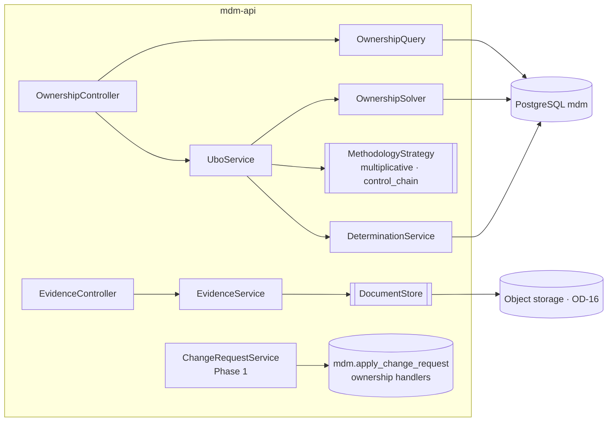

# Phase 6 — Ownership and UBO: low-level design

- **Status:** Draft, awaiting review (2026-11-11)
- **Phase goal (BUILD_PROTOCOL §2):** beneficial-ownership analysis.
- **Exit criteria:** ownership API and graph view; exact cross-holding calculation; UBO results with paths and evidence; thresholds as data.
- **Reads with:** V2 (`evidence_document`, `ownership_edge`, `ubo_threshold`, `effective_ownership`, `ubo_ownership_prong`,
  `ubo_control_prong`, starter rules), ADR-007, ADR-008, P-01, P-18, Phase 1 apply, Phase 3 UI, UI_STANDARD §5 (ownership graph, evidence viewer).

---

## 1. Purpose and scope

**Goal.** Analysts record ownership and control relationships between legal entities and people, each backed by evidence,
through governed change requests. For any entity Nexus computes, deterministically and exactly, who its ultimate
beneficial owners are under a given regime, shows every path with its evidence, and lets a compliance officer record a
determination as a dated, reproducible record.

| ID | Decision | Phase 6 delivers |
|---|---|---|
| NEW-02 | New | Ownership edges via change requests; evidence upload; exact effective ownership including cross-holdings; ownership and control prongs; thresholds as governed, bitemporal data; recorded determinations; API; graph and path-table views |

**Out:** AI extraction of edges from documents (NEW-03, Phase 7 — this phase provides what it writes into); exports of
ownership (Phase 8 if needed); screening against sanctions lists (not in the catalogue).

**Dependencies.** Phase 1 (apply, roles, errors), Phase 2 (workflow for ownership models), Phase 3 (UI shell, node panel tab),
Phase 4 (generator for synthetic ownership graphs). Storage for evidence (OD-16: object storage direction; OD-16a confirmation).

## 2. Confidence and assumptions

**Confidence: Medium.** The data model and path functions exist and are deterministic; the exact solver is standard
linear algebra. The regulatory methodology and the handling of personal data are Compliance and Privacy decisions (OD-34, OD-35).

| # | Assumption | Effect if wrong |
|---|---|---|
| G-1 | Percentages in `ownership_edge` are of the owned entity's total interest (V2 comment) | Per-class calculations need class weights |
| G-2 | Default methodology is **multiplicative with exact cross-holding resolution** (§7.1); a **control-chain** method is available per regime if Compliance requires it (OD-35) | Only the strategy changes; data and API stay |
| G-3 | The upstream component of a target has at most `OWNERSHIP_MAX_COMPONENT` (2 000) entities and depth `OWNERSHIP_MAX_DEPTH` (25, today's default in `effective_ownership`) | Above it the calculation refuses with a clear message rather than approximating |
| G-4 | Every manually entered edge cites evidence or carries a rationale; AI-extracted edges must cite evidence (CHECK exists) | Policy set by OD-34 |
| G-5 | Thresholds (`ubo_threshold`) are loaded and approved by Compliance; no seed values (V2 says so) | Calculations without a threshold return totals and "no threshold for this regime" |
| G-6 | Natural-person nodes and UBO results are personal data; access is limited to ownership roles; logs never contain names | OD-34 |

**Human decisions this phase waits on:** OD-35 methodology per regime (Compliance / Audit-Risk); OD-34 personal-data
handling and retention (Privacy / Security); OD-05 graph-visualisation library (the path table works without it); OD-16a evidence storage.

## 3. Component design



| Type | Responsibility | Key signatures | Must not |
|---|---|---|---|
| `OwnershipQuery` | Direct owners/owned (paged), bounded upstream subgraph for the view | `Page<EdgeView> owners(UUID node, Slice s, Cursor c, int limit)`; `Subgraph upstream(UUID node, Slice s, int maxNodes)` | Compute totals |
| `OwnershipSolver` | Exact effective ownership of every holder in the target via a rational linear solve (§7.1) | `SolveResult solve(UUID target, Slice s, Measure m /* ECONOMIC, VOTING */)` | Use floating point; call any AI |
| `Fraction` (value type) | Exact rational arithmetic on `BigInteger` numerator/denominator, normalised | `add`, `multiply`, `divide`, `toBigDecimal(scale, HALF_EVEN)` | Lose precision |
| `MethodologyStrategy` | Regime-specific attribution: `MultiplicativeStrategy` (default), `ControlChainStrategy` (outline until OD-35) | `List<UboCandidate> owners(SolveResult r, Threshold t)` | Hard-code thresholds |
| `UboService` | Assembles the result: ownership prong (totals, top paths, evidence), control prong (`mdm.ubo_control_prong`), flags | `UboResult ubo(UUID target, String regime, String jurisdiction, Slice s)` | Store anything (determinations do) |
| `DeterminationService` | Records a human determination with the full input hash and result | `Determination record(Actor a, UUID target, UboResult r, String note)` | Let a non-human record one |
| `EvidenceService` | Upload (hash, dedupe by SHA-256, store, metadata row), download for authorised users | `EvidenceView upload(Actor a, InputStream s, EvidenceMeta m)` | Keep files in the database or the repo |
| Apply handlers (SQL, Phase 1 function) | `add_ownership_edge`, `update_ownership_edge`, `end_ownership_edge` (actions exist in V1) | set-from-D on `ownership_edge` (Phase 1 §7.1) | — |

Roles (ADR-022 model, new codes, ADR-030): `OWNERSHIP_ANALYST` (read ownership, propose edges, upload evidence),
`COMPLIANCE_OFFICER` (read, decide ownership and threshold requests, record determinations). Ownership requests are on the
commit-policy hard-limit list already (V6); they always need a human.

## 4. Data design

### 4.1 Edges and evidence (V2, edits)
- `ownership_edge` stays as is (bitemporal, guarded, audited). Add a CHECK proposal: `source <> 'manual' OR
  evidence_document_id IS NOT NULL OR change_request rationale present` cannot be expressed as a CHECK across tables, so it is a
  rule in the `add_ownership_edge` handler: manual edges need `evidence_document_id` or `payload.rationale` (G-4, `N2401`).
- `evidence_document`: add `content_type text`, `size_bytes bigint`, `classification text NOT NULL DEFAULT 'confidential'`,
  `retention_until date` (OD-34); make it append-only (no update or delete; superseding documents are new rows).

### 4.2 Thresholds as governed, bitemporal data (V2, edit)
```sql
ALTER mdm.ubo_threshold ADD recorded_period tstzrange NOT NULL DEFAULT tstzrange(now(), NULL),
                        ADD method text NOT NULL DEFAULT 'multiplicative' CHECK (method IN ('multiplicative','control_chain')),
                        ADD measure text NOT NULL DEFAULT 'economic_or_voting' CHECK (measure IN ('economic','voting','economic_or_voting')),
                        ADD change_request_id uuid REFERENCES mdm.change_request;
-- primary key becomes an exclusion: (jurisdiction_code, regime, entity_category) WITH =, valid_period WITH && WHERE upper_inf(recorded_period)
-- + trg_bitemporal_guard, trg_audit_row
-- change_action gains 'set_ubo_threshold' / 'end_ubo_threshold' (payload: jurisdiction, regime, entityCategory, thresholdPct, method, measure, reference)
--   decided by COMPLIANCE_OFFICER; on the commit-policy hard-limit list
```

### 4.3 Determinations (new file `V13__ubo_determinations.sql`)
```sql
CREATE TABLE mdm.ubo_determination (
  determination_id uuid PRIMARY KEY DEFAULT gen_random_uuid(),
  target_node_id   uuid NOT NULL REFERENCES mdm.node,
  regime           text NOT NULL, jurisdiction_code text NOT NULL,
  as_of            date NOT NULL, recorded_as_of timestamptz NOT NULL,   -- the slice the result was computed on
  threshold        jsonb NOT NULL,                                     -- the threshold row used, verbatim
  method           text NOT NULL, solver_version text NOT NULL,
  input_sha256     char(64) NOT NULL,                                  -- hash of the sorted edge set used (§7.4)
  result           jsonb NOT NULL,                                     -- owners, totals (exact fraction and 6-dp decimal), paths, flags
  determined_by    uuid NOT NULL REFERENCES mdm.app_user,              -- human only (trigger)
  note             text,
  determined_at    timestamptz NOT NULL DEFAULT clock_timestamp()
);  -- append-only; audited; personal data (G-6)
CREATE INDEX ON mdm.ubo_determination (target_node_id, determined_at DESC);
```
Bitemporal behaviour: determinations are records, not facts; they reference the slice they used, so any can be recomputed
and compared later (the input hash proves the inputs were the same).

### 4.4 Volumes and indexes
| Object | Assumed volume | Index |
|---|---|---|
| `ownership_edge` | 10⁶ edges, 10⁵ persons | existing `(owned_node_id)`, `(owner_node_id)` partial indexes |
| Upstream component per target | typically < 100 entities; bound 2 000 (G-3) | recursive CTE over `(owned_node_id)` |
| `ubo_determination` | targets × reviews per year (10⁵/year) | `(target_node_id, determined_at)` |
| `evidence_document` | 10⁶ files metadata; files in object storage | existing `UNIQUE (sha256)` |

## 5. Interface design
| Endpoint | Purpose | Auth | Notes |
|---|---|---|---|
| `GET /ownership/entities/{id}/owners?asOf&recordedAsOf&limit&cursor` | Direct owners with relation, %, evidence, source, confidence | OWNERSHIP_ANALYST or COMPLIANCE_OFFICER | paged |
| `GET /ownership/entities/{id}/owned?…` | Direct holdings | same | paged |
| `GET /ownership/entities/{id}/graph?direction=up&maxNodes=…` | Bounded subgraph for the view (`OWNERSHIP_GRAPH_MAX_NODES` 300) | same | `truncated: true` when bounded |
| `GET /ownership/entities/{id}/ubo?regime&jurisdiction&asOf&recordedAsOf&measure` | Ownership prong (exact totals), control prong, top `UBO_MAX_PATHS` (50) paths per owner with evidence, flags | same | deterministic; same inputs → same body |
| `POST /ownership/entities/{id}/determinations` `{regime, jurisdiction, asOf, note}` | Recompute and record | COMPLIANCE_OFFICER | `Idempotency-Key` |
| `GET /ownership/entities/{id}/determinations?cursor` | History | same | paged |
| `POST /evidence-documents` (multipart: file + `{docType, title, source, issuer, documentDate}`) | Upload | OWNERSHIP_ANALYST | max `EVIDENCE_MAX_MB` (50); dedupe by hash → 200 with the existing id |
| `GET /evidence-documents/{id}` / `…/content` | Metadata / file stream | same (and audited) | — |
| `POST /change-requests` items `add_ownership_edge`, `update_ownership_edge`, `end_ownership_edge`, `set_ubo_threshold`, `end_ubo_threshold` | Governed changes | PROPOSE (analyst) / DECIDE (officer) | Phase 1 conventions |

UBO response (fragment):
```json
{ "target": {"nodeId": "…", "name": "…"}, "slice": {"asOf": "2027-01-15", "recordedAsOf": "2027-01-15T14:00:00Z"},
  "threshold": {"regime": "…", "jurisdiction": "…", "thresholdPct": "25.000", "method": "multiplicative", "reference": "…"},
  "ownershipProng": [{"personNodeId": "…", "totalPct": "37.500000", "totalExact": "3/8", "meetsThreshold": true,
                      "paths": [{"nodes": ["…","…"], "pct": "30.000000", "evidence": ["…"]}], "pathsTruncated": false}],
  "controlProng": [{"personNodeId": "…", "relation": "board_appointment_right", "basis": "…", "evidence": "…"}],
  "flags": ["CROSS_HOLDING_RESOLVED", "LOW_CONFIDENCE_AI_EDGE", "MISSING_EVIDENCE", "NO_THRESHOLD_FOR_REGIME", "UNKNOWN_REMAINDER_40PCT"],
  "inputSha256": "…", "solverVersion": "1" }
```
Errors: `N2401` manual edge without evidence or rationale; `N2402` component too large (G-3); `N2403` closed ownership loop
(an entity owned 100 % within a cycle with no external owner: the system is singular); `N2404` threshold missing for a determination.

## 6. Behaviour

### 6.1 Record an edge
Analyst uploads evidence → draft request with `add_ownership_edge` (owner, owned, relation, %, evidence id, locator) →
submit → validation (`OWN_SUM_LE_100`, `OWN_AI_LOW_CONFIDENCE` exist) → workflow (an ownership model, Phase 2) → officer
commits → apply writes the bitemporal edge. Same transaction rules as Phase 1.

### 6.2 Compute and record a determination
```mermaid
sequenceDiagram
  autonumber
  actor O as Compliance officer
  participant API as mdm-api
  participant DB as PostgreSQL
  O->>API: GET /ubo?regime&jurisdiction&asOf
  API->>DB: upstream component (recursive CTE, bounded) at the slice
  API->>API: OwnershipSolver (exact), strategy, control prong, flags
  API->>DB: mdm.ubo_ownership_prong paths (existing SQL) for evidence listing
  API-->>O: result + inputSha256
  O->>API: POST /determinations {note}
  API->>API: recompute at the same slice; inputSha256 must equal the viewed one, else 409 "inputs changed"
  API->>DB: INSERT mdm.ubo_determination (human-only trigger)
```
Read-only operations take a snapshot of the slice (one `REPEATABLE READ` transaction) so the component, paths and control
prong are consistent.

## 7. Algorithms

### 7.1 Exact effective ownership (multiplicative, with cross-holdings)
For a target `t` and measure `m` (economic or voting):
```text
C := upstream component of t: entities and persons reachable backwards from t over current edges at the slice
     (relation 'shareholding' for economic, 'voting_rights' or shareholding voting_pct for voting; is_direct only;
      nominee edges re-attributed to nominee_for_node_id, as effective_ownership does)
     abort N2402 if |entities(C)| > OWNERSHIP_MAX_COMPONENT
A[i][j] := Fraction(pct(i owns j) / 100) for entities i, j in C (aggregated over share classes)
D[p][j] := Fraction(pct(p owns j) / 100) for persons p, entities j
For every holder h, its integrated share x_h(j) in each entity j satisfies
      x_h(j) = D[h][j] + Σ_k x_h(k) · A[k][j]          (h's share of j directly, plus via every entity k that owns j)
i.e. x_h (I − A) = D[h]   →  solve the linear system once for all persons (multiple right-hand sides)
Solve by Gaussian elimination over Fraction with partial pivoting on non-zero entries.
If (I − A) is singular → N2403 (a closed loop: some entities are owned only by each other).
Result: total_h = x_h(t).
Flag UNKNOWN_REMAINDER_<n>PCT for every entity in C (the target included) whose recorded direct owners sum to less than
100 %: the missing share has no known owner, so totals are lower bounds for that part of the structure.
```
Complexity O(n³) over the component (n entities), with fraction growth; bounded by G-3. Convergence: no iteration, so no
tolerance; the answer is exact.

**Worked example (also a test case).** Person P owns 60 % of A; A owns 50 % of B; B owns 40 % of A. Target B.
`x(A) = 0.6 + 0.4·x(B)`, `x(B) = 0.5·x(A)` → `x(A) = 3/4`, `x(B) = 3/8`. P's effective ownership of B = **37.5 %**.
The existing SQL `effective_ownership` flags the B→A→B path as a cycle and reports 30 % (0.6 × 0.5) for P; the solver adds the
cross-holding contribution. On acyclic graphs both must agree exactly (consistency test).

### 7.2 Paths for evidence
Top `UBO_MAX_PATHS` paths per owner from `mdm.effective_ownership` (acyclic paths, existing SQL), ordered by path %, each
with the evidence document of every edge. The solver's total can exceed the sum of listed acyclic paths when cross-holdings
exist; the response says so (`CROSS_HOLDING_RESOLVED`, with the difference).

### 7.3 Strategies
- **Multiplicative (default):** owners with `total ≥ threshold` (exact comparison of fractions with the threshold as a fraction).
- **Control chain (OD-35, outline):** walk up from the target; an entity controlled > 50 % (by votes) by a holder attributes
  100 % of its holdings to that holder; otherwise multiplicative. Implemented as a second strategy if Compliance chooses it for a regime.
- **Measure `economic_or_voting`:** owner qualifies if either total meets the threshold.

### 7.4 Input hash
SHA-256 over the sorted list of `(owner, owned, relation, share_class, economic_pct, voting_pct, nominee_for, is_direct)` of
the component's edges at the slice, plus the threshold row and `solverVersion`.

## 8. Patterns applied
P-01 (edges and thresholds bitemporal), P-03 (governed edges and thresholds), P-07 (`DocumentStore`, `MethodologyStrategy`),
P-14-style strategy for methodology, P-18 (evidence on every path), P-19 (Phase 7 AI writes edges with evidence only), P-24 (guards).

## 9. Security and controls
| Control | Enforcement | Test |
|---|---|---|
| Deterministic calculations (CLAUDE.md rule 4) | Exact rational solver in Java; SQL paths; no AI anywhere in the calculation | Unit tests with exact expected fractions; same input → same output and hash |
| Maker-checker | Edges and thresholds through change requests; officer decides; ownership actions are STP hard limits | pgTAP |
| Human-only decisions | Determinations recorded by humans only (trigger) | pgTAP |
| Evidence | AI edges need evidence (CHECK exists); manual edges need evidence or rationale (`N2401`) | pgTAP |
| Bitemporal history | Edges, thresholds | pgTAP: determination recomputed at its slice gives the same hash |
| Append-only | Determinations, evidence metadata | pgTAP |
| Personal data | Ownership roles only; evidence downloads audited; no names in logs; retention per OD-34 | JUnit negative access tests |

## 10. Performance and scale
| Target | Value | Proof |
|---|---|---|
| UBO for a component of 100 entities | `P95_UBO_MS` 1 000 | perf test on generated graphs (Phase 4 generator extended) |
| Component of 2 000 entities | recorded; must finish under `UBO_TIMEOUT_S` (30) or refuse | perf test |
| Graph view | `OWNERSHIP_GRAPH_MAX_NODES` 300 in ≤ 500 ms | perf test |

## 11. Observability
Metrics `nexus.ubo.solve.duration`, `nexus.ubo.component.size`, `nexus.ubo.flags{flag}`, `nexus.evidence.uploads`;
audit entries for evidence downloads; no personal data in logs.

## 12. UI design
- **Node panel → Ownership tab** (Phase 3 placeholder becomes live) and **Ownership** in the navigation.
- **Owners / Owned tables** (design-system table): relation, % (two decimals in lists, full precision in detail, right-aligned tabular numerals — UI_STANDARD §7), source, confidence, evidence link.
- **UBO panel:** regime and jurisdiction pickers, threshold shown with its reference, result table of persons (total %, meets
  threshold, path count), expandable paths with evidence per edge, flags as text + icon, "Record determination" (officer only).
- **Ownership graph** (custom component, UI_STANDARD §5) behind an adapter until OD-05 picks the library, **always with the
  equivalent accessible path table**; never the graph alone; keyboard navigation through nodes in table order.
- **Evidence viewer** (custom component) opens beside the fact it supports, showing the locator (page, quote).
- AI-extracted edges carry the AI provenance token and confidence (UI_STANDARD §6).

## 13. Test design
Synthetic ownership graphs only (persons with generated names; no real entities or people).

| Criterion (NEW-02: UBOs computed with paths and evidence) | Cases | Type |
|---|---|---|
| Exact totals | P: chain (60 % × 50 % = 30 %); P: diamond (two paths summed); P: cross-holding worked example = 3/8; P: nominee look-through; P: share classes aggregated; N: closed loop → `N2403`; B: total exactly at threshold (25 % vs 25 %) meets it; B: 1 % below | Unit (solver) |
| Consistency with SQL | P: on 1 000 generated acyclic graphs, solver totals = `ubo_ownership_prong` totals exactly | JUnit |
| Paths and evidence | P: every listed path's edges carry their evidence ids; P: `CROSS_HOLDING_RESOLVED` with the difference | JUnit |
| Control prong | P: board appointment right, trustee, senior managing official appear; N: non-person owners excluded | pgTAP (existing function) + JUnit |
| Thresholds as data | P: threshold change via request, decided by officer; P: result at a past slice uses the then-valid threshold; N: no threshold → `NO_THRESHOLD_FOR_REGIME` | pgTAP + JUnit |
| Governance | N: analyst decides own edge request; N: AI edge without evidence (CHECK); N: manual edge without evidence or rationale (`N2401`) | pgTAP |
| Determinations | P: recorded with hash; P: recomputation at the same slice → same hash; N: inputs changed between view and record → 409; N: non-human recorder | pgTAP + JUnit |
| Access | N: steward without ownership roles gets 403 on every ownership endpoint and evidence download | JUnit |
| UI | Path table keyboard, graph alternative present, provenance tokens | Playwright + axe |
| Compliance-verified samples (catalogue golden source) | Synthetic structures whose expected results Compliance confirms | Golden (synthetic) |

## 14. Rollout and compatibility
Edits to V2 (evidence columns and append-only, threshold bitemporality and method), V1 (new actions, hard limits), new V13.
`ubo_threshold` stays empty until Compliance loads thresholds through requests. The existing SQL functions keep working (paths); the solver adds totals.

## 15. Risks, open questions and alternatives
| # | Item | Handling |
|---|---|---|
| R-1 | Methodology differs by regime (OD-35) | Strategy per threshold row (`method`) |
| R-2 | Personal data and retention (OD-34) | Classification and `retention_until` on evidence; determinations retained per decision; no deletion until decided |
| R-3 | Fraction growth on large components | Bound G-3; timeout; measured |
| Alt-1 | Floating-point matrix inverse `(I − A)⁻¹` | Rejected: not exact; results near thresholds could flip |
| Alt-2 | Iterate paths with a cycle cap | Rejected: approximates a geometric series |
| Alt-3 | Solve in SQL | Rejected: no exact rational arithmetic; harder to test |

## 16. Work breakdown
| # | Increment | Size | Tests |
|---|---|---|---|
| 6-1 | Ownership apply handlers, `N2401` rule, evidence columns, append-only evidence | M | pgTAP |
| 6-2 | Evidence upload/download with `DocumentStore` (local adapter; object storage per OD-16a) | M | JUnit |
| 6-3 | `Fraction`, `OwnershipSolver`, `MultiplicativeStrategy`, consistency test with SQL | L | unit + JUnit |
| 6-4 | Thresholds bitemporal + `set_ubo_threshold` / `end_ubo_threshold`; officer role | M | pgTAP + JUnit |
| 6-5 | `UboService`, owners/owned/graph/UBO endpoints, flags | M | JUnit |
| 6-6 | Determinations (V13), recompute-and-hash | S | pgTAP + JUnit |
| 6-7 | UI: Ownership tab, UBO panel, path table, evidence viewer; graph adapter (library per OD-05) | L | Playwright, Storybook, axe |
| 6-8 | Generator extension for ownership graphs; perf tests | S | perf |
| 6-9 | `ControlChainStrategy` if OD-35 selects it for any regime | M | unit |
| 6-10 | Records | S | review |
New dependencies: none for the backend (`BigInteger` fractions); the graph library is OD-05.
