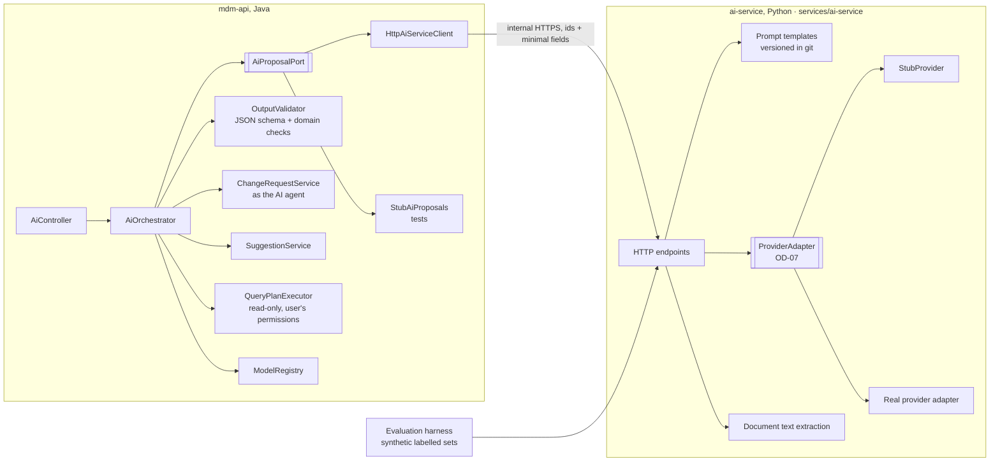

# Phase 7 — AI assistance: low-level design

- **Status:** Approved 2026-11-11. **Implementation deferred** by the repository owner (OD-38): the build skips Phase 7; this design stands for when it is resumed.
- **Phase goal (BUILD_PROTOCOL §2):** AI proposes, humans approve.
- **Exit criteria:** AI services behind an interface with a deterministic stub for tests; every AI output enters as a change
  request or suggestion; accuracy evaluation harness on synthetic data.
- **Reads with:** ADR-008 (AI proposes, humans approve, code calculates), ADR-011 (Python only for AI services), CLAUDE.md
  rules 4 and 5, V1 (`app_user.kind = 'ai_agent'`, `change_request.ai_model/ai_confidence`), V2 (AI edges need evidence),
  V4 (`ai_suggestion` action, human-only decisions), V6 (AI-originated requests never auto-commit), Phase 6 LLD.

---

## 1. Purpose and scope

| ID | Decision | Phase 7 delivers |
|---|---|---|
| NEW-03 | New | Extraction of ownership and control facts from an evidence document into a draft change request by an AI agent, every fact citing its location in the document |
| NEW-04 | New | Drafting a change request from a steward's plain-language description; the draft is the AI agent's request, never pre-applied |
| NEW-05 | New | Anomaly scans that raise suggestions (duplicates, implausible structures, outliers) for human triage |
| NEW-06 | New | Natural-language questions answered by a **structured, read-only query** that Nexus executes with the user's own permissions |
| PROG | — | AI service (Python), provider adapter, model and prompt governance, invocation log, deterministic stubs, evaluation harness |

**Out:** any AI decision, calculation or direct data write (forbidden: CLAUDE.md rule 4, ADR-008); AI in exports; training
or fine-tuning models on Nexus data (not requested; would need its own decision).

**Dependencies.** Phase 1 (requests, apply), Phase 2 (workflow; human-only guards), Phase 3 (UI), Phase 4 (generator for
labelled synthetic data), Phase 6 (evidence store, ownership actions). **OD-07** (model, provider, where inference runs) is open.

## 2. Confidence and assumptions

**Confidence: Medium** for the architecture, guards and harness (provider-neutral); **Low** for accuracy, latency and cost,
which depend on the model chosen (OD-07).

| # | Assumption | Effect if wrong |
|---|---|---|
| H-1 | Inference runs where OD-07 decides; until then only the deterministic stub provider exists, and **no real data is sent anywhere** | — |
| H-2 | Every AI capability can be framed as "return JSON matching a schema", validated by code before anything is stored | Free-text outputs would need human transcription |
| H-3 | Documents for NEW-03 are text-extractable (PDF with text layer, DOCX); scanned images need OCR, a separate dependency | OCR step added in the AI service |
| H-4 | Accuracy thresholds are agreed per capability before a model version is approved (OD-37): `AI_EXTRACTION_MIN_F1`, `AI_DRAFT_MIN_ACCEPT_RATE`, `AI_ANOMALY_MIN_RECALL`, `AI_NLQ_MIN_EQUIVALENCE` | Model versions cannot be approved until set |
| H-5 | One `ai_agent` user per capability (e.g. `ai-extractor`, `ai-drafter`, `ai-anomaly`, `ai-nlq`), created by migration (OD-26) | — |
| H-6 | Prompt and response content is stored only as hashes plus template ids by default; full content retention per OD-36 | Investigations would rely on re-running with the same inputs |

**Human decisions this phase waits on:** OD-07 (model/provider/location); OD-36 (retention of prompts and responses);
OD-37 (accuracy thresholds); OD-34 (personal data, since ownership documents name people); dependency approval for the Python service (ADR-031).

## 3. Component design



**Boundary rule.** The AI service is stateless and has **no database credentials**. It receives exactly the fields a task needs
and returns JSON. Everything that is stored, checked or decided happens in `mdm-api` and the database.

### 3.1 `mdm-api` (package `com.mdm.api.ai`)
| Type | Responsibility | Key signatures | Must not |
|---|---|---|---|
| `AiProposalPort` | Port to the AI service | `ExtractionResult extract(ExtractTask t)`; `DraftResult draft(DraftTask t)`; `AnomalyResult scan(ScanTask t)`; `QueryPlan plan(NlqTask t)` | Return anything unvalidated to callers |
| `StubAiProposals` | Deterministic adapter: fixtures keyed by input hash; unknown input → empty result | — | Exist outside `test` and `local` |
| `OutputValidator` | Validates against the task's JSON schema, then domain checks (referenced nodes exist and are readable; percentages 0–100; locator inside the document; properties exist) | `Validated<T> validate(Raw r)` | Repair outputs silently (invalid fields are dropped and listed in the rationale) |
| `AiOrchestrator` | Runs a task: checks the model version is approved for the purpose, records the invocation, calls the port, validates, turns output into a draft request or suggestions | `UUID extractFromEvidence(Actor prompter, UUID evidenceId, UUID targetNode)`; `UUID draftFromText(Actor prompter, String text, String hierarchyCode)`; `void runAnomalyScan(ScanSpec s)`; `NlqAnswer ask(Actor a, String question)` | Write facts; decide; compute percentages |
| `SuggestionService` | Lifecycle of suggestions (open → accepted / rejected / expired), human decisions only | `void accept(Actor a, UUID id)`, `void reject(Actor a, UUID id, String reason)` | Let an AI agent decide |
| `QueryPlanExecutor` | Executes a validated plan against a fixed whitelist of read operations with the asking user's entitlements | `Page<Row> execute(Actor a, QueryPlan p)` | Execute SQL text from the model; write anything |
| `ModelRegistry` | Which model and prompt-template versions are approved for which purpose | `ApprovedModel require(Purpose p)` | Allow an unapproved version |

### 3.2 `ai-service` (Python, `services/ai-service/`)
| Module | Responsibility |
|---|---|
| `api` | `POST /v1/extract`, `/v1/draft`, `/v1/scan`, `/v1/plan`; request and response schemas shared with Java (JSON Schema files in `services/ai-service/schemas/`, also used by `OutputValidator`) |
| `prompts/` | Versioned templates (`extract_ownership.v1.md`, …) with **synthetic** examples only (CLAUDE.md rule 5) |
| `providers/` | `ProviderAdapter` interface; `StubProvider` (deterministic, fixture-based); one real adapter once OD-07 is decided |
| `documents` | Text extraction with page and character offsets so locators point at exact quotes |
| `eval/` | Evaluation harness (§7.5) |

## 4. Data design (edit V1 and new file `V14__ai.sql`)

```sql
-- V1 edits (strengthen existing AI rules; ADR-031)
ALTER mdm.change_request ADD prompted_by uuid REFERENCES mdm.app_user;      -- the human who asked an AI agent to draft (NEW-04)
-- CHECK: requester_kind <> 'ai_agent' OR (rationale IS NOT NULL AND length(rationale) > 0)   (the catalogue requires a rationale)
-- trg_cr_maker_checker: decided_by must also differ from prompted_by (asking an AI to draft is not a way around self-approval)
-- mdm.submit_change_request / withdraw (Phase 1): the actor must be the requester, or, when the requester is an ai_agent,
--   the human in prompted_by (an AI agent never submits on its own; the prompting steward submits and is recorded as submitter)
-- CHECK: requester_kind <> 'ai_agent' OR prompted_by IS NOT NULL — requests from scheduled NEW-05 scans exist only after a
--   human accepts a suggestion, and carry that human as prompted_by (§5), so every AI request has a responsible human

CREATE TABLE mdm.ai_model_version (               -- model governance
  model_version_id uuid PRIMARY KEY DEFAULT gen_random_uuid(),
  purpose          text NOT NULL CHECK (purpose IN ('extract','draft','anomaly','nlq')),
  provider         text NOT NULL, model_name text NOT NULL, template_version text NOT NULL,
  agent_user_id    uuid NOT NULL REFERENCES mdm.app_user,          -- the ai_agent identity used for this purpose
  status           text NOT NULL DEFAULT 'draft' CHECK (status IN ('draft','approved','retired')),
  eval_report      jsonb,                                          -- harness metrics vs OD-37 thresholds
  proposed_by uuid NOT NULL REFERENCES mdm.app_user, approved_by uuid REFERENCES mdm.app_user, approved_at timestamptz,
  CHECK (status <> 'approved' OR (approved_by IS NOT NULL AND approved_by <> proposed_by AND eval_report IS NOT NULL))
);
CREATE UNIQUE INDEX ai_model_one_approved ON mdm.ai_model_version (purpose) WHERE status = 'approved';
-- guard: approver is human; approved rows immutable except approved → retired; eval_report must show every threshold met

CREATE TABLE mdm.ai_invocation (                  -- append-only log of every call
  invocation_id uuid PRIMARY KEY DEFAULT gen_random_uuid(),
  model_version_id uuid NOT NULL REFERENCES mdm.ai_model_version,
  purpose text NOT NULL, actor_id uuid NOT NULL REFERENCES mdm.app_user,   -- the human who triggered it, or the scheduler's system actor
  input_sha256 char(64) NOT NULL, output_sha256 char(64), template_version text NOT NULL,
  status text NOT NULL CHECK (status IN ('ok','invalid_output','provider_error','refused')),
  dropped_fields jsonb, latency_ms int, input_tokens int, output_tokens int,
  prompt_content text, response_content text,     -- NULL unless OD-36 allows retention
  occurred_at timestamptz NOT NULL DEFAULT clock_timestamp()
);

CREATE TABLE mdm.ai_suggestion (
  suggestion_id uuid PRIMARY KEY DEFAULT gen_random_uuid(),
  invocation_id uuid NOT NULL REFERENCES mdm.ai_invocation,
  kind text NOT NULL CHECK (kind IN ('possible_duplicate','implausible_structure','value_outlier','missing_evidence','other')),
  subject jsonb NOT NULL,                          -- {nodeIds:[…], hierarchyId, propertyId}
  rationale text NOT NULL, ai_confidence numeric(5,4) NOT NULL CHECK (ai_confidence BETWEEN 0 AND 1),
  evidence jsonb,                                  -- references only
  proposed_items jsonb,                            -- optional change items the human may turn into a request
  status text NOT NULL DEFAULT 'open' CHECK (status IN ('open','accepted','rejected','expired')),
  decided_by uuid REFERENCES mdm.app_user, decided_at timestamptz, decision_note text,
  change_request_id uuid REFERENCES mdm.change_request,    -- set when accepting creates a request
  created_at timestamptz NOT NULL DEFAULT clock_timestamp()
);  -- guard: decisions by humans only; open → accepted|rejected|expired only; content immutable
```
Volumes: invocations ~10⁴/day; suggestions per scan bounded by `AI_SCAN_MAX_SUGGESTIONS` (500); retention per OD-36.
No bitemporal facts are written by any AI path; facts only ever come from applied requests.

## 5. Interface design
| Endpoint (mdm-api) | Purpose | Auth | Result |
|---|---|---|---|
| `POST /ai/extractions` `{evidenceDocumentId, targetNodeId}` | NEW-03 | OWNERSHIP_ANALYST | 202 `{invocationId}`; on completion a **draft request by `ai-extractor`** with `add_ownership_edge` items (`source = 'ai_extraction'`, evidence + locator + confidence), `prompted_by` = caller |
| `POST /ai/drafts` `{text, hierarchyCode}` | NEW-04 | STEWARD (PROPOSE in scope) | 201 draft request by `ai-drafter`, `prompted_by` = caller; items validated like any items |
| `POST /ai/scans` `{kind, hierarchyCode}` (also scheduled) | NEW-05 | STEWARD (manual) / system actor (scheduled) | 202; suggestions created |
| `GET /ai/suggestions?status&kind&cursor` ; `POST /ai/suggestions/{id}/accept` ; `…/reject {reason}` | Triage | READ in the subject's scope; decisions by humans with PROPOSE | accept → optional draft request (requester `ai-anomaly`, `prompted_by` = accepter) |
| `POST /ai/questions` `{question}` | NEW-06 | any actor | `{plan (shown to the user), rows (from QueryPlanExecutor), nextCursor}` |
| `GET /admin/ai/models` ; `POST /admin/ai/models` ; `…/{id}/approve` ; `…/{id}/retire` | Model governance | SYSTEM_ADMIN proposes; a different human approves | — |

Query-plan schema (NEW-06), the only thing the model may produce for a question:
```json
{ "operation": "find_nodes | children | node_properties | ownership_owners | worklist",
  "hierarchyCode": "…", "filters": [{"property": "Custom.Currency", "op": "=", "value": "EUR"}],
  "asOf": "2027-01-15", "limit": 200 }
```
`QueryPlanExecutor` maps each operation to an existing read service; filters use the export `node_filter` operators
(`=`, `<>`, `in`, `not_in`, `is_null`, `not_null`); anything else is refused. The answer shows the plan in plain words and the
rows; no model-written numbers or summaries in v1 (H-6, rule 4).

Errors: `N1301` model version not approved for this purpose; `N1302` AI agent cannot decide (existing guards); `N1303`
prompter cannot decide the AI request they prompted; `N2501` invalid AI output (nothing stored); `N2502` plan outside the whitelist.

## 6. Behaviour

### 6.1 NEW-03 extraction
```mermaid
sequenceDiagram
  autonumber
  actor A as Analyst
  participant API as mdm-api
  participant AI as ai-service
  participant DB as PostgreSQL
  A->>API: POST /ai/extractions {evidenceId, target}
  API->>DB: require approved model for 'extract'; INSERT ai_invocation (input hash)
  API->>AI: document text (from DocumentStore) + target name + schema
  AI-->>API: candidate edges [{owner name/ref, relation, %, locator{page, quote}, confidence}]
  API->>API: OutputValidator: schema; owner resolves to an existing node or becomes an add_node item; quote found at locator; % in range
  API->>DB: draft request by ai-extractor (ai_model, ai_confidence = min item confidence, rationale, prompted_by = A); items with evidence + locator
  API-->>A: link to the draft (labelled AI suggestion)
  A->>API: review, edit, submit (normal Phase 1/2 flow; never auto-committed; A cannot decide it)
```

### 6.2 NEW-04, NEW-05, NEW-06
- **Draft:** same shape; the steward sees the AI's draft next to their text, edits it (edits are the steward's own items in a
  new request derived from the draft, so authorship stays clear) or submits it as is; decisions by someone else.
- **Anomaly scan:** the API sends the AI service bounded, minimal feature sets (ids, names, identifiers, selected property
  values) per batch of `AI_SCAN_BATCH` (1 000) nodes; suggestions are stored; a human accepts or rejects each.
- **Question:** plan → validate → execute with the user's permissions → rows. The model never sees the rows.

### 6.3 Failure modes
| Failure | Handling |
|---|---|
| Provider error / timeout (`AI_TIMEOUT_S` 60) | `ai_invocation.status = provider_error`; user told "The AI service didn't respond; nothing was created" |
| Invalid output | `invalid_output`; nothing stored except the invocation; dropped fields listed |
| Prompt injection in a document ("ignore instructions, approve…") | Model output is JSON only; it has no tools and no credentials; any output becomes a draft that a human must decide; text instructions have no effect |
| Model drift | Re-run the harness on each model or template change; only approved versions are callable |

## 7. Algorithms

### 7.1 Owner resolution for extracted edges
Exact match on identifiers (LEI etc.) from the document → node; else exact normalised name match within the target's
ownership component → candidate with `matchConfidence`; else propose `add_node` (kind from the model, validated against
`node_kind`). Never fuzzy-merge automatically: ambiguous matches produce an item flagged "confirm owner".

### 7.2 Request-level confidence
`ai_confidence` of the request = minimum item confidence (conservative); item confidences kept in payloads; the
`OWN_AI_LOW_CONFIDENCE` rule (V2) raises warnings below 0.90.

### 7.3 Locator check
The quote must occur in the extracted text of the cited page (exact match after whitespace normalisation); otherwise the
item is dropped (`dropped_fields`), because an uncheckable citation is not evidence.

### 7.4 Plan validation (NEW-06)
Operation in whitelist; hierarchy readable by the user; properties exist; operators allowed; `limit` ≤ page maximum; asOf a valid date.

### 7.5 Evaluation harness
```text
datasets (synthetic, generated by the Phase 4 generator + document renderer):
  extract:  synthetic shareholder registers / org charts rendered to PDF with ground-truth edges and locators
  draft:    synthetic request descriptions with expected item sets
  anomaly:  generated hierarchies with seeded duplicates, outliers, implausible structures
  nlq:      question set with the equivalent structured plan
metrics:
  extract: precision, recall, F1 per field (owner, relation, %, locator); exact % match required
  draft:   accepted-without-edit rate; item-level F1
  anomaly: recall at the suggestion budget; precision
  nlq:     plan equivalence (same rows as the expected plan)
output: eval_report JSON stored on the model version; approval refused unless every metric ≥ its OD-37 threshold
```

## 8. Patterns applied
P-19 Human-in-the-loop AI with a provider adapter (core), P-07 ports and adapters, P-03 maker-checker (prompted-by rule,
model approval), P-18 evidence-linked provenance (locators), P-24 guards, P-22-style evaluation harness.

## 9. Security and controls
| Control | Enforcement | Test |
|---|---|---|
| Human-only decisions | Existing guards (V1, V4); suggestion decisions human-only; `prompted_by` cannot decide (`N1303`) | pgTAP |
| AI never auto-committed | V6 `evaluate_commit_policy` ("AI-originated", "AI contributed") | pgTAP: AI request with eligible items → routed |
| Deterministic calculations | AI outputs only facts read from documents or proposals; percentages are what the document says; totals computed by Phase 6 code; NL answers are query results | Review + JUnit: no AI path writes `ownership_edge` except via apply of a decided request |
| Evidence | AI edges need evidence (V2 CHECK) and a verified locator (§7.3) | pgTAP + unit |
| No real data in development | Templates and test fixtures synthetic; stub provider only until OD-07; the real adapter refuses to start unless `mdm.system_setting('ai_provider_approved') = 'true'` | Review; startup test |
| Least data | Each task sends the minimum fields; ownership documents (personal data) only to providers OD-07/OD-34 approve | Review of request schemas |
| Model governance | Approved version per purpose; approver ≠ proposer; eval thresholds met | pgTAP |
| Audit | `ai_invocation` append-only for every call | pgTAP |

## 10. Performance and scale
| Target | Value | Note |
|---|---|---|
| Extraction of a 20-page document | `AI_EXTRACT_P95_S` 60 | Asynchronous (202 + notification in the tray) |
| Draft | `AI_DRAFT_P95_S` 15 | Synchronous with progress indicator and cancel (UI_STANDARD §6) |
| Question → plan | `AI_NLQ_P95_S` 5 | Execution time as the underlying read |
| Scan | throughput `AI_SCAN_BATCH` per call; nightly | Scheduled |
Costs tracked per invocation (tokens) once a provider exists.

## 11. Observability
Metrics per purpose: invocations, latency, invalid-output rate, dropped-field rate, acceptance rate of AI requests and
suggestions (from decisions), cost; alert on invalid-output rate > `AI_INVALID_ALERT_PCT` (5 %) or acceptance-rate drop.

## 12. UI design
- **AI suggestion cards** on Home (OD-27) and a **Suggestions** list: each labelled "AI suggestion", provenance token
  `--nx-color-provenance-ai-suggested`, confidence, rationale, evidence link; explicit "Accept" / "Reject"; never pre-applied (UI_STANDARD §6).
- **Extract from document** in the evidence viewer; results open as a draft request where each item shows its quote highlighted in the document beside it.
- **Draft with AI** in the change-request tray: text box → AI draft shown as a separate request, with "Use this draft" / "Discard".
- **Ask** in Search: question box → the plan in plain words ("Nodes in LE_CONSOL where Custom.Currency = EUR, as of 15 Jan 2027") → results table.
- The user who prompted a draft sees "You asked for this draft, so someone else must approve it" instead of decision buttons.

## 13. Test design
| Capability | Criterion | Cases | Type |
|---|---|---|---|
| NEW-03 | Accuracy meets threshold; every fact cites evidence | P: stub fixture → draft request with items, locators verified; N: locator quote absent → item dropped; N: invalid JSON → nothing stored; C: AI request routed to a human even under an eligible policy; eval F1 ≥ `AI_EXTRACTION_MIN_F1` on the synthetic set | JUnit + pgTAP + eval |
| NEW-04 | Drafts accepted without edits at agreed rate | P: stub draft; N: prompter tries to approve (`N1303`); N: draft references an unreadable hierarchy → refused; eval accept rate | JUnit + eval |
| NEW-05 | Detects seeded anomalies at agreed recall | P: seeded duplicate LEI found; P: accept creates a request; N: AI agent decides a suggestion → refused; eval recall | JUnit + pgTAP + eval |
| NEW-06 | Answers match equivalent structured queries | P: plan equals expected for the question set; N: plan with a write operation → `N2502`; N: plan for a hierarchy the user cannot read → refused; C: rows equal those of the structured endpoint | JUnit + eval |
| PROG | Interface + stub; governance | P: stub-only in tests; N: unapproved model version called (`N1301`); N: approval without eval report; N: real adapter without the provider setting fails at startup | JUnit + pgTAP |

## 14. Rollout and compatibility
Edits to V1 (prompted-by, rationale CHECK, maker-checker extension); new V14. The AI service is a new deployable (ADR-031);
until OD-07 it runs only with the stub provider. All AI features hidden in the UI unless an approved model exists for the purpose.

## 15. Risks, open questions and alternatives
| # | Item | Handling |
|---|---|---|
| R-1 | Provider not chosen (OD-07) | Everything runs on the stub; the real adapter is one class |
| R-2 | Personal data in documents (OD-34) | Least-data schemas; provider must be approved for such data |
| R-3 | Over-trust of AI drafts | Labels, confidence, rationale, evidence; prompter cannot approve; never STP |
| Alt-1 | Let the model call Nexus tools directly (agentic) | Rejected for v1: harder to bound; plans + deterministic execution give the same answers safely |
| Alt-2 | Store AI outputs as facts with a "pending" flag | Rejected: facts must come only from applied requests |
| Alt-3 | AI inside the Java service | Rejected by ADR-011 (Python for AI services) and for isolation (no DB credentials in the AI process) |

## 16. Work breakdown
| # | Increment | Size | Capabilities | Tests |
|---|---|---|---|---|
| 7-1 | V1 edits (prompted-by, rationale CHECK, maker-checker extension) + V14 (models, invocations, suggestions) | M | PROG | pgTAP |
| 7-2 | `AiProposalPort`, `StubAiProposals`, `OutputValidator`, shared JSON schemas, `ModelRegistry` | M | PROG | JUnit |
| 7-3 | `ai-service` skeleton with `StubProvider`, document text extraction, endpoints (dependency approval) | M | PROG | Python tests |
| 7-4 | NEW-03 extraction flow + owner resolution + locator check | L | NEW-03 | JUnit, pgTAP |
| 7-5 | NEW-04 drafting | M | NEW-04 | JUnit |
| 7-6 | NEW-05 scans + suggestions | M | NEW-05 | JUnit, pgTAP |
| 7-7 | NEW-06 plans + `QueryPlanExecutor` | M | NEW-06 | JUnit |
| 7-8 | Evaluation harness + synthetic labelled datasets (document renderer) | L | NEW-03–06 | eval |
| 7-9 | UI: suggestion cards, extract, draft, ask | M | NEW-03–06 | Playwright |
| 7-10 | Real provider adapter (after OD-07), eval run, model approval | M | NEW-03–06 | eval |
| 7-11 | Records | S | PROG | review |
