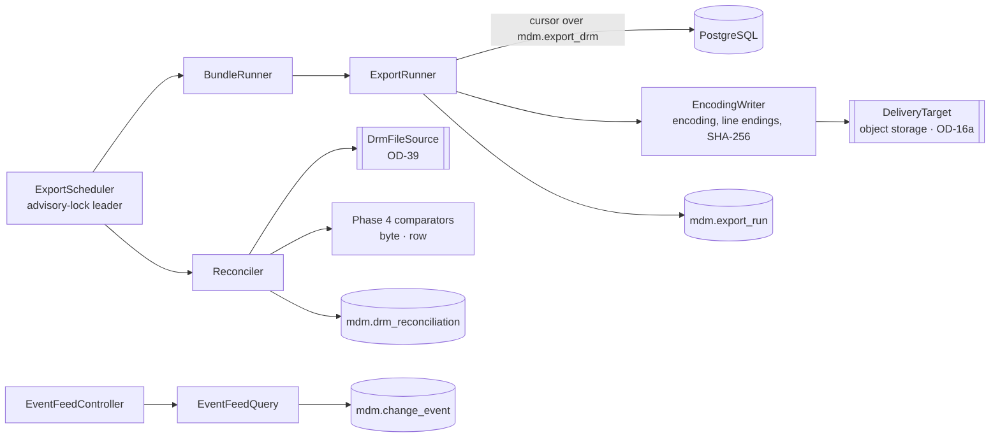

# Phase 8 — Exports and reconciliation: low-level design

- **Status:** Approved 2026-11-11 (consistency fixes CR-nn applied the same day, see `../CONSISTENCY_REVIEW.md`)
- **Migration rule (CR-07):** where this design says "edit Vn", that is allowed only while no shared environment exists (CLAUDE.md rule 6, OD-18). If one exists when this phase is built, the same change goes into a new V-numbered migration (`ALTER` / `CREATE OR REPLACE`). What counts as shared: OD-44.
- **Phase goal (BUILD_PROTOCOL §2):** downstream compatibility.
- **Exit criteria:** export service with profiles and bundles; byte-level comparison harness; export run history.
- **Reads with:** V3 (`export_profile`, `export_profile_column`, `hierarchy_tree`, `property_value_asof`, `export_drm`,
  `run_export`, `export_run`, `drm_reconciliation`, staging `drm_export_definition`), ADR-002, ADR-009, ADR-016, P-06, P-20,
  P-22, P-23, Phase 1 (`mdm.change_event`), Phase 4 (comparators, `PerfHarness` baseline). **Phase 7 is approved but its
  build is deferred (OD-38); nothing here depends on it.**

---

## 1. Purpose and scope

**Goal.** Produce DRM-compatible export files from approved, versioned profiles; run them on a schedule, individually or as
bundles, with a complete run history; compare each Nexus file with the matching DRM file every day of the parallel run;
publish change events so downstream systems can react without waiting for files.

| ID | Decision | Phase 8 delivers |
|---|---|---|
| NEW-09 | New | Daily reconciliation per downstream feed: run, hash, compare byte-for-byte, row-level diff on mismatch, human review of every difference, parallel-run tracking per consumer |
| NEW-07 | New | Change-event feed (pull API) from `mdm.change_event`, scoped per consumer, with an optional broker relay later (OD-20) |
| PROG (infrastructure for NEW-09) | — | Streaming export runner over the existing hierarchy and generation exports; versioned, approved export profiles; bundles; append-only run history; scheduler; object-storage delivery |

**Outline only, pending decision (§15):** EXP-01…08 parity specifics (XML exports, compare/difference and transaction-log
exports, delivery targets beyond object storage, books as user-facing objects, every filter and format option), ADM-02 (web
service API for each current integration), ADM-03 (batch automation of imports and validations). Their acceptance tests are
the golden byte comparisons this phase makes possible.

**Dependencies.** Phase 1 (change events), Phase 2 (workflow for governed configuration, optional), Phase 4 (comparators,
baseline), Phase 6 (`DocumentStore` / object storage, OD-16a). The DRM files must be readable from where reconciliation runs (OD-39).

## 2. Confidence and assumptions

**Confidence: Medium.** The SQL generators exist and run; streaming, hashing and reconciliation are straightforward.
Byte parity for every profile depends on undecided EXP capabilities and on the golden data (OD-31, OD-32).

| # | Assumption | Effect if wrong |
|---|---|---|
| I-1 | The existing `export_drm` output is the reference format for hierarchy and generation exports; Java streams it, adding encoding, line endings and hashing exactly as `run_export` does | If they differ, a consistency test fails before any reconciliation |
| I-2 | The Phase 4 baseline decides whether `export_drm` (row-by-row functions) is fast enough at `MAX_NODES_PER_HIERARCHY`; if not, a set-based generator is built behind the same profile semantics (§7.2) | Increment 8-9 is conditional |
| I-3 | DRM's export job drops its files in an agreed location inside the network each day (OD-39) | Reconciliation cannot run otherwise |
| I-4 | A consumer feed maps one-to-one to an export profile (`export_profile.target_system`, `drm_export_name`) | Many-to-one feeds need bundle-level comparison |
| I-5 | Consumers pull change events and then read the current state through the API with their own read scope | Push to webhooks or a broker needs OD-20 |
| I-6 | Volumes: ~300 profiles; ~100 run daily; largest file ~500 000 lines | Scheduler concurrency `EXPORT_PARALLELISM` (4) |

**Human decisions this phase waits on:** OD-09 (EXP-*, ADM-02, ADM-03), OD-39 (DRM file access), OD-40 (who may accept a
reconciliation difference), OD-20 (broker), OD-06/OD-26 (integration identities), OD-31/32 (golden data).

## 3. Component design (`com.mdm.api.export`, `com.mdm.api.recon`, `com.mdm.api.events`)



| Type | Responsibility | Key signatures | Must not |
|---|---|---|---|
| `ExportRunner` | Runs one approved profile version at a version slice: streams lines (fetch size `BATCH_FETCH_SIZE`), writes through `EncodingWriter`, records the run | `ExportRun run(String profileCode, String versionName, Actor triggeredBy)` | Build the whole file in memory (`run_export` does; fine only for small profiles) |
| `EncodingWriter` | Applies `encoding`, `line_ending`, `trailing_line_ending`; computes SHA-256 and line count while writing | `void writeLine(String)`, `Result close()` | Re-format content (the SQL already formats cells) |
| `BundleRunner` | Runs a bundle's profiles (parallel up to `EXPORT_PARALLELISM`), one bundle run with child export runs | `BundleRun run(String bundleCode, String versionName)` | — |
| `ExportScheduler` | Cron schedules from `mdm.export_schedule`; leader election by PostgreSQL advisory lock (no new dependency); misfire policy "run once" | `@Scheduled` tick every minute | Run the same schedule twice |
| `ProfileAdminService` | Draft, submit, approve (second person), retire profile versions | `ProfileVersion propose(...)`; `void approve(UUID id, Actor a)` | Edit an approved version |
| `Reconciler` | For each feed due: Nexus run (or reuse today's), DRM file from `DrmFileSource`, hash compare, on mismatch row diff (`RowComparator` with the profile's key columns) and first differing lines (`ByteComparator`) | `Reconciliation reconcile(String profileCode, LocalDate day)` | Auto-accept differences |
| `DrmFileSource` (port) | Reads DRM's file for a feed and day | `Optional<Path> fetch(String drmExportName, LocalDate day)` | Copy files outside the network |
| `ParallelRunTracker` | Consecutive exact-match days per consumer; readiness when ≥ `PARALLEL_RUN_DAYS` | `Readiness readiness(String targetSystem)` | — |
| `EventFeedController` / `EventFeedQuery` | `GET /events` (pull, keyset by `event_id`), filtered to the consumer's readable hierarchies | `Page<ChangeEventView> after(Actor consumer, long afterId, int limit)` | Include property values (I-5) |

## 4. Data design (edits to V3; new file `V15__exports.sql`)

### 4.1 Versioned, approved export profiles (V3 edit)
```sql
ALTER mdm.export_profile ADD profile_version int NOT NULL DEFAULT 1,
  ADD status text NOT NULL DEFAULT 'draft' CHECK (status IN ('draft','pending_approval','approved','retired')),
  ADD proposed_by uuid REFERENCES mdm.app_user, ADD approved_by uuid REFERENCES mdm.app_user, ADD approved_at timestamptz,
  DROP CONSTRAINT export_profile_profile_code_key,
  ADD UNIQUE (profile_code, profile_version),
  ADD CHECK (status <> 'approved' OR (approved_by IS NOT NULL AND approved_by <> proposed_by));
CREATE UNIQUE INDEX export_profile_one_approved ON mdm.export_profile (profile_code) WHERE status = 'approved';
-- guard (same shape as wf.trg_policy_guard): content and columns frozen once pending_approval; approved rows immutable
--   except approved → retired; approver human; audited (trg_audit_row on export_profile and export_profile_column)
-- mdm.export_drm / run_export select the approved version instead of "is_active" (is_active kept for switching a feed off)
```
Why: a profile change alters every downstream file; a second person must approve it, and every run must say which version it used.

### 4.2 Runs, bundles, schedules (V15)
```sql
ALTER mdm.export_run ADD profile_version int, ADD status text NOT NULL DEFAULT 'succeeded'
      CHECK (status IN ('running','succeeded','failed')), ADD started_at timestamptz, ADD finished_at timestamptz,
      ADD byte_count bigint, ADD error text, ADD bundle_run_id uuid, ADD generator text NOT NULL DEFAULT 'sql_reference';
-- export_run becomes append-only except running → succeeded|failed (D-30; AUD-03 infrastructure)
CREATE TABLE mdm.export_bundle (bundle_code text PRIMARY KEY, name text NOT NULL, owner_team text, is_active boolean NOT NULL DEFAULT true);
CREATE TABLE mdm.export_bundle_member (bundle_code text REFERENCES mdm.export_bundle, profile_code text NOT NULL, seq int NOT NULL,
  PRIMARY KEY (bundle_code, profile_code));
CREATE TABLE mdm.export_bundle_run (bundle_run_id uuid PRIMARY KEY DEFAULT gen_random_uuid(), bundle_code text NOT NULL,
  version_id uuid NOT NULL REFERENCES mdm.version, status text NOT NULL, started_at timestamptz NOT NULL, finished_at timestamptz,
  triggered_by uuid REFERENCES mdm.app_user);                                  -- append-only except completion
CREATE TABLE mdm.export_schedule (schedule_code text PRIMARY KEY, bundle_code text, profile_code text,
  cron text NOT NULL, version_alias text NOT NULL DEFAULT 'current_working',  -- VER-05 aliases when decided; until then a fixed rule (§7.3)
  time_zone text,                                    -- NULL = the business time zone from mdm.system_setting (CR-01)
  reconcile boolean NOT NULL DEFAULT false, is_active boolean NOT NULL DEFAULT true,
  CHECK ((bundle_code IS NULL) <> (profile_code IS NULL)));
```

### 4.3 Reconciliation (V3 edit of `drm_reconciliation`)
```sql
ALTER mdm.drm_reconciliation ADD feed_day date NOT NULL, ADD profile_code text NOT NULL, ADD target_system text,
  ADD explained_by uuid REFERENCES mdm.app_user, ADD explanation text, ADD decided_at timestamptz;
-- status: open → explained → fixed | accepted ; open → fixed. Guard: humans only; 'accepted' (a permanent parity exception)
--   needs reviewed_by ≠ explained_by (OD-40); closed rows immutable; audited. is_exact_match stays the generated column (exists).
CREATE UNIQUE INDEX ON mdm.drm_reconciliation (profile_code, feed_day);
```

### 4.4 Event feed (uses Phase 1 `mdm.change_event`; V15)
```sql
CREATE TABLE mdm.change_event_consumer (consumer_code text PRIMARY KEY, actor_id uuid NOT NULL REFERENCES mdm.app_user,
  last_event_id bigint NOT NULL DEFAULT 0, updated_at timestamptz NOT NULL DEFAULT now());   -- ADR-016 offsets
```
Event payload (versioned, CloudEvents-like): `{specversion: "1.0", type: "nexus.change_request.applied.v1", id, time,
data: {changeRequestId, effectiveFrom, items: [{seq, action, nodeId, hierarchyCode, propertyCode}]}}` — identifiers only.

### 4.5 Volumes
| Object | Volume | Strategy |
|---|---|---|
| Export files | ~100/day, largest 500 000 lines | streamed; never in the database |
| `export_run` | ~36 500/year | append-only; index `(export_profile_id, generated_at DESC)` |
| `drm_reconciliation` | ~100/day during the parallel run | index `(profile_code, feed_day)` |
| `change_event` | ≈ applied requests (≈ `CHANGE_REQUESTS_PER_DAY`) | pruned per ADR-016 after all consumers pass |

## 5. Interface design
| Endpoint | Purpose | Auth |
|---|---|---|
| `GET /exports/profiles?cursor` / `GET /exports/profiles/{code}/versions` | List profiles and versions | READ (profile's hierarchy) |
| `POST /exports/profiles` (new draft or new version), `…/{id}/submit`, `…/{id}/approve`, `…/{id}/retire` | Profile governance | `EXPORT_ADMIN` (new role) proposes; a different `EXPORT_ADMIN` approves |
| `POST /exports/runs` `{profileCode \| bundleCode, versionName}` | Run now | `EXPORT_ADMIN` or `EXPORT_RUNNER` |
| `GET /exports/runs?profile&from&to&cursor` / `GET /exports/runs/{id}` / `…/{id}/file` | Run history (EXP and AUD-03 infrastructure) and file download | READ on the hierarchy; file download audited |
| `GET /reconciliations?day&status&target&cursor` / `GET /reconciliations/{id}` (hashes, row counts, first differing lines, row diff summary) | NEW-09 | `RECON_REVIEWER` (new role), READ |
| `POST /reconciliations/{id}/explain {explanation}` / `…/fix {changeRequestId \| profileVersionId}` / `…/accept` | Review | `RECON_REVIEWER`; accept by a second reviewer (OD-40) |
| `GET /reconciliations/readiness?target` | Consecutive exact days per consumer | `RECON_REVIEWER` |
| `GET /events?cursor&limit` | NEW-07 pull feed (keyset on `event_id`; ADR-015 envelope `{items, nextCursor}`; a consumer may also start from a stored position, CR-03) | integration identity with `INTEGRATION_READER` (new role) on the hierarchies it may see |
| `PUT /events/consumers/{code}/position {lastEventId}` | Optional server-side offset for consumers that want it | same |

Errors: `N2601` profile version not approved; `N2602` DRM file not available for the day; `N1021` acceptance by the explainer (OD-40; a control, so class N1 / HTTP 403, CR-02).

## 6. Behaviour

### 6.1 Daily reconciliation
```mermaid
sequenceDiagram
  autonumber
  participant S as ExportScheduler (leader)
  participant R as Reconciler
  participant E as ExportRunner
  participant DB as PostgreSQL
  participant D as DrmFileSource
  actor V as Reviewer
  S->>R: schedules due with reconcile = true (America/New_York day)
  R->>E: run profile at the agreed version slice (§7.3)
  E->>DB: stream export_drm → EncodingWriter → object storage; INSERT export_run (sha, rows)
  R->>D: fetch DRM file for the feed and day
  alt file missing
    R->>DB: reconciliation status open, diff_summary {reason: drm_file_missing}
  else
    R->>R: sha compare; on mismatch ByteComparator (first 20 lines) + RowComparator (key columns)
    R->>DB: INSERT drm_reconciliation (mdm_sha256, drm_sha256, counts, diff_summary)
  end
  V->>DB: explain / fix / accept (second reviewer for accept)
```

### 6.2 Profile change
Draft new version → submit (content frozen) → second `EXPORT_ADMIN` approves → the previous version retires in the same
transaction (as `wf.approve_commit_policy` does for policies) → the next scheduled run uses it and records `profile_version`.

### 6.3 Failure and recovery
| Failure | Handling |
|---|---|
| Export fails mid-stream | Run `failed`, partial file deleted from the target, alert; the schedule retries once (`EXPORT_RETRY_DELAY_MIN` 15) |
| Two scheduler instances | Only the advisory-lock holder runs schedules |
| DRM file late | Reconciliation retried until `RECON_DRM_WAIT_H` (6 h), then `drm_file_missing` |
| Consumer falls behind the event feed | Events kept `OUTBOX_RETENTION_DAYS`; beyond that the consumer resyncs from the API |

## 7. Algorithms

### 7.1 Streaming run equals `run_export`
`run_export` concatenates lines with `line_ending`, appends a trailing line ending when configured, converts to `encoding`
and hashes. `EncodingWriter` does the same incrementally: `write(line)`; before every line except the first, write
`line_ending`; at close, write it once more if `trailing_line_ending` and at least one line; encode with the profile's
charset; update SHA-256 on the encoded bytes. A consistency test asserts equal hashes for every profile small enough for `run_export`.

### 7.2 Set-based generator (conditional, I-2)
If the baseline shows `export_drm` too slow, a `SetBasedExportGenerator` computes the tree once (`hierarchy_tree`), resolves
all needed properties in one pass (`node_properties_resolved` per node batched by `BATCH_FETCH_SIZE`), formats cells in Java
with the same rules as `format_cell` and `csv_field`, and is accepted only after its output hash equals the SQL reference
generator's on every golden case (`generator = 'set_based'` recorded on the run).

### 7.3 Which version slice a scheduled run uses
Until VER-05 (version variables) is decided: `current_working` = the most recent `working` version by `business_as_of`;
`latest_finalized` = the most recent finalized version. Reconciliation must use the same slice DRM used for that file, so
each feed's mapping names the rule (stored on the schedule).

### 7.4 Parallel-run readiness
`consecutive_exact(target)` = number of consecutive `feed_day`s, ending yesterday, on which every feed of the target system
has `is_exact_match = true` or an `accepted` difference; ready when ≥ `PARALLEL_RUN_DAYS`.

## 8. Patterns applied
P-06 (change events, consumer offsets), P-20 (streaming exports), P-22 (byte and row comparators), P-23 (consumer-by-consumer
cutover), P-03 (profile versions and difference acceptance by a second person), P-07 (`DeliveryTarget`, `DrmFileSource`).

## 9. Security and controls
| Control | Enforcement | Test |
|---|---|---|
| Deterministic exports | SQL reference generator; Java only streams and encodes; any second generator must match byte for byte | Consistency tests |
| Maker-checker on configuration | Profile versions and difference acceptance need a second person | pgTAP |
| Append-only history | `export_run`, `export_bundle_run`, closed reconciliations | pgTAP |
| Least data in events | Identifiers only; consumers read through their own scope | JUnit: no property values in event payloads |
| Data in files | Export files contain business data: stored in object storage with access logged; downloads need READ and are audited | JUnit |
| Real data stays inside | `DrmFileSource` reads inside the network; files never copied to the repository or CI | Review |

## 10. Performance and scale
| Target | Value | Proof |
|---|---|---|
| Largest export (500 000 lines) | `EXPORT_MAX_MIN` 10 minutes | perf test on generated data; decides 8-9 |
| Daily bundle of ~100 profiles | within the nightly window `EXPORT_WINDOW_H` (3 h) at `EXPORT_PARALLELISM` 4 | perf test |
| Event feed page | 200 ms for 1 000 events | perf test |
| Event latency (apply → visible in feed) | ≤ `OUTBOX_SAFETY_LAG` + read; target `EVENT_LATENCY_P95_S` 5 | integration test |

## 11. Observability
Metrics `nexus.export.duration{profile}`, `nexus.export.rows`, `nexus.export.failures`, `nexus.recon.exact{target}`,
`nexus.recon.open`, `nexus.events.lag{consumer}`; alerts: any failed scheduled export; any new open reconciliation; a consumer lag
over `OUTBOX_LAG_ALERT`; readiness regression (an exact streak broken).

## 12. UI design
Administration → **Exports** (profiles with version history and a side-by-side diff of two versions' settings and columns,
run history with status and hashes, "Run now"), **Reconciliation** (today's board: one row per feed, exact / different /
missing with text and icon; difference detail with the first differing lines side by side using the diff component and change
tokens; explain / fix / accept with the reason and the second-reviewer rule shown), **Readiness** (consecutive exact days per
consumer against `PARALLEL_RUN_DAYS`).

## 13. Test design
| Item | Criterion | Cases | Type |
|---|---|---|---|
| Export runner | Streams equal the reference | P: hash equals `run_export` for every synthetic profile; B: empty export (header only / no lines); B: trailing line ending on and off; P: encodings UTF8 and a single-byte encoding | JUnit |
| Profiles | Governed versions | N: approve own version; N: edit an approved version; P: new version retires the old one; C: run records the version | pgTAP + JUnit |
| Bundles and schedules | All members run; one leader | P: bundle with 3 profiles; N: second scheduler instance does not run; B: misfire after downtime runs once | JUnit |
| Run history | Every run logged with outcome and hash (AUD-03 criterion) | P: success and failure recorded; C: no update after completion | pgTAP |
| NEW-09 | Daily automated comparison during the parallel run | P: exact match; P: mismatch → first lines and row diff; P: missing DRM file; N: explainer accepts (N1021); P: readiness after N exact days (with a shortened parameter) | JUnit + golden |
| NEW-07 | Changes published within agreed latency | P: applied request → event in feed with ids only; N: consumer without scope sees no events for that hierarchy; B: paging across retention | JUnit |
| EXP-01/02/08 | Byte-for-byte with DRM | Golden cases per profile on masked data (OD-31/32) | Golden |

## 14. Rollout and compatibility
Edits to V3 (profile versioning, reconciliation columns; `export_drm`/`run_export` use the approved version) and new V15.
Existing profiles migrate to `profile_version = 1, status = 'approved'` with the migration owner as proposer and a named
human approver at the first deployment (recorded). Consumers cut over one at a time once ready (P-23, ADM-04).

## 15. Risks, open questions and alternatives
| # | Item | Handling |
|---|---|---|
| R-1 | `export_drm` performance (I-2) | Baseline first; conditional set-based generator gated on byte equality |
| R-2 | DRM file access (OD-39) | `DrmFileSource` adapter per location |
| R-3 | Differences accepted too easily | Second reviewer; reasons recorded; readiness counts accepted differences visibly |
| Alt-1 | Push events by webhook now | Deferred (OD-20); the pull feed has no new infrastructure and respects scopes |
| Alt-2 | Generate files inside the database (`COPY … TO`) | Rejected: server-side files, harder delivery and hashing |

**Outline only, pending decision (OD-09):**
| ID | Approach |
|---|---|
| EXP-01 Hierarchy exports | Exists (`export_drm` type `hierarchy`); parity per profile by golden tests |
| EXP-02 Generation exports | Exists (type `generation`); same |
| EXP-03 Hierarchy XML | New generator type `xml` in Java with a profile-level schema mapping; golden bytes |
| EXP-04 Compare / difference exports | Generator over the QRY-02 diff service (Phase 5 outline) |
| EXP-05 Transaction log exports | Generator over `audit_log` + requests for a period, filtered by scope |
| EXP-06 Targets and delivery | `DeliveryTarget` adapters: file share, database table (via a staging table and a governed loader), SFTP; each a dependency/approval |
| EXP-07 Books | Bundles (§4.2) exposed to users as books with owners and schedules |
| EXP-08 Filters and format options | Exist as profile columns; parity per option by golden tests |
| ADM-02 Web service API | Inventory of current integrations → equivalent read endpoints + event feed; contract tests per consumer |
| ADM-03 Batch automation | Schedules (§4.2) extended to imports and batch validations |

## 16. Work breakdown
| # | Increment | Size | Items | Tests |
|---|---|---|---|---|
| 8-1 | Profile versioning and guard (V3 edit), `ProfileAdminService`, `EXPORT_ADMIN` role | M | PROG | pgTAP + JUnit |
| 8-2 | `ExportRunner` + `EncodingWriter` + object-storage delivery; consistency with `run_export` | M | PROG | JUnit |
| 8-3 | Run history (append-only), bundles, bundle runs | M | PROG | pgTAP + JUnit |
| 8-4 | Scheduler with advisory-lock leader | S | PROG | JUnit |
| 8-5 | Reconciliation (V3 edit), `Reconciler`, `DrmFileSource` (local folder adapter), review actions, `RECON_REVIEWER` | L | NEW-09 | JUnit + golden |
| 8-6 | Readiness tracker | S | NEW-09 | JUnit |
| 8-7 | Event feed + consumer offsets + `INTEGRATION_READER` | M | NEW-07 | JUnit |
| 8-8 | UI: Exports, Reconciliation, Readiness | M | NEW-09 | Playwright |
| 8-9 | Set-based generator (only if the Phase 4 baseline requires it) | L | PROG | golden byte equality |
| 8-10 | Records | S | PROG | review |
New dependencies: none (JDK, Spring scheduling, PostgreSQL advisory locks).
