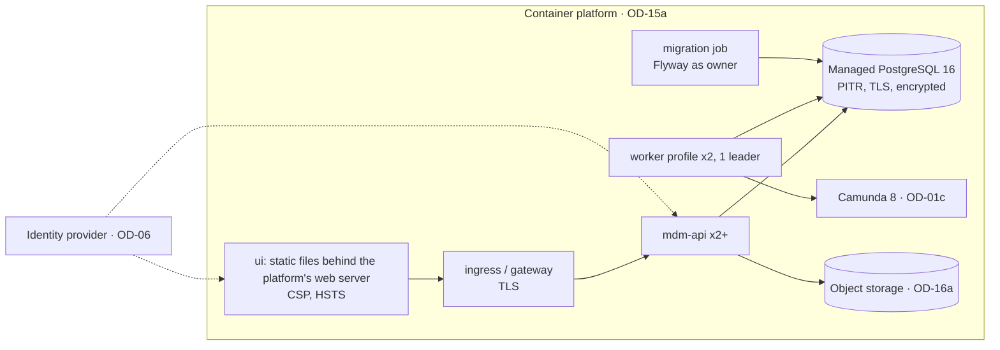

# Phase 9 — Hardening: low-level design

- **Status:** Draft, awaiting review (2026-11-11)
- **Phase goal (BUILD_PROTOCOL §2):** ready for a security and operations review.
- **Exit criteria:** authentication and authorisation integrated; observability; performance targets tested; runbooks; threat model.
- **Reads with:** overview §10 (security layers), §14 (observability); ADR-014, ADR-022, ADR-029; every phase's §10 (targets)
  and §11 (signals); UI_STANDARD §9 (auth library); OPEN_DECISIONS (assumptions). Phase 7 is deferred (OD-38): its AI
  service is out of this phase's scope until resumed.

---

## 1. Purpose and scope

| Item | Decision | Phase 9 delivers |
|---|---|---|
| SEC-05 Authentication / SSO | `—` (provider OD-06 open) | Designed in full as programme infrastructure, because no shared environment can exist without it; the provider-specific adapter is the only open part |
| PROG — authorisation in every environment | — | DB roles (ADR-014) provisioned per environment; endpoint × role matrix as a release gate; integration identities |
| PROG — NFRs | — | Consolidated targets, load / soak / failover tests, capacity plan, DR with point-in-time recovery |
| PROG — observability | — | Structured logs, metrics, traces, dashboards, alerts, SLOs |
| PROG — operations | — | Deployment design, migration procedure, runbooks |
| PROG — security assurance | — | Threat model (STRIDE), dependency / code / container scanning, HTTP hardening, penetration-test scope |
| ADM-01 Environments and metadata migration | `—` | Outline (§15) |

## 2. Confidence and assumptions

**Confidence: Medium.** Patterns are standard; values depend on the platform (OD-15a), the identity provider (OD-06) and NFRs (OD-10).

| # | Assumption | Effect if wrong |
|---|---|---|
| J-1 | The identity provider supports OIDC (Authorization Code + PKCE for the UI, client credentials for integrations) | SAML-only: a gateway translates SAML to OIDC tokens, or Spring's SAML 2 support is used (ADR-033 option B) |
| J-2 | Users are identified by `(issuer, subject)`; e-mail is not a key | — |
| J-3 | Roles stay in Nexus (ADR-022, ADR-029); IdP groups may *propose* grants, never apply them | If the organisation mandates IdP-driven roles, grants become a governed sync (ADR-029 already allows proposals) |
| J-4 | Container platform with ≥ 2 API instances, one worker leader, managed PostgreSQL 16 with PITR (OD-15) | — |
| J-5 | `RPO_MIN` 15 and `RTO_H` 4 (assumed; OD-41) | Backup and replica design scale with them |
| J-6 | Observability backends (log store, metrics, tracing) are provided by the platform (OD-15a) | Exporters change; instrumentation does not |

**Human decisions this phase waits on:** OD-06 (IdP and Angular library), OD-15a (platform), OD-41 (RPO/RTO), OD-10 (NFR
values), OD-42 (security tooling and CI jobs; dependency rule), OD-43 (penetration-test scope and provider), SEC-05 decision (OD-09).

## 3. Component design

### 3.1 Authentication (ADR-033)
| Component | Responsibility | Must not |
|---|---|---|
| `SecurityConfig` (Spring Security, OAuth2 resource server) | Validate bearer JWTs: signature (JWKS from the issuer, cached), `iss`, `aud` = `NEXUS_API_AUDIENCE`, `exp`/`nbf` with `JWT_CLOCK_SKEW_S` (60), algorithm allow-list | Accept tokens from other audiences |
| `OidcActor implements CurrentActor` | Map `(iss, sub)` → `mdm.app_user` via `mdm.app_user_identity`; unknown subject → 403 "Your account is not set up in Nexus" (no auto-creation); `kind` from the user row | Derive roles from token claims (J-3) |
| `IntegrationActor` | Client-credentials tokens (`azp`/`client_id`) → `app_user` of kind `system_feed` with `INTEGRATION_READER` grants | Allow writes |
| `StartupGuard` (Phase 1) | Now passes in shared environments because `OidcActor` exists; `LocalDevActor` still only in `local`/`test` | — |
| UI `AuthModule` | The organisation's Angular auth library (OD-06): login redirect, token refresh, tokens in memory (UI_STANDARD §9), interceptor adds the bearer token; `devIdentityInterceptor` excluded from production builds (Phase 3) | Store tokens in local storage unless the library requires it |
| Session rules | Idle timeout `UI_IDLE_TIMEOUT_MIN` (30) → re-login; decisions and admin actions require a token younger than `STEP_UP_MAX_AGE_MIN` (15) if the IdP supports `max_age` (OD-06) | — |

```sql
-- new file V16__identity.sql
CREATE TABLE mdm.app_user_identity (
  issuer text NOT NULL, subject text NOT NULL,
  user_id uuid NOT NULL REFERENCES mdm.app_user,
  linked_by uuid NOT NULL REFERENCES mdm.app_user, linked_at timestamptz NOT NULL DEFAULT now(),
  PRIMARY KEY (issuer, subject));   -- audited; linking is a governed request (action 'link_identity', SYSTEM_ADMIN maker-checker)
```

### 3.2 Authorisation across environments
- DB roles from ADR-014 (and later `nexus_loader`, `nexus_wf`) created by migration; **logins** created by the platform per
  environment with secrets in the platform's secret store; rotation every `SECRET_ROTATION_DAYS` (90) without downtime (two logins per role, switch, revoke).
- Release gate: the Phase 1 endpoint × role matrix test plus a generated test that every controller method has an explicit permission check (reflection over handler methods; a method without `EntitlementService.require` or a documented "public within actor" marker fails the build).
- Break-glass: an emergency `SYSTEM_ADMIN` grant procedure (runbook RB-09) with mandatory post-review.

### 3.3 Observability (ADR-034)
| Signal | Implementation | Dependency |
|---|---|---|
| Logs | Spring Boot structured logging (JSON, ECS format) to stdout; MDC: `correlationId`, `actorId`, `changeRequestId`, `instanceId`; a log filter drops values of `is_pii` properties and names of `natural_person` nodes | none (Boot 3.4 feature) |
| Metrics | Micrometer (actuator exists) + Prometheus registry; every `nexus.*` metric defined in Phases 1–8 | `micrometer-registry-prometheus` (Boot-managed) |
| Traces | Micrometer Tracing with the OpenTelemetry bridge and OTLP exporter; JDBC spans via a datasource proxy | `micrometer-tracing-bridge-otel`, `opentelemetry-exporter-otlp` (Boot-managed) |
| Health | Actuator health groups: `liveness` (process), `readiness` (DB reachable, migrations at the expected version, outbox lag below threshold for the worker) | none |
| Actuator exposure | `health` public on a management port; `metrics`, `prometheus` only to the platform's scraper network (fixes D-20) | none |

### 3.4 Deployment

- One image for `mdm-api` and the worker (profile selects the role); UI as static assets.
- Release order: migration job (expand) → API and worker rolling update → later release removes old structures (contract).
  After the first shared environment, migrations are additive per CLAUDE.md rule 6 (new V-numbers only).
- Resources and probes per container; `MDM_DB_POOL_SIZE` sized so `instances × pool ≤ DB_MAX_CONNECTIONS × 0.7`.

## 4. Data design
`mdm.app_user_identity` (§3.1). No other schema changes; retention jobs wait for OD-25/OD-34/OD-36.

## 5. Interface design
- All `/api/v1/**` require a bearer token; `401` with `WWW-Authenticate: Bearer error="invalid_token"` on failures; `403` Problem Details for unknown subjects.
- Security headers on the UI: `Content-Security-Policy` (self only, plus the IdP origin for redirects), `Strict-Transport-Security`, `X-Content-Type-Options`, `Referrer-Policy: same-origin`, `frame-ancestors 'none'`.
- CORS: only the UI origin per environment.
- Rate limits per actor: `API_RATE_PER_MIN` (600) general, `API_WRITE_RATE_PER_MIN` (120) writes, `429` with `Retry-After`.
- Request size limits: JSON `API_MAX_BODY_KB` (512); uploads `EVIDENCE_MAX_MB` (Phase 6).

## 6. Behaviour

### 6.1 Sign-in and a request
```mermaid
sequenceDiagram
  autonumber
  actor U as User
  participant UI as Angular UI (org auth library)
  participant IDP as Identity provider
  participant API as mdm-api
  U->>UI: open Nexus
  UI->>IDP: authorization code + PKCE
  IDP-->>UI: code → tokens (in memory)
  UI->>API: GET /me (Bearer)
  API->>API: validate JWT (JWKS, iss, aud, exp); map (iss, sub) → app_user
  API-->>UI: actor, grants, businessToday
```

### 6.2 Failure modes
| Failure | Behaviour |
|---|---|
| IdP down | New sign-ins fail; valid tokens keep working until expiry; status page message |
| JWKS rotation | Cache refresh on unknown `kid`, once per `JWKS_REFRESH_MIN` (5) |
| DB primary failover | Connections retried; writes fail fast with `503 retry-later` during failover; RPO per J-5 |
| Worker leader loss | Advisory lock released; another instance takes over within `LEADER_TAKEOVER_S` (30) |

## 7. Algorithms
- **Pool sizing:** `pool = ceil(peak_concurrent_db_work / instances)`; virtual threads keep request threads cheap, so the pool, not threads, is the limit; measured in the load test.
- **Error budget:** availability SLO `SLO_AVAILABILITY` (99.5 % monthly, assumed) → 3.6 h budget; alerts on 2 % budget burn in 1 h (fast) and 5 % in 6 h (slow).

## 8. Patterns applied
P-07 (`CurrentActor`: `OidcActor` replaces the dev adapter), P-17 (entitlements, now with real identities), P-24 (DB roles in every environment), P-06 (outbox lag as a readiness signal).

## 9. Security and controls

### 9.1 Threat model (STRIDE, first version; full document `docs/architecture/threat-model.md` in the build)
| Element | Threat | Mitigation | Verified by |
|---|---|---|---|
| UI ↔ API | Spoofing with a stolen token | Short-lived tokens, PKCE, audience check, TLS, in-memory tokens | Pen test; config tests |
| API | Elevation: endpoint without a permission check | Release gate (§3.2) + matrix test | CI |
| API → DB | Tampering through SQL injection | Parameterised `JdbcClient` only; no dynamic SQL except admin-authored rules run under restricted roles (D-39) | SAST; review |
| DB | Repudiation of decisions | Append-only `audit_log`, `instance_action`, decisions; actor always set by apply | pgTAP |
| DB | Elevation through the application login | ADR-014 roles; decision columns writable only by definer functions | pgTAP `SET ROLE` |
| Object storage | Information disclosure of evidence and export files | Access only through the API with READ checks; downloads audited; encryption at rest; retention lock | Pen test |
| Logs | Disclosure of personal data | PII log filter; no values in logs | Log-scan test in CI |
| Worker ↔ Camunda | Tampering with process state | Camunda drives order only; every state change re-checked by guards | pgTAP + process tests |
| Event feed | Disclosure across scopes | Identifiers only; per-consumer scope | JUnit |
| Admin functions | Insider misuse | Maker-checker on grants, profiles, policies, models, load runs; break-glass reviewed | pgTAP; runbook audit |
| Availability | Request floods | Rate limits, body limits, pool limits | Load test |

### 9.2 Controls from CLAUDE.md in production
All guards are database-level and therefore identical in every environment; Phase 9 adds no new rule but proves them under
the production privilege model: the full pgTAP suite runs against a database built exactly as the platform builds it (roles, logins, extensions).

### 9.3 Assurance tooling (OD-42; each is a CI change or dependency to approve)
Dependency scanning (GitHub Dependabot or OWASP dependency-check), SAST (CodeQL), container image scanning (platform
scanner), secret scanning (GitHub), licence report, accessibility checks (already in Phase 3).

## 10. Performance and scale — consolidated targets
| Target | Value (assumed; OD-10) | Phase | Test |
|---|---|---|---|
| Children page p95 | 300 ms | 1, 3 | load |
| Node detail p95 | 500 ms | 1 | load |
| Worklist p95 | 500 ms | 2 | load |
| Submit / apply (≤ 50 items) p95 | 2 s / 2 s | 1 | load |
| Decision → next stage active p95 | 5 s | 2 | integration |
| UBO p95 (100-entity component) | 1 s | 6 | load |
| Largest export | 10 min | 8 | perf |
| Event latency p95 | 5 s | 8 | integration |
| UI initial JS / interaction | 350 KB / 200 ms | 3 | Playwright |
| Availability | 99.5 % monthly | 9 | SLO |
Test programme: load at `CONCURRENT_STEWARDS` with the Phase 4 `PerfHarness` mix for 1 h; soak for `SOAK_H` (8) at 50 %; spike
×3 for 10 minutes; failover (DB primary, one API instance, worker leader) during load; restore drill to a point in time.
Results go into `docs/phases/phase-9/PERF_REPORT.md` with hardware, data spec and seed.

## 11. Observability — dashboards and alerts
Dashboards: API (latency, errors by `type`), apply and validation, workflow (relay lag, jobs, incidents), commit policies
(`v_commit_policy_daily`), exports and reconciliation, database (connections, locks, slow queries), UI (client errors, timings).
Alerts consolidated from Phases 1–8 plus: SLO burn rates; certificate expiry < 21 days; backup failure; migration version mismatch; PII found by the log scanner.

## 12. UI design
Sign-in through the organisation's library and shell (OD-06, UI_STANDARD §1); "Signed out after 30 minutes of inactivity"
message; an "Account not set up" page with the support contact text (no mailto dependency); environment badge in the header (exists).

## 13. Test design
| Item | Criterion | Cases | Type |
|---|---|---|---|
| SEC-05 | Users sign in with corporate SSO | P: valid token → actor; N: wrong audience, expired, bad signature, unknown subject; B: clock skew at the limit | JUnit with a test JWKS; integration with the IdP in test |
| Authorisation | Every endpoint protected | P/N: matrix; C: release gate fails on an unprotected handler | JUnit + build check |
| DB roles | Production privileges | Full pgTAP and JUnit suites on a platform-built database | CI against an ephemeral environment |
| Observability | Signals present | P: correlation id across UI → API → DB spans; N: PII scanner finds no names in a log sample | integration |
| Performance | §10 targets | load, soak, spike, failover; report | perf |
| DR | RPO/RTO | restore drill within `RTO_H` to within `RPO_MIN` | operational test |
| Security | Threat model mitigations | pen test per OD-43; scan results without high findings | external |

## 14. Rollout and compatibility
The first shared environment is created only after: OD-06 implemented, OD-17a/OD-18a confirmations received, roles and
logins provisioned, and this phase's gate passed in a pre-production environment. From then on CLAUDE.md rule 6 applies
(no edits to applied migrations).

## 15. Risks, open questions and alternatives
| # | Item | Handling |
|---|---|---|
| R-1 | IdP undecided (OD-06) | `CurrentActor` adapter; OIDC assumed (J-1) with the SAML option in ADR-033 |
| R-2 | Platform undecided (OD-15a) | Requirements stated, not platform specifics |
| R-3 | Tooling adds CI jobs and dependencies | OD-42, approved in the Phase 9 plan |
| Alt-1 | API gateway does all authentication, API trusts headers | Rejected: a misconfigured route would bypass identity; the API validates tokens itself |
| Alt-2 | Roles from IdP groups only | Rejected for scopes (J-3); allowed as proposals |

**Outline only, pending decision:** **ADM-01** environments and metadata migration — configuration that is data (workflow
models, policies, export profiles, validation rules, thresholds, role definitions) promoted between environments as signed,
hashed packages exported from one environment and imported as governed requests or versions in the next (each import still
needs that environment's approvals); never by copying tables.

## 16. Work breakdown
| # | Increment | Size | Items | Tests |
|---|---|---|---|---|
| 9-1 | Spring Security resource server, `OidcActor`, `IntegrationActor`, identity table and linking request | M | SEC-05 | JUnit |
| 9-2 | UI auth module with the organisation's library (OD-06) | M | SEC-05 | Playwright |
| 9-3 | Release gate for permission checks; HTTP hardening (headers, CORS, rate and size limits) | S | PROG | build check, JUnit |
| 9-4 | Structured logs, PII log filter, metrics registry, tracing, health groups, actuator exposure | M | PROG | integration |
| 9-5 | Deployment descriptors for the platform (OD-15a), migration job, secrets, role/login provisioning scripts | M | PROG | ephemeral environment |
| 9-6 | Load, soak, spike, failover tests and report | M | PROG | perf |
| 9-7 | DR: PITR configuration and restore drill | S | PROG | operational |
| 9-8 | Threat model document; scanning in CI (OD-42); pen-test preparation (OD-43) | M | PROG | external |
| 9-9 | Runbooks RB-01 … RB-12 (below) | M | PROG | review + tabletop exercise |
| 9-10 | Records and the security/operations review pack | S | PROG | review |

Runbooks: RB-01 deploy and roll back · RB-02 run migrations · RB-03 restore to a point in time · RB-04 engage a commit-policy kill
switch · RB-05 outbox lag · RB-06 Camunda incident and reconciler · RB-07 apply failures · RB-08 reconciliation mismatch triage ·
RB-09 access requests and break-glass · RB-10 secret and certificate rotation · RB-11 migration load run · RB-12 suspected data incident (who to notify, what to preserve).
